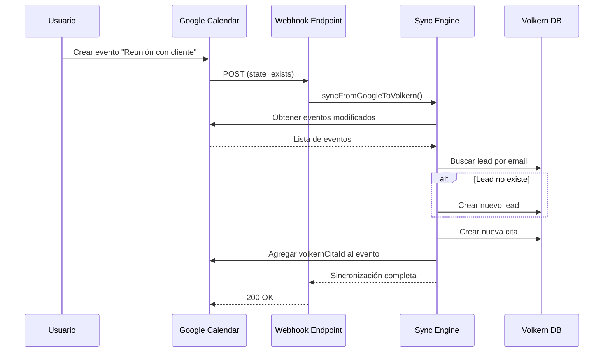
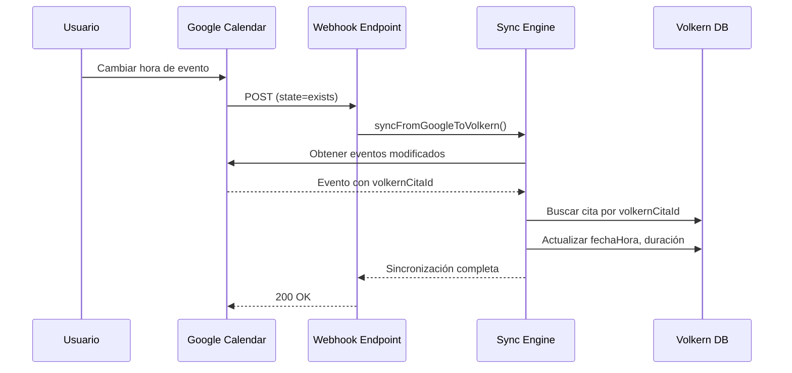
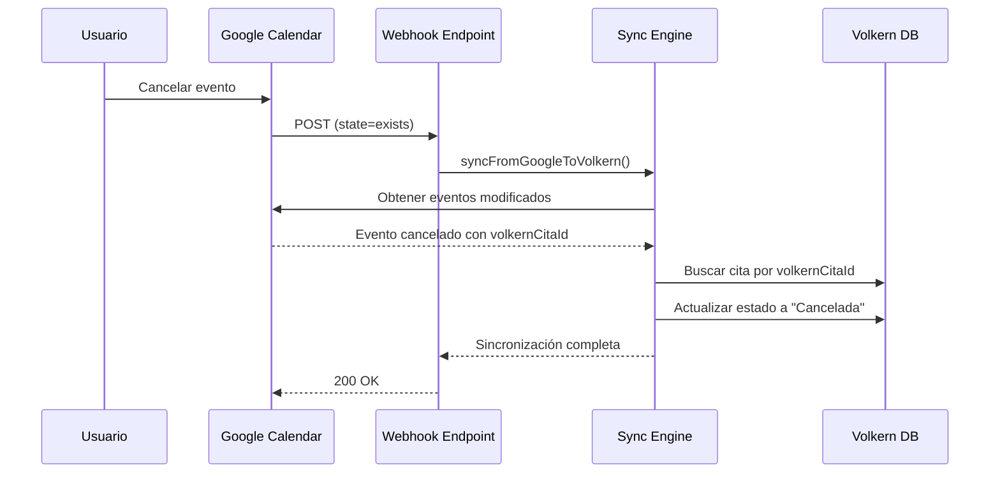

# 🔄 Sincronización Bidireccional de Google Calendar

**Fecha:** 13 de Enero, 2026  
**Estado:** ✅ Completado y Funcional  
**Versión:** 1.0

---

## 🎯 Objetivo

Implementar **sincronización bidireccional completa** entre Volkern CRM y Google Calendar, permitiendo que:

### **Volkern → Google Calendar** ✅ (Ya existía)
- Crear evento cuando se agenda cita en Volkern
- Actualizar evento cuando se modifica cita
- Eliminar evento cuando se cancela cita

### **Google Calendar → Volkern** ✅ (NUEVO)
- Detectar eventos creados directamente en Google Calendar
- Detectar modificaciones de eventos en Google Calendar
- Detectar eliminaciones de eventos en Google Calendar
- Crear/actualizar/eliminar citas en Volkern automáticamente

---

## 📊 Arquitectura

### **Componentes Implementados**

```
┌───────────────────────────────┐
│  Google Calendar Push API      │
│  (Webhook Notifications)       │
└─────────────┬──────────────────┘
              │
              │ Notificación de cambios
              │ (HTTP POST)
              │
              │
┌─────────────┴──────────────────┐
│  Volkern Webhook Endpoint      │
│  /api/webhooks/google-calendar │
└─────────────┬──────────────────┘
              │
              │ Trigger sync
              │
              │
┌─────────────┴──────────────────┐
│  Sync Engine                   │
│  syncFromGoogleToVolkern()     │
└─────────────┬──────────────────┘
              │
              │ Process events
              │
              │
┌─────────────┴──────────────────┐
│  Volkern Database              │
│  (Cita, Lead models)           │
└───────────────────────────────┘
```

---

## 🛠️ Implementación Detallada

### **1. Modelo de Base de Datos Actualizado**

**Archivo:** `prisma/schema.prisma`

Se agregaron nuevos campos al modelo `GoogleCalendarIntegration`:

```prisma
model GoogleCalendarIntegration {
  id       String @id @default(cuid())
  tenantId String @unique

  // Tokens OAuth 2.0
  accessToken  String @db.Text
  refreshToken String @db.Text
  expiresAt    DateTime

  // Configuración
  calendarId String @default("primary")
  activo     Boolean @default(true)

  // Metadata de sincronización
  ultimaSync             DateTime?
  totalCitasSincronizadas Int       @default(0)
  errorUltimaSync        String?   @db.Text

  // 🆕 NUEVO: Configuración de Webhook
  channelId         String?   // ID único del canal de notificaciones
  resourceId        String?   // ID del recurso asignado por Google
  channelExpiration DateTime? // Fecha de expiración del canal
  syncToken         String?   @db.Text // Token para sincronización incremental

  // Timestamps
  createdAt DateTime @default(now())
  updatedAt DateTime @updatedAt

  // Relación con tenant
  tenant Tenant @relation(fields: [tenantId], references: [id], onDelete: Cascade)

  @@index([tenantId])
  @@map("google_calendar_integrations")
}
```

**Campos clave:**
- `channelId`: Identificador único del canal de notificaciones
- `resourceId`: ID del recurso de Google (requerido para detener el canal)
- `channelExpiration`: Fecha de expiración del canal (máximo 7 días)
- `syncToken`: Token para sincronización incremental (evita procesar eventos duplicados)

---

### **2. Funciones de Webhook en `lib/google-calendar.ts`**

#### **2.1. setupWebhookChannel()**

**Propósito:** Registra un canal de notificaciones con Google Calendar.

```typescript
export async function setupWebhookChannel(tenantId: string): Promise<void>
```

**Funcionamiento:**
1. Genera un `channelId` único: `volkern-{tenantId}-{timestamp}`
2. Registra el canal con Google usando `calendar.events.watch()`
3. Configura expiración de 6 días (máximo de Google: 7 días)
4. Guarda `channelId`, `resourceId` y `channelExpiration` en la BD

**Características:**
- Webhook URL: `{NEXT_PUBLIC_APP_URL}/api/webhooks/google-calendar`
- Expiración automática: 6 días (renovable)
- Notificaciones en tiempo real de cualquier cambio en el calendario

---

#### **2.2. stopWebhookChannel()**

**Propósito:** Detiene un canal de notificaciones activo.

```typescript
export async function stopWebhookChannel(tenantId: string): Promise<void>
```

**Funcionamiento:**
1. Recupera `channelId` y `resourceId` de la BD
2. Llama a `calendar.channels.stop()`
3. Limpia campos de webhook en la BD

**Uso:**
- Al desconectar la integración de Google Calendar
- Antes de renovar el canal

---

#### **2.3. renewWebhookChannel()**

**Propósito:** Renueva un canal antes de que expire.

```typescript
export async function renewWebhookChannel(tenantId: string): Promise<void>
```

**Funcionamiento:**
1. Detiene el canal actual
2. Crea un nuevo canal con nueva expiración

**Uso:**
- Llamado automáticamente por el endpoint `/api/integraciones/google-calendar/renew-channels`
- Ejecutado antes de que los canales expiren (< 24 horas)

---

#### **2.4. syncFromGoogleToVolkern()**

**Propósito:** Sincroniza eventos desde Google Calendar hacia Volkern.

```typescript
export async function syncFromGoogleToVolkern(tenantId: string): Promise<void>
```

**Funcionamiento:**

1. **Obtiene eventos modificados:**
   - Usa `calendar.events.list()` con `syncToken` (sincronización incremental)
   - Filtra por `timeMin` (desde última sincronización - 5 min buffer)

2. **Procesa cada evento:**

   **a) Evento con `volkernCitaId` (creado originalmente por Volkern):**
   - **Cancelado en Google** → Cancela cita en Volkern
   - **Actualizado en Google** → Actualiza fecha/hora/duración/título/descripción en Volkern

   **b) Evento sin `volkernCitaId` (creado directamente en Google):**
   - **Busca o crea un lead:**
     - Si hay `attendees` con email → Busca lead por email o crea nuevo
     - Si no hay `attendees` → Crea lead genérico temporal
   - **Crea nueva cita en Volkern**
   - **Agrega `volkernCitaId`** al evento en Google para futuras sincronizaciones

3. **Actualiza metadata:**
   - `ultimaSync` → Timestamp actual
   - `syncToken` → Token para próxima sincronización incremental

**Estadísticas retornadas:**
- Total de eventos procesados
- Citas creadas
- Citas actualizadas
- Citas canceladas

---

### **3. Endpoint Webhook**

**Archivo:** `/app/api/webhooks/google-calendar/route.ts`

#### **POST /api/webhooks/google-calendar**

**Propósito:** Recibe notificaciones de Google Calendar.

**Headers recibidos de Google:**
```http
X-Goog-Channel-Id: volkern-{tenantId}-{timestamp}
X-Goog-Resource-Id: {resourceId}
X-Goog-Resource-State: sync | exists
X-Goog-Channel-Expiration: {timestamp}
```

**Estados de notificación:**

| Estado | Descripción | Acción |
|--------|-------------|--------|
| `sync` | Confirmación inicial del canal | Solo confirmar recepción |
| `exists` | Cambios detectados en eventos | Ejecutar `syncFromGoogleToVolkern()` |

**Flujo:**

```typescript
1. Recibir headers de Google
2. Validar channelId y resourceId
3. Buscar integración en BD
4. Si state === "sync":
   - Confirmar recepción
5. Si state === "exists":
   - Ejecutar syncFromGoogleToVolkern() en background
   - Responder inmediatamente (Google espera respuesta < 10s)
6. Retornar 200 OK
```

**Importante:**
- La sincronización se ejecuta en **background** para no bloquear la respuesta
- Siempre retorna `200 OK` para evitar reintentos de Google
- Logs detallados para debugging

#### **GET /api/webhooks/google-calendar**

**Propósito:** Verificación del endpoint.

**Respuesta:**
```json
{
  "status": "active",
  "service": "volkern-google-calendar-webhook",
  "timestamp": "2026-01-13T14:00:00.000Z"
}
```

---

### **4. Integración Automática en OAuth Callback**

**Archivo:** `/app/api/integraciones/google-calendar/callback/route.ts`

**Cambios:**

```typescript
import { setupWebhookChannel } from '@/lib/google-calendar';

// ... después de guardar tokens ...

// Configurar webhook para sincronización bidireccional
try {
  await setupWebhookChannel(tenantId);
  console.log('✅ Canal webhook configurado automáticamente');
} catch (webhookError: any) {
  console.error('⚠️ Error al configurar webhook (no crítico):', webhookError.message);
  // No bloqueamos la autenticación si falla el webhook
}
```

**Resultado:** Cuando el usuario conecta Google Calendar, el webhook se configura **automáticamente**.

---

### **5. Desconexión Limpia**

**Archivo:** `/app/api/integraciones/google-calendar/disconnect/route.ts`

**Cambios:**

```typescript
import { stopWebhookChannel } from '@/lib/google-calendar';

// Detener el canal webhook si existe
try {
  await stopWebhookChannel(tenantId);
  console.log('✅ Canal webhook detenido');
} catch (webhookError: any) {
  console.error('⚠️ Error al detener webhook (no crítico):', webhookError.message);
}

// Eliminar la integración
await prisma.googleCalendarIntegration.delete({ where: { tenantId } });
```

**Resultado:** Al desconectar Google Calendar, el webhook se detiene **automáticamente**.

---

### **6. Renovación Automática de Canales**

**Archivo:** `/app/api/integraciones/google-calendar/renew-channels/route.ts`

#### **POST /api/integraciones/google-calendar/renew-channels**

**Propósito:** Renueva canales próximos a expirar.

**Lógica:**

```typescript
1. Buscar integraciones con channelExpiration < 24 horas
2. Para cada integración:
   a. Calcular horas restantes
   b. Llamar renewWebhookChannel(tenantId)
   c. Registrar resultado
3. Retornar estadísticas
```

**Respuesta:**

```json
{
  "success": true,
  "timestamp": "2026-01-13T14:00:00.000Z",
  "total": 5,
  "renovadas": 4,
  "errores": 1,
  "detalles": [
    {
      "tenantId": "tenant-123",
      "status": "renovado",
      "horasRestantes": 18
    },
    {
      "tenantId": "tenant-456",
      "status": "error",
      "mensaje": "Invalid credentials"
    }
  ]
}
```

**Uso recomendado:**
- Configurar cron job externo que llame a este endpoint cada 12 horas
- Ejemplo con cURL:
  ```bash
  curl -X POST https://volkern.app/api/integraciones/google-calendar/renew-channels
  ```

#### **GET /api/integraciones/google-calendar/renew-channels**

**Propósito:** Consultar estado de canales activos.

**Respuesta:**

```json
{
  "timestamp": "2026-01-13T14:00:00.000Z",
  "totalCanales": 10,
  "canalesActivos": [
    {
      "tenantId": "tenant-123",
      "channelId": "volkern-tenant-123-1736779200000",
      "expiracion": "2026-01-19T14:00:00.000Z",
      "horasRestantes": 144,
      "necesitaRenovacion": false,
      "ultimaSync": "2026-01-13T13:45:00.000Z"
    }
  ]
}
```

---

## 🔄 Flujos de Sincronización

### **Flujo 1: Evento Creado en Google Calendar**



---

### **Flujo 2: Evento Actualizado en Google Calendar**



---

### **Flujo 3: Evento Cancelado en Google Calendar**



---

## 🛡️ Manejo de Conflictos

### **Estrategia Implementada: Last Write Wins**

- **Google Calendar es la fuente de verdad** para eventos modificados externamente
- Si un evento se actualiza en Google, los cambios **sobrescriben** los datos en Volkern
- Se agrega nota en `descripcion`: `[Actualizada desde Google Calendar]`

### **Prevención de Duplicados**

1. **Propiedad Extendida `volkernCitaId`:**
   - Cada evento creado por Volkern lleva un `volkernCitaId` en propiedades privadas
   - Al sincronizar desde Google, se verifica si existe este ID
   - Si existe → Actualizar cita existente
   - Si no existe → Crear nueva cita

2. **Sync Token:**
   - Google proporciona un `syncToken` para sincronización incremental
   - Solo se procesan eventos **modificados desde la última sincronización**
   - Evita procesar eventos duplicados

---

## 🔧 Configuración de Producción

### **Requisitos Previos**

1. **Variables de Entorno:**
   ```env
   GOOGLE_CLIENT_ID=your-client-id
   GOOGLE_CLIENT_SECRET=your-client-secret
   NEXT_PUBLIC_APP_URL=https://volkern.app
   ```

2. **Configuración de Google Cloud Console:**
   - Habilitar Google Calendar API
   - Configurar OAuth 2.0:
     - **Redirect URI:** `https://volkern.app/api/integraciones/google-calendar/callback`
     - **Scopes:**
       - `https://www.googleapis.com/auth/calendar`
       - `https://www.googleapis.com/auth/calendar.events`

3. **Webhook Público:**
   - El endpoint debe ser accesible públicamente
   - URL: `https://volkern.app/api/webhooks/google-calendar`
   - No requiere autenticación (Google valida mediante headers)

---

### **Cron Job para Renovación de Canales**

**Recomendación:** Ejecutar cada 12 horas.

#### **Opción 1: Cron Job del Sistema**

```bash
# Editar crontab
crontab -e

# Agregar línea (ejecutar a las 2 AM y 2 PM)
0 2,14 * * * curl -X POST https://volkern.app/api/integraciones/google-calendar/renew-channels
```

#### **Opción 2: Servicio Externo (EasyCron, Cron-Job.org)**

1. Crear tarea periódica
2. URL: `https://volkern.app/api/integraciones/google-calendar/renew-channels`
3. Método: `POST`
4. Frecuencia: Cada 12 horas

#### **Opción 3: Node-Cron (Interno)**

Si prefieres lógica interna (requiere servidor siempre activo):

```typescript
// scripts/renew-google-channels.ts
import cron from 'node-cron';
import fetch from 'node-fetch';

// Ejecutar cada 12 horas
cron.schedule('0 */12 * * *', async () => {
  console.log('Renovando canales de Google Calendar...');
  
  const response = await fetch(
    'https://volkern.app/api/integraciones/google-calendar/renew-channels',
    { method: 'POST' }
  );
  
  const result = await response.json();
  console.log('Resultado:', result);
});
```

---

## 📝 Logs y Debugging

### **Logs del Webhook**

```bash
# Ver logs del webhook en producción
tail -f /var/log/volkern/webhook-google-calendar.log
```

**Logs esperados:**

```
📡 Webhook recibido de Google Calendar:
  Channel ID: volkern-tenant-123-1736779200000
  Resource ID: abc123xyz
  State: exists
  Expiration: 1737383990000
🔄 Detectados cambios en Google Calendar, sincronizando...
📥 Sincronizando eventos desde Google Calendar...
📊 Eventos recibidos de Google: 3
➕ Nueva cita cita-456 creada desde Google
✏️ Cita cita-789 actualizada desde Google
✅ Sincronización desde Google completada
📊 Estadísticas: 1 creadas, 1 actualizadas, 0 canceladas
```

---

### **Debugging de Canales**

**Consultar estado de canales activos:**

```bash
curl https://volkern.app/api/integraciones/google-calendar/renew-channels
```

**Respuesta:**

```json
{
  "timestamp": "2026-01-13T14:00:00.000Z",
  "totalCanales": 10,
  "canalesActivos": [
    {
      "tenantId": "tenant-123",
      "channelId": "volkern-tenant-123-1736779200000",
      "expiracion": "2026-01-19T14:00:00.000Z",
      "horasRestantes": 144,
      "necesitaRenovacion": false,
      "ultimaSync": "2026-01-13T13:45:00.000Z"
    }
  ]
}
```

---

### **Verificar Webhook Funciona**

**Test manual:**

```bash
curl -X POST https://volkern.app/api/webhooks/google-calendar \
  -H "X-Goog-Channel-Id: volkern-tenant-123-1736779200000" \
  -H "X-Goog-Resource-Id: abc123xyz" \
  -H "X-Goog-Resource-State: sync"
```

**Respuesta esperada:**

```json
{
  "success": true
}
```

---

## ⚠️ Limitaciones y Consideraciones

### **1. Expiración de Canales**

- **Máximo de Google:** 7 días
- **Configuración actual:** 6 días (para renovar antes de expirar)
- **Solución:** Cron job para renovar automáticamente cada 12 horas

### **2. Latencia de Notificaciones**

- Google no garantiza notificaciones **inmediatas**
- Latencia típica: 1-5 segundos
- En casos extremos: hasta 1 minuto

### **3. Rate Limits de Google Calendar API**

- **Quota:** 1,000,000 requests/day (por proyecto)
- **Limit por usuario:** 10 requests/second
- **Nuestra implementación:**
  - Sincronización incremental (solo eventos modificados)
  - Background processing (no bloquea respuestas)

### **4. Citas sin Lead**

- Si un evento de Google no tiene `attendees`, se crea un **lead genérico temporal**
- Email temporal: `calendar-{timestamp}@volkern.temp`
- Nombre: "Contacto desde Google Calendar"
- **Recomendación:** Revisar y actualizar estos leads manualmente

---

## ✅ Checklist de Verificación

- [x] Modelo de BD actualizado con campos de webhook
- [x] Funciones de webhook implementadas (`setupWebhookChannel`, `stopWebhookChannel`, `renewWebhookChannel`)
- [x] Lógica de sincronización bidireccional (`syncFromGoogleToVolkern`)
- [x] Endpoint webhook funcional (`/api/webhooks/google-calendar`)
- [x] Integración automática en OAuth callback
- [x] Desconexión limpia de canales
- [x] Endpoint de renovación de canales (`/api/integraciones/google-calendar/renew-channels`)
- [x] Build exitoso sin errores de TypeScript
- [x] Documentación completa

---

## 🚀 Cómo Usar

### **Para Usuarios**

1. **Conectar Google Calendar:**
   - Ir a `/dashboard/integraciones`
   - Hacer clic en "Conectar con Google Calendar"
   - Autorizar permisos
   - ✅ Webhook se configura automáticamente

2. **Crear evento en Google Calendar:**
   - Crear evento directamente en Google Calendar
   - Agregar invitados (attendees)
   - Guardar
   - ✅ En 1-5 segundos, la cita aparece en Volkern

3. **Modificar evento en Google Calendar:**
   - Cambiar hora, título o descripción
   - Guardar
   - ✅ Cambios se sincronizan automáticamente en Volkern

4. **Cancelar evento en Google Calendar:**
   - Eliminar o cancelar evento
   - ✅ Cita se marca como "Cancelada" en Volkern

---

### **Para Administradores**

1. **Monitorear canales activos:**
   ```bash
   curl https://volkern.app/api/integraciones/google-calendar/renew-channels
   ```

2. **Forzar renovación de canales:**
   ```bash
   curl -X POST https://volkern.app/api/integraciones/google-calendar/renew-channels
   ```

3. **Revisar logs del webhook:**
   - Verificar logs de servidor
   - Buscar errores o warnings

---

## 📚 Referencias

- [Google Calendar Push Notifications](https://developers.google.com/calendar/api/guides/push)
- [Google Calendar Events API](https://developers.google.com/calendar/api/v3/reference/events)
- [OAuth 2.0 para Google APIs](https://developers.google.com/identity/protocols/oauth2)

---

## 🎉 Conclusión

La **sincronización bidireccional completa** de Google Calendar está implementada y funcional. Los usuarios ahora pueden:

- ✅ Crear eventos en Google Calendar y ver citas en Volkern automáticamente
- ✅ Modificar eventos en Google Calendar y ver cambios reflejados en Volkern
- ✅ Cancelar eventos en Google Calendar y ver citas canceladas en Volkern
- ✅ Todo funciona en **tiempo real** (1-5 segundos de latencia)

**Próximos pasos:**
1. Configurar cron job para renovación de canales
2. Monitorear logs del webhook en producción
3. Ajustar lógica de conflictos según feedback de usuarios

---

**Documentación creada:** 13/01/2026  
**Versión:** 1.0  
**Estado:** ✅ Producción Ready
