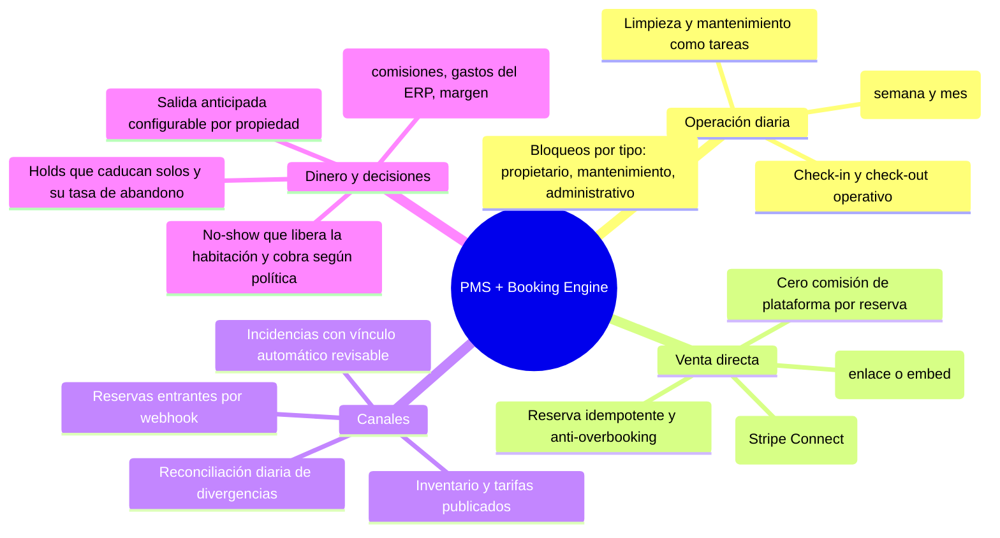
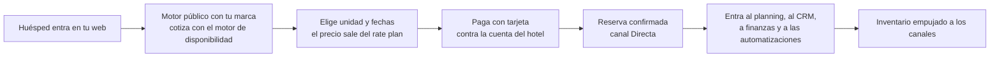
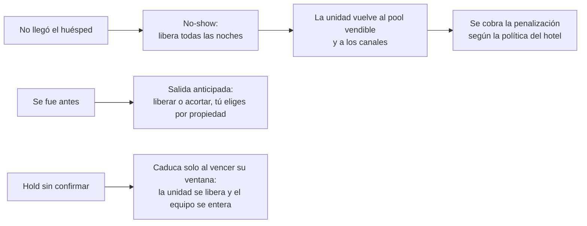

# 🏨 Vertical Hospitality (PMS + Booking Engine) — Documentación Comercial

> **Producto:** Volkern ERP — Módulo Hospitality (PMS + motor de reservas + pagos)
> **Versión:** 1.0.0 · **Público objetivo:** hoteles boutique independientes, casas rurales y villas, apartamentos turísticos, gestores multi-propiedad y cadenas regionales
> **Precio:** suscripción **por tamaño** (unidades y canales) y **cero comisión por reserva**.
> **Las bandas de precio de este documento son hipótesis a validar en el piloto, no tarifa pública.**
> **Estado del producto:** plan de Booking Engine + Payments completo y ensayado contra el sistema real (60 comprobaciones E2E del motor + 76 del ciclo de no-show, 7.143 pruebas automáticas en verde). Ver [`hospitality-resumen-ejecutivo.md`](./hospitality-resumen-ejecutivo.md).

---

## 📋 Tabla de Contenidos

1. [Propuesta de Valor](#propuesta-de-valor)
2. [Perfiles de Cliente Ideal](#perfiles-de-cliente-ideal)
3. [Funcionalidades por Plan](#funcionalidades-por-plan)
4. [Ventajas Competitivas](#ventajas-competitivas)
5. [Casos de Uso](#casos-de-uso)
6. [Estrategia de Pricing (hipótesis del piloto)](#estrategia-de-pricing-hipótesis-del-piloto)
7. [Cómo se valida el precio en el piloto](#cómo-se-valida-el-precio-en-el-piloto)
8. [Puesta en marcha y checklist del piloto](#puesta-en-marcha-y-checklist-del-piloto)
9. [Argumentos de Venta por Canal](#argumentos-de-venta-por-canal)
10. [FAQ Comercial](#faq-comercial)
11. [Materiales de Marketing](#materiales-de-marketing)
12. [Roadmap de Producto](#roadmap-de-producto)
13. [KPIs de Éxito para el Cliente](#kpis-de-éxito-para-el-cliente)

---

## Propuesta de Valor

### El Pitch (conectividad + control)

> **"Conecta tu hotel con los canales sin perder el control. Cada reserva entra en tu calendario con su desglose de cobro y su rentabilidad; si un canal y tu PMS se desincronizan, Volkern lo detecta, te avisa y lo reconcilia — incluso cancelando por ti lo que el canal canceló y tú nunca supiste."**

### El Pitch de venta directa (lo nuevo)

> **"Publica tu motor de reservas en tu propia web, con tu marca y tu precio. El huésped reserva y paga con tarjeta y el dinero entra íntegro en tu cuenta: Volkern no se queda comisión de tus reservas. Y lo que ningún channel manager te da: cuánto ganas por reserva —ingreso bruto, comisiones de OTA, gastos, margen, cobrado y pendiente— sin abrir una hoja de cálculo."**

### Los 4 Pilares



### Beneficios Clave

Todos están redactados como afirmaciones **verificables**: la tercera columna es lo que hay que medir en el piloto antes de usarlas como titular comercial. No publicamos porcentajes que no hayamos visto en un hotel real.

| Beneficio | Qué significa | Cómo se mide en el piloto |
|-----------|---------------|---------------------------|
| **La comisión que no pagas** | Cada reserva que entra por tu página en vez de por una OTA es una comisión que se queda en el hotel | Comisión evitada = reservas directas × tarifa media × comisión de OTA del hotel. Es la métrica de la que depende la banda de precio |
| **Cuánto ganas por reserva** | Ingreso bruto, comisión de canal, gastos del ERP con su IVA, margen, cobrado y pendiente: por reserva y por canal | Nº de reservas con margen revisado y tiempo en cerrar el mes (línea base vs. mes 3) |
| **Habitaciones que no se quedan bloqueadas** | Un no-show, un hold olvidado o una salida anticipada liberan la unidad para venderla | Noches liberadas y revendidas; holds caducados frente a confirmados (Reportes) |
| **Inventario sin fugas** | Un solo motor de disponibilidad para planning, web y canales: no hay dos verdades | Divergencias sin explicar y reconciliaciones con acción de revisión |
| **Menos WhatsApp y Excel** | El sistema hace las tareas repetitivas: comunicaciones al huésped en su idioma, limpieza, avisos de incidencia | Horas/semana del equipo en tareas que el sistema ya hace |
| **Un solo sistema para todo el ciclo** | Reserva → huésped → cobro → gasto → impuesto: sin exportar nada a mano | Tiempo de conciliación mensual y hojas de cálculo eliminadas |

---

## Perfiles de Cliente Ideal

### 1. Hotel boutique independiente (10–50 unidades) — *el perfil del piloto*

- **Perfil:** propiedad única o dos, con recepción propia, 2–5 canales activos y una web que no convierte.
- **Dolor:** paga 15–18 % a las OTAs; no sabe cuánto gana por reserva; los no-shows y los overbookings los arregla a mano; el channel manager y el Excel no se hablan.
- **Solución:** Growth — conectividad, motor de reservas con cobro a su cuenta, finanzas por reserva, reportes y las políticas de no-show/salida/holds.
- **Banda hipotética:** 149–299 €/mes (a validar).
- **Caso típico:** hotel de diseño de 20 habitaciones, 60 % de ocupación, mitad del negocio por OTA.
- **Quién decide:** el propietario o el director; influye el responsable de recepción (quien sufre las incidencias) y el contable.
- **Señal de compra:** pide ver el panel financiero por reserva en la primera demo.

### 2. Casa rural, villa o boutique pequeño (≤10 unidades)

- **Perfil:** propiedad familiar, 1 canal activo, gestión con Excel y la web del pueblo.
- **Dolor:** quiere vender directo sin regalar comisión ni complicarse; hoy reserva por WhatsApp y apunta en papel.
- **Solución:** Starter — planning, tarifas, motor público con enlace/embed, reservas manuales, cobros registrados.
- **Banda hipotética:** 49–79 €/mes (a validar).
- **Caso típico:** casa rural con 6 habitaciones que quiere dejar de pagar comisión por sus huéspedes habituales.

### 3. Apartamentos turísticos y gestor multi-propiedad (20–100 unidades en varias propiedades)

- **Perfil:** gestiona unidades de varios propietarios en la misma ciudad o región.
- **Dolor:** planning por unidad, bloqueos por propietario, inventario disperso y comisiones de canal distintas por apartamento.
- **Solución:** Growth multi-propiedad — varias propiedades en la misma cuenta, ocupación por propiedad, bloqueos por tipo (propietario/mantenimiento) y finanzas por reserva.
- **Banda hipotética:** 149–299 €/mes, escalando por unidades (a validar).
- **Aviso de coste (decirlo en la primera conversación):** la conectividad va como **add-on por tramo de unidades vendibles**, y en este perfil **cada apartamento es una unidad** (sus dormitorios no cuentan): 8 apartamentos → tramo 0–10; 20 apartamentos → tramo 11–30. Mejor plantearlo antes de la propuesta que justificarlo después.
- **Nota honesta:** la **liquidación al propietario** (owner statement) no existe hoy: si es requisito del prospecto, es roadmap, no oferta.

### 4. Cadena regional o grupo (50+ unidades, varios hoteles)

- **Perfil:** 3–8 hoteles con marca común y una central que quiere ver todo.
- **Dolor:** cada hotel con su sistema; la central no consolida ocupación ni comisiones.
- **Solución:** Enterprise — el grupo como una cuenta con varias propiedades, panel consolidado de ocupación, políticas por propiedad y AIOps.
- **Banda hipotética:** 499–999 €/mes (a validar; ver la decisión de plan pendiente en «Estrategia de Pricing»).
- **Señal de descarte:** si la central impone un PMS corporativo (Opera y similares), no es un prospecto de esta vertical.

### Quién **no** es cliente hoy (para no gastar el ciclo de venta)

- Hoteles que exigen **POS/F&B**, **revenue management** o **canal propio** como requisito de compra: no lo tenemos.
- Hoteles en México que exigen **CFDI del huésped timbrado desde el sistema**: no hay timbrado CFDI (ver «Lo que NO se debe prometer todavía»). En **España** el hotel sí queda cubierto: el ERP factura al huésped con Veri*Factu.
- Hostales y moteles que solo quieren un channel manager barato: no valorarán la rentabilidad por reserva ni el control de incidencias.
- Cadenas con PMS corporativo impuesto por la central.

---

## Funcionalidades por Plan

> **Aviso de empaquetado.** El módulo es **uno solo**: las bandas describen el **tamaño del cliente**, no límites que el sistema imponga por plan. Este empaquetado es una **propuesta a validar en el piloto** (ver «Cómo se valida el precio»): si el hotel pide una función de Growth estando en Starter, esa conversación es exactamente el dato que buscamos. La conectividad es la **única línea que se contrata aparte** (add-on por tramo de unidades vendibles): tiene costo variable propio y se cobra donde nace (ver «El costo variable de la conectividad»).

| Funcionalidad | Starter | Growth | Enterprise |
|---------------|:-------:|:------:|:----------:|
| Propiedades, unidades y tarifas (rate plans) | ✅ | ✅ | ✅ |
| Planning por unidad (semana y mes) | ✅ | ✅ | ✅ |
| Bloqueos por tipo (propietario, mantenimiento, administrativo) | ✅ | ✅ | ✅ |
| Tareas de limpieza y mantenimiento ligadas a la reserva | ✅ | ✅ | ✅ |
| Check-in / check-out operativo | ✅ | ✅ | ✅ |
| Reservas manuales y alta desde el planning | ✅ | ✅ | ✅ |
| Motor de reservas público (enlace y embed) con tu marca | ✅ | ✅ | ✅ |
| Reserva pública idempotente y anti-overbooking (409) | ✅ | ✅ | ✅ |
| Registro de cobros manuales (transferencia, efectivo) | ✅ | ✅ | ✅ |
| Cobro con tarjeta a la **cuenta del hotel** (Stripe Connect) | ❌ | ✅ | ✅ |
| Conectividad con canales (inventario y tarifas fuera, reservas por webhook) — **add-on por tramo de unidades vendibles, al costo + margen** | 1 canal | multi-canal | multi-canal |
| Reconciliación diaria de divergencias + cancelación revisada con deshacer | ❌ | ✅ | ✅ |
| Panel de incidencias con vinculación automática revisable | ❌ | ✅ | ✅ |
| Finanzas por reserva: comisiones, gastos del ERP con IVA, margen, cobrado/pendiente | ❌ | ✅ | ✅ |
| Reportes: ADR, RevPAR, estancia media, no-shows, cancelaciones, antelación, holds abandonados + CSV | básicos | ✅ | ✅ |
| Políticas por propiedad: no-show, salida anticipada, ventana de holds | ❌ | ✅ | ✅ |
| Huéspedes (ficha, historial, valor) y comunicaciones automáticas | ✅ | ✅ | ✅ |
| Comunicaciones al huésped en su idioma (ES/EN) | ✅ | ✅ | ✅ |
| Reseñas de huésped integradas en la web | ❌ | ❌ | ❌ |
| App móvil del huésped (check-in autónomo) | ❌ | ❌ | ❌ |
| Protección de daños / depósito pre-autorizado | ❌ | ❌ | ❌ |
| Promociones y extras en la reserva pública | ❌ | ❌ | ❌ |
| Inbox unificado multi-canal con IA y SMS | ❌ | ❌ | ❌ |
| Varias propiedades en la misma cuenta con ocupación por propiedad | ❌ | ✅ | ✅ |
| Gemma (capa de IA **transversal** del ERP, no específica de la vertical) y AIOps | ❌ | ❌ | ✅ |
| Web del hotel con marca propia (Web Creator + dominio personalizado) | ❌ | ❌ | ✅ |

---

## Ventajas Competitivas

> **Los precios de la competencia son rangos públicos de referencia**, no tarifas verificadas en cada mercado: **reconfirmar antes de usar cualquier cifra en una propuesta**. Los nuestros son hipótesis (ver «Estrategia de Pricing»).

### vs. Channel manager + booking engine al uso (SiteMinder, Cloudbeds, Amenitiz, Little Hotelier)

| Característica | Channel manager al uso | Volkern |
|----------------|:----------------------:|:-------:|
| Publicar inventario y tarifas a canales | ✅ | ✅ |
| Recibir reservas de canal por webhook | ✅ | ✅ |
| Reconciliación de divergencias con acción auditada | ❌ (avisos, no resolución) | ✅ |
| Canal "deshacer" sobre un vínculo automático mal asignado | ❌ | ✅ |
| Panel de incidencias de conectividad para el hotel (no para el proveedor) | ❌ | ✅ |
| **Cuánto ganas por reserva** (comisiones, gastos con IVA, margen) | ❌ | ✅ |
| Gastos del ERP imputados a la reserva | ❌ | ✅ |
| Precio | por canal / por habitación / por reserva según proveedor | suscripción por tamaño, **0 % por reserva** |
| Otras verticales del mismo ERP (CRM, finanzas, nómina, marketing) | ❌ | ✅ |

### vs. Lodgify (el espejo directo de la banda baja)

> **Fuente:** PDF de su página de precios capturado el 18 sep 2026 (1 propiedad, mensual, EUR). Los precios de la competencia son rangos públicos de referencia: **reconfirmar antes de usar cualquier cifra en una propuesta**.

Lodgify es el competidor que hay que saber nombrar: mismo modelo (channel manager + web + motor, 0 % de fee por reserva) y precios públicos **por número de propiedades** (16 € con 1, y sube por tramos). Es el ancla a la baja del mercado y el referente que el prospect pequeño ya ha mirado.

| Característica | Lodgify | Volkern |
|----------------|:-------:|:-------:|
| Channel manager (Airbnb, Vrbo, Booking) y sincronía | ✅ | ✅ |
| Web + motor de reserva propios, 0 % de fee por reserva | ✅ | ✅ |
| Cobro en la cuenta del hotel (Stripe Connect) | ✅ | ✅ |
| Finanzas por reserva: comisiones, gastos del ERP con IVA, margen | ❌ | ✅ |
| Reconciliación de divergencias con acción auditada y deshacer | ❌ | ✅ |
| Otras verticales del mismo ERP (CRM, finanzas, nómina) | ❌ | ✅ |
| Web con constructor sin código, páginas libres y reseñas de huésped | ✅ | parcial (Web Creator con dominio propio, sin reseñas integradas) |
| Inbox unificado con IA, SMS y flujos de mensajería | ✅ | parcial (comunicaciones automáticas ES/EN, sin inbox ni SMS) |
| App móvil del huésped | ✅ | ❌ (fuera de la vertical hoy) |
| Protección de daños / depósito pre-autorizado | add-on | ❌ |
| Dynamic pricing y cerraduras inteligentes | add-on | ❌ |
| Multialojamiento y alquiler de larga temporada | ✅ | ❌ (vertical hotel/rural) |

**Cómo se vende la comparación:** Lodgify gana en anchura de producto de alojamiento vacacional (web sin código, inbox con IA, app del huésped, add-ons); Volkern gana en **profundidad de negocio** — lo que queda de cada reserva después de comisiones y gastos, la resolución auditada de incidencias de canal y el ERP completo detrás. Si el prospect pide el constructor sin código o el inbox con IA como imprescindible, **no es nuestro cliente hoy** (véase «Quién no es cliente»); si pregunta por cuánto le queda de cada reserva, nadie de su lista se lo contesta.

### vs. PMS tradicional de gama media (Mews, Hotelogix, Opera Cloud para cadenas)

| Característica | PMS tradicional | Volkern |
|----------------|:---------------:|:-------:|
| Planificación e inventario de habitaciones | ✅ | ✅ |
| Canal + motor propios | ✅ (según plan) | ✅ (canal acotado a nuestro proveedor) |
| Facturación fiscal del huésped | ✅ | ⚠️ **no desde la reserva** (el circuito fiscal vive en el ERP; ver límites) |
| Finanzas por reserva con gastos del ERP y IVA | parcial | ✅ |
| Implementación | semanas de proyecto | puesta en marcha acompañada, con ensayo de conectividad y reserva de prueba |
| Precio | por habitación/mes, crece con el hotel | por tamaño del hotel, **0 % por reserva** |
| POS/F&B, revenue management, app móvil | ✅ (a menudo el motivo de compra) | ❌ (no competimos ahí hoy) |

**Cómo se vende la comparación:** no le pedimos al hotel que cambie su PMS corporativo si no puede. El caso natural es el hotel **sin** PMS pesado — o el que tiene un channel manager y una hoja de cálculo — y el argumento es la parte que ningún PMS tradicional le da: **una sola cuenta con el ciclo completo, del canal al gasto**.

### vs. OTAs (Booking, Expedia, Airbnb)

| Concepto | OTA | Volkern (venta directa) |
|----------|:---:|:-----------------------:|
| Comisión por reserva | 15–18 % | **0 % de plataforma** (el huésped paga en la cuenta del hotel) |
| Quién es el dueño del huésped | la OTA | el hotel (ficha e historial en su CRM) |
| Precio por noche | lo marca la OTA con su paridad | lo marca el rate plan del hotel |
| Coste fijo | 0 | suscripción por tamaño |

**El argumento en demo (cifras del hotel, no nuestras):** un hotel de 20 habitaciones a 120 €/noche con 60 % de ocupación factura ~43.000 €/mes; si la mitad pasa por OTAs con una comisión media del 15 %, son ~3.200 €/mes de comisión. La banda de Growth (149–299 €/mes) **no crece con la venta**: cada reserva que se lleva a directo es comisión que el hotel no paga. En el piloto medimos exactamente eso.

### vs. Excel + WhatsApp + channel manager barato

Es **el competidor real** en hoteles pequeños, y hay que tratarlo como tal: no se gana con una tabla de funcionalidades, se gana poniendo en pantalla las dos cosas que el Excel no puede dar — **cuánto queda de cada reserva** después de comisión y gastos, y **qué habitación volvió a estar libre** cuando un huésped no llegó. La demo es el producto, no el PDF.

---

## Casos de Uso

### Caso 1: Reserva directa, sin comisión, con el dinero en la cuenta del hotel



**Valor para el cliente:** "La misma reserva que te cuesta 15–18 % en una OTA te cuesta 0 % en tu propia página — y entra al mismo flujo, con su desglose de rentabilidad desde el primer minuto."

### Caso 2: El canal canceló y el hotel nunca se enteró

- **Escenario:** una reserva de Booking se cancela en el canal; el mensaje se pierde.
- **Problema:** la habitación queda ocupada en el sistema, se rechaza una venta real y el hotel no lo sabe hasta que el huésped no aparece.
- **Solución Volkern:** la reconciliación diaria detecta la divergencia, crea la incidencia, la muestra en el panel y, tras la revisión del operador, **cancela la reserva por él** — con auditoría de la acción. En el camino contrario (vínculo automático mal asignado), el operador puede **deshacerlo**.

**Valor para el cliente:** "El sistema no solo te avisa: te deja el arreglo hecho y auditado. La venta que ibas a perder se recupera."

### Caso 3: La habitación que vuelve a venderse (las tres decisiones de producto de este ciclo)



**Valor para el cliente:** "Un huésped que no aparece no te bloquea la habitación, y una reserva que nadie confirmó no te la bloquea para siempre. Cobrar y ocupar son dos hechos distintos, y el sistema los separa."

### Caso 4: El margen por reserva que no se veía

- **Escenario:** hotel con 4 canales y comisiones distintas; el contable cierra el mes con una hoja de cálculo.
- **Problema:** sabe cuánto factura, no cuánto gana por reserva ni por canal.
- **Solución Volkern:** cada reserva lleva su desglose (ingreso bruto, comisión de canal, gastos del ERP con su IVA, margen, cobrado y pendiente) y los reportes dan ADR, RevPAR, estancia media, no-shows y antelación por período y por propiedad, exportables a CSV.

**Valor para el cliente:** "La decisión de a qué canal dedicar habitaciones deja de ser intuición: es una comparación de márgenes."

---

## Estrategia de Pricing (hipótesis del piloto)

### Modelo: suscripción por tamaño, cero comisión por reserva

El precio se mide en **unidades y canales**, no en usuarios de oficina: es lo que crece con el negocio del hotel y lo que hace el precio defendible. **No cobramos nada por reserva**: el dinero del huésped entra en la cuenta Stripe del hotel.

> **Precisión técnica (para el contrato, no para el pitch):** el mecanismo de Stripe Connect permite a Volkern cobrar una tarifa de plataforma. Hoy está en **0** por decisión comercial. Conviene dejarlo escrito como decisión (y no como límite del sistema) para no cerrar la puerta a un futuro fee por uso.

### Las tres bandas (hipótesis)

| Plan | Banda hipotética | Ideal para | Unidad de medida | Comisión por reserva |
|------|-----------------:|------------|------------------|---------------------:|
| Starter | 49–79 €/mes | Casa rural o boutique de hasta ~10 unidades, un canal | unidades | 0 % |
| Growth | 149–299 €/mes | Hotel boutique y apartamentos de 10–50 unidades, multi-canal, motor propio y pagos | unidades × canales | 0 % |
| Enterprise | 499–999 €/mes | Cadena o multi-propiedad de 50+ unidades, AIOps y Gemma | unidades · propiedades del grupo | 0 % |

**Por qué estas bandas y no otras:** coinciden a propósito con la escalera real del ERP y con los add-ons vigentes (usuario extra 10 €/mes), así que el nombre comercial y el plan que se factura se pueden mapear sin ambigüedad:

| Nombre comercial | Plan del ERP | Precio hoy |
|------------------|--------------|-----------:|
| Starter | Esencial | 69 €/mes (14 días de prueba) |
| Growth | Profesional / Infinity | 149 € / 299 €/mes |
| Enterprise | **no existe todavía** | ver la decisión pendiente de abajo |

Un hotel que compra Hospitality no compra un producto aparte: compra el ERP con la vertical activada, y eso hace la banda fácil de explicar y de subir cuando el hotel crece.

**Moneda:** las bandas están en € porque la escalera del ERP está en €. Si el piloto es en México, la banda se **fija con el cliente en MXN** (mercado, competencia y disposición a pagar locales); no se deriva de una conversión.

### El espejo del mercado: Lodgify (18 sep 2026)

Lo que el competidor más parecido cobra en público, capturado de su web (mensual, EUR, precios por número de propiedades; **reconfirmar antes de citarlo en una propuesta**):

| Plan | Precio público | Nota |
|------|---------------:|------|
| Basic | 16 €/mes (1 propiedad) | calendario unificado + sincronía de canales; sin web propia |
| Starter | 28 €/mes | + web sin código y motor |
| Professional | 44 €/mes | + mensajería automática y Google Vacation Rentals |
| Ultimate | 64 €/mes | + tareas, pagos a propietario, analítica y app del huésped |

**Lectura para nuestras bandas:** las tres escalones de Lodgify caben dentro de nuestra banda de arranque (49–79 €/mes), y su Ultimate (64 €) queda por debajo de nuestro Starter más caro. Dos lecturas posibles y ambas útiles para el piloto: que nuestro suelo esté **por encima** del mercado (nos deja margen para el ERP detrás, y habría que defenderlo con el margen por reserva) o que quepan **un Starter de entrada más barato y subidas por unidades** — exactamente la conversación que la hipótesis 7 manda medir. En ambos casos, el argumento diferencial no está en la tabla de precios: es el margen por reserva y las incidencias resueltas, que Lodgify no enseña.

### El costo variable de la conectividad (y cómo se cobra)

> **Fuente:** tarifa pública del proveedor de conectividad (su plan Basic PMS, «Property
> Management System»), capturada el **18 sep 2026**: **30 / 40 / 50 / 60 USD por mes** para
> **0–10 / 11–30 / 31–50 / 50+ unidades vendibles**. El precio depende del **número de unidades
> que se venden por separado**, no del número de reservas. Reconfirmar la cifra y el corte de
> cada tramo antes de usarla en una propuesta, y si nuestro alta como **partner** tiene tarifa
> propia: cambia el número.

- **Qué cuenta como una unidad:** «Rooms» es la **unidad vendible**. En un hotel, la
  habitación; en un **apartamento que se alquila completo, el apartamento** — sus dormitorios
  **no cuentan** (contarían solo si se alquilaran por habitación). Un gestor con **8
  apartamentos son 8 unidades**, no 32: cae en el tramo 0–10. Lo que mueve el coste es cuántas
  unidades se venden por separado, no cuántos dormitorios tiene cada una.
- La conectividad es un **costo variable por conexión** y crece con el número de unidades
  vendibles: mientras la conexión esté activa, arrastra esa tarifa mensual. El precio no puede
  depender del volumen de reservas (vendemos 0 % por reserva), así que el costo se cobra
  **donde nace**.
- **Decisión: la conectividad se contrata aparte, como add-on al costo + margen**, con el
  precio del tramo de unidades vendibles y por conexión (ver el punto abierto de facturación
  más abajo). El plan es el software (planning, motor, pagos,
  finanzas, reportes, comunicaciones); la conectividad con canales es una línea propia.
  **Nunca se vende por debajo del tramo de coste.**
- **Lo que falta confirmar con el proveedor (cambia el número hasta 8×):** si factura **por
  cuenta** (un precio según el tramo de unidades totales) o **por cada propiedad conectada**
  (una suscripción por propiedad). Con 8 apartamentos en una misma cuenta, la primera lectura
  son 30 USD al mes; la segunda, 240 USD. Hasta confirmarlo, el add-on se plantea **por tramo
  de unidades vendibles** y la pregunta va escrita en la propuesta, no asumida.
- **Propuesta de add-on (a validar en el piloto)**, con el coste en EUR al cambio aproximado
  (1 USD ≈ 0,93 €) y por conexión (cuenta o propiedad, según lo que confirme el proveedor):

| Unidades vendibles | Tramo de coste (proveedor) | Coste aprox. | Add-on propuesto | Margen bruto |
|---|---|---:|---:|---:|
| 0–10 | 30 USD | ~28 €/mes | 35 €/mes | ~7 € (20 %) |
| 11–30 | 40 USD | ~37 €/mes | 45 €/mes | ~8 € (18 %) |
| 31–50 | 50 USD | ~46 €/mes | 59 €/mes | ~13 € (22 %) |
| 50+ | 60 USD | ~55 €/mes | 69 €/mes | ~14 € (20 %) |

- **Consecuencia de producto:** el plan **no puede prometer conectividad ilimitada**: la
  tarifa sube con el tramo de unidades vendibles y el add-on debe seguir ese tramo. Un gestor
  con 20 apartamentos (cada uno su propia unidad) queda en el tramo 11–30 aunque cada
  apartamento tenga dos dormitorios.
- **La unidad de medida que confirma el coste:** las **unidades vendibles** de la conexión
  (tramo 0–10, 11–30…) para la conectividad, y unidades y canales para el software. Coincide
  con la hipótesis 2 de la tabla de validación, que ya medía esto mismo desde el lado del
  cliente.

- **Por qué así y no «incluida» en el plan:** con la conectividad dentro del plan, el suelo de
  Starter (49 €) **no cubre el costo de conectividad** en los tramos altos y el margen lo paga
  el software. Como add-on, el precio y el costo **crezcan con la misma variable** (unidades y
  tramo) y el hotel ve qué está pagando: canal conectado no es lo mismo que software.
- **Lo que implica comercialmente:** un anfitrión de una propiedad con 3 habitaciones
  compararía Lodgify (16–64 €, channel manager dentro) contra 49 € de plan + ~35 € de add-on ≈
  **84 €/mes**. Ese prospect **no es nuestro cliente** (véase «Quién **no** es cliente hoy»):
  el add-on protege el margen en ese segmento en lugar de competir a pérdida. El cliente
  objetivo (10–50 unidades, con finanzas y políticas por propiedad) no se compara con una
  cuota de channel manager, sino con su gasto real: channel manager + comisiones de OTA +
  horas de Excel.
- **Base del cálculo:** **solo la conectividad** (lo que cuesta conectar la API del
  proveedor). Los costos operativos (soporte, infraestructura, gente) quedan fuera de este
  análisis por decisión explícita; si entran, el add-on y las bandas se revisan juntos.

### Cero comisión por reserva: la decisión que sostiene el precio

- **0 % por reserva**, 0 % por canal y 0 € por cada reserva adicional: el software cuesta lo mismo si el hotel vende mucho o poco. Lo único que no es ilimitado es la conectividad, porque a nosotros también nos cuesta: va aparte, por propiedad.
- **Lo que sí cobra Stripe** es la tarifa de procesamiento del cobro con tarjeta (la paga el hotel en cualquier pasarela, también en su TPV actual). No es comisión de Volkern y hay que decirlo así.
- La comparación honesta no es contra la OTA sino contra **el gasto actual del hotel**: channel manager + comisiones de OTA + horas de Excel.

### ⚠️ Decisión pendiente antes de vender la banda alta

La escalera de planes de hoy **termina en Infinity (299 €/mes)**: la banda de cadena (499–999 €/mes) **no existe como plan al que apuntar**. Antes de prometerla hay que decidir una de estas tres:

1. crear un **plan Hospitality Enterprise** con su precio en Stripe;
2. un **add-on por unidad** para los planes actuales;
3. renunciar a la banda alta y vender la cadena como multi-propiedad dentro de Infinity.

**Hasta que se decida, no se ofrece la banda de 499–999 €/mes.** Es exactamente el tipo de decisión que el piloto debe cerrar con datos.

---

## Cómo se valida el precio en el piloto

El piloto no sirve para "ver si gusta": sirve para convertir estas bandas en tarifa pública con evidencia. Cada hipótesis tiene su forma de validarse y su señal de falsedad.

| # | Hipótesis | Cómo se valida | Señal de que es falsa |
|---|-----------|----------------|------------------------|
| 1 | Un hotel boutique de 20 unidades paga **149–299 €/mes** por esto | propuesta real con esa banda en el piloto; registrar la respuesta (acepta / regatea / rechaza) | pide pagar menos de 100 €, o pide pagar por reserva |
| 2 | La **unidad de medida correcta** son las **unidades vendibles** (cada tramo de la tarifa) para la conectividad y las **unidades y canales** para el software | comparar la banda con su gasto actual (channel manager + comisiones) en la misma conversación | el hotel piensa su presupuesto en % de ventas, no en unidades |
| 3 | El **0 % de comisión** es el argumento que desbloquea la decisión | registrar qué es lo que hace decir "sí" al final (comisión evitada vs. panel financiero vs. incidencias) | la decisión se toma por una función que no es el ahorro (p. ej. exigencia de facturación) |
| 4 | La **comisión evitada** paga el software en el primer trimestre | medir reservas directas y tarifa media antes/después en el hotel del piloto | el directo no sube o el hotel no las atribuye a la web |
| 5 | La banda de cadena **499–999 €/mes** tiene comprador | dos conversaciones con grupos regionales, con la decisión de plan ya tomada | no hay comprador disponible o exigen PMS corporativo |
| 6 | El **empaquetado por bandas** no se percibe como limitación artificial | registrar cuántas veces piden una función de otra banda estando dentro de una | el cliente siente que le falta algo "básico" en Starter |
| 7 | Nuestro suelo de 49–79 €/mes es defendible contra Lodgify (16–64 €/mes por propiedades) | en cada conversación donde citen a Lodgify, registrar si compran por el margen por reserva o regatean el precio; probar en un caso un Starter de entrada por debajo de 49 € con subida por unidades | el prospect compara solo por precio y se va a Lodgify: la tabla de funcionalidades no compensa la diferencia |
| 8 | El hotel acepta la conectividad **como add-on separado** (transparencia) en vez de «todo incluido» | ofrecer las dos formas en el piloto (plan + add-on por tramo de unidades vs un precio único con conectividad dentro) y registrar cuál elige y por qué | el hotel exige precio único y percibe el add-on como letra pequeña, o negocia el add-on a la baja por debajo del tramo de coste |

**Evidencia que alimenta la decisión:** dos o tres hoteles del piloto, la banda que aceptan (no la que dicen que es razonable), el gasto actual que sustituye y el uso real a los 90 días. Con eso se publica la tarifa; sin eso, no.

---

## Puesta en marcha y checklist del piloto

| Etapa | Qué pasa | Quién |
|-------|----------|-------|
| 1. Acuerdo y credenciales | El proveedor de conectividad entrega las credenciales del hotel | Proveedor + Volkern |
| 2. Alta de la cuenta | Tenant, módulos de la vertical, usuarios y roles | Volkern |
| 3. Propiedades y tarifas | Carga de propiedades, unidades y rate plans (moneda y mínimo de noches por plan) | Volkern + hotel |
| 4. Stripe Connect | Alta y verificación (KYC) de la cuenta del hotel para cobrar la venta directa | Hotel |
| 5. Conectividad | Vinculación de unidades con el canal **con revisión humana del vínculo** | Volkern |
| 6. Ensayo controlado | **Reserva de prueba inyectada y verificada** antes de publicar; luego el primer día en sombra con reconciliación revisada | Volkern + hotel |
| 7. Publicación del motor | Enlace público (español e inglés) y embed en la web del hotel | Volkern + hotel |
| 8. Corte | Las políticas de no-show, salida anticipada y ventana de holds se eligen **por propiedad** | Hotel |

El procedimiento detallado (etapas, responsables, plan de vuelta atrás y verificación de cada etapa) está en [`hospitality-go-live-pms-guia.md`](./hospitality-go-live-pms-guia.md).

**Dos pendientes de producto detectados al preparar este pack — ya resueltos:**

1. ~~**La vertical no está dada de alta como vertical del ERP.**~~ **Resuelto:** hospitality está en `VERTICAL_DEFINITIONS` (lib/plans.ts) y el provisioner siembra su paquete de módulos al provisionar una cuenta de hotel: el onboarding es repetible y seleccionable desde el wizard y el bulk de partners.
2. ~~**La página pública está solo en español.**~~ **Resuelto:** la página pública de reserva está en **español e inglés** (`?lang=en`, con conmutador ES/EN visible) y la sección Booking Engine da a cada propiedad el **enlace público en inglés** para su web y campañas internacionales. El español sigue siendo el idioma por defecto para enlaces antiguos o sin parámetro.

---

## Argumentos de Venta por Canal

### Para el propietario o director del hotel

> "Su hotel vende por cinco sitios y no sabe cuál le deja dinero. Volkern pone cada reserva en su calendario con lo que costó conseguirla, lo que pagó de comisión y lo que queda de margen. Y su propia página cobra directo a su cuenta: cero comisión de plataforma. El software cuesta lo mismo si vende mucho o poco; la comisión que evita, no."

### Para recepción y operaciones (quien sufre las incidencias)

> "Un huésped que no llega no le deja la habitación bloqueada: se libera para venderla y la penalización se cobra sola según la política que ustedes elijan. Un canal que cancela aparece en el panel de incidencias y usted lo resuelve con un botón, con el registro de quién lo hizo. Y si se equivocaron al vincular una unidad, se deshace."

### Para finanzas y controlling

> "El ADR y el RevPAR salen del sistema, no de una hoja de cálculo. Cada reserva lleva su desglose: bruto, comisión de canal, gastos del ERP con su IVA, margen, cobrado y pendiente. Cierre el mes comparando márgenes por canal en vez de descubrirlos."

### Para el que ya tiene channel manager (por qué cambiar)

> "No le pedimos que cambie de canales: le pedimos que deje de pagar por algo que no le dice cuánto gana. Mantenga sus canales, súmelos a un sistema donde el inventario es uno solo y donde la divergencia se detecta, se explica y se arregla —con auditoría— en vez de quedarse en un aviso que nadie mira."

### Para el huésped final (lo que ve)

> "Reserva en la web del hotel, con su marca, en tres pasos: fechas, disponibilidad real, datos y pago. Sin registro, sin rodeos y con la certeza de que la habitación está libre porque el calendario del hotel es el mismo que ve él."

### Para el asesor o inversor hotelero

> "El coste de adquisición del huésped es la variable que más pesa en el resultado de un hotel independiente. Un sistema que mueve reservas de 15–18 % de comisión a 0 % cambia el margen por noche sin cambiar la tarifa. Y el precio es fijo: no participa de la venta."

---

## FAQ Comercial

### P: ¿Cobráis comisión por reserva?
**R:** No. **0 %** de comisión de plataforma: el dinero del huésped entra en la cuenta del hotel. La pasarela de pago cobra su tarifa de procesamiento, como en cualquier cobro con tarjeta — es la misma que pagaría en su TPV actual, y no es un ingreso nuestro.

### P: ¿Qué necesito para empezar?
**R:** Una cuenta en Volkern con la vertical activada, sus propiedades y tarifas cargadas, una cuenta Stripe del hotel (para cobrar la venta directa) y las credenciales de su proveedor de conectividad. La puesta en marcha va acompañada; no es un proyecto de semanas.

### P: ¿Se integra con Booking, Expedia y Airbnb?
**R:** Sí, a través de nuestro **proveedor de conectividad** (que nunca aparece con su marca ante el huésped). El inventario y las tarifas salen publicados y las reservas entran por webhook al mismo flujo que una reserva directa. El alcance exacto de canales depende del acuerdo con el proveedor y se fija en el go-live.

### P: ¿Y si un canal cancela una reserva y yo no me entero?
**R:** Es el caso que resuelve la reconciliación diaria: detecta la divergencia, crea la incidencia, la muestra en el panel y, tras la revisión del operador, cancela la reserva con registro de quién lo hizo. Si el problema es un vínculo de unidad mal asignado, hay deshacer.

### P: ¿Los no-shows me bloquean las habitaciones?
**R:** No. Un no-show libera **todas** las noches de la unidad (también la de llegada) para volver a venderlas, y a la vez se cobra la penalización según la política del hotel (ninguna, primera noche o estancia completa). Cobrar y ocupar son dos hechos distintos.

### P: ¿Puedo dejar de perder habitaciones por una reserva a medio confirmar?
**R:** Sí. Una reserva pendiente bloquea la unidad solo durante su ventana (24 h por defecto, ajustable por propiedad o desactivada). Si nadie la confirma, se cancela sola, la unidad vuelve al inventario y el equipo recibe el aviso. Un hold **con pagos registrados nunca caduca solo**: eso lo decide una persona. Y en Reportes se ve la tasa de holds abandonados.

### P: ¿Puedo cobrar las reservas de las OTAs desde Volkern?
**R:** El cobro en línea es de la **reserva directa** (a la cuenta del hotel). Las reservas de canal se liquidan por el circuito de la OTA y se registran en Finanzas como cobro manual, para que la rentabilidad por reserva quede completa.

### P: ¿Emitís la factura del huésped?
**R:** **No desde la reserva**, pero sí desde el ERP, y la situación por país es la siguiente:

- **España: sí, con Veri*Factu.** El circuito fiscal del ERP emite la factura del huésped conforme a Veri\*Factu (AEAT). De la reserva llegan al ERP el receptor fiscal y los cargos (incluida la penalización por no-show, que se emite sola).
- **México: sin CFDI.** Hoy **no hay timbrado CFDI** para el huésped. Si su operación lo exige, la factura se sigue emitiendo en su contabilidad y Volkern aporta el desglose y la rentabilidad por reserva.
- **EE. UU. y mercados sin factura electrónica obligatoria: sin obstáculo.** No hay requisito de e-factura que cubrir; el cobro va por Stripe Connect y la documentación fiscal la maneja el ciclo del ERP según las reglas del país (sales tax informativo, no timbrado).

En resumen: en España el hotel queda cubierto de principio a fin; en México el único hueco es el timbrado CFDI del huésped, y conviene saberlo antes de la compra, no después.

### P: ¿Puedo migrar mi PMS actual?
**R:** Hoy **no hay migrador automático de PMS**. El camino es la integración con el proveedor de conectividad y la carga asistida de propiedades, unidades y tarifas durante la puesta en marcha. No prometemos traer el histórico de un PMS ajeno.

### P: ¿Sirve para apartamentos turísticos con propietarios distintos?
**R:** Sí, con varias propiedades y unidades en la misma cuenta, con ocupación por propiedad y bloqueos de tipo «propietario». Lo que **no** existe hoy es la liquidación al propietario (owner statement): si es un requisito, hoy es roadmap.

### P: ¿Hace precios dinámicos o revenue management?
**R:** No. El motor vende la tarifa del rate plan que el hotel publica (por unidad, con su mínimo de noches). Revenue management y tarifas por temporada automáticas están en roadmap, no en la oferta.

### P: ¿Cuántas propiedades puedo tener?
**R:** Varias en la misma cuenta, con su ocupación por propiedad. Un grupo o cadena se gestiona como una cuenta con varias propiedades (la banda Enterprise es la que corresponde a ese tamaño).

### P: ¿Hay app móvil?
**R:** No. La operación (planning, reservas, incidencias) se hace desde el navegador, también en el móvil del equipo. Una app nativa está en roadmap.

### P: ¿Puedo usar mi propio dominio?
**R:** El motor se publica con un enlace público y se **embebe en la web del hotel** (iframe), con la marca del hotel. El dominio es el del hotel porque la página vive dentro de su web.

### P: ¿Qué pasa si hay overbooking?
**R:** El sistema no debería permitirlo: existe **un solo motor de disponibilidad** para planning, página pública y canales, y también el alta manual valida el solape (responde conflicto). Si el hotel fuerza un solape, el sistema lo rechaza en vez de aceptarlo en silencio.

### P: ¿Puedo probarlo antes de decidir?
**R:** El ERP tiene 14 días de prueba. Para esta vertical proponemos un **piloto acompañado**: puesta en marcha con ensayo de conectividad y reserva de prueba, y una revisión a los 30 días con las métricas de valor (reservas directas, comisión evitada, incidencias resueltas).

### ⚠️ Lo que NO se debe prometer todavía

- **Factura fiscal del huésped emitida desde la reserva** — desde el ERP sí (España con Veri*Factu), pero la reserva no la emite, y en **México no hay CFDI**.
- **Cobro automático de reservas de OTA.**
- **Migración automática** desde un PMS ajeno.
- **POS/F&B, revenue management, app móvil, kiosco de check-in.**
- Idiomas de la página pública **más allá de ES/EN** (francés, alemán… están en roadmap).
- **API bidireccional** con los canales: hoy se publica inventario y tarifas, y entran reservas + reconciliación; no es un channel manager propio.
- **Liquidación al propietario** en apartamentos turísticos.
- La **banda de cadena** (499–999 €/mes) mientras no se decida su plan.

---

## Materiales de Marketing

### Tags y Hashtags

```
#Volkern #HotelTech #PMS #BookingEngine #ChannelManager #HotelIndependiente
#VentaDirecta #CeroComision #RevenuePorReserva #HotelBoutique #ApartamentosTuristicos
```

### Keywords SEO

- software de gestión hotelera
- PMS para hoteles boutique
- motor de reservas sin comisión
- channel manager y PMS en uno
- venta directa hotelera
- cuánto cuesta la comisión de Booking
- software para casas rurales y apartamentos turísticos
- rentabilidad por reserva hotel
- control de overbooking y no-show

### Piezas que hacen falta (y su dueño)

| Pieza | Para qué | Estado |
|-------|----------|--------|
| **Demo guiada del circuito de divergencia** (canal cancela → incidencia → cancelación auditada) | Es el momento "no sabía que esto se podía hacer" | Guion pendiente |
| **Calculadora de comisión evitada** (unidades × tarifa × ocupación × % OTA) | Convierte el pitch en un número del hotel, no nuestro | Pendiente |
| **Caso del piloto** (con las métricas reales de «Cómo se valida el precio») | Sustituye toda promesa por evidencia | Se escribe al cerrar el primer piloto |
| **Vídeo de 90 s del motor público** | Enseña la reserva directa sin explicarla | Pendiente |
| **Resumen ejecutivo de una página** ([`hospitality-resumen-ejecutivo.md`](./hospitality-resumen-ejecutivo.md)) | Dejar algo en la mesa de la dirección | ✅ Listo |

---

## Roadmap de los 5 huecos frente a Lodgify (coste y beneficio)

Los cinco huecos funcionales que la comparativa destapó (reseñas, app del huésped,
protección de daños, inbox/SMS y promociones) **no se ordenan por lo que pide el
guion de la competencia, sino por su relación coste/beneficio con la estructura de
costos real**: la conectividad ya cuesta un variable por propiedad y no hay ingreso
por reserva que lo compense. Por eso se prioriza lo que sube conversión o ticket
**con costo fijo** y se postpone lo que arrastra costo variable o exige dos apps.

| Hueco de Lodgify | Coste (desarrollo + variable) | Beneficio esperado | Veredicto |
|---|---|---|---|
| **Reseñas de huésped en la web** | fijo (modelo, moderación, pintarlas en la página) · sin variable | Prueba social en la página que convierte venta directa; **el mejor coste/beneficio de los cinco** | **Entra · Fase 2** |
| **Promociones y extras en la reserva** (desayuno, late check-out, traslados) | fijo-bajo (motor de promos + extras con precio; la cotización ya existe) | Sube el **ticket medio** de la reserva directa y alimenta el ADR; se nota en el primer mes | **Entra · Fase 2** (antes era Fase 4) |
| **Protección de daños / depósito pre-autorizado** | medio (pre-auth en Stripe + flujo de reclamación) o ceder a un socio | Quita fricción en villas y puede ser **ingreso** (margen del add-on) | **Socio antes que build · Fase 3**, solo si el piloto de villas lo pide |
| **Inbox unificado + IA + SMS** | medio-alto (bandeja multi-canal, IA, y **SMS con costo variable por mensaje**) | Operativa diaria de recepción y retención; el SMS es el único que cuesta por uso | **Inbox sí, SMS no de entrada · Fase 3** (con Gemma y las comunicaciones ya existentes) |
| **App móvil del huésped** | alto (dos apps que mantener, 32 idiomas, stores) · fijo alto | Experiencia y upsell; **no decide la compra** en hoteles de 10–50 unidades | **No ahora** · el check-in online en la web móvil **ya existe** (enlace por token, ES/EN) y cubre el 80 % |

**El orden, en una frase:** primero lo que convierte y solo cuesta desarrollo una vez
(reseñas, promociones), después lo que se puede resolver con un socio o con lo que ya
tenemos (daños con socio, inbox con Gemma), y al final lo que añade costo recurrente o
mantenimiento permanente (SMS, dos apps). Con la conectividad costando 30–60 USD por
propiedad, **un hueco con costo variable es un hueco que hay que cobrar aparte**, no una
función «incluida».

**Lo que de aquí no se promete:** ni reseñas ni promociones tienen fecha hasta que entren en
una fase cerrada del roadmap de abajo. La tabla ordena la decisión, no anuncia entregas.

---

## Roadmap de Producto

### Fase 1 — Actual ✅

- [x] PMS: propiedades, unidades, tarifas (rate plans con mínimo de noches), planning semana/mes
- [x] Bloqueos por tipo (propietario, mantenimiento, administrativo) y tareas de limpieza/mantenimiento
- [x] Reservas: manuales, de canal por webhook y del motor público (un solo flujo)
- [x] Motor de reservas público con enlace, embed, cotización con el motor central y anti-overbooking
- [x] Cobro con tarjeta a la cuenta del hotel (Stripe Connect) y registro de cobros manuales
- [x] Finanzas por reserva con gastos del ERP imputados y su IVA
- [x] Reportes: ADR, RevPAR, estancia media, no-shows, cancelaciones, antelación, holds abandonados + CSV
- [x] Conectividad: publicación de inventario y tarifas, reservas entrantes, reconciliación diaria, incidencias con vínculo revisable y deshacer
- [x] Políticas por propiedad: no-show, salida anticipada, ventana de holds (con aviso al equipo)
- [x] Huéspedes (ficha, historial, valor) y comunicaciones automáticas al huésped
- [x] Comunicaciones al huésped en su idioma: ES/EN con fallback al español (un huésped que reservó en inglés recibe confirmación, pre-llegada y post-estancia en inglés)

### Fase 2 — Próximo trimestre 🚧

- [x] ~~Alta de la vertical en el provisioner (paquete de módulos repetible)~~ — hecha: hospitality en `VERTICAL_DEFINITIONS`
- [x] ~~Multi-idioma en la página pública~~ — hecha: ES/EN en la página de reserva y enlace inglés por propiedad
- [ ] Resolución del circuito fiscal del huésped por país (incluido CFDI en México, si aplica) — **España ya cubierta con Veri*Factu; el hueco real es el CFDI en México**
- [ ] Importación asistida de propiedades, unidades y tarifas (y evaluación de migración de reservas)
- [ ] Liquidación al propietario para gestores de apartamentos turísticos
- [ ] **Reseñas de huésped en la web pública** (mejor coste/beneficio de los 5 huecos: costo fijo, efecto directo en conversión)
- [ ] **Promociones y extras en la reserva** (sube el ticket medio; la cotización del motor ya existe)

### Fase 3 — Medio plazo 📋

- [ ] Tarifas por temporada y mínimos por fecha (revenue management básico)
- [ ] App móvil de operaciones (limpieza, incidencias, check-in)
- [x] ~~Check-in online del huésped y registro de llegada sin papeles~~ — hecha: `/checkin/<token>` ES/EN con documentos de todo el grupo, preguntas del hotel y registro de viajeros MIR (se adelantó desde esta fase; véase el doc del registro de viajeros)
- [ ] API bidireccional con los proveedores de conectividad
- [ ] Inbox ligero con respuestas rápidas (reutilizando Gemma; **SMS no de entrada** porque cobra por mensaje)
- [ ] Protección de daños con un socio de seguros (solo si el piloto de villas lo pide)
- [x] ~~Upsell y extras en la reserva (desayuno, late check-out, traslados)~~ — movido a Fase 2 (mejor coste/beneficio)

### Fase 4 — Largo plazo 🚀

- [ ] Sugerencias de tarifa con IA a partir de ocupación y mix de canales
- [ ] Liquidación multi-propietario y reporting para inversores
- [ ] Gestión ligera de F&B y consumos de la estancia
- [ ] Marketplace de servicios para el huésped (traslados, experiencias, restaurantes)

### Descartado por ahora (con el porqué)

- **App móvil del huésped**: dos apps que mantener y 32 idiomas para un beneficio que no decide
  compra en hoteles de 10–50 unidades; el check-in online en la web móvil **ya está hecho** (enlace
  por token, ES/EN, con el registro de viajeros resuelto) y cubre el 80 %. Si el piloto de villas pide
  llaves digitales, la vía es integrar una cerradura, no publicar una app.
- **SMS en las comunicaciones**: costo variable por mensaje contra un modelo de 0 % por reserva;
  el email en el idioma del huésped ya cubre el ciclo.
- **POS/F&B, revenue management y motor de precios dinámico**: siguen fuera (es el hueco real
  de los PMS tradicionales, no el nuestro).

---

## KPIs de Éxito para el Cliente

**Objetivos a medir en el piloto**, no promesas. La línea base se toma antes de la puesta en marcha y se revisa a los 30 y 90 días.

| KPI | Qué mide | Objetivo del piloto |
|-----|----------|---------------------|
| **Reservas directas** | % de reservas que entran por la web del hotel | Punto de partida + su mejora real |
| **Comisión evitada** | Comparación de comisión pagada antes/después, con el mix real | Que pague el software en el trimestre |
| **Tiempo de conciliación** | Horas de administración para cerrar el mes | Reducción medida, no estimada |
| **Divergencias sin explicar** | Incidencias de conectividad abiertas al final de la semana | Cero sin explicar |
| **Noches liberadas y revendidas** | No-shows, holds caducados y salidas anticipadas reaprovechadas | Se mide; sirve para demostrar el valor de las políticas |
| **Holds abandonados** | Tasa de caducados frente a confirmados (Reportes) | Un goteo; un pico sostenido indica ventana corta o canales lentos |
| **ADR y RevPAR visibles** | Que dirección los lea del sistema, no de un Excel | Adopción semanal del reporte |

---

## Contacto Comercial

- **Web:** [volkern.com](https://volkern.com)
- **Email:** ventas@volkern.com
- **Demo:** solicitar demo del módulo Hospitality (el mejor guion es el circuito de divergencia + la reserva directa)
- **Resumen ejecutivo para dirección:** [`hospitality-resumen-ejecutivo.md`](./hospitality-resumen-ejecutivo.md)
- **Procedimiento de go-live:** [`hospitality-go-live-pms-guia.md`](./hospitality-go-live-pms-guia.md)
- **Contrato técnico de conectividad:** [`hospitality-connectivity-contract.md`](./hospitality-connectivity-contract.md)
- **Estrategia de verticales y bandas de precio:** [`COMMERCIAL-VERTICALS.md`](./COMMERCIAL-VERTICALS.md)

---

*Documento generado el 18 de septiembre de 2026 — Volkern ERP.*
*Las bandas de precio son hipótesis del piloto: se publican como tarifa cuando haya evidencia de la sección «Cómo se valida el precio en el piloto».*
