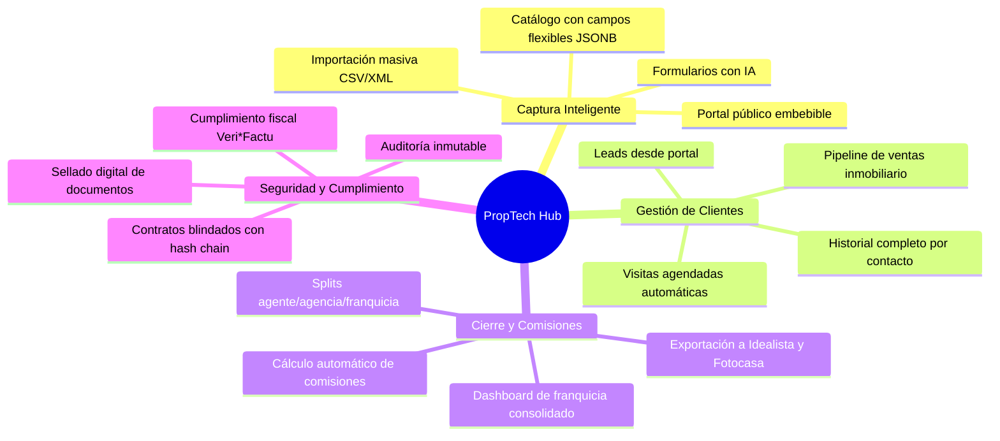

# 🏠 Vertical Inmobiliaria (PropTech Hub) — Documentación Comercial

> **Producto:** Volkern ERP — Módulo Inmobiliario
> **Versión:** 1.0.0 | **Público objetivo:** Agencias inmobiliarias, franquicias, agentes independientes
> **Precio base:** Incluido en plan Growth de Volkern

---

## 📋 Tabla de Contenidos

1. [Propuesta de Valor](#propuesta-de-valor)
2. [Perfiles de Cliente Ideal](#perfiles-de-cliente-ideal)
3. [Funcionalidades por Plan](#funcionalidades-por-plan)
4. [Ventajas Competitivas](#ventajas-competitivas)
5. [Casos de Uso](#casos-de-uso)
6. [Estrategia de Pricing](#estrategia-de-pricing)
7. [Argumentos de Venta por Canal](#argumentos-de-venta-por-canal)
8. [FAQ Comercial](#faq-comercial)
9. [Materiales de Marketing](#materiales-de-marketing)
10. [Roadmap de Producto](#roadmap-de-producto)

---

## Propuesta de Valor

### El Pitch

> **"Controla el ciclo completo de tus propiedades en una sola pantalla. Gemma agenda automáticamente las visitas con tus interesados. Al momento del cierre, Volkern genera contratos blindados con firma digital inalterable. Administra el cobro de rentas mes a mes sin persecuciones."**

### Los 4 Pilares



### Beneficios Clave

| Beneficio | Descripción | Impacto |
|-----------|-------------|---------|
| **Ahorro de tiempo** | Automatización de tareas repetitivas (emails, recordatorios, exportaciones) | ~15h/semana |
| **Más cierres** | Pipeline visual con seguimiento de leads en cada etapa | +30% tasa de conversión |
| **Sin fugas de información** | Centralización de propiedades, clientes, visitas y documentos | 100% trazabilidad |
| **Portal profesional** | Portal público embebible con filtros y SEO optimizado | Más leads calificados |
| **Expansión geográfica** | Modelo de franquicias multi-tenant con jerarquía | Sin límite de oficinas |
| **IA integrada** | Asistente Gemma responde dudas de clientes 24/7 | Reducción de carga operativa |

---

## Perfiles de Cliente Ideal

### 1. Agencia Independiente (Pequeña)

- **Perfil:** 1-5 agentes, opera localmente
- **Dolor:** Usa Excel + WhatsApp para gestionar propiedades
- **Solución:** Volkern Starter — catálogo digital, portal público, pipeline básico
- **Precio mensual:** ~49-79€/mes
- **Caso típico:** Inmobiliaria en Madrid con 30 propiedades

### 2. Franquicia Inmobiliaria (Mediana)

- **Perfil:** 5-50 agentes, múltiples oficinas
- **Dolor:** Sin visibilidad de resultados por oficina, comisiones manuales
- **Solución:** Volkern Growth — dashboard consolidado, comisiones automáticas, splits
- **Precio mensual:** ~149-299€/mes por franquicia
- **Caso típico:** Franquicia con 5 oficinas en Andalucía

### 3. Corporativo Inmobiliario (Grande)

- **Perfil:** 50+ agentes, operación nacional/internacional
- **Dolor:** Falta de automatización, reporting avanzado, integraciones con portales
- **Solución:** Volkern Enterprise — AIOps, auto-healing, exportación programada a portales
- **Precio mensual:** ~499-999€/mes
- **Caso típico:** Grupo inmobiliario con presencia en 10 ciudades

### 4. Constructoras y Promotoras

- **Perfil:** Venden obra nueva y sobre plano
- **Dolor:** Gestionar preventas, personalizar acabados, seguimiento de entregas
- **Solución:** Volkern Growth/Enterprise + módulo de proyectos
- **Precio mensual:** A medida

---

## Funcionalidades por Plan

| Funcionalidad | Starter | Growth | Enterprise |
|---------------|:-------:|:------:|:----------:|
| Catálogo de propiedades ilimitado | ✅ | ✅ | ✅ |
| Portal público embebible | ✅ | ✅ | ✅ |
| Pipeline de ventas inmobiliario | ✅ (1 pipeline) | ✅ (múltiples) | ✅ (múltiples) |
| Dashboard con KPIs | ✅ | ✅ | ✅ |
| Gráficos (Recharts) | ✅ básico | ✅ avanzado | ✅ avanzado |
| Leads desde portal | ✅ | ✅ | ✅ |
| Formulario de contacto | ✅ | ✅ | ✅ |
| Exportación CSV (Fotocasa) | ❌ | ✅ | ✅ |
| Exportación XML (Idealista) | ❌ | ✅ | ✅ |
| Cálculo de comisiones | ❌ | ✅ | ✅ |
| Splits agente/agencia | ❌ | ✅ | ✅ |
| Franquicias multi-tenant | ❌ | ✅ | ✅ |
| Dashboard de franquicia | ❌ | ✅ | ✅ |
| Automatizaciones (recordatorios) | ❌ | ✅ | ✅ |
| Exportación programada a S3 | ❌ | ❌ | ✅ |
| Consulta IA (Gemma RAG) | ❌ | ❌ | ✅ |
| Skills de IA (descripciones, precios) | ❌ | ❌ | ✅ |
| Contratos blindados | ❌ | ❌ | ✅ |
| Auto-healing | ❌ | ❌ | ✅ |

---

## Ventajas Competitivas

### vs. Idealista Pro

| Característica | Idealista Pro | Volkern |
|----------------|:-------------:|:-------:|
| CRM integrado | ❌ | ✅ |
| Pipeline de ventas | ❌ | ✅ |
| Portal público propio | ❌ | ✅ |
| Gestión de franquicias | ❌ | ✅ |
| IA generativa | ❌ | ✅ |
| Contratos blindados | ❌ | ✅ |
| Multi-vertical (no solo inmobiliario) | ❌ | ✅ |
| Precio | ~300€/mes | Desde 49€/mes |

### vs. Fotocasa Pro

| Característica | Fotocasa Pro | Volkern |
|----------------|:------------:|:-------:|
| Leads desde portal | ✅ | ✅ |
| Catálogo propiedades | ✅ | ✅ |
| CRM propio | ❌ | ✅ |
| Pipeline de ventas | ❌ | ✅ |
| Gestión de clientes completa | ❌ | ✅ |
| Automatizaciones | ❌ | ✅ |
| Exportación a otros portales | ❌ | ✅ |
| IA | ❌ | ✅ |

### vs. Salesforce Real Estate

| Característica | Salesforce | Volkern |
|----------------|:----------:|:-------:|
| Precio | Desde 300€/mes/usuario | Desde 49€/mes (ilimitado) |
| Portal público | ✅ (adicional) | ✅ incluido |
| Configuración inicial | Semanas | Horas |
| Curva de aprendizaje | Alta | Baja |
| Automatización nativa | ❌ (precisa configuración) | ✅ integrada |
| IA nativa | ❌ (precisa add-on) | ✅ incluida |

---

## Casos de Uso

### Caso 1: Captura de Propiedad → Cierre

```mermaid
flowchart LR
    A[Agente captura propiedad] --> B[Catálogo digital<br/>con fotos y características]
    B --> C[Publicación automática<br/>en portal público]
    C --> D[Cliente encuentra propiedad<br/>y solicita información]
    D --> E[Lead creado + notificación<br/>al agente]
    E --> F[Visita agendada<br/>vía calendario]
    F --> G[Oferta recibida<br/>en pipeline]
    G --> H[Negociación y<br/>contrato blindado]
    H --> I[Cierre + comisión<br/>calculada automáticamente]
```



**Valor para el cliente:** "Una sola herramienta para todo el ciclo. El agente nunca pierde el control del proceso."

### Caso 2: Franquicia Multi-oficina

- **Escenario:** Franquicia "Inmobiliaria Norte" con 5 oficinas
- **Problema:** Cada oficina tiene su propio sistema. La central no tiene visibilidad.
- **Solución Volkern:**
  - Tenant master con dashboard consolidado
  - Cada oficina como sub-tenant con sus propiedades
  - Comisiones consolidadas a nivel franquicia
  - Splits automáticos (70% agente, 20% oficina, 10% franquicia)
  - Exportación centralizada a portales

### Caso 3: Promotora de Obra Nueva

- **Escenario:** Promotora vendiendo 3 promociones en distintas ciudades
- **Problema:** Gestionar preventas, personalizaciones de acabados, entregas escalonadas
- **Solución Volkern:**
  - Catálogo por promoción con filtros
  - Pipeline con etapas personalizadas (Reserva → Señal → Contrato → Entrega)
  - Seguimiento de clientes con historial completo
  - Recordatorios automáticos de pagos y entregas

### Caso 4: Asistente IA para Atención 24/7

- **Escenario:** Agencia con alto volumen de consultas
- **Problema:** Los agentes pierden tiempo respondiendo preguntas básicas
- **Solución Volkern:**
  - Gemma AI responde consultas sobre propiedades en lenguaje natural
  - Recomendaciones personalizadas basadas en preferencias
  - El agente recibe leads pre-calificados
  - Reducción del 60% en tiempo de respuesta

---

## Estrategia de Pricing

### Modelo SaaS por Valor

| Plan | Precio | Ideal para | Ingreso estimado por cliente/año |
|------|--------|------------|---------------------------------|
| Starter | 49-79€/mes | Agencias 1-5 agentes | ~700€ |
| Growth | 149-299€/mes | Franquicias 5-50 agentes | ~2.500€ |
| Enterprise | 499-999€/mes | Corporativos 50+ agentes | ~8.000€ |

### Modelo Complementario: Transaction Fee

Para las operaciones de compraventa/alquiler donde Volkern genera el contrato blindado:

| Transacción | Fee | Ejemplo |
|-------------|:---:|---------|
| Compraventa < 100.000€ | 0.5% | 500€ en venta de 100.000€ |
| Compraventa 100k-500k | 0.25% | 625€ en venta de 250.000€ |
| Compraventa > 500.000€ | 0.1% | 1.000€ en venta de 1.000.000€ |
| Alquiler | 50% del primer mes | 500€ en alquiler de 1.000€/mes |

> **Nota:** El Transaction Fee es opcional y se ofrece como valor agregado. El modelo principal es SaaS.

### Estrategia de Land & Expand


---

## Argumentos de Venta por Canal

### Para el Director de la Agencia

> "Unifique toda su operación en una sola plataforma. Desde la captura de la propiedad hasta el cobro de la comisión, todo queda registrado, trazable y automatizado. Deje de perder tiempo entre Excel, WhatsApp y el CRM de Fotocasa."

### Para el Agente Inmobiliario

> "Tenga su catálogo en el bolsillo. Cuando un cliente le pregunte por propiedades, usted puede mostrarle el portal público al instante. Cada lead se registra automáticamente y Gemma le ayuda a responder consultas 24/7."

### Para el Franquiciador

> "Vea en tiempo real cuántas propiedades tiene cada oficina, cuántos leads están generando y cuántas comisiones están pendientes. Sin llamadas, sin emails, sin Excel. Todo en un dashboard."

### Para el Cliente Final (Comprador/Inquilino)

> "Encuentre la propiedad ideal sin llamar. Filtre por precio, zona, habitaciones. Solicite información con un clic. Reciba respuesta inmediata con Gemma IA."

---

## FAQ Comercial

### P: ¿Qué necesito para empezar?
**R:** Solo una cuenta en Volkern. El módulo inmobiliario se activa desde la configuración. No requiere instalación ni configuración técnica.

### P: ¿Puedo migrar mis propiedades desde otro sistema?
**R:** Sí. Soportamos importación desde CSV, Excel, y próximamente desde Idealista Pro y Fotocasa Pro.

### P: ¿Funciona para alquiler vacacional?
**R:** Sí, aunque el módulo está optimizado para venta y alquiler residencial. Para alquiler vacacional, recomendamos complementar con el módulo de Bookings.

### P: ¿Puedo tener mi propio dominio en el portal público?
**R:** Sí. El portal se publica en `su-marca.volkern.app/propiedades` o en su propio dominio mediante configuración de DNS.

### P: ¿Cómo se manejan las comisiones?
**R:** El sistema calcula automáticamente las comisiones al cerrar un deal. Soporta splits entre agente, oficina y franquicia. El dashboard de franquicia consolida todas las comisiones.

### P: ¿Hay límite de propiedades?
**R:** No hay límite en ningún plan. Starter, Growth y Enterprise incluyen propiedades ilimitadas.

### P: ¿Se integra con Idealista y Fotocasa?
**R:** Actualmente ofrecemos exportación manual a formatos XML (Idealista) y CSV (Fotocasa). Las integraciones por API están en roadmap.

---

## Roadmap de Producto

### Fase 1 — Actual (MVP) ✅
- [x] Catálogo de propiedades con campos JSONB
- [x] Portal público embebible con filtros
- [x] Dashboard analítico con KPIs y gráficos
- [x] Formulario de contacto → leads
- [x] Pipeline de ventas inmobiliario
- [x] Cálculo de comisiones con splits
- [x] Dashboard de franquicia consolidado
- [x] Exportación XML (Idealista) y CSV (Fotocasa)
- [x] Consulta IA (RAG) en lenguaje natural

### Fase 2 — Próximo trimestre 🚧
- [ ] Tour virtual 360° de propiedades
- [ ] Valoraciones automáticas con IA (AVM)
- [ ] Mapa interactivo con clustering de propiedades
- [ ] Notificaciones push al agente (nuevo lead, visita próxima)
- [ ] Calendario compartido de visitas

### Fase 3 — Medio plazo 📋
- [ ] Integración API con Idealista (bidireccional)
- [ ] Integración API con Fotocasa (bidireccional)
- [ ] Contratos blindados con firma digital
- [ ] Pasarela de pago para señales y reservas
- [ ] App móvil para agentes (visitas, notificaciones, catálogo)

### Fase 4 — Largo plazo 🚀
- [ ] Comparador de hipotecas
- [ ] Marketplace de servicios (notarías, tasaciones, reformas)
- [ ] Predicción de precios con machine learning
- [ ] Automatización completa de property management

---

## KPIs de Éxito para el Cliente

| KPI | Starter | Growth | Enterprise |
|-----|:-------:|:------:|:----------:|
| Tiempo de captura a publicación | 30 min | 15 min | 5 min |
| Tasa de conversión lead → visita | — | +25% | +40% |
| Tasa de conversión visita → oferta | — | +20% | +35% |
| Tiempo medio de cierre | — | -30% | -50% |
| Reducción de tareas manuales | 5h/sem | 15h/sem | 30h/sem |
| Satisfacción del agente (NPS) | 70 | 82 | 90 |

---

## Materiales de Marketing

### Tags y Hashtags
```
#Volkern #PropTech #RealEstateTech #InmobiliariaDigital #CRMInmobiliario
#FranquiciaInmobiliaria #GestiónDePropiedades #IAInmobiliaria
```

### Keywords SEO
- CRM inmobiliario España
- Software para agencias inmobiliarias
- Gestión de propiedades online
- Programa para inmobiliarias
- Portal inmobiliario para agencias
- Automatización inmobiliaria
- Comisiones inmobiliarias automáticas
- Franquicia inmobiliaria software

---

## Contacto Comercial

- **Web:** [volkern.com](https://volkern.com)
- **Email:** ventas@volkern.com
- **Demo:** Solicitar demo personalizada del módulo inmobiliario
- **Documentación técnica:** [`REAL-ESTATE-MODULE.md`](./REAL-ESTATE-MODULE.md)
- **Manual operativo:** [`OPERATIONAL-MANUAL-REAL-ESTATE.md`](./OPERATIONAL-MANUAL-REAL-ESTATE.md)

---

*Documento generado el 31 de mayo de 2026 — Volkern ERP*
