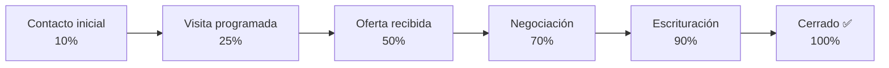

# 🏠 Manual Operativo — Módulo Inmobiliario Volkern

> **Versión:** 1.0.0 | **Audiencia:** Usuarios finales (agentes, administradores, franquiciadores)
> **Última actualización:** Mayo 2026

---

## 📋 Índice

1. [Introducción](#introducción)
2. [Primeros Pasos](#primeros-pasos)
3. [Gestión de Propiedades](#gestión-de-propiedades)
4. [Portal Público](#portal-público)
5. [Leads y Clientes](#leads-y-clientes)
6. [Pipeline de Ventas](#pipeline-de-ventas)
7. [Dashboard y Reportes](#dashboard-y-reportes)
8. [Comisiones](#comisiones)
9. [Franquicias](#franquicias)
10. [Exportación a Portales](#exportación-a-portales)
11. [Asistente IA (Gemma)](#asistente-ia-gemma)
12. [Solución de Problemas](#solución-de-problemas)
13. [FAQ Operativo](#faq-operativo)

---

## Introducción

### ¿Qué es el Módulo Inmobiliario?

Es el sistema de gestión de propiedades de Volkern. Te permite:

- **Publicar propiedades** en un portal profesional en segundos
- **Recibir leads** de clientes interesados directamente a tu CRM
- **Gestionar visitas** con calendario integrado
- **Seguir oportunidades** en un pipeline visual
- **Calcular comisiones** automáticamente al cerrar una operación
- **Exportar** tus propiedades a Idealista y Fotocasa

### Acceso

1. Inicia sesión en tu Volkern: `tu-marca.volkern.app`
2. Ve a **Dashboard** → **Inmobiliario** (sidebar izquierda)
3. También puedes acceder desde: **Configuración** → **Inmobiliaria**

---

## Primeros Pasos

### 1. Activar el Módulo

Si es la primera vez que usas el módulo inmobiliario:

1. Ve a **Configuración** → **Inmobiliaria**
2. Haz clic en **"Activar módulo inmobiliario"**
3. El sistema creará automáticamente:
   - ✅ Pipeline de ventas (6 etapas)
   - ✅ Automatizaciones base
   - ✅ Campos personalizados para propiedades

### 2. Configurar tu Marca

1. Ve a **Configuración** → **Marca Blanca**
2. Completa:
   - **Nombre de la agencia** (visible en portal público)
   - **Logo** (recomendado: 200x200px, PNG)
   - **Colores** (primario, secundario, acento)
   - **Redes sociales** (URLs completas)

### 3. Publicar tu Primera Propiedad

Sigue la guía en [Gestión de Propiedades → Crear Propiedad](#crear-propiedad).

---

## Gestión de Propiedades

### Crear Propiedad

1. Ve a **Catálogo** en la sidebar
2. Haz clic en **"Añadir propiedad"**
3. Completa los campos obligatorios:

| Campo | Descripción | Ejemplo |
|-------|-------------|---------|
| **Título** | Nombre de la propiedad | "Ático de Lujo en Salamanca" |
| **Tipo de operación** | Venta, Alquiler o Traspaso | Venta |
| **Tipo de inmueble** | Casa, Departamento, Local... | Casa |
| **Precio** | En euros (o moneda configurada) | 450.000 |
| **Superficie total** | Metros cuadrados | 120 |
| **Estado** | Disponible, Reservada... | Disponible |
| **Descripción** | Texto atractivo (máx 500 chars) | "Impresionante ático..." |
| **Imágenes** | Arrastra fotos aquí | (máx 10 imágenes) |

4. Opcionalmente completa:
   - Habitaciones, baños, estacionamientos
   - Ubicación (dirección, ciudad, coordenadas)
   - Amenidades (ascensor, piscina, jardín)
   - Certificación energética
   - Tags SEO
   - Propiedad destacada (aparece primero)

5. Haz clic en **"Guardar"**

### Editar Propiedad

1. Ve a **Catálogo**
2. Busca la propiedad (usa los filtros si hay muchas)
3. Haz clic en el nombre de la propiedad
4. Modifica los campos necesarios
5. Haz clic en **"Guardar cambios"**

### Eliminar Propiedad

1. Ve a **Catálogo**
2. Busca la propiedad
3. Haz clic en el menú de acciones (⋮)
4. Selecciona **"Eliminar"**
5. Confirma la eliminación

> ⚠️ Eliminar una propiedad es irreversible. Si solo quieres ocultarla del portal, cambia su estado a "No disponible".

### Campos Personalizados

Además de los campos estándar, puedes agregar campos personalizados desde **Configuración** → **Campos del catálogo** → **Añadir campo personalizado**.

Esto es útil para características específicas de tu agencia (ej: "¿Acepta mascotas?", "¿Tiene trastero?", "Número de planta").

---

## Portal Público

### ¿Cómo se ve?

Tu portal público está en: `tu-marca.volkern.app/propiedades`

**Incluye:**
- Hero carrusel con propiedades destacadas
- Grid de propiedades con tarjetas
- Filtros (operación, tipo, ciudad, precio, habitaciones)
- Página de detalle con galería y formulario de contacto

### Configurar el Portal

1. Ve a **Configuración** → **Inmobiliaria**
2. En "Portal Público" puedes configurar:
   - Activar/desactivar portal
   - Título y descripción SEO
   - Propiedades por página
   - Orden por defecto

### Compartir una Propiedad

Desde la página de detalle de cualquier propiedad:

1. Copia la URL del navegador
2. Compártela por WhatsApp, email o redes sociales
3. El enlace mostrará la propiedad con toda su información

O desde el dashboard:
1. Ve a **Dashboard Inmobiliario**
2. En "Propiedades Recientes", busca la propiedad
3. Haz clic derecho → "Copiar enlace"

---

## Leads y Clientes

### ¿Cómo llegan los Leads?

Cuando un cliente interesado:

1. Visita tu portal público
2. Encuentra una propiedad
3. Hace clic en **"Solicitar información"**
4. Rellena el formulario (nombre, email, teléfono, mensaje)

El lead se crea automáticamente en tu CRM con:
- Fuente: "Portal Inmobiliario"
- Propiedad de interés (si especificó una)
- Fecha y hora de la consulta
- Mensaje del cliente

### Gestionar Leads

1. Ve a **CRM** → **Leads**
2. Usa el filtro **Fuente: Portal Inmobiliario**
3. Haz clic en un lead para ver su detalle
4. Acciones disponibles:
   - **Convertir a contacto** (cliente recurrente)
   - **Crear tarea** (ej: "Llamar a Juan")
   - **Agendar visita** (crea una cita)
   - **Mover a pipeline** (inicia oportunidad de venta)

### Automatización de Leads

El sistema tiene 2 automatizaciones pre-configuradas:

| Automatización | ¿Qué hace? | ¿Activa por defecto? |
|----------------|------------|:--------------------:|
| **Bienvenida a lead** | Crea una tarea de seguimiento urgente cuando llega un lead del portal | ✅ Sí |
| **Recordatorio de visita** | 24h antes de una visita, prepara un recordatorio | ✅ Sí |

Para gestionar automatizaciones: **Configuración** → **Automatizaciones**

---

## Pipeline de Ventas

### Etapas del Pipeline



| Etapa | Descripción | Acción del agente |
|-------|-------------|-------------------|
| **Contacto inicial** | El cliente ha mostrado interés | Llamar o enviar WhatsApp |
| **Visita programada** | Se ha agendado una visita | Confirmar día antes |
| **Oferta recibida** | El cliente ha hecho una oferta | Presentar al propietario |
| **Negociación** | Negociando términos | Coordinar con ambas partes |
| **Escrituración** | Trámites legales | Preparar documentación |
| **Cerrado** | ✅ Operación cerrada | Calcular comisión |

### Mover un Deal entre Etapas

1. Ve a **CRM** → **Deals** (o **Pipeline**)
2. Arrastra la tarjeta del deal a la siguiente etapa
3. Opcionalmente, añade una nota sobre el movimiento
4. El sistema registra el cambio automáticamente

### Crear un Deal desde un Lead

1. En el detalle del lead, haz clic en **"Crear oportunidad"**
2. Se abre un formulario pre-rellenado con los datos del lead
3. El deal aparece automáticamente en la etapa **"Contacto inicial"**

---

## Dashboard y Reportes

### Dashboard Inmobiliario

Accede desde: **Dashboard** → **Inmobiliario**

#### KPIs Principales (4 cards)

| Card | Muestra | Color |
|------|---------|-------|
| **Total Propiedades** | Número total + disponibles | 🔵 Azul |
| **Precio Promedio** | Precio medio + €/m² | 🟢 Verde |
| **Transacciones** | Vendidas + Alquiladas | 🟣 Índigo |
| **Reservadas** | Reservadas + Destacadas | 🟡 Ámbar |

#### KPIs Secundarios (3 cards)

| Card | Muestra |
|------|---------|
| **Leads (Portal)** | Leads este mes + barra de progreso |
| **Visitas Agendadas** | Pendientes + completadas |
| **Destacadas** | Número + % del total |

#### Gráficos

- **Pastel (donut):** Distribución por tipo de operación (venta, alquiler)
- **Barras:** Top 10 ciudades con más propiedades
- **Barras de progreso:** Distribución por estado (disponible, reservada, vendida, alquilada)

#### Propiedades Recientes

Lista de las últimas 10 propiedades añadidas, con imagen, precio y badge de operación.

### Acciones Rápidas

Desde el dashboard puedes ir directamente a:
- **Catálogo** — Gestionar propiedades
- **Exportar** — Descargar CSV/XML
- **Portal Público** — Ver el portal

### Actualizar Datos

Los datos del dashboard se cargan automáticamente al entrar. Para refrescar manualmente, haz clic en **"Actualizar"** (arriba a la derecha).

---

## Comisiones

### ¿Cómo funcionan?

Cuando se cierra un deal (etapa "Cerrado"), el sistema puede calcular la comisión automáticamente.

### Modos de Cálculo

| Modo | Descripción | Ejemplo |
|------|-------------|---------|
| **% sobre venta** | Porcentaje del precio de venta | 3% de 300.000€ = 9.000€ |
| **% sobre comisión** | Porcentaje de la comisión total | 70% de 9.000€ = 6.300€ |
| **Tarifa fija** | Monto fijo por operación | 1.000€ por cada venta |
| **Por tramos** | % variable según precio | 2% hasta 200k, 3% de 200k a 500k |

### Splits (Reparto)

Puedes dividir la comisión entre:
- **Agente** (ej: 70%)
- **Agencia / Franquicia** (ej: 30%)

### Ver Comisiones

1. Ve a **Inmobiliario** → **Comisiones**
2. Verás todas las comisiones generadas
3. Puedes filtrar por:
   - **Agente** — Ver comisiones de un agente
   - **Estado** — Pendientes, aprobadas, pagadas
   - **Fecha** — Rango de fechas

### Aprobar y Pagar Comisiones

1. En la lista de comisiones, haz clic en una comisión pendiente
2. Revisa los detalles (deal, monto, split)
3. Haz clic en **"Aprobar"** para validar
4. Cuando se haya pagado al agente, haz clic en **"Marcar como pagada"**
5. Opcionalmente, añade una referencia de pago

---

## Franquicias

### ¿Qué es el modo Franquicia?

Si tienes varias oficinas, puedes configurar una jerarquía de franquicia:

```
Franquicia Master (tú)
├── Oficina Madrid
│   ├── Agente 1
│   └── Agente 2
├── Oficina Barcelona
│   ├── Agente 1
│   └── Agente 2
└── Oficina Valencia
    └── Agente 1
```

### Dashboard de Franquicia

Como franquiciador, ves:

- **Estadísticas globales:** Total propiedades, deals, leads, comisiones de todas las oficinas
- **Comisiones por oficina:** Cuánto ha generado cada oficina
- **Top propiedades:** Las mejores propiedades de toda la franquicia
- **Leads recientes:** Últimos leads de cualquier oficina
- **Deals por etapa:** Cuántos deals hay en cada etapa del pipeline

### Ventajas del Modelo Franquicia

- ✅ Visibilidad completa de todas las oficinas
- ✅ Comisiones consolidadas (split automático)
- ✅ Cada oficina gestiona sus propiedades de forma independiente
- ✅ El franquiciador ve todo sin intervenir en la operación diaria

---

## Exportación a Portales

### Exportar a Idealista (XML)

1. Ve a **Dashboard Inmobiliario**
2. En "Acciones Rápidas", haz clic en **"Exportar"**
3. Selecciona formato **"XML (Idealista)"**
4. Opcionalmente, filtra por estado y operación
5. Haz clic en **"Descargar"**
6. Sube el archivo XML a Idealista (sección de importación masiva)

### Exportar a Fotocasa (CSV)

1. Mismo proceso que Idealista
2. Selecciona formato **"CSV (Fotocasa)"**
3. Descarga el archivo CSV
4. Súbelo a Fotocasa (formato compatible)

### Exportación Automática (Plan Enterprise)

Si tienes el plan Enterprise, puedes configurar exportaciones automáticas:

1. Ve a **Configuración** → **Automatizaciones**
2. Activa "Exportación semanal a Idealista"
3. El sistema generará y subirá el XML a S3 automáticamente cada lunes
4. Recibirás una notificación cuando esté listo

> 💡 **Consejo:** Programa la exportación semanal los lunes por la mañana para tener el feed actualizado toda la semana.

---

## Asistente IA (Gemma)

### ¿Qué puede hacer Gemma?

| Acción | Cómo pedírselo |
|--------|----------------|
| **Buscar propiedades** | "Encuentra pisos en Madrid con 3 habitaciones" |
| **Recomendar propiedades** | "Recomiéndame casas cerca de la playa" |
| **Comparar propiedades** | "Compara el ático de Salamanca con el piso de Chamberí" |
| **Información general** | "Cuéntame sobre el mercado inmobiliario en Barcelona" |

### ¿Dónde usar Gemma?

- **Chat del dashboard:** Icono de chat en la esquina inferior derecha
- **Portal público:** Los clientes pueden preguntar directamente
- **API:** Integración con otros sistemas

### ¿Cómo funciona?

1. El usuario hace una pregunta en lenguaje natural
2. Gemma analiza la consulta y extrae los filtros relevantes
3. Busca en la base de datos las propiedades que coinciden
4. Genera una respuesta natural con los resultados
5. Si no encuentra propiedades, sugiere ajustar los filtros

### Ejemplos de Consultas

```
Usuario: "Busco un piso en el centro de Madrid, 2 habs, menos de 200.000€"
Gemma: "Encontré 3 pisos que coinciden...

1. Piso en Gran Vía - 185.000€ - 65m² - 2 habs
   ✔️ Céntrico, cerca de metro, ascensor

2. Piso en Malasaña - 175.000€ - 70m² - 2 habs
   ✔️ Zona moderna, parking disponible

3. Piso en Chamberí - 195.000€ - 60m² - 2 habs  
   ✔️ Tranquilo, bien comunicado

¿Quieres más detalles de alguno?"
```

---

## Solución de Problemas

### Problemas Comunes

| Problema | Causa | Solución |
|----------|-------|----------|
| **No aparecen propiedades en el portal** | La propiedad no está activa o el estado no es "disponible" | Ve al catálogo, edita la propiedad, cambia estado a "Disponible" y activo a "Sí" |
| **El portal público da error 404** | No hay propiedades publicadas o el slug del tenant es incorrecto | Verifica que haya al menos una propiedad activa y disponible |
| **No llegan leads del portal** | El formulario no está activo o hay rate limiting | Revisa Configuración → Portal Público. Espera 1 minuto entre pruebas |
| **El dashboard muestra 0 propiedades** | No hay propiedades con tipo "inmueble" | Ve a Catálogo y crea una propiedad |
| **Error al exportar a XML/CSV** | No hay propiedades disponibles para exportar | Asegúrate de tener propiedades con estado "disponible" |
| **Gemma no respuesta o da error** | Límite de API alcanzado o timeout | Espera unos minutos y vuelve a intentar. Si persiste, contacta a soporte |
| **Las comisiones no se calculan** | El deal no tiene precio o la regla de comisión no está configurada | Revisa que el deal tenga "valor real" y que exista una regla de comisión activa |

### Errores en Consola (para administradores)

| Error en consola | Significado | Acción |
|------------------|-------------|--------|
| `[RealEstate Dashboard] Error` | Fallo al cargar estadísticas | Verificar conexión a BD y que existan datos |
| `[RAG Consult] Error` | Fallo en consulta IA | Verificar API key de IA y conectividad |
| `[RealEstate Export] Error` | Fallo al exportar | Verificar que haya propiedades y permisos de S3 |

### Contactar a Soporte

Si el problema persiste:
1. Abre la consola del navegador (F12 → Console)
2. Busca errores con `[RealEstate` en el texto
3. Captura el error completo
4. Envía a: support@volkern.com

---

## FAQ Operativo

### P: ¿Puedo tener dos pipelines diferentes (inmobiliario + general)?
**R:** Sí. El pipeline inmobiliario usa `categoria = 'real_estate'` y coexiste con el pipeline general del CRM.

### P: ¿Cuántas propiedades puedo tener?
**R:** Ilimitadas. No hay límite de propiedades en ningún plan.

### P: ¿Las imágenes se almacenan en Volkern?
**R:** Sí, las imágenes se suben a AWS S3 y se sirven vía CDN. Tamaño máximo por imagen: 10MB.

### P: ¿Puedo personalizar las etapas del pipeline?
**R:** Sí, desde Configuración → Pipeline puedes añadir, editar o eliminar etapas.

### P: ¿Cómo se calcula el precio por m² en el dashboard?
**R:** Se divide `precioBase / superficie_total` de cada propiedad y se promedia. Solo propiedades con superficie > 0.

### P: ¿Los leads del portal se cuentan en el CRM general?
**R:** Sí. Los leads del portal inmobiliario se almacenan con `fuente = 'portal_inmobiliario'`. Puedes filtrarlos en cualquier momento.

### P: ¿Puedo exportar solo propiedades de alquiler?
**R:** Sí. Usa el filtro `operationType=alquiler` en la exportación.

### P: ¿Gemma habla español?
**R:** Sí, Gemma está entrenada en español y entiende variantes de España y LATAM.

### P: ¿Qué monedas soporta?
**R:** EUR (por defecto), USD, MXN, COP y cualquier moneda configurada en el tenant.

---

## Atajos y Tips

### Atajos del Dashboard

- **Actualizar dashboard:** Clic en "Actualizar" (top-right)
- **Ir a catálogo:** Clic en "Catálogo" en Acciones Rápidas
- **Exportar:** Clic en "Exportar" en Acciones Rápidas
- **Portal público:** Clic en "Portal Público" en Acciones Rápidas

### Tips de Productividad

1. **🏷️ Usa tags SEO** para que las propiedades aparezcan en búsquedas de Google
2. **📸 Sube mínimo 5 fotos** — las propiedades con más fotos convierten 40% más
3. **⭐ Destaca tus mejores propiedades** — aparecen primero en el portal y en el carrusel
4. **📅 Agenda visitas rápido** — usa el calendario desde el lead directamente
5. **🤖 Pregunta a Gemma** — antes de buscar manualmente, prueba con lenguaje natural
6. **📊 Revisa el dashboard cada mañana** — detecta tendencias antes que tu competencia
7. **🔔 Automatiza todo** — activa las automatizaciones de exportación y recordatorios

---

## Glosario

| Término | Definición |
|---------|------------|
| **CatalogoItem** | Registro de base de datos que almacena una propiedad |
| **customFieldValues** | Campo JSONB donde se guardan las características específicas de cada propiedad |
| **Deal** | Oportunidad de venta asociada a un cliente y una propiedad |
| **Lead** | Persona interesada que ha solicitado información |
| **Pipeline** | Secuencia de etapas por las que pasa una oportunidad hasta cerrarse |
| **Split** | Reparto porcentual de una comisión entre agente y agencia |
| **Tenant** | Cliente de Volkern (agencia, oficina o franquicia) |
| **Slug** | Identificador único en la URL (ej: `inmobiliaria-ejemplo`) |
| **GIN Index** | Índice PostgreSQL para búsquedas eficientes en JSONB |
| **RAG** | Retrieval-Augmented Generation — técnica de IA que busca datos antes de responder |

---

## Referencias Rápidas

| Acción | Ruta |
|--------|------|
| Dashboard inmobiliario | `/dashboard/real-estate` |
| Catálogo de propiedades | `/dashboard/catalogo?tipo=inmueble` |
| Portal público | `/p/[tu-slug]/propiedades` |
| Configuración inmobiliaria | `/dashboard/configuracion/real-estate` |
| Pipeline de ventas | `/dashboard/pipeline?categoria=real_estate` |
| Leads del portal | `/dashboard/leads?fuente=portal_inmobiliario` |
| Comisiones (API) | `GET /api/real-estate/franchise/commissions` |
| Franquicia (API) | `GET /api/real-estate/franchise/overview` |
| Exportar propiedades | `GET /api/real-estate/export` |

---

*Documento generado el 31 de mayo de 2026 — Volkern ERP*
