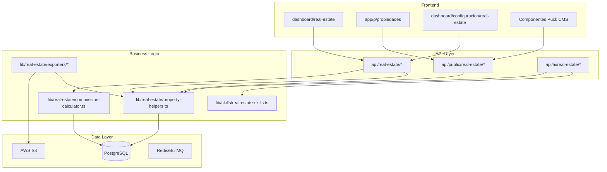
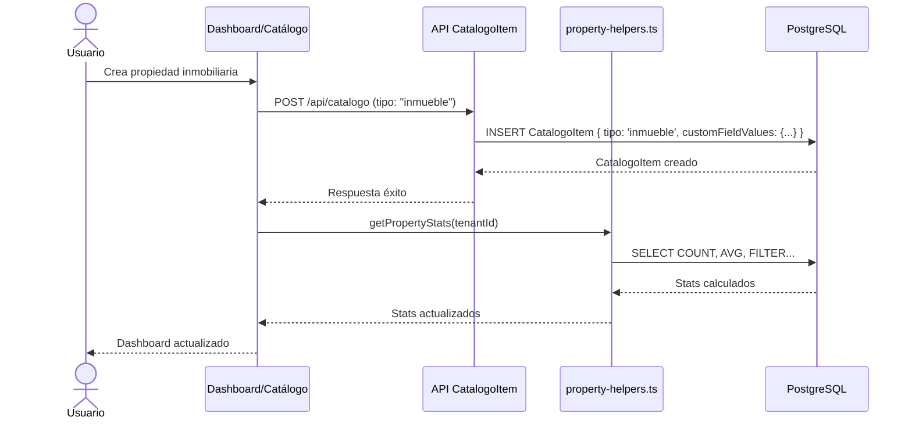
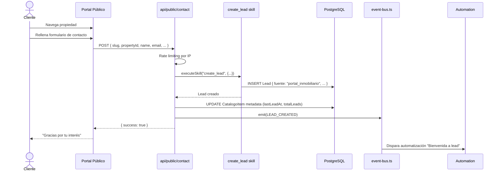
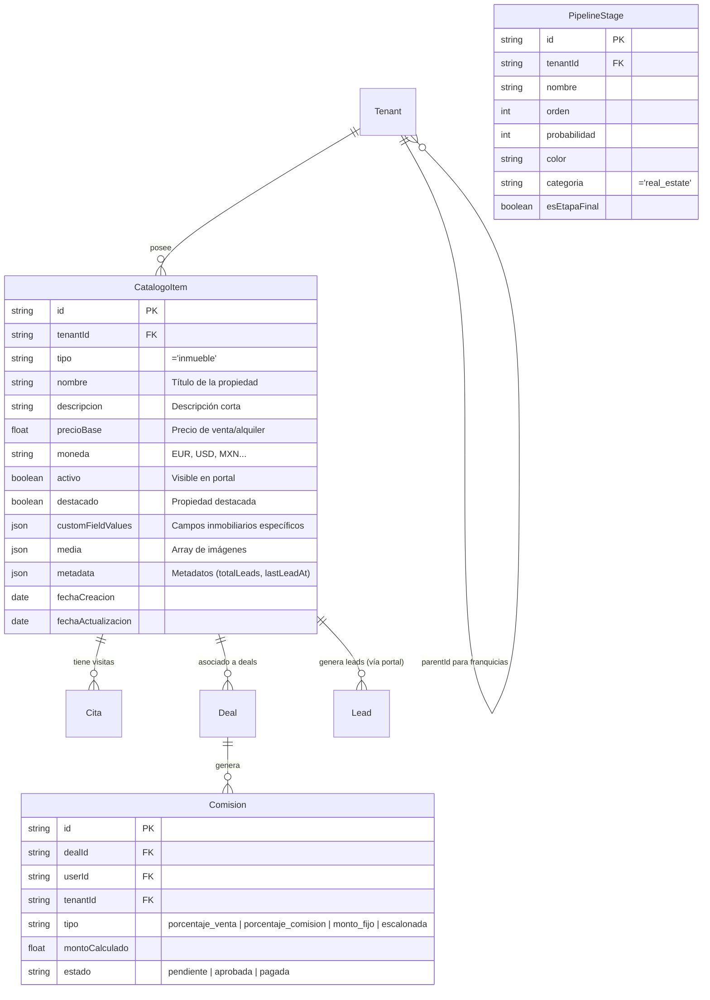
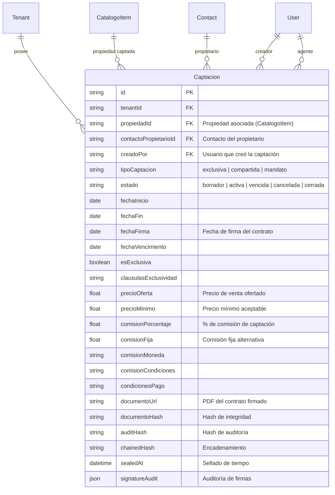
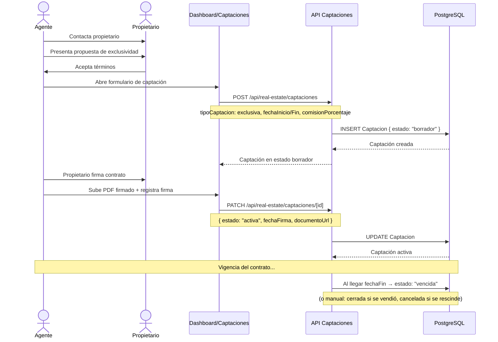
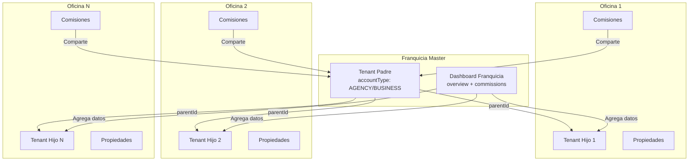

# 🏠 Módulo Inmobiliario — Volkern ERP

> **Versión:** 1.0.0 | **Última actualización:** Mayo 2026
> **Estado:** ✅ Producción — 59 tests, 0 fallos

Sistema completo de gestión inmobiliaria (PropTech Hub) integrado al ecosistema Volkern. Cubre el ciclo de vida completo: captura de propiedades → portal público → leads y visitas → pipeline de ventas → comisiones → exportación a portales.

---

## 📋 Índice

1. [Arquitectura General](#arquitectura-general)
2. [Modelo de Datos](#modelo-de-datos)
3. [API REST](#api-rest)
4. [Portal Público](#portal-público)
5. [Dashboard y KPIs](#dashboard-y-kpis)
6. [Sistema de Franquicias](#sistema-de-franquicias)
7. [Componentes Puck (CMS)](#componentes-puck-cms)
8. [Skills de IA (Gemma)](#skills-de-ia-gemma)
9. [Exportación a Portales](#exportación-a-portales)
10. [Pipeline de Ventas](#pipeline-de-ventas)
11. [Módulo Seed y Setup](#módulo-seed-y-setup)
12. [Tests y Cobertura](#tests-y-cobertura)
13. [Mantenimiento y Operaciones](#mantenimiento-y-operaciones)

---

## Arquitectura General



### Mapa de Archivos

```
app/
├── api/
│   ├── real-estate/                      # API interna (dashboard, export)
│   │   ├── dashboard-stats/route.ts      #   GET — Stats consolidados
│   │   ├── export/route.ts               #   GET/POST — Export CSV/XML
│   │   └── franchise/
│   │       ├── overview/route.ts         #   GET — Vista franquicia
│   │       └── commissions/route.ts      #   GET — Comisiones
│   ├── public/real-estate/               # API pública (portal embebible)
│   │   ├── properties/route.ts           #   GET — Listado + filtros
│   │   └── contact/route.ts             #   POST — Formulario de contacto
│   └── ai/real-estate/consult/route.ts   # POST — Consulta RAG con IA
│
├── dashboard/
│   ├── real-estate/page.tsx              # Dashboard analítico
│   └── configuracion/real-estate/        # Página de configuración
│
└── p/[tenantSlug]/propiedades/           # Portal público
    ├── page.tsx                          # Listado público con filtros
    ├── HeroCarousel.tsx                  # Carrusel de propiedades
    └── [id]/
        ├── page.tsx                      # Detalle público (SSR)
        └── PropertyDetailClient.tsx      # Cliente con formulario de contacto

lib/
├── real-estate/
│   ├── property-helpers.ts               # Parseo, queries, stats
│   ├── commission-calculator.ts          # Cálculo de comisiones
│   ├── seed.ts                           # Seed del módulo
│   ├── setup-pipeline.ts                 # Pipeline stages
│   └── exporters/
│       ├── csv-exporter.ts               # → Fotocasa CSV
│       └── xml-exporter.ts              # → Idealista XML
└── skills/real-estate-skills.ts          # Skills IA para Gemma
```

### Flujo de Datos — Creación de Propiedad



### Flujo de Datos — Lead desde Portal Público



---

## Modelo de Datos

### CatalogoItem (extendido para inmuebles)

Los inmuebles se almacenan en la tabla `CatalogoItem` con `tipo = 'inmueble'`. Los campos específicos se guardan en `customFieldValues` (JSONB con índices GIN).



### Mapeo de Campos JSONB → TypeScript

| Campo JSONB | Propiedad TypeScript | Tipo | Requerido |
|-------------|---------------------|------|-----------|
| `tipo_operacion` | `operationType` | `'venta' \| 'alquiler' \| 'traspaso'` | ✅ |
| `tipo_inmueble` | `propertyType` | `'Casa' \| 'Departamento' \| ...` | ❌ |
| `superficie_total` | `areaM2` | `number` | ✅ |
| `superficie_construida` | `builtM2` | `number` | ❌ |
| `habitaciones` | `bedrooms` | `number` | ❌ |
| `banos` | `bathrooms` | `number` | ❌ |
| `estacionamientos` | `parking` | `number` | ❌ |
| `direccion` | `address` | `string` | ❌ |
| `zona` | `city` | `string` | ❌ |
| `latitud` | `lat` | `number` | ❌ |
| `longitud` | `lng` | `number` | ❌ |
| `antiguedad` | `yearBuilt` | `number` (años) | ❌ |
| `ascensor` | `hasElevator` | `boolean` | ❌ |
| `estacionamiento` | `hasParking` | `boolean` | ❌ |
| `alberca` | `hasPool` | `boolean` | ❌ |
| `jardin` | `hasGarden` | `boolean` | ❌ |
| `trastero` | `hasStorageRoom` | `boolean` | ❌ |
| `amueblado` | `furnished` | `boolean` | ❌ |
| `orientacion` | `orientation` | `string` | ❌ |
| `certificacion_energetica` | `energyCert` | `string` | ❌ |
| `estado` | `status` | `'disponible' \| 'reservada' \| 'vendida' \| 'alquilada'` | ✅ |
| `destacada` | `featured` | `boolean` | ❌ |
| `descripcion_larga` | `longDescription` | `string` | ❌ |
| `tags_seo` | `seoTags` | `string` | ❌ |

### Índices GIN Recomendados

```sql
-- Índice principal: búsqueda por cualquier campo JSONB
CREATE INDEX idx_catalogo_item_inmueble_fields 
ON "CatalogoItem" USING gin ("customFieldValues" jsonb_path_ops)
WHERE tipo = 'inmueble' AND activo = true;

-- Índice para filtros por estado + tenant
CREATE INDEX idx_catalogo_item_inmueble_status
ON "CatalogoItem" ("tenantId", ("customFieldValues"->>'estado'))
WHERE tipo = 'inmueble';
```

---

## API REST

### Endpoints Internos (requieren autenticación)

#### `GET /api/real-estate/dashboard-stats`

Estadísticas consolidadas para el dashboard.

**Response:**
```json
{
  "stats": {
    "total": 150,
    "available": 85,
    "reserved": 12,
    "sold": 35,
    "rented": 18,
    "featured": 10,
    "avgPrice": 245000,
    "avgPricePerM2": 1850
  },
  "leads": { "thisMonth": 24, "total": 312 },
  "visits": { "pending": 8, "completed": 42, "total": 50 },
  "recentProperties": [{ "id": "...", "nombre": "Ático de Lujo", ... }],
  "distribution": {
    "byOperation": [{ "operation": "venta", "count": 98 }],
    "byCity": [{ "city": "Madrid", "count": 45 }]
  }
}
```

**Cálculos:** Usa `getPropertyStats()` con SQL raw y agregaciones. Filtra por `tenantId` y `tipo = 'inmueble'`.

---

#### `GET /api/real-estate/export`

Exporta propiedades a CSV (Fotocasa) o XML (Idealista).

**Query Params:**
| Parámetro | Tipo | Default | Descripción |
|-----------|------|---------|-------------|
| `format` | `string` | `'xml'` | `'csv'` o `'xml'` |
| `status` | `string?` | — | Filtrar por estado |
| `operationType` | `string?` | — | Filtrar por operación |

**POST (mismo endpoint):** Exporta y sube a S3, devuelve URL firmada.

---

#### `GET /api/real-estate/franchise/overview`

Dashboard consolidado para franquicia master. Agrega datos de todos los sub-tenants.

**Requiere:** `accountType = 'AGENCY' | 'BUSINESS'`

**Response incluye:** `globalStats`, `commissions[]`, `topProperties[]`, `recentLeads[]`, `dealsByStage[]`

---

#### `GET /api/real-estate/franchise/commissions`

Reporte detallado de comisiones con filtros.

**Query Params:** `agenteId`, `desde`, `hasta`, `estado`, `incluirHijas`

**Response:** `data[]` (comisiones individuales), `totals` (agregados), `byAgent[]` (agrupado)

---

#### `GET /api/real-estate/captaciones`

Lista paginada de captaciones con filtros. También acepta `?stats=true` para obtener estadísticas agregadas.

**Query Params:** `estado`, `tipoCaptacion`, `propiedadId`, `contactoPropietarioId`, `creadoPor`, `desde`, `hasta`, `search`, `limit`, `offset`

#### `POST /api/real-estate/captaciones`

Crea una nueva captación.

**Body:**
```json
{
  "propiedadId": "uuid",
  "contactoPropietarioId": "uuid",
  "tipoCaptacion": "exclusiva",
  "fechaInicio": "2026-06-01",
  "fechaFin": "2027-06-01",
  "esExclusiva": true,
  "precioOferta": 250000,
  "comisionPorcentaje": 3.5,
  "comisionMoneda": "EUR",
  "clausulasExclusividad": "...",
  "condicionesPago": "..."
}
```

#### `GET /api/real-estate/captaciones/[id]`

Obtiene una captación con sus relaciones (propiedad, contacto propietario, creador).

#### `PATCH /api/real-estate/captaciones/[id]`

Actualiza parcialmente una captación.

#### `DELETE /api/real-estate/captaciones/[id]`

Elimina una captación.

---

## Modelo Captación (Contratos de Exclusividad)



### Flujo de Captación



### Estados

| Estado | Descripción |
|--------|-------------|
| `borrador` | En edición, sin firmar |
| `activa` | Contrato vigente, propiedad en comercialización |
| `vencida` | Se cumplió la fecha de fin sin venderse |
| `cancelada` | Se rescindió el contrato antes del vencimiento |
| `cerrada` | Se vendió/alquiló la propiedad durante la vigencia |

### Endpoints

| Método | Ruta | Descripción |
|--------|------|-------------|
| `GET` | `/api/real-estate/captaciones` | Listar captaciones con filtros y paginación |
| `GET` | `/api/real-estate/captaciones?stats=true` | Estadísticas agregadas |
| `POST` | `/api/real-estate/captaciones` | Crear nueva captación |
| `GET` | `/api/real-estate/captaciones/[id]` | Obtener detalle con relaciones |
| `PATCH` | `/api/real-estate/captaciones/[id]` | Actualizar captación |
| `DELETE` | `/api/real-estate/captaciones/[id]` | Eliminar captación |

### Cálculo de Comisión de Captación

La comisión de captación se calcula sobre el precio ofertado:

- **Porcentaje:** `precioOferta * comisionPorcentaje / 100`
- **Fija:** `comisionFija` (si no hay porcentaje)

```typescript
// Ejemplo: propiedad de 250.000€ con 3.5% de comisión
const comision = calcularComisionCaptacion(250000, 3.5, null);
// Resultado: 8.750€
```

### Archivos

| Archivo | Propósito |
|---------|-----------|
| `lib/real-estate/captacion-helpers.ts` | Tipos, serializador, helpers, CRUD, stats |
| `app/api/real-estate/captaciones/route.ts` | Listar y crear captaciones |
| `app/api/real-estate/captaciones/[id]/route.ts` | Obtener, actualizar y eliminar |

---

### Endpoints Públicos (sin autenticación, rate-limited)

#### `GET /api/public/real-estate/properties?slug=<tenantSlug>`

Listado público de propiedades con filtros y paginación.

**Query Params:**
| Parámetro | Tipo | Descripción |
|-----------|------|-------------|
| `slug` | `string` | **Requerido.** Slug del tenant |
| `operation` | `string` | `'venta'` \| `'alquiler'` |
| `type` | `string` | Tipo de inmueble |
| `city` | `string` | Ciudad o zona |
| `minPrice` | `number` | Precio mínimo |
| `maxPrice` | `number` | Precio máximo |
| `bedrooms` | `number` | Mínimo de habitaciones |
| `status` | `string` | Estado (default: `'disponible'`) |
| `featured` | `boolean` | Solo destacadas |
| `sort` | `string` | `'precio_asc'` \| `'precio_desc'` \| `'superficie_desc'` \| `'destacados'` |
| `limit` | `number` | Máx 100 (default 20) |
| `offset` | `number` | Paginación |

**Rate limit:** 120 requests/minuto por IP/tenant.

**Response:** `{ properties: InmuebleParsed[], pagination: { limit, offset, total, totalPages, currentPage } }`

---

#### `POST /api/public/real-estate/contact`

Formulario de contacto para propiedades. Crea un lead y dispara eventos.

**Body:**
```json
{
  "slug": "inmobiliaria-ejemplo",
  "propertyId": "uuid-opcional",
  "name": "Juan Pérez",
  "email": "juan@ejemplo.com",
  "phone": "+34612345678",
  "message": "Quiero más información",
  "preferredDate": "2026-06-15"
}
```

**Proceso:**
1. Rate limiting (50/hora)
2. Busca propiedad (opcional)
3. Ejecuta skill `create_lead` con fuente `'portal_inmobiliario'`
4. Actualiza metadata de la propiedad (`lastLeadAt`, `totalLeads`)
5. Dispara evento `LEAD_CREATED` en EventBus
6. Devuelve `{ success: true, leadId, message }`

---

### Endpoint IA (requiere API Key)

#### `POST /api/ai/real-estate/consult`

Consulta RAG (Retrieval-Augmented Generation) sobre propiedades.

**Body:**
```json
{
  "consulta": "recomiéndame pisos en Madrid con 3 habitaciones",
  "limit": 8
}
```

**Proceso (3 pasos con IA):**
1. **Extracción de filtros:** IA analiza la consulta y extrae filtros JSON (tipoOperacion, ciudad, precioMin, habitaciones, etc.)
2. **Búsqueda SQL:** Construye query dinámica con los filtros + score de relevancia
3. **Respuesta RAG:** Pasa los resultados como contexto a la IA y genera respuesta natural

**Fallback:** Si la extracción de filtros con IA falla, usa `extractSimpleFilters()` (regex-based).

**Response:**
```json
{
  "success": true,
  "respuesta": "string — respuesta generada por IA",
  "filtrosDetectados": { "tipoOperacion": "venta", ... },
  "propiedades": [{ "id": "...", "titulo": "...", "precio": 250000, ... }],
  "total": 5
}
```

---

## Portal Público

### Estructura de Rutas

```
/p/[tenantSlug]/propiedades            → Listado público con filtros (SSR)
/p/[tenantSlug]/propiedades/[id]       → Detalle público (SSR + hydration)
/p/[tenantSlug]/propiedades/[id]#contacto → Ancla al formulario
```

### Componentes del Portal

```mermaid
graph LR
    subgraph "Portal Público - Listado"
        PL[p/[tenantSlug]/propiedades/page.tsx]
        HC[HeroCarousel.tsx]
        PG[PropertyGrid - propiedades]
    end
    
    subgraph "Portal Público - Detalle"
        PD[p/[tenantSlug]/propiedades/[id]/page.tsx]
        DC[PropertyDetailClient.tsx]
        CF[ContactForm integrado]
    end
    
    subgraph "API Pública"
        API_PROP[api/public/real-estate/properties]
        API_CONTACT[api/public/real-estate/contact]
    end
    
    PL --> API_PROP
    HC --> API_PROP
    PD --> API_PROP
    DC --> API_CONTACT
```

### Página de Listado (`/propiedades`)

- **Server-rendered** con datos frescos (SSR)
- Hero carrusel con propiedades destacadas
- Grid de propiedades con tarjetas
- Filtros por: operación, tipo, ciudad, precio, habitaciones
- Paginación server-side
- Estado vacío: "No hay propiedades disponibles"

### Página de Detalle (`/propiedades/[id]`)

- **Server-rendered** con datos frescos
- Galería de imágenes
- Características clave (habitaciones, baños, superficie, etc.)
- Amenidades con iconos
- Mapa de ubicación
- Precio formateado
- Formulario de contacto integrado
- Propiedades relacionadas
- Botón "Volver a propiedades"

---

## Dashboard y KPIs

### Dashboard Analítico (`/dashboard/real-estate`)

```mermaid
graph TB
    subgraph "Dashboard Inmobiliario"
        KPIS["KPIs Principales (4 cards)"]
        KPIS2["KPIs Secundarios (3 cards)"]
        CHARTS["Gráficos (2 columnas)"]
        STATUS["Distribución por Estado"]
        RECENT["Propiedades Recientes"]
        ACTIONS["Acciones Rápidas"]
    end
    
    KPIS --> |border-l-* colored| K1[Total Propiedades] 
    KPIS --> K2[Precio Promedio]
    KPIS --> K3[Transacciones]
    KPIS --> K4[Reservadas]
    
    KPIS2 --> S1[Leads del Portal]
    KPIS2 --> S2[Visitas Agendadas]
    KPIS2 --> S3[Destacadas]
    
    CHARTS --> C1[PieChart - Por Operación]
    CHARTS --> C2[BarChart - Por Ciudad]
    
    STATUS --> S1[S Disponibles]
    STATUS --> S2[S Reservadas]
    STATUS --> S3[S Vendidas]
    STATUS --> S4[S Alquiladas]
    
    RECENT --> R1["Últimas 8 propiedades"]
    
    ACTIONS --> A1[Catálogo]
    ACTIONS --> A2[Exportar]
    ACTIONS --> A3[Portal Público]
```



**Carga de datos:**
1. Monta el componente → `fetch('/api/real-estate/dashboard-stats')`
2. Muestra spinner de carga
3. Renderiza KPIs, gráficos (Recharts), y listas
4. Botón "Actualizar" para refrescar datos

**Gráficos (Recharts):**
- **PieChart (donut):** Distribución por tipo de operación (venta, alquiler, traspaso)
- **BarChart (horizontal):** Top ciudades por número de propiedades
- **Barras de progreso:** Distribución por estado (disponible, reservada, vendida, alquilada)

---

## Sistema de Franquicias



### Cálculo de Comisiones

| Modo | Descripción | Default |
|------|-------------|---------|
| `porcentaje_venta` | % sobre precio de venta | 3% |
| `porcentaje_comision` | % sobre comisión total | 100% |
| `monto_fijo` | Tarifa fija | — |
| `escalonada` | Por tramos de precio | — |

**Splits:** `splitAgente` + `splitAgencia` permiten dividir la comisión entre el agente y la agencia/franquicia.

```typescript
// Ejemplo: 70% agente, 30% agencia
const result = calculateCommission({
  dealId: "...",
  valorOperacion: 300000,
  rule: {
    tipo: 'porcentaje_venta',
    porcentaje: 3,
    splitAgente: 70,
    splitAgencia: 30,
  },
});
// result.montoCalculado = 9000 (3% de 300.000)
// result.splitAgente = 6300 (70%)
// result.splitAgencia = 2700 (30%)
```

---

## Componentes Puck (CMS)

Componentes arrastrables para landing pages y portales editables.

| Componente | Descripción | Props clave |
|------------|-------------|-------------|
| `RealEstateStatsWidget` | KPIs con métricas | `title`, `showAvgPrice`, `columns` |
| `RealEstateChartWidget` | Gráficos Recharts | `title`, `chartType` |
| `RealEstateRecentWidget` | Actividad reciente | `title`, `maxItems` |

Los componentes se renderizan con datos dinámicos del endpoint `/api/real-estate/dashboard-stats`.

---

## Skills de IA (Gemma)

Skills registrados en `lib/skills/real-estate-skills.ts` e importados en `lib/skills/index.ts`.

| Skill | Descripción | Entrada | Salida |
|-------|-------------|---------|--------|
| `generate_property_description` | Genera descripción comercial | `{ propertyId, tenantId }` | `{ description }` |
| `suggest_price_based_on_market` | Sugiere precio según mercado | `{ propertyId, tenantId }` | `{ suggestedPrice, confidence }` |
| `calculate_property_quality_score` | Score 0-100 de calidad | `{ propertyId, tenantId }` | `{ score, grade, details }` |
| `recommend_properties` | Recomienda propiedades | `{ tenantId, tipoOperacion?, ... }` | `{ recommendations[], mensaje }` |
| `calculate_franchise_commissions` | Calcula comisiones | `{ tenantId, dealId, userId, ... }` | `{ montoCalculado, desglose }` |
| `search_properties_by_filters` | Busca para chatbot | `{ tenantId, query }` | `{ properties[], total }` |

**Uso de IA:** Todos los skills usan `AIEngine.chat()` con modelo `gemma` para generación y `gemini` para análisis. Incluyen fallback automático si la IA falla.

---

## Exportación a Portales

### Idealista (XML)

Formato XML compatible con Idealista 1.0.

```xml
<?xml version="1.0" encoding="UTF-8"?>
<idealista:feed xmlns:idealista="http://idealista.com/schema/feed/1.0" version="1.0">
  <idealista:info>
    <company>Inmobiliaria Ejemplo</company>
    <email>info@ejemplo.com</email>
    <generated>2026-05-31</generated>
    <totalProperties>25</totalProperties>
  </idealista:info>
  <properties>
    <property>
      <reference>uuid</reference>
      <title>Ático de Lujo en Salamanca</title>
      <price>450000</price>
      <operation>venta</operation>
      ...
    </property>
  </properties>
</idealista:feed>
```

**Endpoint:** `GET /api/real-estate/export?format=xml`

### Fotocasa (CSV)

Formato CSV semicolon con cabeceras en español.

**Endpoint:** `GET /api/real-estate/export?format=csv`

**Columnas:** Referencia, Titulo, Descripcion, Precio, Moneda, Operacion, TipoInmueble, SuperficieTotal, Habitaciones, Banos, Ascensor, Parking, Piscina, Jardin, Amueblado, Direccion, Ciudad, Latitud, Longitud, Estado, Destacada, FotoURLs, Tags...

**Incluye:** BOM UTF-8 para compatibilidad con Excel.

---

## Pipeline de Ventas

| Etapa | Orden | Probabilidad | Color | Descripción |
|-------|-------|--------------|-------|-------------|
| Contacto inicial | 0 | 10% | Gris | Cliente muestra interés |
| Visita programada | 1 | 25% | Azul | Visita agendada |
| Oferta recibida | 2 | 50% | Amarillo | Oferta formal presentada |
| Negociación | 3 | 70% | Naranja | Negociando términos |
| Escrituración | 4 | 90% | Púrpura | Trámites legales |
| Cerrado | 5 | 100% | Verde | ✅ Operación cerrada |

Las etapas se crean automáticamente al activar el módulo inmobiliario vía `setupRealEstatePipeline(tenantId)`. Usan `categoria = 'real_estate'` para coexistir con el pipeline general del CRM.

---

## Módulo Seed y Setup

### Activación del Módulo

```typescript
import { seedRealEstateModule } from '@/lib/real-estate/seed';

// Al activar el módulo inmobiliario para un tenant:
await seedRealEstateModule(tenantId);
```

Esto crea:
1. **Pipeline stages** (6 etapas inmobiliarias) — solo si no existen
2. **Automatizaciones base** — "Bienvenida a lead" y "Recordatorio de visita"
3. **Automatizaciones de exportación** — Exportación semanal/mensual a portales
4. **Preset de campos** — Aplicado desde el endpoint de field-definitions

### Seed de Datos de Prueba

```bash
npx tsx scripts/seed-real-estate.ts
```

Genera propiedades de ejemplo con todos los campos JSONB poblados (tipo, operación, ubicación, características, imágenes mock).

---

## Tests y Cobertura

### Archivos de Test

| Archivo | Tipo | Tests | Descripción |
|---------|------|-------|-------------|
| `tests/real-estate-property-helpers.test.ts` | Unitario | ~20 | Parseo, queries, stats |
| `tests/real-estate-commission-calculator.test.ts` | Unitario | ~18 | Cálculo de comisiones |
| `tests/real-estate-api.test.ts` | Integración | ~8 | Endpoints REST |
| `tests/real-estate-consult.test.ts` | Integración | ~13 | RAG con IA |

**Total: 59 tests, 0 fallos**

### Ejecutar Tests

```bash
# Todos los tests inmobiliarios
npx vitest run tests/real-estate-*.test.ts --reporter=verbose

# Test específico
npx vitest run tests/real-estate-property-helpers.test.ts
```

### Patrón de Mocking

```typescript
import { vi } from 'vitest';

const mockPrisma = { catalogoItem: { ... }, $queryRawUnsafe: vi.fn() };
vi.mock('@/lib/db', () => ({
  prisma: mockPrisma,
  getCurrentTenantId: vi.fn().mockReturnValue('test-tenant'),
}));
```

> ⚠️ Usar `vi.hoisted()` cuando se necesitan variables antes del hoisting de `vi.mock`.

---

## Mantenimiento y Operaciones

### Índices de Base de Datos

Verificar que los índices GIN estén creados:
```sql
SELECT schemaname, tablename, indexname, indexdef 
FROM pg_indexes 
WHERE tablename = 'CatalogoItem' AND indexdef LIKE '%gin%';
```

### Cache de Estadísticas

El dashboard consulta stats en cada carga. Para volúmenes > 10,000 propiedades, considerar:
- Cache en Redis (TTL 5 min)
- Vista materializada en PostgreSQL
- Refresco programado vía cron

### Exportación Automatizada

Las automatizaciones `CRON_WEEKLY` y `CRON_MONTHLY` requieren:
1. Redis/BullMQ activo
2. Worker ejecutándose
3. Configuración de S3 (AWS_ACCESS_KEY_ID, AWS_SECRET_ACCESS_KEY, AWS_BUCKET_NAME)

### Monitoreo

- **Dashboard:** `/dashboard/real-estate` muestra stats en tiempo real
- **Logs:** Endpoints registran errores con `console.error('[RealEstate ...] Error:', error)`
- **Alertas:** Las automatizaciones notifican vía `in-app` o `email`

---

## Stack Tecnológico

| Componente | Tecnología |
|------------|------------|
| Framework | Next.js 14 + React 18 + TypeScript |
| Base de Datos | PostgreSQL + Prisma ORM + índices GIN |
| Gráficos | Recharts (PieChart, BarChart) |
| CMS | @measured/puck (componentes arrastrables) |
| UI | Tailwind CSS + Shadcn/UI + Lucide icons |
| IA | AIEngine (Gemma, Gemini) con fallback |
| Colas | BullMQ + Redis |
| Testing | Vitest + vi.mock |
| Almacenamiento | AWS S3 (imágenes, exportaciones) |
