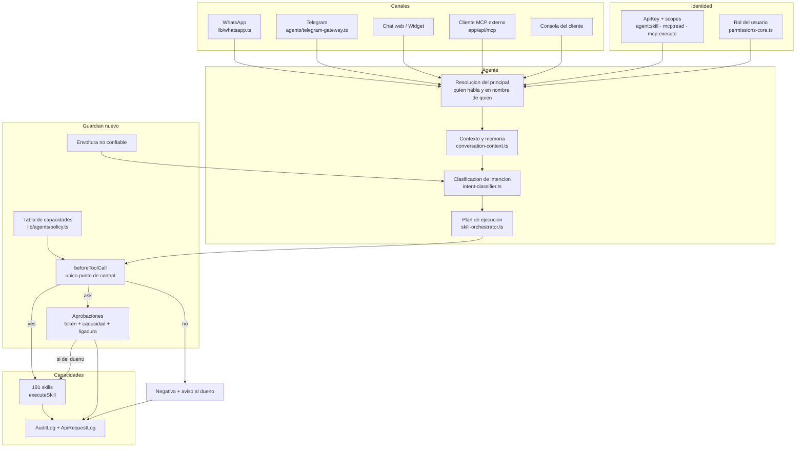

# Agente por cliente en Volkern — evaluación y plan de implementación

> **Origen de este documento.** Nace de la pregunta: ¿podemos integrar
> [open-instinct](https://github.com/mariagorskikh/open-instinct) para que cada cliente tenga un
> agente con el que controlar su información en Volkern?
>
> Todo lo que se afirma aquí sobre Volkern está medido sobre el código de este repositorio
> (recuentos de líneas con `wc -l`, inventario de skills, lectura de las rutas citadas). Todo lo que
> se afirma sobre Open Instinct está leído de su repositorio público y sus documentos, no de memoria.
> La fecha de medición es el 27 de octubre de 2026.

---

## 0. Resumen ejecutivo

**Veredicto: sí se puede, pero no integrando Open Instinct. Se puede —y conviene— portar cuatro
mecanismos de gobierno suyos a la capa de agente que Volkern ya tiene construida.**

La conclusión sale de una asimetría medida:

| | Open Instinct | Volkern |
|---|---|---|
| Lo que **ejecuta** (herramientas) | Composio (apps de terceros) | **191 skills** propias + 44 tools MCP |
| Lo que **identifica** (quién llama) | Inkbox (teléfono), Maritime (VM) | tenant + usuario + **ApiKey con scopes** |
| Lo que **gobierna** (qué puede hacer) | tabla de capacidades + guardián por llamada | disperso y, en la puerta ancha, **ausente** |

Volkern ya tiene los verbos y la identidad. Lo que le falta es exactamente el guardián. Open Instinct
es, en lo esencial, un guardián con un agente doméstico alrededor: su valor transferible son **la
tabla de capacidades, el punto único de control, la mecánica de aprobación y la auditoría legible**.
Su runtime (una microVM por persona, con escritorio Linux y `bash`) es la forma equivocada para un
SaaS multi-tenant, y su canal (iMessage vía Inkbox) no existe en el mercado de Volkern.

**El plan tiene una fase 0 bloqueante.** Antes de dar un agente a ningún cliente hay que cerrar una
puerta que hoy está abierta: el gateway de skills
(`app/api/skills/user/[userId]/execute/route.ts`) **no verifica la credencial que recibe**. Detalle
en la sección 4. No es un hallazgo colateral del plan: es la superficie sobre la que el agente
trabajaría y contra la que el guardián debe actuar.

**Esfuerzo estimado: 5 a 8 semanas de una persona para el piloto completo** (fases 0 a 5), con la
fase 0 en 1 o 2 días y un piloto mínimo sin canal nuevo en unas 3 semanas. Desglose en la sección 7.
Son estimaciones de orden de magnitud, no compromisos.

**Qué se entrega al cliente al final:** un agente en su canal (WhatsApp), que consulta y opera sobre
sus propios datos respetando el rol de quien pregunta, que pide aprobación humana para lo
irreversible y lo que mueve dinero, que se calla cuando debe callarse, y una pantalla donde el
cliente ve qué hizo su agente y puede apagarle la llave.

---

## 1. Qué es Open Instinct, medido

Repositorio público, licencia **MIT**, versión **0.1**, Node 22.19+ y pnpm 10. Nueve paquetes, 837
pruebas y un *smoke test* guionizado. Se autodefine como clon documentado de "Instinct".

| Pieza | Qué es |
|---|---|
| `packages/core` | Bucle de agente Pi, motor de políticas, memoria, planificador, aprobaciones, auditoría |
| `packages/inkbox` | iMessage, SMS, email, webhooks, transporte agente-a-agente |
| `packages/computer` | Escritorio Linux (Maritime `desktopd`) o Computers MCP alojado |
| `packages/apps` | Enrutador de herramientas de Composio (Gmail, Calendar, Contacts) |
| `packages/network` | Contactos, niveles de confianza, concesiones, invitaciones |
| `packages/payments` | Cartera Stripe Link: tarjetas de un solo uso aprobadas por el dueño |
| `packages/server` | Proceso del agente (`/health`, `/chat`, `/schedules`) |
| `packages/gateway` | Relay multiusuario y página de alta |
| `packages/cli` | El comando `instinct` |
| `skills/` | Guiones que sigue el agente |
| `docs/` | Arquitectura (29 KB), Permisos (18 KB), Seguridad (15 KB), Protocolo, Claves, Despliegue en Maritime (20 KB), Auto-hospedaje (20 KB), Pagos, Composio, Inkbox |

### 1.1 Cómo funciona

```
iPhone del dueño ──iMessage──▶ Inkbox ──webhook firmado──▶ gateway ──/chat──▶ Maritime ──▶ VM del agente
◀──────────────── el agente responde por Inkbox ◀────────────────────────────────┘
```

La pasarela (*gateway*) es un servicio siempre encendido que **no guarda estado de conversación y
nunca ve el modelo**: recibe el webhook firmado de Inkbox, lo verifica, descarta duplicados y lo
reenvía a la VM de esa persona. La VM duerme cuando nadie habla con ella y despierta en 1–3 s. Cada
persona tiene su propia microVM Firecracker con sus ficheros, memoria y secretos bajo `/data`:
**nada se comparte entre personas**.

### 1.2 El motor de permisos (lo que realmente importa)

Es la parte más madura del proyecto y la única cuyo diseño conviene copiar.

**Siete niveles de confianza**, definidos en `packages/core/src/policy.ts`, con una prueba que
compara la tabla con la documentación para que no diverjan:

`owner` · `staff` · `partner` · `family` · `friend` · `contact` · `stranger`

**Una veintena larga de capacidades** con cuatro veredictos posibles: `yes`, `ask` (permitido tras
aprobación explícita del dueño), `limit` (permitido dentro de una política de gasto) y `no`. Ejemplos:
`calendar.freebusy`, `calendar.read`, `calendar.write`, `email.read`, `email.send`, `purchase`,
`phone.call`, `computer.use`, `files.read`, `memory.write`, `trust.manage`.

**El guardián actúa dos veces.** Primero el constructor de prompt sólo ofrece al modelo las
herramientas que ese nivel podría llegar a usar; después `beforeToolCall` comprueba **cada llamada**
contra la tabla, las concesiones activas y la política de gasto. El guardián es código, no texto de
prompt: "los prompts se pueden convencer; el guardián no".

**La negativa nunca es silenciosa.** Cuando se deniega a alguien que no es el dueño pasan dos cosas:
el solicitante recibe un "no" educado y **el dueño recibe un aviso** ("el agente de Sam pidió leer tu
calendario; lo denegué"), con límite de un aviso por conversación y hora para que nadie le inunde el
teléfono. Cada aviso queda además en la auditoría con `ownerNotified: true`.

**Aprobaciones con mecánica bien pensada.** Un token por aprobación, con caducidad, ligado a *una
llamada exacta* (misma conversación, mismo solicitante, misma herramienta y mismos argumentos
hasheados; importe con 5 % de tolerancia). Un "sí" pelado sólo cuenta si se cumplen varias
condiciones a la vez: hay exactamente una aprobación pendiente, el texto es un veredicto corto, y
esa aprobación es la última cosa que el agente dijo. Las respuestas sólo valen desde canales
vinculados al dispositivo (iMessage, SMS, `chat`), **nunca desde email ni desde otro agente**. Y el
modelo no puede liquidar nada que mueva dinero: eso espera el "sí" literal del dueño.

**Envoltura de contenido no confiable.** Todo lo que el dueño no escribió (mensajes de terceros,
emails, páginas web, resultados de herramientas) se envuelve en `<untrusted source="…">`, borrando
antes cualquier etiqueta anidada para que el contenido no cierre el envoltorio. Se documenta
explícitamente que esto *reduce* la probabilidad de inyección pero no la elimina; por eso la última
línea es el guardián y no el prompt.

**Otras defensas:** guardián SSRF en `web_fetch` (resuelve cada nombre y rechaza loopback, rangos
privados, `localhost`, el rango de metadatos de nube; redirecciones a mano, máximo tres saltos, 1 MiB);
confinamiento de ficheros a `workspace/`; `bash` con un entorno sin variables que contengan
`KEY`, `SECRET`, `TOKEN`, `PASSWORD` o `CREDENTIAL`; y *takeover* para credenciales, 2FA y pagos —
el agente nunca teclea una contraseña ni una tarjeta, se lo pasa al humano en el escritorio.

### 1.3 La alta multiusuario

`POST /api/signup` ejecuta seis pasos guardando después de cada uno, de modo que un fallo **reanuda
en lugar de crear un segundo agente facturable**: crea la identidad de Inkbox, acuña una clave
limitada a esa identidad, crea la clave de firma de webhooks, suscribe los webhooks, crea la VM y
marca el registro como listo. Un teléfono que ya tiene agente recibe una respuesta neutra: ni se crea
un segundo agente ni se revela nada del registro existente.

---

## 2. Qué piezas merecen la pena y cuáles no

| Pieza | Veredicto | Motivo |
|---|---|---|
| Tabla de capacidades en código, con prueba por (actor × capacidad) | **Adoptar** | Es el núcleo que falta. Licencia MIT lo permite con atribución. |
| Punto único de control en cada llamada (`beforeToolCall`) | **Adoptar** | Mapea directo sobre `executeSkill`, que hoy no valida nada. |
| Semántica de aprobación (token, caducidad, ligadura a la llamada exacta, "sí" pelado) | **Adoptar** | Ya tenéis `ApprovalWorkflowService`; falta esta mecánica fina. |
| Negativa no silenciosa + aviso al dueño + entrada de auditoría | **Adoptar** | Es exactamente lo que un cliente espera de un agente que actúa por él. |
| Envoltura de contenido no confiable | **Adoptar** | Barato y reduce superficie de inyección en los canales que ya tenéis. |
| Auditoría legible por el dueño (`audit_read`, "¿qué hiciste hoy?") | **Adaptar** | Ya tenéis `AuditLog` y `ApiRequestLog`; falta la pantalla. |
| Niveles de confianza tal cual (`partner`, `family`, `friend`…) | **Traducir** | Vuestros actores son roles de tenant y agentes, no familiares. Ver sección 6. |
| Gateway de alta multiusuario | **No adoptar** | Ya tenéis alta de tenants, roles, planes y subdominios. |
| MicroVM por persona (Maritime) | **No adoptar** | 4 GiB y 2 vCPU por cliente, facturadas mientras está despierta. Tenéis cientos o miles de tenants, no un círculo familiar. |
| iMessage / Inkbox como canal | **No adoptar** | No hay WhatsApp, que es donde están vuestros clientes. Tenéis `lib/whatsapp.ts` y pasarela de Telegram como precedente. |
| Escritorio Linux, `bash`, ficheros (`computer.use`, `files.*`) | **No adoptar** | Es potencia que Open Instinct reserva al dueño de *su propia máquina*; entregársela al agente de un cliente sobre vuestro SaaS es sólo riesgo. |
| Composio como capa de herramientas | **No adoptar para módulos propios** | Vuestras 191 skills ya son las herramientas. Sólo tendría sentido para que el agente alcance apps **de terceros** del cliente (su Gmail, su Calendar). |
| Stripe Link / cartera de pagos | **No adoptar** | No encaja: el agente no debe pagar con tarjeta; debe **pedir aprobación** para cotizar, gastar o tocar nómina. |
| Modelo por defecto (Claude Fable 5.1) | **Decidir aparte** | Ya tenéis `gemma-router` y `gemma-app`. Ver decisiones abiertas. |

---

## 3. Lo que Volkern ya tiene

Esta sección existe para justificar la conclusión del resumen: **no hay que construir la capa de
agente, hay que gobernarla.**

### 3.1 La capa de agente, ya escrita (11.664 líneas en `lib/agents/`, más 506 en el servicio de aprobaciones)

| Fichero | Líneas | Papel |
|---|---|---|
| `lib/agents/intent-classifier.ts` | 4.128 | Clasificación de intención |
| `lib/agents/execution-engine.ts` | 1.330 | Ejecución |
| `lib/agents/skill-orchestrator.ts` | 1.276 | Intención → plan multi-paso; `INTENT_TO_SKILL` con **153** entradas |
| `lib/agents/chatwoot-chatbot-handler.ts` | 650 | Manejador de chatbot de canal |
| `lib/agents/response-formatter.ts` | 523 | Formato de respuesta al canal |
| `lib/agents/gemma-router.ts` | 444 | Enrutado al modelo |
| `lib/agents/telegram-gateway.ts` | 434 | Pasarela de canal (precedente directo) |
| `lib/agents/orchestrator.ts` | 406 | Orquestación |
| `lib/agents/security-checkpoint.ts` | 344 | Permisos por intent, aislamiento de tenant, límite de ritmo |
| `lib/agents/conversation-context.ts` | 303 | Contexto y memoria de conversación |
| `lib/agents/command-validator.ts` | 293 | Confirmación y aprobación **por intent** |
| `lib/agents/entity-extractor.ts` | 269 | Extracción de entidades |
| `lib/agents/confidence-checker.ts` | 234 | Umbral de confianza |
| `lib/agents/fact-extractor.ts` | 228 | Hechos |
| `lib/agents/telegram-chatbot.ts` | 220 | Chatbot del canal |
| `lib/agents/audit-logger.ts` | 136 | Auditoría del agente |
| `lib/agents/rate-limiter.ts` | 129 | Límite de ritmo |
| `lib/agents/fallback-agent.ts` | 123 | Reserva |
| `lib/agents/skill-registry.ts` | 102 | Registro |
| `lib/agents/moneda-tenant.ts` | 46 | Moneda del tenant |
| `lib/agents/index.ts` | 30 | Punto de entrada |
| `lib/agents/destructive-labels.ts` | 16 | Etiquetas destructivas |
| `lib/approval-workflow-service.ts` | 506 | Reglas por categoría, umbral de importe, rol aprobador, jerarquía, escalado |

Total: **11.664 líneas** en `lib/agents/` (22 ficheros) más **506** en el servicio de aprobaciones =
**12.170 líneas**.

### 3.2 Las capacidades, ya escritas (191 skills)

`lib/skills/` expone `skills`, `executeSkill` y `listSkills`, con **191 skills** repartidas en **47
ficheros de módulo** (contactos, leads, deals, cotizaciones, finanzas, nómina, RRHH, inventario,
marketing, anuncios, inmobiliario, seguros, hospitality, logística…). Es el catálogo de verbos del
agente, ya construido y ya probado.

### 3.3 La identidad y los scopes, ya escritos

- `lib/api-key-auth.ts` (575 líneas): `withTenantAuth`, `authenticateRequest`, `hasAnyScope`.
- Modelo `ApiKey`: `scopes[]`, `expiraEn`, `ultimoUso`, `totalUsos`, `rateLimitPerMin`,
  `revokedAt`/`revokedReason`, más etiqueta de partner y webhooks.
- Scopes ya en uso en las rutas: `leads:read|write`, `deals:read|write`, `erp:read|write` (33 usos
  cada uno), `config:read|write`, `catalogo:read`, `ads:read|write`, `campaigns:write`, `cms:read|write`,
  `insurance:read|write`, `automations:read|write`, `contacts:read|write`, `subscriptions:read`,
  `admin:write`, `orders:write`, `hr:read`… y los del agente: **`mcp:read`, `mcp:execute`, `agent:skill`**.
- `POST /api/users/me/skill-key` ya acuña una clave `vk_live_…` con `['agent:skill','mcp:execute','mcp:read']`.
- `app/api/mcp/route.ts`: MCP remoto con scopes, entitlements por tenant y límite por clave/usuario.
- `mcp-server/`: paquete npm con **44 tools** (43 nombres `volkern_*`) y flujo comercial completo.
- Modelos de auditoría: `AuditLog` (con `cambiosAntes`/`cambiosDespues`, `hash`, `metadata`) y
  `ApiRequestLog`.

### 3.4 Los canales, ya escritos

`lib/whatsapp.ts` (553), `lib/agents/telegram-gateway.ts` (434) + `telegram-chatbot.ts` (220),
`lib/agents/chatwoot-chatbot-handler.ts` (650). Es decir: el patrón "webhook de canal → resolver
identidad → bucle de agente → responder" **ya está resuelto dos veces** en el código.

### 3.5 La puerta de planes, ya escrita

`lib/plans.ts` define `CrmModule` con más de 50 módulos (55 identificadores contados), entre ellos
`chatbot_whatsapp`, `whatsapp`, `telegram`, `api_access` y `taskforce`. Un módulo nuevo (`agente_ia`)
encaja en el sistema de gating existente sin inventar nada.

### 3.6 Permisos de usuario, ya escritos

`lib/permissions-core.ts` (344) define **22 módulos** (`leads`, `citas`, `estudiantes`, `cursos`,
`automatizaciones`, `campanas`, `ads`, `mensajes`, `analytics`, `configuracion`, `equipo`,
`whitelabel`, `telefonia`, `pages` y siete de hospitality) y **19 acciones** (`ver`, `crear`, `editar`,
`eliminar`, `asignar`, `exportar`, `gestionar`, `inscribir`, `publicar`, `activar`, `enviar`,
`responder`, `invitar`, `cancelar`, `ver_todos`, `checkin`, `administrar`, `documento_completo`,
`roles`), con roles predefinidos (Superadmin, Admin, Sales Agent, Support, Instructor) y una jerarquía
de aprobación (`Viewer` < `Agent` < `Manager` < `Admin` < `Superadmin` < `OWNER`).

Dos matices del diseño que conviene no perder al unificar el vocabulario: `ver` y `ver_todos` están
separadas a propósito (abrir un módulo no concede los datos de los demás), y `cancelar` no es
`eliminar` (la reserva cancelada sigue existiendo con su historial). El guardián del agente debe
heredar esa distinción, no colapsarla.

### 3.7 La conclusión de inventario

Volkern tiene **dos vocabularios de permiso** que no se hablan entre sí —los *scopes* de API key
(`leads:read`) y los permisos de rol (`leads` + `ver`)— y **dos sitios donde vive la aprobación**
(`CommandValidatorAgent` por intent y `ApprovalWorkflowService` por categoría), mientras que el
punto por el que pasan *todas* las capacidades del agente, `executeSkill`, **no valida nada**:

```ts
export async function executeSkill<T extends SkillName>(
  skillName: T,
  payload: Parameters<typeof skills[T]>[0]
): Promise<ReturnType<typeof skills[T]>> {
  const skill = skills[skillName];
  if (!skill) {
    throw new Error(`Skill "${skillName}" no encontrado`);
  }
  return skill(payload as any) as ReturnType<typeof skills[T]>;
}
```

Ese es el hueco. Open Instinct lo tapa con `beforeToolCall`. El plan de la sección 7 es,
en esencia, poner ahí ese guardián y alimentarlo con una tabla de capacidades que unifique los dos
vocabularios existentes.

---

## 4. Hallazgo bloqueante: el gateway de skills no verifica la credencial

**Ubicación:** `app/api/skills/user/[userId]/execute/route.ts` (54 líneas) y, con la misma forma,
`app/api/skills/user/[userId]/[...slug]/route.ts`.

**Qué hace hoy:**

1. `middleware.ts` incluye `/api/skills` en la lista de rutas de API que **no pasan por la sesión**
   (junto a `/api/public/`, `/api/webhooks/`, `/api/cotizacion`, `/api/tarjeta`…). La ruta es pública
   por diseño del middleware.
2. La ruta comprueba únicamente que exista una cabecera que *empiece por* `"Bearer "`:

   ```ts
   const authHeader = req.headers.get('authorization');
   if (!authHeader?.startsWith('Bearer ')) {
     return NextResponse.json({ error: 'No autorizado' }, { status: 401 });
   }
   ```

   **El valor del token no se compara con nada.** No se llama a `authenticateRequest`, no se
   consulta `ApiKey`, no se comprueban scopes.
3. La identidad se toma de la **ruta**, no de la credencial:

   ```ts
   const { userId } = params;
   const user = await globalPrisma.user.findUnique({ where: { id: userId }, include: { tenant: true } });
   ```

4. Esa identidad se inyecta en la llamada, sobrescribiendo lo que mande el cliente:

   ```ts
   const payloadWithContext = { ...toolArgs, tenantId: user.tenantId, userId: user.id };
   const result = await executeSkill(tool as any, payloadWithContext);
   ```

**Por qué importa para esta iniciativa:** la posesión de un `userId` es, en la práctica, la
autorización completa sobre las 191 skills de ese tenant —incluidas finanzas, nómina, RRHH y las
operaciones destructivas— con cualquier cadena como token. No es que los `userId` (cuid) sean
triviales de adivinar: es que **el token no autoriza nada y la ruta sí**, así que cualquier filtración
de un identificador (en logs, en URLs compartidas, en capturas, en el propio panel, que lo muestra en
`components/hubs/PerfilDashboard.tsx`) equivale a una llave maestra. Además, los manifiestos públicos
`/.well-known/agent-card.json`, `/.well-known/ai-plugin.json` y `/.well-known/api-catalog` publican
este endpoint como punto de entrada para agentes.

**Alcance preciso de la afirmación.** He leído el fichero completo (54 líneas), el trato del
middleware hacia `/api/skills` y la implementación de `executeSkill`. Lo que afirmo es que la
credencial no se verifica y que la identidad viene de la ruta. **No he ejecutado una petición contra
un despliegue** para confirmarlo de punta a punta; hacerlo requiere un entorno con datos y es parte
de la fase 0.

**Corrección propuesta (fase 0).** Verificar con `authenticateRequest(req, ['agent:skill'])`, derivar
`tenantId`/`userId` de la clave verificada, rechazar con 403 cuando el `userId` de la ruta no
coincida con el de la credencial, y sacar `/api/skills` del bypass del middleware salvo los
documentos que no exponen datos (`openapi.yaml`, `SKILL.md`, `manifest.json`). Con su prueba de
regresión.

---

## 5. Arquitectura propuesta

Sin microVMs, sin canales nuevos de terceros: **el guardián dentro de Volkern, delante de las skills
que ya existen.**



Leyenda: el camino sólido es el que existe hoy. El **guardián** es lo nuevo, y su única puerta de
salida hacia las capacidades es `beforeToolCall`.

---

## 6. La tabla de capacidades

El vocabulario de capacidades **ya existe** en Volkern en dos formas incompatibles: los scopes de
API key (`leads:read`, `erp:write`) y los permisos de rol (módulo `leads` + acción `ver`). La tabla
los unifica: una capacidad es `modulo:accion`, que es el scope, y el rol del usuario se traduce a la
columna de actor.

**Actores** (traducción de los siete niveles de Open Instinct a la realidad de un tenant de Volkern):

| Actor | Quién es | Equivalente en Open Instinct |
|---|---|---|
| `titular` | El dueño de la cuenta (rol `OWNER`/`Superadmin`) | `owner` |
| `staff` | Empleados del cliente con rol (`Admin`, `Manager`, `Sales Agent`, `Support`, `Instructor`) | `staff` |
| `agente` | El agente de IA actuando **en nombre de** un usuario concreto del tenant | `staff` (sólo A2A) |
| `externo` | Persona de fuera que conversa con el cliente: un lead, un inquilino, un huésped | `contact` / `stranger` |

**Veredictos:** `si`, `pide` (requiere aprobación humana), `limite` (dentro de una política de
importe), `no`.

Ejemplo de tabla (extracto; la tabla completa va en `lib/agents/policy.ts`, con una prueba por celda):

| Capacidad | titular | staff | agente | externo |
|---|---|---|---|---|
| `leads:read` | si | si | si | no |
| `leads:write` | si | si | pide | no |
| `deals:read` | si | si | si | no |
| `deals:write` | si | si | pide | no |
| `erp:read` | si | si | si | no |
| `erp:write` | si | pide | pide | no |
| `ads:write` | si | pide | pide | no |
| `cotizaciones:*` | si | si | pide | no |
| `finanzas:*` | si | pide | pide | no |
| `hr:read` | si | si | no | no |
| `nomina:*` | si | no | no | no |
| `api_access` | si | no | no | no |
| `equipo:*` / `config:write` | si | no | no | no |
| `agente:gestionar` (revocar la llave, ver auditoría) | si | no | no | no |
| `booking:crear` (reservar en nombre de un externo) | si | si | pide | pide |

Dos reglas que toma de Open Instinct y conviene conservar:

1. **Las concesiones suman, nunca ensanchan por encima del titular.** Una concesión es una excepción
   con alcance y caducidad ("Sam puede reservarnos cena esta semana"), no un cambio de nivel.
2. **El "pide" no lo puede liquidar el modelo cuando hay dinero de por medio.** Cotizar, gastar o
   tocar nómina esperan el "sí" literal del humano.

**Un solo vocabulario para dos públicos.** Esta tabla gobierna a la vez el agente privado del cliente
(`titular`/`staff`/`agente`) y los bots públicos que ya existen (booking, portal inmobiliario,
chatbot), porque ahí el actor es `externo`. Hoy esa frontera está repartida entre
`security-checkpoint.ts`, `command-validator.ts` y los permisos de rol.

---

## 7. Plan por fases

Cada fase termina en algo verificable. Las estimaciones son de orden de magnitud para una persona.

### Fase 0 — Cerrar la puerta · 1–2 días · **bloqueante**

No se entrega un agente a un cliente sobre una puerta abierta, y además esta es la superficie que el
guardián va a gobernar, así que se arregla igualmente.

| Entregable | Dónde |
|---|---|
| Verificar la credencial con `authenticateRequest(req, ['agent:skill'])` | `app/api/skills/user/[userId]/execute/route.ts` |
| Derivar `tenantId`/`userId` de la clave; 403 si el `userId` de la ruta no coincide | mismo fichero |
| Sacar `/api/skills` del bypass de sesión salvo los documentos sin datos | `middleware.ts` |
| Pruebas de regresión: sin cabecera → 401; Bearer inventado → 401; clave de otro usuario → 403; clave válida con `agent:skill` → 200 | `tests/` |

**Criterio de aceptación:** una cadena arbitraria como `Authorization` no ejecuta ninguna skill.

### Fase 1 — Tabla de capacidades · ~1 semana

| Entregable | Dónde |
|---|---|
| Tabla `(actor × capacidad) → si/pide/limite/no`, con los scopes existentes como vocabulario | `lib/agents/policy.ts` (nuevo) |
| Traducción rol de Volkern → actor | mismo fichero + `lib/permissions-core.ts` |
| Mapa `skill → capacidad requerida`, con **denegación por defecto** para lo no mapeado | `lib/agents/skill-capabilities.ts` (nuevo) |
| Política de importes (`porAccion`, `porDia`, `preguntarPorEncima`, `nuncaSinPreguntar`) | `lib/agents/policy-spend.ts` (nuevo) |
| Prueba por celda, al estilo de Open Instinct (`policy.test.ts`) | `tests/agente-policy.test.ts` |

**Decisión de diseño a tomar aquí:** mapear las 191 skills es trabajo real. Se propone empezar por
los módulos del piloto (CRM de ventas: leads, deals, cotizaciones, tareas, contactos) y dejar el resto
en **denegado por defecto**, de modo que la tabla crece sin abrir huecos.

### Fase 2 — El guardián en el punto único · ~1 semana

| Entregable | Dónde |
|---|---|
| `beforeToolCall(principal, skill, args)` con la tabla, las concesiones y el importe | `lib/agents/policy-guard.ts` (nuevo) |
| `executeSkill` pasa por el guardián antes de invocar la skill | `lib/skills/index.ts` |
| Negativa con mensaje para el solicitante + aviso al titular + fila en `AuditLog` | guardián + `lib/agents/audit-logger.ts` |
| Envoltura `<untrusted>` de todo lo que no escribió el titular | `lib/agents/conversation-context.ts` |
| Pruebas: cada veredicto (`si`/`pide`/`limite`/`no`), aislamiento entre tenants, y que una skill no mapeada se deniega | `tests/agente-policy-guard.test.ts` |

**Criterio de aceptación:** ninguna skill se ejecuta sin pasar por el guardián, y una skill no mapeada
se deniega en lugar de ejecutarse.

### Fase 3 — Canal WhatsApp · 1–2 semanas

| Entregable | Dónde |
|---|---|
| Pasarela de WhatsApp con el patrón que ya usáis en Telegram: webhook → firma → identidad → agente → respuesta | `lib/agents/whatsapp-gateway.ts` (nuevo), sobre `lib/whatsapp.ts` |
| Resolución de principal por teléfono → usuario del tenant → actor | mismo fichero |
| Un hilo por (canal, teléfono) con memoria | `lib/agents/conversation-context.ts` |
| Límite de ritmo por conversación y por usuario | `lib/agents/rate-limiter.ts` |
| Pruebas: webhook sin firma → rechazo; teléfono desconocido → `externo`; teléfono del titular → `titular`; reintento del mismo evento → sin duplicado | `tests/agente-whatsapp.test.ts` |

### Fase 4 — Aprobaciones por texto · ~1 semana

Portar la mecánica fina de Open Instinct y **unificar las dos que ya tenéis** para que no diverjan:

| Entregable | Dónde |
|---|---|
| Token por aprobación, caducidad y ligadura a la llamada exacta (hash de skill + argumentos, importe ±5 %) | `lib/approval-workflow-service.ts` |
| Un "sí" pelado sólo cuenta bajo las condiciones estrictas; nunca desde un canal no vinculado; nunca para dinero | mismo fichero |
| `CommandValidatorAgent` pasa a leer la tabla de capacidades en vez de su lista propia de intents | `lib/agents/command-validator.ts` |
| Pruebas: token caducado; "sí" con dos aprobaciones pendientes; "sí" que no es el último mensaje; intento de liquidar dinero desde otro canal | `tests/agente-aprobaciones.test.ts` |

### Fase 5 — Auditoría y control para el cliente · 3–5 días

Es la parte que el cliente ve y la que más se usa ("¿qué hiciste hoy?").

| Entregable | Dónde |
|---|---|
| Pantalla "qué hizo mi agente": lecturas de `AuditLog` y `ApiRequestLog` por la clave del agente | `app/dashboard/...` |
| Apagar y rotar la llave del agente desde la interfaz | usa `ApiKey.revokedAt` + `POST /api/users/me/skill-key` |
| Módulo de plan `agente_ia` para la puerta de planes | `lib/plans.ts` |
| Prueba de que un tenant no ve la auditoría de otro | `tests/agente-auditoria.test.ts` |

### Fase 6 — Endurecimiento (opcional, ~1 semana)

Guardián SSRF si el agente llega a hacer `web_fetch`; límites diarios de acciones; `preguntarPorEncima`
en toda skill que mueva dinero; y revisión de la envoltura no confiable en los canales públicos.

### Resumen de esfuerzo

| Fase | Estimación | Acumulado |
|---|---|---|
| 0 Puerta | 1–2 días | 1–2 días |
| 1 Tabla | ~1 semana | ~1,5 semanas |
| 2 Guardián | ~1 semana | ~2,5 semanas |
| 3 WhatsApp | 1–2 semanas | ~4 semanas |
| 4 Aprobaciones | ~1 semana | ~5 semanas |
| 5 Auditoría | 3–5 días | ~6 semanas |
| 6 Endurecimiento | ~1 semana | ~7 semanas |

Las columnas son medias de una horquilla: la banda realista de las fases 0 a 5 va de **5 a 8
semanas**, y de las fases 0 a 6 de **6 a 9**.

**Piloto mínimo defendible: fases 0, 1, 2 y 5 sin canal nuevo** (el agente vive en la consola y por
MCP) ≈ **3 semanas**. Con WhatsApp, ≈ 6.

---

## 8. No-objetivos

Decidir esto por escrito ahorra discusiones después.

1. **No se despliega Open Instinct.** Se portan cuatro mecanismos, con atribución MIT donde
   corresponda; no se levanta su runtime.
2. **No hay una VM ni un escritorio por cliente.** El agente corre en el proceso de Volkern, sobre
   vuestros datos.
3. **No se da `bash`, ficheros ni escritorio al agente del cliente.** Es el nivel `owner` de Open
   Instinct sobre *su* máquina; aquí sería capacidad destructiva sobre vuestro SaaS sin ninguna
   ventaja.
4. **No se sustituye vuestro modelo de canales.** WhatsApp y Telegram ya existen; no se añade Inkbox.
5. **No se sustituye el catálogo de skills por Composio.** Composio sólo se valoraría para que el
   agente alcance apps de terceros del cliente, y como fase posterior.
6. **El agente no paga ni mueve dinero solo.** Cotizar, gastar y nómina son `pide`.
7. **No se promete que un cliente nuevo tenga agente el primer día.** La tabla crece por módulos y el
   resto queda denegado por defecto.

---

## 9. Riesgos

| Riesgo | Impacto | Mitigación |
|---|---|---|
| **La fase 0 no es sólo un bug**: hay que asumir que la superficie pudo usarse y revisar los `ApiRequestLog`/`AuditLog` de los últimos meses en busca de llamadas al gateway. | Alto | Fase 0 incluye esa revisión antes de seguir. |
| Mapear 191 skills es más trabajo del que parece y se hace a medias. | Medio | Denegación por defecto + empezar por los módulos del piloto. La tabla puede crecer sin abrir huecos. |
| Dos vocabularios de permiso que siguen divergiendo (scopes de API key y permisos de rol). | Medio | La fase 1 los unifica en una sola tabla; la fase 4 hace que `CommandValidatorAgent` lea de ahí. |
| Inyección de prompt desde el contenido que entra al agente (mensajes de un lead, páginas, correos). | Alto | Envoltura no confiable (fase 2) **y** guardián como última línea, no el prompt. |
| Coste de modelo por conversación. | Medio | `gemma-router` y límites por plan; medir antes de abrir a todos los tenants. |
| Un cliente le da su llave de agente a un tercero. | Medio | La llave es revocable y auditable por diseño (`ApiKey.revokedAt`, `ApiRequestLog`); la pantalla de la fase 5 lo hace evidente. |
| Expectativa comercial por delante de la realidad: "tu agente lo hace todo" antes de que exista la tabla. | Alto | El piloto se limita a CRM de ventas y se dice; el resto es `no` explícito hasta su fase. |

---

## 10. Decisiones abiertas

Ninguna bloquea las fases 0–2, que son las que hay que empezar.

1. **Canal del piloto.** ¿WhatsApp (donde está el mercado y ya hay `lib/whatsapp.ts`) o consola + MCP
   primero (más barato de probar, menos visible para el cliente)? *Recomendación: consola + MCP para
   validar el guardián, WhatsApp para el piloto real.*
2. **Modelo.** ¿Seguir con `gemma-router` o añadir un modelo mayor para el agente? Afecta coste por
   conversación y calidad de la clasificación de intención.
3. **Alcance del primer módulo.** Se propone CRM de ventas (leads, deals, cotizaciones, tareas,
   contactos) porque tiene el flujo completo y ya está documentado en
   `docs/crm-ventas-documento-tecnico.md`.
4. **¿El agente también para los bots públicos?** La tabla lo permite desde el primer día (actor
   `externo`), pero cambiar el comportamiento de los bots que ya están en producción merece su propia
   decisión.
5. **Atribución MIT.** Si se copia código de `packages/core/src/policy.ts` conviene decidir desde el
   inicio dónde se anota la procedencia; si sólo se copian las ideas y la tabla de veredictos, basta
   con citarlo en el documento.

---

## 11. Método y verificación

**Cómo se midió la parte de Volkern.** Recuentos con `wc -l` sobre los ficheros citados; inventario
de `lib/skills/` contando `export async function` por módulo; lectura íntegra de
`app/api/skills/user/[userId]/execute/route.ts` (54 líneas), del trato de `/api/skills` en
`middleware.ts`, de `executeSkill` en `lib/skills/index.ts`, de `lib/api-key-auth.ts`,
`lib/agents/command-validator.ts`, `lib/agents/security-checkpoint.ts`,
`lib/approval-workflow-service.ts`, `lib/permissions-core.ts`, `lib/plans.ts` y de los modelos
`ApiKey`, `ApiRequestLog` y `AuditLog` en `prisma/schema.prisma`.

**Cómo se midió la parte de Open Instinct.** Lectura de su `README.md`, del árbol completo del
repositorio vía la API de GitHub, de `docs/PERMISSIONS.md`, `docs/SECURITY.md` y
`docs/DEPLOY-MARITIME.md`. Commit de referencia: `cb3d97ca2322a6c53d0208155b7b5ab66c5ba0d4`.

**Lo que no se ha hecho.** No se ha ejecutado ninguna petición contra un despliegue para confirmar el
hallazgo de la sección 4 de punta a punta; no se ha levantado la aplicación; no se ha revisado el
contenido de `ApiRequestLog` de producción en busca de uso del gateway sin credencial; y no se ha
probado Open Instinct en ejecución (su propio README advierte que iMessage y Maritime se ejercitaron
"contra identidades reales durante el desarrollo" y que deben tratarse como beta).
