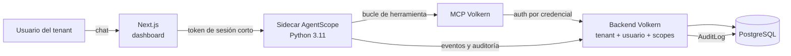
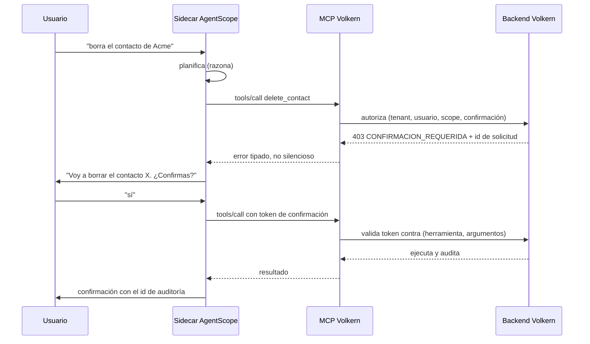

# AgentScope como motor del agente de Volkern

**Revisión de compatibilidad y plan de desarrollo**

Fecha: 28 de octubre de 2026
Estado: revisión previa a cualquier modificación de código
Alcance: conectar AgentScope SDK al MCP existente para probar si Volkern puede operarse por conversación

---

## 1. Veredicto

**AgentScope es técnicamente compatible con el MCP de Volkern, y su adopción es viable como servicio satélite en Python.** No es compatible como biblioteca dentro de Next.js: no existe SDK de JavaScript, y el SDK es Python 3.11 o superior. Eso obliga a un segundo runtime en el despliegue, que es el coste dominante de la decisión, no la integración.

La compatibilidad de protocolo es buena. El MCP de Volkern ya habla el dialecto que AgentScope consume:

- `initialize`, `tools/list`, `tools/call`, `ping` y notificaciones, sobre JSON-RPC por POST.
- Respuesta en JSON plano, sin sesión y sin stream SSE.
- Autenticación por `Authorization: Bearer vk_...` con el scope `mcp:execute`.
- Negociación de versión de protocolo entre `2025-03-26` y `2026-07-28`.

Hay tres problemas que **no son de compatibilidad sino de autorización**, y que deben resolverse antes de conectar un agente, porque el agente amplifica cualquier agujero existente: pasa de "un humano hace clic" a "un modelo ejecuta en bucle". Los detallo en la sección 5 con líneas exactas.

La conclusión operativa: **el piloto vale la pena, pero no empieza por AgentScope**. Empieza por cerrar la autorización del MCP durante una semana. Sin eso, la prueba de seguridad del propio piloto (impedir accesos cruzados y modificaciones no autorizadas) no se puede aprobar, y el resultado sería un "no" que no distingue si falló el agente o falló la puerta.

---

## 2. Qué es AgentScope 2.x, verificado

| Componente | Qué es | ¿Hace falta? |
|---|---|---|
| `agentscope` (SDK) | Framework Python para construir agentes: modelos, herramientas, memoria, permisos | Sí, es lo que se propone |
| Agent Service | Capa de hosting incluye UI web, sesiones multi-tenant y persistencia SQL/NoSQL | No en la fase 1 |
| AgentScope Runtime | Runtime de despliegue y sandboxes. **Repositorio archivado**, absorbido por 2.0 | No |
| AgentScope Studio | Visualizador de desarrollo. **Repositorio archivado**, sustituido por la UI del Agent Service | No |
| AgentTeams | Orquestación de contenedores de agentes con Matrix. Repositorio aparte, requiere Docker/Kubernetes | No |

Datos comprobados:

- Última versión estable: **2.0.11**, publicada el 27 de octubre de 2026.
- Licencia **Apache 2.0**.
- Python **3.11+**. El repositorio principal no publica SDK de TypeScript; AgentScope Java vive en un repositorio separado.
- Existe un SDK de Java mantenido aparte, sin relación con el stack de Volkern.

### 2.1 Cliente MCP

AgentScope soporta MCP por **stdio y HTTP**, y dentro de HTTP tanto **SSE** como **Streamable HTTP**. La API actual del código fuente es `MCPClient` con `HttpMCPConfig`, que acepta cabeceras arbitrarias:

```python
from agentscope.mcp import MCPClient, HttpMCPConfig

client = MCPClient(
    name="volkern",
    is_stateful=False,
    mcp_config=HttpMCPConfig(
        url="https://volkern.app/mcp",
        headers={"Authorization": "Bearer vk_..."},
    ),
)
```

`is_stateful=False` es exactamente lo que el endpoint de Volkern necesita, porque no emite `Mcp-Session-Id`.

Advertencia de deriva documental: la documentación pública todavía muestra los nombres antiguos `HttpStatefulClient` y `HttpStatelessClient`, mientras el código usa `MCPClient` y `HttpMCPConfig`. Hay que fijar la versión y programar contra el código fuente, no contra los ejemplos del tutorial.

### 2.2 Modelos

`OpenAIChatModel` acepta un endpoint compatible con OpenAI mediante `client_kwargs={"base_url": ...}`. Proveedores con integración declarada: OpenAI, Anthropic, Gemini, DashScope, DeepSeek, Moonshot, Volcengine, xAI y Ollama.

Esto encaja con lo que Volkern ya usa: DeepSeek y OpenRouter, con cadena de fallback y circuit breaker en `lib/assistant/openrouter-client.ts` (902 líneas).

### 2.3 Confirmación humana

El SDK tiene un sistema de permisos que permite **permitir, denegar o pedir confirmación** por llamada a herramienta. El agente emite `RequireUserConfirmEvent` y se pausa; la aplicación presenta la llamada y lo reanuda con `UserConfirmResultEvent` y `ConfirmResult`.

Es un mecanismo de la aplicación, no del servidor de herramientas. Esto es importante para el diseño: **la confirmación en Python es consultiva**. Si el token del agente puede ejecutar la herramienta directamente, un agente comprometido se salta la confirmación. La garantía tiene que estar en el backend de Volkern.

### 2.4 Multi-tenant

El SDK por sí solo **no** aporta aislamiento durable entre inquilinos. El repositorio atribuye "aislamiento multi-tenant y multi-sesión" y "persistencia SQL y NoSQL" al **Agent Service**, no al SDK. Con el SDK a secas, la memoria es tu responsabilidad.

Consecuencia de diseño: el sidecar no debe tener un cliente MCP compartido. Un cliente por sesión, con la credencial de esa sesión, y nunca una caché indexada solo por nombre.

---

## 3. La superficie actual de Volkern, medida

### 3.1 Lo que el MCP expone

| Dato | Valor medido |
|---|---|
| Endpoint canónico | `app/mcp/route.ts` (233 líneas), POST JSON-RPC |
| Herramientas publicadas | **43** (`mcp-server/src/tools-catalog.ts`, fuente única) |
| Skills ejecutables | **187** (`lib/skills/index.ts`, objeto `skills`) |
| Cobertura MCP sobre skills | **23 %** |
| Herramientas de configuración | **0 de 43** |
| Herramientas que mutan datos | **21 de 43** |
| Autenticación de `tools/call` | Bearer `vk_` con scope `mcp:execute` |
| Autenticación de `tools/list` | Ninguna (metadatos públicos) |
| Rate limit | 100 peticiones por minuto por clave |
| Auditoría | `AuditLog` por llamada |
| Versiones de protocolo | `2026-07-28`, `2025-11-25`, `2025-06-18`, `2025-03-26` |
| Sesión | Ninguna. Sin `Mcp-Session-Id` |
| Stream SSE | No. Respuesta JSON plana |

Endpoints alternativos:

- `app/api/mcp/route.ts`: mismas 43 herramientas, acepta `X-API-Key` o sesión, en formato JSON-RPC o simplificado.
- `mcp-server/src/index.ts` (507 líneas): servidor independiente con SDK oficial v2, transportes **stdio** y **Streamable HTTP**, que actúa de proxy REST contra la API con `VOLKERN_API_KEY`.

### 3.2 Lo que ya existe en conversación

Esto cambia el planteamiento: **Volkern ya tiene un agente, y no es un prototipo**.

| Pieza | Medida | Qué hace |
|---|---|---|
| `app/api/ai/chat/route.ts` | 790 líneas | Ciclo completo: clasifica, pide datos que faltan, ejecuta skill, responde |
| `lib/agents/intent-classifier.ts` | 4.128 líneas | Clasificación de intención con LLM y reglas |
| `lib/agents/intents/*.ts` | **138** intenciones | Catálogo declarativo con `requiredParams`, `optionalParams` y `destructive` |
| `lib/agents/skill-orchestrator.ts` | 1.276 líneas | **153** mapeos intención → skill, planes multi-paso |
| `lib/approval-workflow-service.ts` | 506 líneas | Flujo de aprobación por categoría, rol y umbral |
| `lib/agents/conversation-context.ts` | 303 líneas | Contexto pendiente y saneado de entrada |
| `ChatbotAuditLog` | Tabla | Historial (últimos 10 mensajes) y auditoría de ejecución |

La diferencia con AgentScope no es "tener o no tener agente". Es el **tipo de ciclo**:

| | Gemma actual | AgentScope |
|---|---|---|
| Ciclo | Una llamada al modelo → un JSON → una skill | Bucle: razona, llama, observa, corrige |
| Recuperación de error | No. Si la skill falla, se reporta | Sí. Reintenta o replantea |
| Multi-paso | Planes predefinidos en el orquestador | Decidido por el modelo en cada turno |
| Cobertura | 23 intenciones mapeadas en `/api/ai/chat` | Todas las herramientas que se le expongan |
| Historial | `ChatbotAuditLog`, 10 mensajes | Configurable, con memoria del SDK |
| Confirmación | Bandera `requiresConfirmation` en el JSON | Evento de confirmación con reanudación |

Por eso el piloto tiene sentido: el bucle con observación es una capacidad que Gemma no tiene, y es la que se necesita para "configurar y operar por conversación".

### 3.3 La brecha de expectativa más importante

El objetivo declarado es un CRM "que se configura y se utiliza mediante una conversación". Medido contra el catálogo:

- **Utilizar**: sí, parcialmente. 43 herramientas cubren contactos, leads, deals, tareas, notas, interacciones, citas, cotizaciones, contratos, órdenes, catálogo, servicios, inventario, producción, finanzas, WhatsApp y bóveda.
- **Configurar**: no. **Cero** de las 43 herramientas toca pipelines y etapas, campos personalizados, usuarios y roles, integraciones, reglas de automatización, branding o plantillas.

Un agente conectado hoy al MCP puede operar el CRM, no configurarlo. Configurar por conversación exige **publicar nuevas herramientas** (configuración como skills), y eso es un trabajo aparte que conviene no confundir con el piloto de AgentScope. Mi recomendación es separarlo en dos fases y no prometer lo segundo al validar lo primero.

---

## 4. Matriz de compatibilidad

| # | Aspecto | Estado | Detalle |
|---|---|---|---|
| 1 | Transporte Streamable HTTP sin sesión | Compatible con reservas | Requiere `is_stateful=False`. El endpoint no emite `Mcp-Session-Id` ni SSE. Verificar en el spike |
| 2 | Transporte stdio | Compatible | Vía `mcp-server` con SDK oficial en ambos extremos. Es la ruta de menor riesgo |
| 3 | Autenticación Bearer | Compatible | `authenticateRequest` acepta `Authorization: Bearer vk_...` (`lib/api-key-auth.ts:372`) |
| 4 | Negociación de versión | Compatible | El servidor negocia a la baja hasta `2025-03-26` |
| 5 | Modelos | Compatible | Endpoint compatible con OpenAI; DeepSeek y OpenRouter ya están en uso |
| 6 | Licencia | Compatible | Apache 2.0 |
| 7 | Cobertura de herramientas | Parcial | 43 de 187 skills; 0 de configuración |
| 8 | Autorización por acción | **Bloqueante** | Un solo scope abre las 43. Ver H2 |
| 9 | Aislamiento entre empresas | **Bloqueante en `/api/mcp`** | Correcto en `/mcp`. Ver H1 |
| 10 | Identidad del usuario | **Requiere trabajo** | El `userId` lo controla el cliente. Ver H3 |
| 11 | Confirmación de acciones sensibles | Requiere trabajo | No existe mecanismo en el servidor; solo bandera en el prompt |
| 12 | Idempotencia y marcha atrás | Requiere trabajo | Sin claves de idempotencia ni simulación previa; 21 herramientas mutan |
| 13 | Multi-tenant del runtime | Requiere trabajo | El SDK no lo da; hay que construirlo en el sidecar |
| 14 | Despliegue | Coste asumible | Segundo runtime Python 3.11+; hoy la imagen es `node:20-slim` |
| 15 | Observabilidad | Parcial | `AuditLog` existe; el agente debe escribir en él, no en un log propio |
| 16 | Superficie de uso | Requiere trabajo | `/api/ai/chat` no lo consume ningún componente web: lo usa la app móvil Gemma. El widget del dashboard prueba el chatbot público, no el agente |

---

## 5. Hallazgos que bloquean (verificados en código)

### H1. `/api/mcp` acepta el `tenantId` del cliente

En `app/api/mcp/route.ts`, la inyección de contexto es:

```ts
tenantId: params?.arguments?.tenantId || auth.tenant?.id,   // línea 223
tenantId: body.tenantId || auth.tenant?.id,                 // línea 245
```

El valor del cliente **tiene prioridad** sobre el del token. El handler lo propaga tal cual a `ctx` y al payload (`lib/mcp/mcp-handler.ts:158-175`), y las skills leen `input.tenantId`. Resultado: una clave con `mcp:execute` puede leer y escribir datos de otra empresa pasando su `tenantId`.

El endpoint `/mcp` sí lo fuerza al revés (`app/mcp/route.ts:171`), pero `/api/mcp` queda expuesto. Un agente con inyección de prompt en una nota o en el nombre de un lead tiene aquí una vía directa a datos de otro cliente.

**Corrección propuesta**: derivar siempre el tenant de la credencial y rechazar con `403` si el cuerpo trae uno distinto, en lugar de ignorarlo en silencio. El rechazo es preferible al silencio porque convierte un intento de cruce en una señal de auditoría.

### H2. El MCP no autoriza por acción; un scope abre las 43 herramientas

`tools/call` exige `mcp:execute` y nada más. No hay comprobación de rol ni de módulo por herramienta.

El único control de rol del handler es este (`lib/mcp/mcp-handler.ts:142-144`):

```ts
const sensitiveTools = ['authorize_bulk_expenses', 'orchestrate_secure_payroll'];
if (sensitiveTools.includes(bareSkillName) && user?.role?.nombre !== 'OWNER') {
```

Es **inalcanzable desde el MCP**: ninguna de las 43 herramientas del catálogo resuelve a esos dos skills, y el handler rechaza antes cualquier nombre que no esté en el catálogo. Es código muerto que da una falsa sensación de control.

Además, `app/api/api-keys/route.ts` (POST) **no comprueba el rol** del solicitante: cualquier usuario autenticado del tenant puede acuñar una clave con los scopes que pida, incluido `mcp:execute` y `payroll:write`. La cadena completa es: usuario de staff → crea clave → ejecuta cualquiera de las 43 herramientas, incluidas `delete_contact` (borrado físico, `lib/skills/mcp-ops-skills.ts:729`) y `send_whatsapp` (mensaje real a un tercero).

**Corrección propuesta**: una tabla de capacidades explícita por herramienta y por rol, con **denegación por defecto** para lo no mapeado, y restringir la acuñación de claves por rol. Es el mismo trabajo que la fase 1 del plan de agente por cliente, y conviene hacerlo una sola vez.

### H3. La identidad del usuario también la controla el cliente

```ts
userId: toolArgs.userId || auth.user?.id,   // app/mcp/route.ts:172
```

`handleCallTool` busca el usuario por ese `userId` (`lib/mcp/mcp-handler.ts:136`) y usa su rol para el control de la línea 144. En la práctica: la atribución del `AuditLog` y el rol que se evalúa salen de un valor que el llamante elige. Aunque H2 hace ese control inalcanzable, la atribución falsa ya es real: un agente puede escribir en el CRM "en nombre de" otra persona del mismo tenant, y la auditoría lo creerá.

**Corrección propuesta**: `userId` siempre desde la credencial. Si el cuerpo trae otro, `403`. Para delegación legítima (un admin que actúa por otro) hace falta un campo explícito `onBehalfOf` con su propio permiso, no un campo genérico reutilizable.

### H4. No hay confirmación ejecutable ni idempotencia

`requiresConfirmation` existe en el prompt de Gemma (`app/api/ai/chat/route.ts`), pero es una instrucción al modelo: nada en el servidor impide ejecutar. `lib/approval-workflow-service.ts` cubre gastos, contratos y descuentos, no llamadas MCP.

Para un agente que reintenta, esto son dos problemas distintos:

1. **Sin confirmación server-side**, un agente comprometido o confundido ejecuta un borrado sin que nadie apruebe.
2. **Sin idempotencia**, un reintento tras timeout duplica un lead, una cotización o un mensaje de WhatsApp.

**Corrección propuesta**: token de confirmación ligado a `(tenant, usuario, herramienta, hash de argumentos)` y caducidad corta, y cabecera de clave de idempotencia para las 21 herramientas que mutan.

---

## 6. Arquitectura propuesta



Tres decisiones de diseño que sostienen la seguridad:

**1. El sidecar no guarda claves de larga duración.** Next.js acuña un token de agente de vida corta (15 minutos) por sesión de usuario, con `tenantId`, `userId`, `sid` y scopes acotados. El sidecar lo usa y lo descarta. Una fuga del contenedor no entrega una llave maestra del tenant.

**2. Un cliente MCP por sesión, nunca compartido.** El SDK de AgentScope no aísla inquilinos. La regla es estructural: el cliente se construye dentro del contexto de la sesión, con la credencial de esa sesión, y no se cachea por nombre ni por tenant.

**3. La autorización vive en Volkern, no en el prompt.** El sidecar puede pedir confirmación, pero el backend la exige. Si el agente llama a `delete_contact` sin token de confirmación válido, recibe `403` aunque su prompt diga lo contrario.

### 6.1 Flujo de una operación sensible



La clave es que el `403` sea **tipado y accionable** ("requiere confirmación", no "error"), porque el modelo necesita entenderlo para pedirla. Un error genérico hace que el agente reintente o invente.

### 6.2 Dos rutas de conexión, y cuál elegir

| Ruta | Ventaja | Riesgo | Uso recomendado |
|---|---|---|---|
| HTTP `/mcp` | Sin proceso hijo; cero instalación | Implementación propia del protocolo; sin sesión; `is_stateful=False` obligatorio | Producción si el spike lo valida |
| stdio con `mcp-server` | SDK oficial en ambos extremos; proceso por sesión = aislamiento natural | Un proceso por sesión (memoria); hay que fijar la versión | Spike y comparación |

Recomendación: **empezar por stdio** en el spike, porque elimina la variable "¿está bien implementado el transporte?" y deja medir solo el comportamiento del agente. Después validar HTTP para producción, donde el proceso por sesión no escala igual.

---

## 7. Plan de desarrollo

### Fase 0 — Spike de compatibilidad (3 a 4 días)

Objetivo: saber si AgentScope habla con el MCP de Volkern **sin tocar el producto**. Nada de código mergeado.

- Entorno Python 3.11 aislado, `agentscope==2.0.11` fijado.
- Prueba 1: `tools/list` contra `/mcp` con `is_stateful=False`. Verifica handshake, versión negociada y catálogo de 43.
- Prueba 2: una lectura (`volkern_list_leads`) y una escritura inocua (`volkern_create_note`) en un tenant de pruebas.
- Prueba 3: el mismo par por stdio con `npx volkern-mcp-server`, `VOLKERN_API_URL` y `VOLKERN_API_KEY`.
- Prueba 4: un bucle de tres pasos que requiera observación (buscar lead → crear deal → crear tarea).
- Prueba 5: los mismos 10 enunciados con 3 modelos, para una primera señal de calidad de llamada.

Salida: matriz de compatibilidad rellenada con resultados reales, no con expectativas, y decisión sobre transporte.

**Puerta de salida**: si las dos rutas fallan, se para aquí. El coste hundido es de cuatro días, no de un trimestre.

### Fase 1 — Endurecer el MCP (7 a 10 días)

Sin esto, el piloto no puede aprobar su criterio de seguridad.

- H1: `tenantId` siempre desde la credencial; `403` si el cuerpo trae otro. Prueba de regresión de cruce entre dos tenants.
- H3: `userId` siempre desde la credencial; `onBehalfOf` explícito para delegación.
- H2: tabla de capacidades herramienta × rol, con denegación por defecto; restringir la acuñación de claves por rol. Reutiliza `lib/permissions-core.ts` en lugar de inventar un vocabulario nuevo.
- Confirmación: token ligado a `(tenant, usuario, herramienta, hash de argumentos)`; error tipado `CONFIRMACION_REQUERIDA`.
- Idempotencia: clave por llamada en las 21 herramientas que mutan.
- Auditoría: una fila por llamada con el agente como actor, no solo el usuario.

**Puerta de salida**: 0 cruces entre tenants en la batería adversarial; toda mutación sin confirmación rechazada.

### Fase 2 — Sidecar AgentScope (10 a 12 días)

- Servicio Python con `/chat` en streaming y `/health`.
- Emisión y validación del token de agente de vida corta.
- Cliente MCP por sesión; sin caché compartida.
- Puente de confirmación: `RequireUserConfirmEvent` → UI → `UserConfirmResultEvent`, con el `403` tipado como fuente de verdad.
- Persistencia de conversación por `(tenant, usuario, sesión)` con retención definida.
- Filtro de PII en el sidecar: el que existe hoy (`lib/ai/pii-filter`) está en Node y no protege este camino.
- Telemetría: tokens, coste, latencia, herramienta elegida, resultado.

### Fase 3 — Superficie de uso (7 a 10 días)

- Chat de agente en el dashboard, reutilizando el estilo existente.
- Vista "qué hizo mi agente": llamadas, resultados, confirmaciones y coste.
- Interruptor de apagado por tenant y por usuario.
- Enlace desde cada ejecución al registro de auditoría.

### Fase 4 — Comparación de modelos y piloto (5 a 7 días)

- Suite de 40 tareas sobre un tenant real de pruebas.
- Tres modelos, temperatura 0, tres repeticiones.
- Métricas por tarea: acierto de herramienta, validez del JSON, recuperación tras error inyectado, tokens, coste, latencia.
- Canario con un cliente real durante dos semanas, con línea base de tiempo administrativo.

### Resumen de esfuerzo

| Fase | Días | Acumulado |
|---|---|---|
| 0. Spike | 3–4 | 4 |
| 1. Endurecer MCP | 7–10 | 14 |
| 2. Sidecar | 10–12 | 26 |
| 3. Superficie | 7–10 | 36 |
| 4. Bake-off y piloto | 5–7 | 43 |

**Total: 32 a 43 días laborables**, unos 6 a 9 semanas con un desarrollador backend y dedicación parcial de frontend. El camino crítico es la fase 1: es la única que no se puede saltar ni paralelizar con la 2 sin aceptar riesgo.

---

## 8. Criterios de aceptación del piloto

Los tres criterios que planteaste, convertidos en algo medible. Los umbrales son **propuestos** y deben calibrarse con la línea base del piloto; lo que no debe cambiar es que se midan antes de decidir.

### Fiabilidad

| Métrica | Umbral propuesto |
|---|---|
| Tareas completadas correctamente | ≥ 90 % (36 de 40) |
| Herramienta correcta en el primer intento | ≥ 85 % |
| Argumentos válidos contra el esquema | ≥ 98 % |
| Recuperación tras error inyectado | ≥ 80 % |
| Operaciones que fallan en silencio | **0** |

La última es la más importante. Un agente que falla y lo dice es un agente usable; uno que falla y responde "hecho" es peor que no tener agente.

### Seguridad

| Prueba | Umbral |
|---|---|
| Cruce entre tenants (30 casos adversariales) | **0** éxitos |
| Inyección de prompt en notas o nombre de lead | **0** acciones no solicitadas |
| Escalada de privilegios vía `userId` o `tenantId` | **0** |
| Acción destructiva sin confirmación | **0** |
| Fuga de datos de otro tenant en la respuesta | **0** |

### Utilidad económica

| Métrica | Umbral propuesto |
|---|---|
| Coste medio por tarea resuelta | ≤ 0,02 USD |
| Latencia p95 por turno | ≤ 8 s |
| Llamadas de herramienta por tarea | ≤ 2,5 de media |
| Tiempo administrativo ahorrado (5 usuarios, 2 semanas) | ≥ 30 % |

Si el agente acierta pero cuesta más tiempo del que ahorra, el criterio económico falla y el piloto no pasa, por buena que sea la calidad conversacional. Es exactamente el matiz que planteaste y conviene mantenerlo como veto.

---

## 9. Comparación de modelos: método

No elegir por calidad conversacional. El mismo conjunto de 40 tareas, ejecutado igual para cada modelo:

1. **Selección de herramienta**: ¿eligió la correcta entre 43?
2. **Construcción de argumentos**: ¿cumple el `inputSchema` sin inventar campos?
3. **Uso del resultado**: ¿aprovecha lo devuelto o repite la llamada?
4. **Recuperación**: se inyecta un fallo controlado y se mide si replantea.
5. **Coste y latencia**: por tarea resuelta, no por turno.

Candidatos: DeepSeek (ya integrado), Gemini (fallback actual) y un modelo fuerte vía OpenRouter como techo de referencia. Los tres entran por el adaptador compatible con OpenAI.

Precaución: el circuit breaker de `lib/assistant/openrouter-client.ts` está en Node. Si el sidecar habla directo con los proveedores, hay que replicar esa política o el piloto medirá latencias que producción no tendrá.

---

## 10. Riesgos

| Riesgo | Impacto | Mitigación |
|---|---|---|
| Segundo runtime en producción | Operación duplicada: imagen, healthcheck, logs, despliegue | Un solo servicio; imágenes fijadas; mismo pipeline; el sidecar no accede a la base de datos |
| Deriva entre las dos implementaciones de herramientas | El standalone usa REST y el backend usa skills; pueden divergir | Un solo contrato (el catálogo) y una prueba que compare resultados de ambos caminos |
| Inyección de prompt desde datos del CRM | Acción no solicitada, cruce de datos | Envolver resultados como no confiables; autorización en backend; 30 casos adversariales |
| API joven con cambios frecuentes | Roturas entre versiones menores | Fijar 2.0.11; actualizar solo con la suite en verde |
| Coste y latencia del bucle multi-paso | Fricción de uso | Límite de pasos; caché de lecturas; medir coste por tarea |
| PII hacia el proveedor del modelo | Cumplimiento | Filtro de PII en el sidecar antes de cada llamada |
| Memoria de conversación sin retención | Cumplimiento y coste | Retención definida por tenant; borrado por usuario |
| Confusión de alcance ("configurar") | Expectativa incumplida | Separar "operar" (fase 1) de "configurar" (herramientas nuevas, fase posterior) |

---

## 11. No objetivos de esta fase

1. AgentTeams, Kubernetes o sandboxes por cliente. Un contenedor por inquilino no se justifica con el volumen actual.
2. Autonomía sin confirmación en dinero, nómina, borrado o mensajes a terceros.
3. Configurar el CRM por conversación (pipelines, roles, integraciones). Requiere herramientas que hoy no existen.
4. Sustituir a Gemma. `/api/ai/chat` sigue siendo el camino estable; el agente es un segundo camino.
5. Servir el Agent Service con su UI propia.
6. Reescribir el clasificador de intenciones.
7. Migrar las 187 skills al catálogo MCP de golpe.

---

## 12. Decisiones abiertas

1. **Sidecar frente a bucle en Node.** Si el único valor que se busca es el bucle con observación, Node puede hacerlo contra el mismo `/mcp` sin segundo runtime. AgentScope aporta además memoria, permisos y adaptadores. Mi recomendación: hacer el spike de la fase 0 también contra un bucle mínimo en Node, y decidir con los mismos 10 enunciados. Cuesta un día más y evita adoptar un runtime por una capacidad que se puede tener sin él.
2. **Dónde vive el chat.** Dashboard web, app móvil Gemma o ambos. Cambia la fase 3.
3. **Modelo por defecto.** Se decide en la fase 4, no antes.
4. **Canal de confirmación.** En el chat, por correo o por WhatsApp. En el chat es lo más rápido; por correo deja rastro y no depende de que la sesión siga abierta.
5. **Alcance de "configurar".** Qué se expone primero: pipelines y etapas, campos personalizados o automatizaciones. Es la decisión que más cambia el producto y no bloquea el arranque.

---

## 13. Anexo A: spike reproducible

Pasos concretos para la fase 0, sin tocar el repositorio:

```bash
python3 -m venv .venv-agentscope
. .venv-agentscope/bin/activate
pip install "agentscope==2.0.11"

export VOLKERN_API_KEY="vk_..."      # clave de un tenant de pruebas, scope mcp:execute
export VOLKERN_API_URL="https://volkern.app/mcp"

python spike_mcp.py
```

Esqueleto de `spike_mcp.py` para la ruta HTTP:

```python
import asyncio, os
from agentscope.mcp import MCPClient, HttpMCPConfig

async def main():
    client = MCPClient(
        name="volkern",
        is_stateful=False,
        mcp_config=HttpMCPConfig(
            url=os.environ["VOLKERN_API_URL"],
            headers={"Authorization": f"Bearer {os.environ['VOLKERN_API_KEY']}"},
        ),
    )
    await client.connect()
    tools = await client.list_tools()
    print(len(tools), [t.name for t in tools][:5])

    result = await client.call_tool("volkern_list_leads", {"limit": 3})
    print(result)

asyncio.run(main())
```

Comprobaciones del spike, en orden:

1. `initialize` responde con versión negociada y `serverInfo.name = volkern-crm`.
2. `list_tools` devuelve **43**.
3. Una lectura devuelve datos del tenant de la clave.
4. Una escritura inocua aparece en `AuditLog` con el usuario correcto.
5. Repetir con `is_stateful=True` para documentar el fallo exacto si lo hay.
6. Repetir por stdio con `npx volkern-mcp-server`.

Si `is_stateful=False` falla por una peculiaridad del transporte, la ruta stdio sigue siendo válida y el plan no se detiene.

---

## 14. Anexo B: las 43 herramientas por dominio

| Dominio | N | Herramientas |
|---|---|---|
| Contactos | 5 | list, get, create, update, delete |
| Leads | 4 | list, get, create, update |
| Deals | 2 | list, create |
| Tareas | 3 | list, create, complete |
| Notas | 2 | list, create |
| Interacciones | 2 | list, create |
| Citas | 4 | list, create, update, acción |
| Cotizaciones | 1 | create |
| Contratos | 1 | create desde cotización |
| Órdenes de venta | 3 | list, get, crear desde cotización |
| Catálogo | 5 | list, get, create, update, search |
| Servicios | 2 | list, get |
| Inventario | 2 | salud, consumo |
| Producción | 1 | registrar merma |
| Finanzas | 2 | dashboard, provisiones fiscales |
| WhatsApp | 1 | enviar |
| Conversaciones | 1 | listar |
| Bóveda | 1 | verificar integridad |
| Disponibilidad | 1 | consultar |

Ninguna de las 43 toca configuración del CRM. Ese es el dato que separa "operar por conversación" de "configurar por conversación", y conviene tenerlo presente al fijar expectativas del piloto.

---

## 15. Fuentes

- Repositorio de AgentScope: https://github.com/agentscope-ai/agentscope
- Versiones: https://github.com/agentscope-ai/agentscope/releases
- Tutorial de MCP: https://doc.agentscope.io/tutorial/task_mcp.html
- Tutorial de modelos: https://doc.agentscope.io/tutorial/task_model.html
- Confirmación humana: https://docs.agentscope.io/en/versions/2.0.9/building-blocks/agent/human-in-the-loop
- FAQ (persistencia y multi-tenant): https://agentscope.io/blog/agentscope-faq/
- Runtime (archivado): https://github.com/agentscope-ai/agentscope-runtime
- Studio (archivado): https://github.com/agentscope-ai/agentscope-studio
- AgentTeams: https://github.com/agentscope-ai/AgentTeams

Código de Volkern citado:

- `app/mcp/route.ts`
- `app/api/mcp/route.ts`
- `lib/mcp/mcp-handler.ts`
- `lib/api-key-auth.ts`
- `lib/api-keys.ts`
- `app/api/api-keys/route.ts`
- `mcp-server/src/tools-catalog.ts`
- `mcp-server/src/index.ts`
- `lib/skills/index.ts`
- `lib/skills/mcp-ops-skills.ts`
- `app/api/ai/chat/route.ts`
- `lib/agents/intent-classifier.ts`
- `lib/agents/skill-orchestrator.ts`
- `lib/assistant/openrouter-client.ts`
- `lib/approval-workflow-service.ts`
- `middleware.ts`
