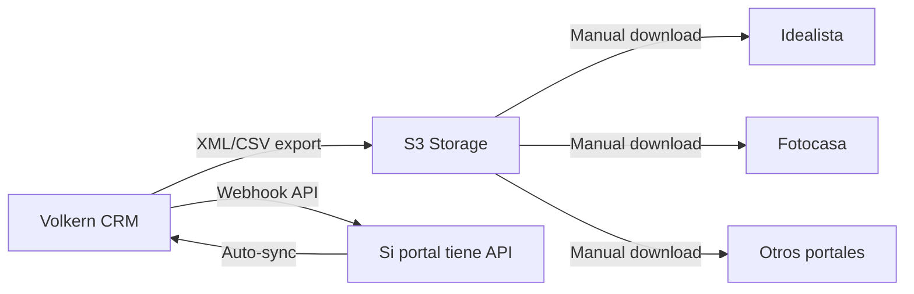

# 🏠 Consideraciones Técnicas — Módulo Inmobiliario Volkern CRM

> **Documento de análisis:** 7 decisiones críticas que deben resolverse antes de implementar el plan inmobiliario.
> Basado en auditoría del código base real (schema.prisma, API routes, skills, componentes).

---

## 📋 Tabla de Contenidos

1. [Arquitectura de Base de Datos: PostgreSQL y JSON Path](#1-arquitectura-de-base-de-datos-postgresql-y-json-path)
2. [Preset de Campos Inmobiliarios Existente](#2-preset-de-campos-inmobiliarios-existente)
3. [Modelo de Datos: Extensión vs. Tabla Separada para Inmuebles](#3-modelo-de-datos-extensión-vs-tabla-separada-para-inmuebles)
4. [Pipeline de Ventas: Único vs. Paralelo para Inmuebles](#4-pipeline-de-ventas-único-vs-paralelo-para-inmuebles)
5. [Integración con Portales: API vs. XML/CSV](#5-integración-con-portales-api-vs-xmlcsv)
6. [Stripe Connect y Split Payments](#6-stripe-connect-y-split-payments)
7. [Portal Público: Puck vs. API Independiente](#7-portal-público-puck-vs-api-independiente)

---

## 1. Arquitectura de Base de Datos: PostgreSQL y JSON Path

### Estado Actual
El `schema.prisma` confirma:

```prisma
datasource db {
  provider = "postgresql"
  url      = env("DATABASE_URL")
}
```

### Implicación
**PostgreSQL soporta JSON Path de forma nativa** (`customFieldValues::jsonb @> '{"status": "disponible"}'`). El plan puede filtrar propiedades por `customFieldValues` sin problemas de rendimiento, **siempre que se agreguen índices GIN** sobre la columna `customFieldValues` de `CatalogoItem`.

### Recomendación
- ✅ **Agregar índice GIN** en `CatalogoItem.customFieldValues` en la migración inicial
- ✅ Usar `JSONB` queries nativas de PostgreSQL (Prisma `$queryRaw` o `WHERE` con casts)
- ❌ **No usar** `path: '$.status'` de Prisma — no está soportado para filtros JSON en queries directas. Usar `$queryRaw` o agregar filtro en capa de aplicación

```sql
-- Índice recomendado
CREATE INDEX idx_catalogo_item_inmueble_status 
ON catalogo_items USING gin (custom_field_values jsonb_path_ops)
WHERE tipo = 'inmueble' AND activo = true;
```

### Decisión requerida
> **¿Confirmas que la base de datos en producción es PostgreSQL?**

---

## 2. Preset de Campos Inmobiliarios Existente

### Estado Actual
En `app/api/catalogo/field-definitions/presets/route.ts` **ya existe un preset completo** para `inmobiliaria`:

```typescript
inmobiliaria: [
  { fieldKey: 'tipo_operacion', label: 'Tipo de Operación', type: 'select', 
    options: ['Venta', 'Renta', 'Traspaso'], required: true },
  { fieldKey: 'tipo_inmueble', label: 'Tipo de Inmueble', type: 'select', 
    options: ['Casa', 'Departamento', 'Oficina', 'Local Comercial', 'Terreno', 'Bodega'] },
  { fieldKey: 'superficie_total', label: 'Superficie Total', type: 'number', unidad: 'm²', required: true },
  { fieldKey: 'superficie_construida', label: 'Superficie Construida', type: 'number', unidad: 'm²' },
  { fieldKey: 'habitaciones', label: 'Habitaciones', type: 'number' },
  { fieldKey: 'banos', label: 'Baños', type: 'number' },
  { fieldKey: 'estacionamientos', label: 'Estacionamientos', type: 'number' },
  { fieldKey: 'antiguedad', label: 'Antigüedad', type: 'number', unidad: 'años' },
  { fieldKey: 'amueblado', label: 'Amueblado', type: 'boolean' },
  { fieldKey: 'direccion', label: 'Dirección', type: 'text' },
  { fieldKey: 'zona', label: 'Zona/Colonia', type: 'text' },
  { fieldKey: 'amenidades', label: 'Amenidades', type: 'textarea' },
]
```

También existe un endpoint `POST /api/catalogo/field-definitions/presets` con body `{ industria: "inmobiliaria" }` que aplica el preset a un tenant.

### Recomendación
- ✅ **NO crear** `lib/real-estate/property-extension.ts` desde cero
- ✅ **Extender** el preset existente agregando campos faltantes (lat/lng, yearBuilt, elevator, pool, featured, estado)
- ✅ El `POST /api/catalogo/field-definitions/presets` ya crea `CatalogoFieldDefinition` por tenant
- ✅ Luego crear `usePropertyFields()` que lea desde `CatalogoFieldDefinition` y valide contra el preset

### Decisión requerida
> **¿Aceptas usar el preset `inmobiliaria` existente como base y extenderlo, o prefieres crear uno nuevo separado?**

---

## 3. Modelo de Datos: Extensión vs. Tabla Separada para Inmuebles

### Estado Actual
- `CatalogoItem` (línea 3017 del schema) se usa actualmente para **servicios/productos industriales** (con `isManufactured`, `isStockable`, `requiresQualityControl`)
- Tiene `customFieldValues: Json?`, `media: Json?`, `pricing: Json?`, `categorias: String[]`, `etiquetas: String[]`
- `Cita` (línea 654) **ya tiene** `catalogoItemId` — perfecto para visitas a propiedades
- El AI generator en `app/api/ai-generator/route.ts` ya reconoce el bloque `'v-catalog-card': Catálogo/Inmuebles`

### Opciones

#### Opción A: Extender CatalogoItem (como propone el plan original)
| Pros | Contras |
|---|---|
| Mínimo cambio en schema | Consultas tipo "3 hab en Madrid" requieren índices GIN específicos |
| Reutiliza `Cita.catalogoItemId` ya existente | Campos tipados vs. JSON (sin autocompletado en Prisma) |
| Reutiliza UI de catálogo existente | `CatalogoItem` se mezcla con productos industriales |
| Sin migración de datos | Crecimiento de tabla compartida |

#### Opción B: Modelo `Inmueble` separado con link a CatalogoItem
```prisma
model Inmueble {
  id             String   @id @default(cuid())
  catalogoItemId String   @unique // Relación 1:1 con CatalogoItem
  tipoInmueble   String
  tipoOperacion  String
  direccion      String
  ciudad         String
  provincia      String
  latitud        Float?
  longitud       Float?
  superficieM2   Float
  habitaciones   Int      @default(0)
  banos          Int      @default(0)
  // ...campos tipados...
  catalogoItem   CatalogoItem @relation(fields: [catalogoItemId], references: [id])
}
```

| Pros | Contras |
|---|---|
| Campos tipados con validación nativa | Migración de schema |
| Queries eficientes sin JSON | Desvío del plan actual |
| Separación clara de dominio inmobiliario vs. industrial | Mantener sincronía con CatalogoItem |
| Índices nativos en cada columna | Más código boilerplate |

#### Opción C: Híbrido (Recomendada para MVP)
- Usar `CatalogoItem.tipo = "inmueble"` para el MVP
- Crear **vista materializada** o función `get_inmuebles()` que filtre y mapee
- Agregar índices GIN y compuestos
- Evaluar migración a tabla separada en v2 cuando haya datos suficientes para justificarlo

### Decisión requerida
> **¿Qué opción prefieres?**
> - **A** — Extensión pura de CatalogoItem (mínimo cambio, máximo reaprovechamiento)
> - **B** — Modelo Inmueble separado (más robusto, más trabajo inicial)
> - **C** — Híbrido: MVP con CatalogoItem, migrar a tabla separada en v2

---

## 4. Pipeline de Ventas: Único vs. Paralelo para Inmuebles

### Estado Actual
- `PipelineStage` (línea 2237 del schema) con campos: `nombre`, `orden`, `probabilidad`, `color`, `esEtapaFinal`, `tipoEtapaFinal`
- `Deal.etapa` es un `String` libre, linkeado por nombre a `PipelineStage.nombre`
- Existe API completa en `app/api/pipeline/stages/route.ts` (CRUD de etapas)
- No existe concepto de "pipelines múltiples" o "categorías de pipeline"

### Opciones

#### Opción A: Renombrar pipeline global
Reemplazar las etapas actuales del tenant con las etapas inmobiliarias. Todos los deals usan el mismo pipeline.

**Problema:** Si el tenant ya tiene deals activos con etapas antiguas, se rompen.

#### Opción B: Múltiples pipelines (recomendada)
Agregar un campo `categoria` a `PipelineStage`:

```prisma
model PipelineStage {
  // ...campos existentes...
  categoria  String  @default("default") // "default" | "real_estate" | ...
}
```

O crear un modelo `Pipeline` separado:
```prisma
model Pipeline {
  id        String   @id @default(cuid())
  tenantId  String
  nombre    String
  categoria String   @default("default")
  stages    PipelineStage[]
}
```

**Ventaja:** Un tenant puede operar CRM general + inmobiliario simultáneamente.

### Decisión requerida
> **¿Quieres que el pipeline inmobiliario reemplace al existente, o que coexistan como pipelines paralelos?**
> 
> Pipeline inmobiliario sugerido: **Contacto → Visita programada → Oferta → Negociación → Escrituración → Cerrado**

---

## 5. Integración con Portales: API vs. XML/CSV

### Estado Actual
- No existe integración con ningún portal inmobiliario (Idealista, Fotocasa, Habitaclia)
- El modelo `Integration` (línea 1948) tiene: `tipo`, `credenciales: Json`, `configuracion: Json?`, `ultimaSincronizacion`, `estadisticas`
- Existe `WebhookLog` para tracking
- n8n es externo (no embebido), conectado vía webhooks
- AI Generator ya tiene bloque `v-catalog-card` para Catálogo/Inmuebles

### Realidad del mercado
- **Idealista**: API solo disponible mediante acuerdo comercial (no pública). No hay API key gratuita.
- **Fotocasa**: Similar, requiere contrato comercial.
- **Habitaclia**: Tiene API pero limitada a clientes del producto.
- **Pisos.com**: Sin API pública.
- **MLS locales**: Varía por país/región (en España no existe MLS centralizado como en US).

### Recomendación para MVP


1. **Fase 1 (MVP):** Exportación manual a XML/CSV siguiendo el schema de cada portal
2. **Fase 2:** Adapter genérico `PortalAdapter` (como propone el plan) para cuando haya APIs disponibles
3. **Fase 3:** Automatización con n8n para sincronización bidireccional

El adapter genérico está bien diseñado en el plan, pero su implementación real dependerá de acuerdos comerciales con cada portal.

### Decisión requerida
> **¿Confirmas que el MVP usará exportación XML/CSV manual como respaldo, y las integraciones por API se habilitarán cuando se tengan acuerdos comerciales con los portales?**

---

## 6. Stripe Connect y Split Payments

### Estado Actual
- **Stripe Connect NO existe** en el código base
- El modelo `Subscription` (línea 1858) usa `stripeSubscriptionId` para suscripciones directas (cargo único a tenant)
- `PlatformSettings` tiene `stripePublicKey`, `stripePriceKey` — solo para cobros directos
- `Comision` (línea 2530) existe para comisiones internas: `tenantId, dealId, userId, tipo, porcentaje, montoCalculado, estado`
- No hay modelo de "cuenta stripe por agente/tenant hijo"
- No hay split payments ni payout routing

### Opciones

#### Opción A: Stripe Connect (recomendada a largo plazo)
Implementar Stripe Connect:
- `Tenant.stripeConnectAccountId` (para cada subagencia)
- Split payments automáticos al cerrar un deal
- Payouts a franquiciados

**Costo:** ~1 semana de desarrollo + revisión legal Stripe Connect

#### Opción B: Reporte + Pago manual (recomendada para MVP)
- Usar el modelo `Comision` existente
- Reporte mensual de comisiones generadas
- Franquicia master paga manualmente a subagencias (transferencia bancaria)
- Dashboard muestra "pendiente de pago" para cada comisión
- Stripe Connect se implementaría en v2

#### Opción C: Split manual con Stripe (híbrido)
- Usar Stripe Payment Intents con `application_fee` (sin Connect completo)
- Menos integración que Connect, pero permite split básico
- **Limitación:** Solo funciona si pagas a una sola cuenta receptora (no aplica para múltiples agencias)

### Decisión requerida
> **¿Qué modelo de pagos usarás para el MVP?**
> - **Opción B (recomendada MVP):** Reporte de comisiones + pago manual. Stripe Connect en v2.
> - **Opción A:** Stripe Connect desde el inicio (~1 semana extra).
> - **Opción C:** Híbrido con Stripe Payment Intents application_fee.

---

## 7. Portal Público: Puck vs. API Independiente

### Estado Actual
- El sistema usa **Puck** (no GrapesJS) como editor de páginas visual
- `Page.contenido` es un `Json` que almacena el estado del editor Puck
- `PageTemplate` guarda templates reutilizables
- `PageComponent` guarda componentes reutilizables
- Existe `formularioLeadId` en Page — permite conectar formularios a creación de leads
- El AI generator puede crear páginas desde texto con Gemini 1.5 Flash

### Opciones

#### Opción A: Componentes Puck dentro del template existente (recomendada)
Crear componentes Puck reutilizables:
- `RealEstateGrid` — grid de propiedades con filtros
- `PropertyCard` — tarjeta individual
- `PropertyDetail` — ficha completa
- `PropertyContactForm` — formulario pre-conectado a `create_lead`

**Ventaja:** El usuario puede arrastrar estos componentes en cualquier página Puck, no solo en la de propiedades.

#### Opción B: Página pública independiente (API directa + frontend propio)
Endpoint `/api/public/real-estate/properties` + frontend React separado.

**Ventaja:** Más control sobre el diseño y rendimiento.
**Desventaja:** Duplica esfuerzo, no reutiliza el sistema de páginas existente.

#### Opción C: Híbrido (recomendado por el plan)
- Componentes Puck para el portal público
- API `/api/public/real-estate/properties` para datos dinámicos (los componentes Puck consumen esta API internamente)
- El template se publica en `/{tenant-slug}/propiedades`

**Nota importante:** El AI generator ya reconoce `v-catalog-card` como bloque de Catálogo/Inmuebles. Se puede reutilizar/extender.

### Decisión requerida
> **¿Confirmas el enfoque híbrido (componentes Puck + API pública), o prefieres un portal independiente?**

---

## 📊 Tabla Resumen de Decisiones

| # | Decisión | Opción recomendada | ¿Bloqueante? |
|---|---|---|---|
| 1 | PostgreSQL con índices GIN | ✅ Agregar índices GIN en migración | **Sí** — sin índices, rendimiento degrada con >1,000 propiedades |
| 2 | Preset de campos existente | ✅ Extender preset `inmobiliaria` actual | No — se puede crear preset nuevo |
| 3 | Modelo Inmueble | **Opción C: Híbrido** (CatalogoItem para MVP) | **Sí** — afecta todo el plan |
| 4 | Pipeline de ventas | **Opción B: Múltiples pipelines** con categoría | No — se puede hacer después |
| 5 | Integración portales | XML/CSV manual para MVP, API cuando haya acuerdos | No — MVP funciona sin portales |
| 6 | Stripe Connect | **Opción B: Reporte + pago manual** para MVP | No — MVP sin split payments |
| 7 | Portal público | **Opción C: Híbrido** (Puck + API pública) | No — se puede cambiar después |

---

## ⚠️ Checklist para Dar Luz Verde

Antes de comenzar la implementación, necesitamos resolver:

- [ ] **Decisión 1:** ¿PostgreSQL con índices GIN? (confirmar proveedor DB)
- [ ] **Decisión 3:** ¿Usar CatalogoItem extendido o tabla Inmueble separada?
- [ ] **Decisión 4:** ¿Pipeline único o múltiples pipelines?
- [ ] **Decisión 6:** ¿Stripe Connect ahora o después?

Las decisiones 2, 5 y 7 no son bloqueantes y pueden definirse durante la implementación.

---

*Documento generado el 28 de mayo de 2026 basado en auditoría del código base de Volkern CRM (rama master).*
