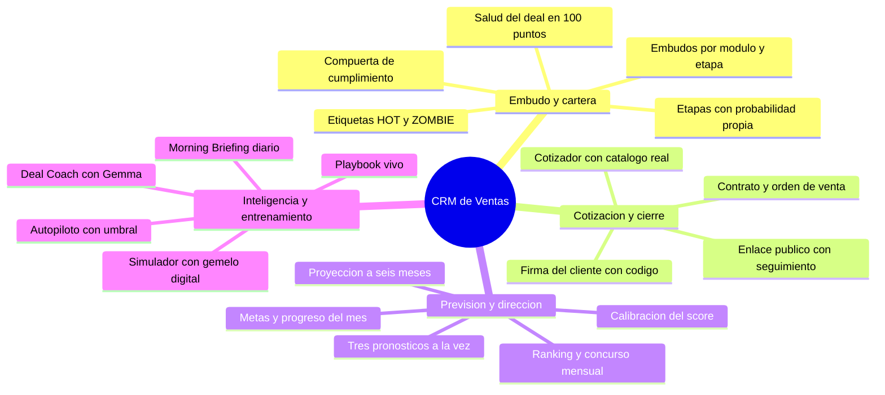
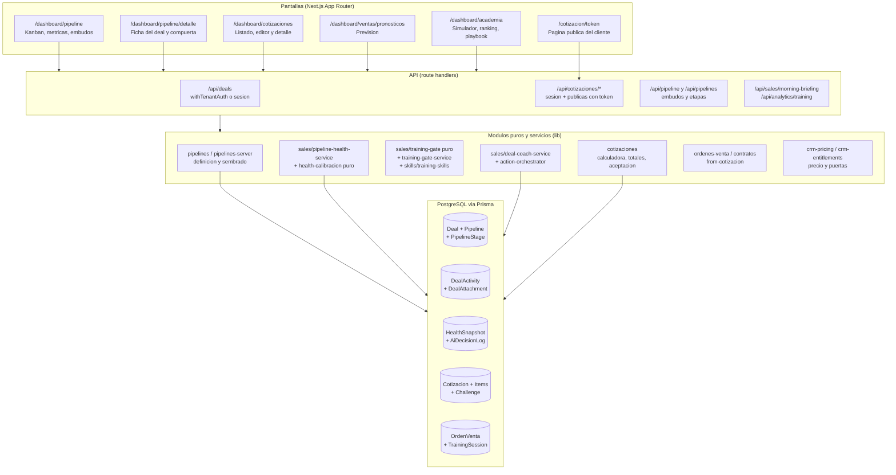
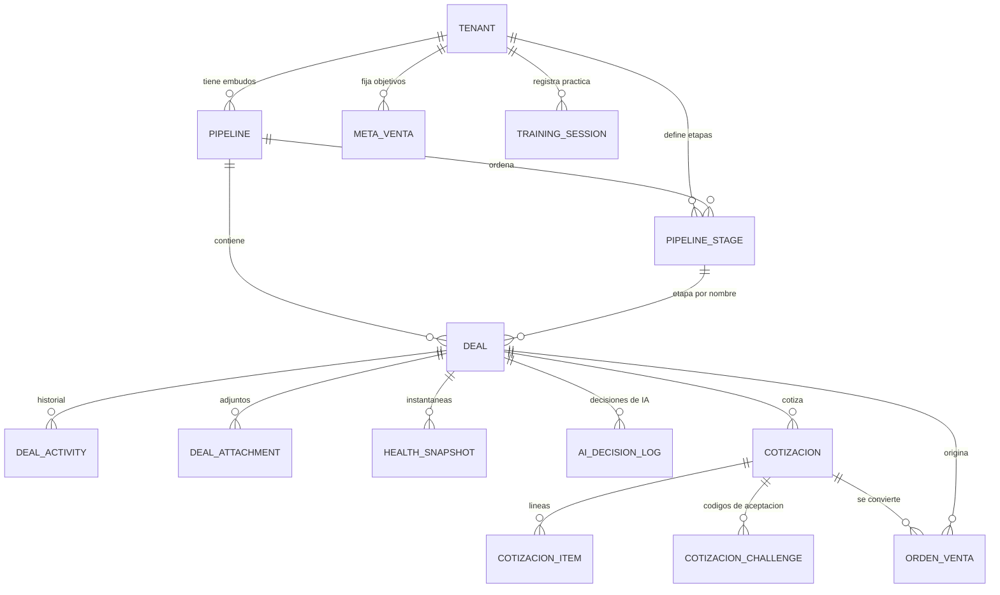
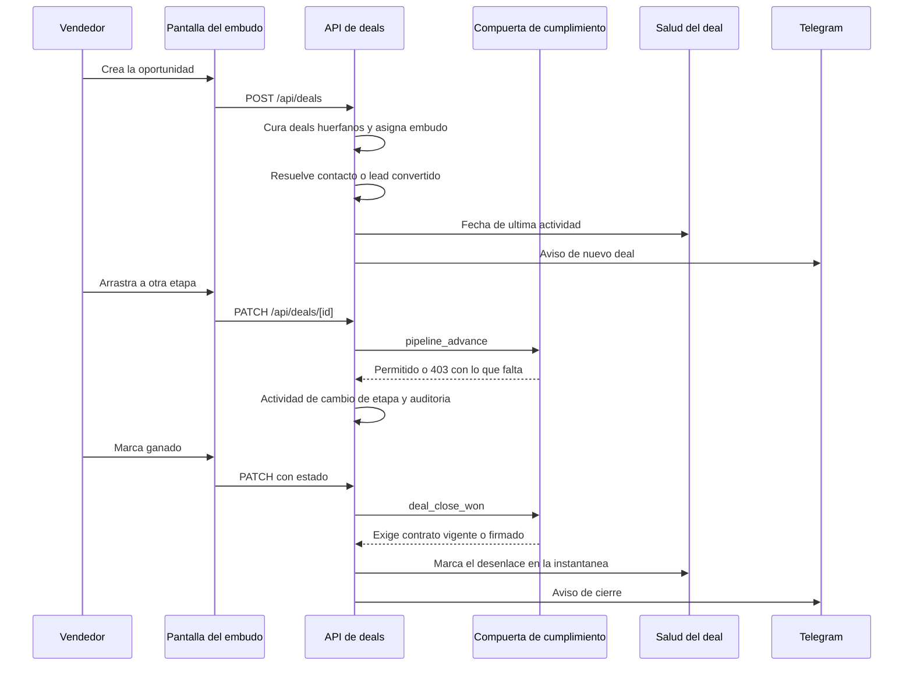
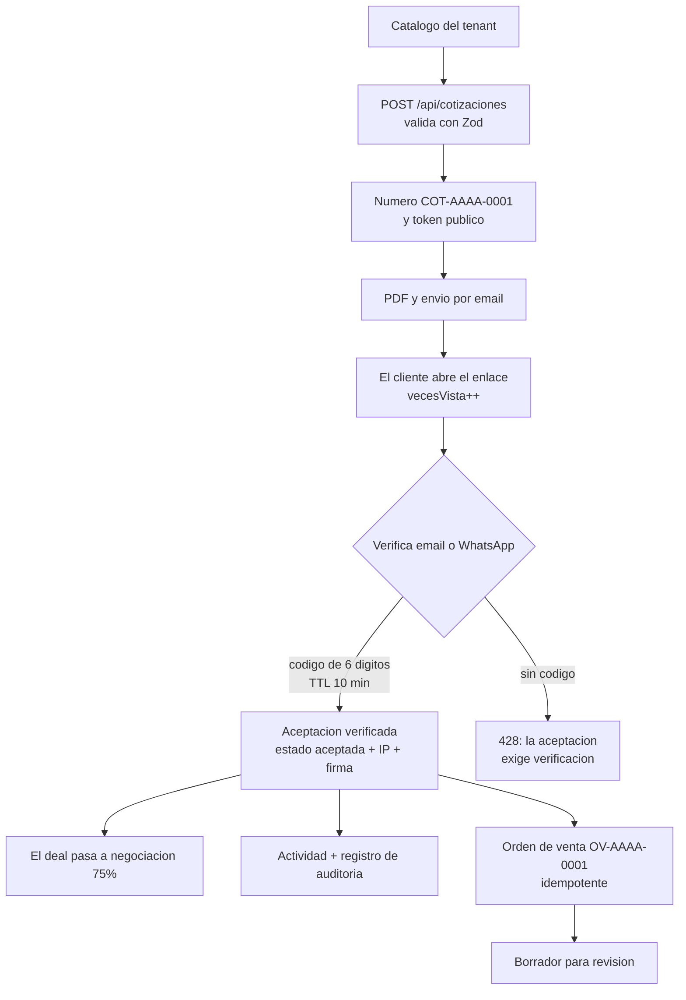
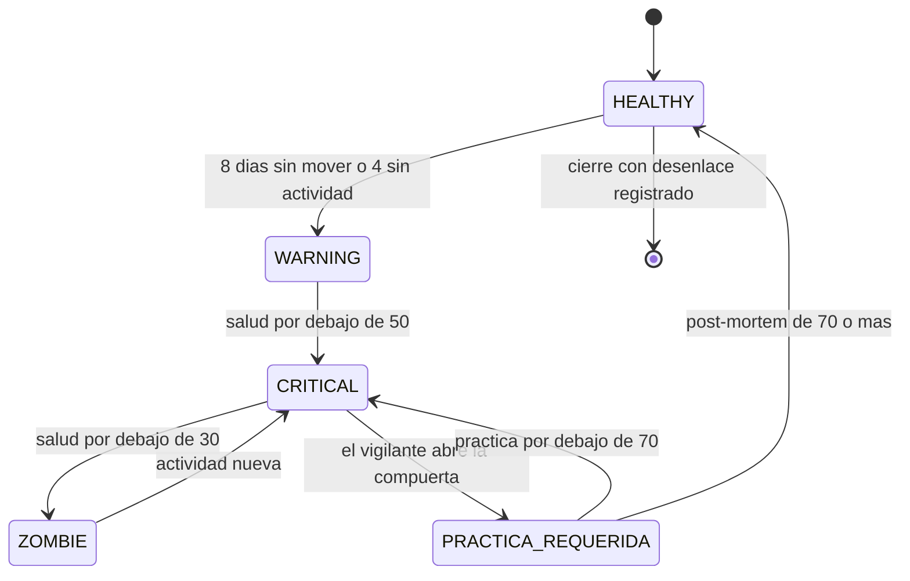

# Volkern CRM de Ventas — Documento técnico del módulo

**Qué es, qué hace hoy, cómo funciona por dentro y en qué se diferencia**

Fecha: **2026-10-27** · Rama: `feat/nobeds-f1-lectura` · Autor del inventario: ingeniería de producto Volkern

> **Regla del documento.** No aparece ninguna credencial, contraseña ni clave de API. Cuando un dato
> proviene de una medición, se dice **cuándo** y **cómo** se midió. Cuando proviene de otro documento
> y no se ha podido re-medir, se dice también. Nada se afirma «porque el plan lo decía».

## Cómo se ha verificado este documento

| Fuente | Qué se leyó |
|---|---|
| Código del módulo | `lib/sales/` (11 ficheros, 1.686 líneas), `lib/cotizaciones/` (6 ficheros, 824), `lib/pipelines.ts` + `lib/pipelines-server.ts`, `lib/crm-pricing.ts`, `lib/crm-entitlements.ts`, `lib/ordenes-venta/`, `lib/contratos/from-cotizacion.ts`, `lib/deals/orphan-deals.ts`, `lib/skills/deal-skills.ts`, `lib/skills/training-skills.ts`, `lib/agents/intents/crm-intents.ts` |
| Rutas | 27 `route.ts` bajo `app/api/deals`, `app/api/cotizaciones`, `app/api/pipelines` y `app/api/pipeline`, más `sales/morning-briefing`, `analytics/training/*`, `ordenes-venta/from-cotizacion` y `contratos/from-cotizacion` |
| Interfaz | `app/dashboard/pipeline` (2.528 + 1.438), `app/dashboard/cotizaciones` (2.195 en tres pantallas), `app/dashboard/ventas/pronosticos` (526), `app/cotizacion/[token]` (93), `components/deals/GemmaDealCoach.tsx`, `components/training/*`, `components/analytics/TrainingLeaderboard.tsx`, `components/hubs/AcademiaDashboard.tsx` |
| Esquema | `prisma/schema.prisma` (`Deal`, `Pipeline`, `PipelineStage`, `DealActivity`, `DealAttachment`, `Cotizacion`, `CotizacionItem`, `CotizacionAcceptanceChallenge`, `OrdenVenta`, `HealthSnapshot`, `MetaVenta`, `TrainingSession`, `AiDecisionLog`) e índices reales |
| Pruebas | 32 ficheros del módulo **ejecutados el 2026-10-27: 533 pruebas, 533 en verde** (las 6 rojas de la primera pasada se diagnosticaron y arreglaron, §12.1), y `npm run typecheck` con **0 errores** |
| Documentos previos | [`algoritmos-inventario.md`](./algoritmos-inventario.md) (22-sep-2026), [`algoritmos-guia.md`](./algoritmos-guia.md), [`precios-crm.md`](./precios-crm.md), `documentacion_comercial/modulos/Volkern_CRM_Commercial.md` |

**Qué corrige este documento respecto a lo que ya estaba escrito** (lo que se midió y ya no es cierto):

1. **El inventario de algoritmos (22-sep-2026) decía que la familia comercial «sigue sin una sola
   prueba».** Hoy los 32 ficheros de la suite del módulo cubren embudo, cotizaciones, previsión y el
   ciclo del riesgo completo. El dato del inventario caducó; el §13 recoge la medición de hoy.
2. **El briefing de la mañana ya tiene guardia** (dos ficheros, opt-in por usuario), donde el
   inventario lo daba como C10 sin ninguna.
3. **La aceptación pública de una cotización ya no es un POST directo.** La ruta existe pero
   responde **428** `verificationRequired`: el cliente demuestra que controla el email o el WhatsApp
   registrado (§7.3).
4. **El tope de embudos por nivel (1 / 10 / 25) no estaba en ningún documento de precios** y sí en
   `lib/crm-pricing.ts`; aquí queda escrito (§4.5).
5. **`/api/training/roleplay` no existe.** Es el enlace que devuelve la compuerta de práctica al
   negarse a registrar una llamada (§8.4) y hoy no lleva a ninguna parte.
6. **El «Hub de Ventas»** (`components/hubs/VentasDashboard.tsx`) es el hub del **ERP** —pedidos,
   producción, despachos—, no del CRM. El CRM se opera en `/dashboard/pipeline`.

---

## 1. Resumen: qué es el módulo

El CRM de Ventas de Volkern es el módulo comercial de la plataforma: **convierte interés en dinero
firmado y dice a quién llamar hoy**. No es una vertical (🏠 Real Estate, 🛡️ Seguros…) sino un
**plan** —`crm_ventas`, hoy `crm_esencial` / `crm_profesional` / `crm_avanzado`— que cualquier cuenta
puede contratar, y que las otras verticales usan por dentro.

Su decisión arquitectónica central, de la que sale casi todo lo demás:

> **La salud de una oportunidad es un número, y ese número se puede medir, persistir y auditar.**
> `Deal.healthScore` (0-100, con tres pesos declarados) más `HealthSnapshot`, que guarda la
> instantánea con sus entradas y —al cerrar— el desenlace real.

Esa decisión es la que permite lo que ningún CRM de tarjetas hace: **calibrar el propio criterio con
los desenlaces del cliente**, en vez de defender para siempre los pesos que alguien eligió el primer
día (§9.3). Y de ahí cuelga el resto del ciclo: la alerta, la compuerta de práctica, el entrenamiento
con el cliente real y la cosecha del conocimiento en un manual vivo.

### Los cuatro pilares, en términos de producto

### Para quién está pensado

| Perfil | Dolor que resuelve | Pieza del módulo que lo resuelve |
|---|---|---|
| Autónomo (1 comercial) | Excel que no avisa de nada | Embudo de 1 embudo, cotizaciones, informe básico (Esencial) |
| Equipo de 5–50 | Previsión que se hace a mano y nadie cree | Previsión ajustada por tasa histórica, metas, ranking (Profesional) |
| Equipo de 10+ con rotación | Vendedor nuevo que aprende a costa del cliente | Simulador con el gemelo digital, compuerta de práctica, playbook (Avanzado) |
| Dirección comercial | No sabe qué operaciones están muertas | Salud del pipeline, alertas de abandono, calibración del score |
| Agencia / distribuidor | Otra vertical que necesita vender | El CRM como base de las verticales: dos clientes antiguos conservan Avanzado completo |

---

## 2. Alcance

### 2.1 Dentro de alcance (implementado y alcanzable hoy)

- **Embudos múltiples** con etapas propias por categoría (ventas, captación, compra, RRHH, proyectos,
  finanzas, logística), orden, color, probabilidad, etapa final marcada y reordenación.
- **Oportunidades** (deals) con valor, divisa, etapa, probabilidad, prioridad, fecha estimada de
  cierre, origen, etiquetas, contacto, empresa, lead, inmueble vinculado y adjuntos.
- **Calidad operativa automatizada**: salud del deal, alertas de abandono, etiquetado HOT/ZOMBIE,
  dataset de calibración con desenlace.
- **Compuerta de cumplimiento** antes de avanzar de etapa y antes de cerrar (§6.3).
- **Cotización completa**: desde catálogo, con impuestos y retenciones por línea, numeración por
  cuenta, PDF, envío por email, enlace público con seguimiento de aperturas y aceptación **verificada
  con código**.
- **Cierre administrativo**: contrato desde cotización, orden de venta desde cotización (idempotente)
  y firma digital con sello encadenado.
- **Previsión**: pronóstico básico, ajustado por conversión histórica, proyección a 6 meses,
  predicción por tendencia, embudo con probabilidad teórica vs real, tiempo de ciclo, top 10 y meta
  del mes.
- **Inteligencia sobre datos propios**: Deal Coach (estrategia, objeciones, riesgo de ghosting,
  borrador), Morning Briefing, autopiloto con umbral de confianza y registro de decisiones.
- **Entrenamiento**: simulador con el gemelo digital del cliente real, post-mortem puntuado, ranking,
  concurso mensual y playbook vivo.
- **API y MCP** (nivel Avanzado): 34 rutas HTTP y 43 herramientas MCP, 19 de ellas de la cadena
  comercial.

### 2.2 Fuera de alcance (declarado, no es deuda)

| Fuera de alcance | Estado |
|---|---|
| **Cobro y comisiones** | El CRM no mueve dinero: cotiza, cierra y factura a través del ERP. No hay pasarela de pago en el camino del deal. |
| **Firma electrónica cualificada** (eIDAS, certificado) | La orden de venta tiene campos de sellado y hash encadenado, pero no hay integración con un proveedor de firma cualificada. |
| **Asientos de solo lectura** | Todos los asientos son de acceso completo; vender «usuario de consulta» más barato es una palanca declarada y no implementada (`precios-crm.md` §4). |
| **Enrutado por territorio/industria** | `TenantFeature` permite topes a medida, pero no hay reglas de reparto geográfico de cartera. |
| **App móvil nativa** | El panel es web responsive. No hay aplicación. |
| **Sincronización con el calendario del cliente final** | Hay renovación de webhooks de Google Calendar; no hay agenda bidireccional con el contacto. |

### 2.3 Lo que el módulo NO promete hacer

Conviene decirlo porque la IA ocupa un lugar central en el producto:

1. **La IA propone; el sistema decide con límites.** El Deal Coach sugiere y persiste su razonamiento;
   solo ejecuta por sí mismo si el tenant activó el autopiloto **y** la confianza declarada por el
   modelo llega a 0,7. Por debajo, la acción queda como sugerencia y así se registra.
2. **No promete acertar el pronóstico.** Publica tres números distintos —probabilidad teórica,
   conversión histórica y tendencia— precisamente porque ninguno es la verdad.
3. **Practicar no es un castigo.** La compuerta de práctica bloquea el contacto con el cliente, no el
   trabajo interno: la nota, la tarea, la cotización y el cambio de etapa siguen funcionando (§8.3).

---

## 3. Arquitectura

### 3.1 Capas

**Dos reglas de diseño que sostienen lo demás:**

- **Los módulos puros no tocan Prisma.** `lib/pipelines.ts` (definiciones y etapas),
  `lib/sales/training-gate.ts`, `lib/sales/health-calibracion.ts`, `lib/sales/leaderboard.ts` y
  `lib/crm-pricing.ts` no importan la base de datos a propósito: los usa el navegador (los límites del
  plan, la compuerta de la ficha) y los usan los tests sin montar un cliente de Prisma. `lib/sales/*`
  documenta esa frontera en su propia cabecera.
- **Un solo sitio decide cada cosa.** El «crítico» del sistema es `ESTADO_ACTIVACION` de
  `training-gate.ts`; el corte de la alerta es `CORTE_ALERTA` de `health-calibracion.ts`; el ranking
  tiene `TOP_RANKING`; el precio tiene `CRM_TIERS`. Cuando el mismo número aparecía en dos pantallas,
  se movió al módulo y se congeló con una prueba.

### 3.2 Mapa de ficheros

| Ruta | Líneas | Para qué |
|---|---:|---|
| `app/dashboard/pipeline/page.tsx` | 2.528 | Kanban, métricas del embudo, alta de deal, gestión de embudos y etapas, sincronización con el vigilante |
| `app/dashboard/pipeline/[id]/page.tsx` | 1.438 | Ficha del deal: línea de tiempo, actividades, adjuntos, coach, compuerta de práctica |
| `app/dashboard/ventas/pronosticos/page.tsx` | 526 | Los tres pronósticos, proyección, embudo comparado, top 10, meta del mes |
| `app/dashboard/cotizaciones/{page,nueva,[id]}` | 2.195 | Listado con vistas, editor con catálogo e impuestos, detalle con PDF y envío |
| `app/cotizacion/[token]/page.tsx` | 93 | Vista pública del cliente y contador de aperturas |
| `lib/sales/pipeline-health-service.ts` | 219 | Salud del deal, instantáneas de calibración, métricas ejecutivas |
| `lib/sales/morning-briefing-service.ts` | 212 | Briefing por usuario y envío global por Telegram |
| `lib/sales/contest-ediciones.ts` | 193 | Ediciones mensuales del concurso de práctica |
| `lib/sales/playbook-cosecha.ts` | 173 | De la sesión excelente a la lección del playbook |
| `lib/sales/deal-coach-service.ts` | 162 | Asesoría táctica del deal con Gemma y su persistencia |
| `lib/sales/training-gate-service.ts` | 159 | Abrir y levantar la compuerta de práctica |
| `lib/sales/training-gate.ts` | 136 | **Puro**: el umbral, la etiqueta y qué es «contacto con el cliente» |
| `lib/sales/health-calibracion.ts` | 133 | **Puro**: ¿el score separa ganados de perdidos? |
| `lib/sales/leaderboard.ts` | 119 | **Puro**: ranking y periodos del concurso |
| `lib/sales/action-orchestrator.ts` | 104 | Autopiloto con guardarraíl de confianza y registro de decisiones |
| `lib/sales/pipeline-watchdog.ts` | 76 | Barrido: salud, compuertas, alertas y etiquetas |
| `lib/cotizaciones/cotizacion-calculator.ts` | 109 | Esquema de entrada y cálculo de líneas |
| `lib/cotizaciones/cotizacion-totals.ts` | 49 | **Puro**: subtotal, descuentos y base imponible de la vista |
| `lib/cotizaciones/acceptance-verification.ts` | 40 | **Puro**: código, tokens, hashes y máscaras |
| `lib/cotizaciones/accept-cotizacion.ts` | 91 | Aceptación verificada y sus efectos en el deal |
| `lib/ordenes-venta/from-cotizacion.ts` | 262 | Cotización → orden de venta, idempotente |
| `lib/contratos/from-cotizacion.ts` | 327 | Cotización → contrato con cláusulas |
| `lib/pipelines.ts` / `lib/pipelines-server.ts` | 263 / 178 | Etapas por categoría y sembrado por módulos |
| `lib/crm-pricing.ts` / `lib/crm-entitlements.ts` | 376 / 105 | Escalera de precios (pura) y puertas por plan |
| `lib/skills/deal-skills.ts` / `training-skills.ts` | 331 / 323 | Skills de negocio y el motor del roleplay |
| `lib/agents/intents/crm-intents.ts` | 504 | 37 intenciones de lenguaje natural del CRM |
| `components/deals/GemmaDealCoach.tsx` | 280 | La pantalla del coach |
| `components/training/RoleplaySimulator.tsx` | 253 | El simulador y su post-mortem |
| `components/analytics/TrainingLeaderboard.tsx` | 176 | Ranking de cerradores |
| `components/training/LivingPlaybook.tsx` | 103 | El manual vivo |

---

## 4. Modelo de datos

### 4.1 Diagrama de entidades

### 4.2 Las tablas, una a una

| Modelo | Tabla | Papel en el módulo |
|---|---|---|
| `Deal` | `deals` | **La oportunidad.** Valor y valor real, divisa, etapa, probabilidad, estado, prioridad, fechas, razón de pérdida, competidor, origen, etiquetas, y las **11 columnas de IA y salud**: `healthScore`, `healthStatus`, `lastAlertSent`, `lastHealthUpdate`, `aiSentiment`, `aiDetectedPain`, `aiStrategy`, `aiNextBestAction`, `aiGhostingRisk`, `lastAiConsult`, `pipelineId` |
| `Pipeline` | `pipelines` | El embudo: nombre, categoría, orden, color, icono, activo. Único por `(tenantId, nombre)` |
| `PipelineStage` | `pipeline_stages` | La etapa: orden, probabilidad, color, `requiereAprobacion`, `esEtapaFinal` + `tipoEtapaFinal`, `categoria`. **El deal guarda el nombre de la etapa, no su id** |
| `DealActivity` | `deal_activities` | Todo lo que pasa en la oportunidad: tipo, título, resultado, duración, metadata |
| `DealAttachment` | `deal_attachments` | Adjuntos en almacenamiento de objetos |
| `HealthSnapshot` | `health_snapshots` | **El dataset**: score, las tres entradas, el estado y el desenlace (nulo hasta el cierre) |
| `AiDecisionLog` | — | Cada decisión de la IA con su razonamiento, evidencia, confianza y si se ejecutó sola |
| `Cotizacion` | `cotizaciones` | Importes (subtotal, descuento, impuestos, total), divisa, validez, estados, firma del cliente con IP, **seguimiento de aperturas** (`vecesVista`, `fechaPrimeraVista`, `ultimaVista`), token público y emisor fiscal |
| `CotizacionItem` | `cotizacion_items` | Línea: cantidad, precio, descuento, impuesto y retención por línea, vínculo al catálogo |
| `CotizacionAcceptanceChallenge` | — | Código y token **hasheados** (SHA-256), canal, destino enmascarado, caducidad |
| `OrdenVenta` | `ordenes_venta` | El cierre administrativo: importes, retenciones, totales, firma y **sellado encadenado** (`sealHash`, `parentSealHash`, `sequenceNumber`) |
| `MetaVenta` | `metas_venta` | Objetivo por periodo, con usuario opcional: es lo que da sentido al «progreso de meta del mes» |
| `TrainingSession` | `training_sessions` | La práctica persistida: score, argumento más fuerte, punto de mejora, técnica detectada |

### 4.3 Índices: lo que hay

Medido sobre `prisma/schema.prisma`. `deals` es de las tablas mejor indexadas del esquema —**11
índices**—: `tenantId`, `leadId`, `contactId`, `companyId`, `catalogoItemId`, `usuarioAsignadoId`,
`etapa`, `estado`, `fechaEstimadaCierre`, `fechaCreacion` y `pipelineId`. Y sin embargo:

**`healthStatus`, `healthScore` y `lastAlertSent` no tienen índice**, y son justo las columnas que
recorre el vigilante en cada barrido (`where { estado: 'activo' }` y luego filtro en memoria por
`healthStatus === 'CRITICAL'`). El índice que falta es el del par que se consulta más a menudo que
cualquier filtro de la interfaz: **qué está crítico y no se ha avisado**. `HealthSnapshot` sí está
indexado por `dealId` y por `desenlace`, que es lo que necesita la calibración.

### 4.4 Claves de configuración del módulo

| Clave | Dónde vive | Para qué |
|---|---|---|
| `crmTier` | `Tenant.configuracion` | Nivel contratado (`esencial`, `profesional`, `avanzado`) — abre las puertas de `crm-entitlements` |
| `crmSeats` | `Tenant.configuracion` | Asientos contratados, si el cobro los conoce |
| `max_pipelines` | `TenantFeature` | Tope a medida de embudos que **pisa** al del nivel |
| `aiAutopilot` | `Tenant.aiAutopilot` | El interruptor que permite a la IA ejecutar sin preguntar |
| `notifications.briefing` | `User.metadata` | Opt-out del briefing (por defecto, activado) |

El tope real de embudos es `Math.min(getMaxPipelines(tenantId, plan), entitlements.limits.maxPipelines)`:
la excepción por cuenta no puede saltarse el nivel contratado, solo recortarlo.

### 4.5 La escalera de precios y sus puertas

Única fuente: `lib/crm-pricing.ts`. La web, el checkout, el dossier y los tests leen de ahí.

| Nivel | Mensual | Anual | Embudos | Automatizaciones | IA | API/MCP | Contratos | Previsión | Academia |
|---|---:|---:|---:|---:|:--:|:--:|:--:|:--:|:--:|
| Esencial | 15 € | 12 € | 1 | 2 | — | — | — | — | — |
| Profesional | 29 € | 24 € | 10 | 100 | — | — | ✓ | ✓ | — |
| Avanzado | 49 € | 39 € | 25 | 500 | ✓ | ✓ | ✓ | ✓ | ✓ |

Precios **por usuario y mes**, sin IVA; el volumen se descuenta por **tramos marginales** (0 % hasta 9
asientos, 10 % de 10 a 24, 15 % de 25 a 49, 20 % de 50 a 99, 25 % hasta 249, 30 % hasta 499, 35 %
hasta 999 y 40 % desde 1.000), con autoservicio hasta 1.000 asientos y precio a medida por encima.
Los tenants anteriores a la escalera y los de otras verticales conservan **Avanzado completo** con
`legacy: true`: bajar funciones a quien ya las pagaba no es parte del cambio de tarifa.

---

## 5. Superficie funcional

### 5.1 Pantallas

| # | Pantalla | Ruta | Estado |
|---|---|---|---|
| 1 | Embudo de ventas | `/dashboard/pipeline` | Kanban con métricas, alta de deal, gestión de embudos y etapas, filtros por salud y prioridad, botón de sincronización |
| 2 | Ficha del deal | `/dashboard/pipeline/[id]` | Información, línea de tiempo, actividades, adjuntos, coach, compuerta de práctica y simulador |
| 3 | Cotizaciones | `/dashboard/cotizaciones` | Listado con vistas, estados y aperturas del cliente |
| 4 | Nueva cotización | `/dashboard/cotizaciones/nueva` | Editor con líneas del catálogo, descuentos, impuestos y previsualización |
| 5 | Detalle de cotización | `/dashboard/cotizaciones/[id]` | Detalle, PDF, envío, historial |
| 6 | Pronósticos | `/dashboard/ventas/pronosticos` | Previsión en seis bloques (§9) |
| 7 | Academia | `/dashboard/academia` | Ranking de cerradores, simulador, playbook |
| 8 | Publicación comercial | `/soluciones/crm-ventas` | `CrmVentasLanding.tsx`, alimentada por `crm-pricing.ts` |

### 5.2 API interna (sesión o API key)

| Área | Rutas | Qué hacen |
|---|---|---|
| Oportunidades | `GET/POST /api/deals`, `GET/PATCH/DELETE /api/deals/[id]` | Listado con filtros y métricas, alta con contacto o lead, ficha completa, cambio de etapa y cierre **con compuerta de cumplimiento** |
| Señales | `/api/deals/[id]/activities`, `/api/deals/[id]/timeline`, `/api/deals/[id]/attachments`, `/api/deals/[id]/ai-audit` | Historial, línea de tiempo, adjuntos y auditoría de decisiones de IA |
| Inteligencia | `/api/deals/[id]/coach` | Asesoría del deal (nivel Avanzado; 403 con el nivel que la abre) |
| Salud y dirección | `/api/deals/forecast`, `/api/deals/metrics`, `/api/deals/calibracion`, `/api/deals/sync` | Previsión (nivel Profesional), métricas por periodo, calibración del score y barrido del vigilante |
| Embudos | `/api/pipelines`, `/api/pipelines/[id]`, `/api/pipelines/[id]/duplicate`, `/api/pipelines/seed`, `/api/pipeline/stages`, `/api/pipeline/stages/[id]`, `/api/pipeline/stages/reorder` | Gestión de embudos con tope por plan y etapas con compuerta |
| Cotizaciones | `GET/POST /api/cotizaciones`, `/api/cotizaciones/[id]`, `/api/cotizaciones/[id]/pdf`, `/api/cotizaciones/[id]/send`, `/api/cotizaciones/from-catalog` | Ciclo completo, con numeración por cuenta y envío por email |
| Conversión | `/api/ordenes-venta/from-cotizacion`, `/api/contratos/from-cotizacion[/id]` | Cotización → orden de venta y → contrato |
| Rutina | `/api/sales/morning-briefing`, `/api/analytics/training/leaderboard`, `/api/analytics/training/playbook` | Briefing del día, ranking y playbook |

### 5.3 API pública (sin sesión)

| Ruta | Autenticación | Qué hace |
|---|---|---|
| `GET /cotizacion/[token]` | Token público de la cotización | Página del cliente y **contador de aperturas** |
| `GET /api/cotizaciones/public/[id]/verification` | `withPublicTenant` | Canales disponibles, con destino enmascarado |
| `POST /api/cotizaciones/public/[id]/verification` | `withPublicTenant` | Envía el código de 6 dígitos con TTL de 10 minutos y enfriamiento de 60 segundos |
| `POST .../verification/verify` | Token de desafío | Comprueba el código y acepta la cotización |
| `POST /api/cotizaciones/public/[id]/accept` | — | **Deshabilitada a propósito**: responde 428 `verificationRequired` |
| `GET /api/cotizaciones/public/[id]/pdf` | Token público | PDF para el cliente |

### 5.4 Herramientas MCP y skills

43 herramientas MCP en total (`mcp-server/src/tools-catalog.ts`), **19 de ellas de la cadena
comercial**: contactos, leads, deals, cotizaciones, contratos y órdenes, tareas, notas, citas e
interacciones. Detalle relevante: **el embudo no está expuesto por MCP** —no hay herramienta de
embudos ni de etapas—, así que un agente externo puede crear una oportunidad pero no reordenar el
pipeline.

Skills del catálogo interno (`lib/skills/index.ts`): **9 en las categorías del núcleo** —`deals`
(`create_deal`, `get_deal`, `list_deals`, `update_deal`), `sales` (`create_orden_from_cotizacion`,
`get_orden_venta`, `list_ordenes_venta`) y `training` (`generate_customer_response`,
`generate_post_mortem`)— más las que completan la cadena desde otras categorías: `create_cotizacion`
(catálogo), `create_interaction`, `list_notes`, `get_upcoming_bookings` y las de proactividad
(`detect_ghosting`, `generate_success_path`). Y 37 intenciones de lenguaje natural en
`lib/agents/intents/crm-intents.ts`, de `crear_negocio` a `detectar_ghosting`.

### 5.5 El embudo por defecto y sus variantes

`DEFAULT_STAGES` (7 etapas) es el embudo de ventas: **Calificación 10 % → Contacto Inicial 25 % →
Propuesta 50 % → Negociación 75 % → Cierre 90 % → Ganado 100 % → Perdido 0 %**, con las dos últimas
marcadas como finales por tipo. Cada categoría trae su juego: captación (7), compra (8), RRHH (8),
proyectos (7), finanzas (8) y logística (8). Cuando una cuenta activa un módulo, `seedTenantPipelines`
crea su embudo con las etapas de su categoría, reasigna lo que quedó sin embudo y corrige dos deudas
históricas: desactiva el antiguo embudo «Inmobiliario» (sustituido por Captación y Compra) y arregla
el orden de Finanzas, que compartía el 5 con Compra.

---

## 6. Flujo A — Alta de oportunidad, avance y cierre

### 6.1 Alta: lo que el backend arregla por su cuenta

`POST /api/deals` no se limita a insertar. Reasigna los deals huérfanos (`pipelineId` nulo) al primer
embudo activo, resuelve el tercero del trío —contacto nuevo, contacto existente o lead **ya
convertido**— y rechaza el lead sin convertir. Si no llega `pipelineId` (el formulario de Contactos no
lo envía), asigna el primero activo para que la oportunidad aparezca en el tablero. Después deja
actividad, auditoría y aviso.

### 6.2 Avance: la etapa se guarda por nombre

`Deal.etapa` es una cadena y `PipelineStage.nombre` es la referencia: la probabilidad que usa el
pronóstico se busca por nombre. Por eso `lib/skills/deal-skills.ts` expone
`resolveStageToCanonical()`: normaliza el texto que llega de la IA o de un formulario
(«negociación» → «Negociación») y devuelve el nombre exacto con su probabilidad, para que el tablero y
el motor de salud coincidan. Es la respuesta a un defecto clásico de este diseño: dos etapas con la
misma palabra y distinta probabilidad.

### 6.3 La compuerta de cumplimiento

`ComplianceGate` se consulta antes de tocar el estado del deal. Tres reglas afectan al CRM
(`lib/compliance-rules.ts`):

| Acción | Regla | Qué exige |
|---|---|---|
| `pipeline_advance` | `pipeline_requires_tasks` (`:163`) | Tareas de tipo `obligatoria` completadas |
| `deal_close_won` | `deal_close_won_requires_contract` (`:71-72`) | Al menos un contrato en estado `vigente` o `firmado` |
| `deal_close_lost` | `deal_close_lost_requires_reason` (`:302-303`) | Razón de pérdida de 5 caracteres o más |

Y dos protegen la propia configuración del embudo: `pipeline_stage_create` y `pipeline_stage_modify`
—desactivar una etapa por la que pasan oportunidades no es una edición inocente—. Cuando bloquea,
devuelve **403** con `requiredAction`, `missingRequirements` y el modo de la regla, no un «no puedes».

---

## 7. Flujo B — De la cotización a la orden de venta

### 7.1 Cálculo de la cotización

`calculateCotizacionItems()` es la única calculadora. Tres detalles que el dinero agradece:

- **El descuento de línea es un importe, no un porcentaje**, y no puede superar el bruto de la línea:
  el módulo devuelve el error con la cifra concreta en lugar de aceptar un subtotal negativo.
- **El impuesto es por línea**: si la línea viene del catálogo y trae tasa, manda la suya; si el
  artículo está marcado como `exento`, es cero; solo las líneas manuales caen al IVA general de la
  cotización.
- **El descuento global se prorratea sobre los impuestos**: el total se recalcula con la base
  imponible resultante, y todo se redondea a dos decimales en cada paso en vez de al final.

La numeración es secuencial **por cuenta y por año** (`COT-2026-0001`), y el token público se genera
con número + marca de tiempo + aleatorio.

### 7.2 Seguimiento del documento

El enlace público incrementa `vecesVista` y sella `fechaPrimeraVista` y `ultimaVista`
(`app/cotizacion/[token]/page.tsx:52`). El listado del CRM lo usa para algo más útil que un adorno: una
cotización vista varias veces sin respuesta aparece marcada como seguimiento. Es la señal de compra
más barata que existe y el módulo la recoge.

### 7.3 La aceptación exige demostrar quién eres

La aceptación directa por POST quedó deshabilitada: devuelve **428** con `verificationRequired`. El
camino real es un desafío de dos pasos:

1. `GET .../verification` informa de los canales disponibles, con el destino **enmascarado**
   (`javascript***@dominio.com`, `****1234`).
2. `POST .../verification` genera un código de 6 dígitos y un token de desafío, guarda **solo sus
   hashes SHA-256**, con TTL de 10 minutos y enfriamiento de 60 segundos, y los envía por email o por
   WhatsApp —con respaldo al número de la plataforma si la cuenta no tiene el suyo, para que el código
   no se pierda—. Si el envío falla, el desafío se borra: no se deja un código vivo que nadie recibió.
3. `POST .../verification/verify` comprueba el código con `timingSafeEqual` y acepta.

Al aceptar, en una sola operación: la cotización pasa a `aceptada` con firma, fecha e IP; el deal salta
a **negociación al 75 %**; se registran actividad y auditoría; y se genera la **orden de venta** como
borrador para revisión. Este último paso es **idempotente y no bloquea**: si falla, el cliente ya ha
aceptado y eso no se pierde.

### 7.4 La orden de venta y el sello

`crearOrdenVentaDesdeCotizacion()` recalcula la orden desde la cotización —no copia importes— aplicando
el perfil fiscal del cliente: exención, retenciones y **inversión del sujeto pasivo** cuando
corresponde. Acepta `ajustarPrecios` para repreciar desde el catálogo si este cambió. La orden nace en
borrador con número `OV-AAAA-0001` y, en el modelo, con las columnas de firma digital encadenada
(`sealHash`, `parentSealHash`, `sequenceNumber`): el sello de cada firma incluye el anterior.

---

## 8. Flujo C — El ciclo del riesgo (el diferencial del módulo)

Es la parte que ningún CRM de esta categoría tiene completa, y va de la señal al conocimiento:

### 8.1 La salud del deal: tres pesos declarados

`PipelineHealthService.updateDealHealth()` empieza en 100 y resta tres veces:

| Vía | Peso | Regla exacta | Ancla |
|---|---:|---|---|
| Estancamiento | 40 | `> 7 días` sin mover: 5 por día de exceso, tope 40 | `pipeline-health-service.ts:40` |
| Actividad | 40 | Sin actividad **nunca**: −40. Con la última a más de 3 días: 8 por día de exceso, tope 40 | `:50` |
| SLA | 20 | `diasEnPipeline` por encima de 5 (urgente), 10 (alta) o 20 (resto) | `:55` |

Los cortes: `< 30` **ZOMBIE**, `< 50` **CRITICAL**, `< 75` **WARNING**, el resto **HEALTHY**
(`:65`). Cada recálculo intenta además dejar una **instantánea** con el score, sus tres entradas y el
desenlace nulo, con deduplicación de 24 horas (`:15`) para que el barrido diario no infle el dataset
con filas idénticas. Y hay una regla que protege la medición: **la instantánea no puede tumbar el
cálculo** — si falla, se registra y el score se guarda igual.

### 8.2 El vigilante: cuatro cosas en un barrido

`PipelineWatchdog.runWatchdog(tenantId)` —que se dispara desde `POST /api/deals/sync`— recalcula la
salud de todo el pipeline activo y después:

1. **Abre las compuertas de práctica** de lo que acaba de caer a crítico.
2. **Avisa** por Telegram de los críticos con valor superior a 5.000 (`pipeline-watchdog.ts:23`), con
   silencio de 24 horas por deal para que la alerta no se vuelva ruido.
3. **Etiqueta**: `HOT` si la salud supera 85, `ZOMBIE` si baja de 25 (`:56`, `:59`), limpiando la
   etiqueta contraria.
4. Devuelve el recuento: escaneados, alertas y puertas abiertas.

### 8.3 La compuerta de práctica: riesgo → entrenamiento

Cuando la salud llega a **CRITICAL** (`ESTADO_ACTIVACION = 'CRITICAL'`, `training-gate.ts:25`), el
sistema deja de esperar: añade la etiqueta `PRACTICA_REQUERIDA` a `Deal.tags` (`:35`) y **bloquea el
contacto con el cliente** hasta que el vendedor practique con ese cliente concreto y saque al menos
**70** (`PUNTUACION_MINIMA = 70`, `:28`).

Lo que bloquea son seis tipos de actividad (`:58`): `actividad`, `cita`, `interaccion`, `llamada`,
`email` y `reunion`. La respuesta es **423** con el motivo y el enlace al simulador. Lo que **no**
bloquea es trabajar la oportunidad por dentro —nota, tarea, cotización, cambio de etapa, adjunto—: la
regla del módulo es que practicar no es castigo ni burocracia, y preparar la venta es justo lo que se
espera mientras se prepara la práctica.

Dos decisiones de implementación que conviene conocer: la etiqueta viaja en `Deal.tags` **para no
necesitar una migración** (es el mismo almacén operativo que ya usaban HOT y ZOMBIE), y la llave de la
compuerta es la propia sesión de post-mortem: no hay un paso extra de «validación».

### 8.4 El simulador: el gemelo digital del cliente real

`generateCustomerResponse()` construye el papel del cliente con **sus datos reales**: las 10 últimas
notas y las 5 últimas interacciones. La escalada es automática: si el récord del **propio vendedor**
supera 85, el cliente simulado pasa a «MODO LEYENDA» con temperatura 0,9 en lugar de 0,7. Sin récord no
hay consulta, y el récord de otro nunca se usa.

`generatePostMortem()` puntúa la sesión de 0 a 100 sobre cuatro criterios declarados (manejo de
objeciones, aportación de valor, técnica de cierre, escucha activa), normaliza el rango en el borde del
módulo —un `null`, un 850 o un decimal no corrompen el récord— y tiene dos puntuaciones de respaldo si
la IA falla: 50 con la conexión caída y 60 con la evaluación parcial. **Los respaldos son sintéticos y
jamás celebran récord ni high-five**: si el modelo no evaluó, el sistema no festeja.

> **Deuda medida.** El enlace que devuelve la compuerta al bloquear una llamada es
> `/api/training/roleplay?leadId=…` y **esa ruta no existe** (`app/api/training` no está en el
> proyecto); el simulador real vive en la ficha del deal y llama a `/api/ai/skill-handler`. El test
> `tests/sales-training-gate.test.ts:332` congela esa cadena, así que el enlace muerto está protegido
> por una guardia que hay que cambiar a propósito.

### 8.5 La cosecha: de la práctica al manual

Con una puntuación de 90 o más (`UMBRAL_COSECHA`), `cosecharMejorPractica()` convierte la sesión en una
lección del **playbook vivo**: calcula una huella de la lección para no repetir, clasifica el tema
—mediante `clasificarTema()`, con `TEMA_SIN_CLASIFICAR` como salida honesta— y la guarda. El ranking
se completa con el concurso: ediciones de **mes natural** (`clavePeriodo` → `AAAA-MM`, `rangoPeriodo`
→ `[desde, hasta)`), un ganador que es la primera entrada del ranking, y el cierre de las ediciones
pendientes. Sin práctica no hay ganador: un mes vacío no corona a nadie.

El desempate del ranking es una decisión declarada, no un accidente: a igual media, gana quien **más
sesiones** completó.

### 8.6 El ciclo completo, de una pasada

El vigilante detecta el riesgo → abre la compuerta → el vendedor practica con el gemelo digital de ese
cliente → el post-mortem puntúa → si llega al umbral, levanta la compuerta y emite
`TRAINING_COMPLETED`, que es lo que engancha con el motor de automatizaciones → si la lección es
excelente, entra en el playbook → y el ranking y el concurso mensual premian la constancia.

La rutina diaria del comercial —el briefing de la mañana— es un flujo aparte (§10): consume la salud
del deal, pero no forma parte del bucle de riesgo.

---

## 9. Flujo D — Los tres pronósticos y la calibración

### 9.1 Por qué hay tres números

`GET /api/deals/forecast` (nivel **Profesional**; si no, 403 con el nivel que lo abre) no publica un
pronóstico, publica tres, y esa es la decisión de producto más honesta del módulo:

| Número | Cómo se calcula | Qué dice |
|---|---|---|
| **Pronóstico básico** | Suma de `valor × probabilidad` de la etapa de cada deal | Lo que dice el proceso |
| **Pronóstico ajustado** | Suma de `valor × tasa histórica` de conversión de la etapa, con la probabilidad de la etapa como respaldo | Lo que dice la historia de esta cuenta |
| **Predicción por tendencia** | Regresión lineal sobre las ventas ganadas de los últimos 12 meses, proyectada 3 meses | Lo que dice el tiempo |

Además: proyección mes a mes de los próximos 6 meses con su meta, embudo comparado con
**probabilidad teórica vs real** por etapa, tiempo medio de ciclo (30 días por defecto cuando no hay
histórico), top 10 de oportunidades por valor ponderado, y progreso de la meta del mes —que solo existe
si alguien ha creado un `MetaVenta` que cubra la fecha—.

### 9.2 Lo que la pantalla enseña

`/dashboard/ventas/pronosticos` presenta los tres números juntos, la evolución de 12 meses con su
proyección, el embudo por valor, las tasas de conversión por etapa («Comparación entre probabilidad
teórica e histórica») y los diez deals ordenados por valor ponderado. El mensaje implícito es el
correcto: **la diferencia entre los tres números es el margen de incertidumbre del vendedor.**

### 9.3 Calibración: ¿el score sirve?

Aquí está la pieza menos habitual del módulo. `HealthSnapshot` acumula el score **con sus entradas** y,
al cerrar el deal, marca el **desenlace** (`marcarDesenlaceEnSnapshots()`), de modo que el historial
anterior se conserva intacto: lo que se compara con lo que pasó es el score de **antes** del cierre.

Sobre ese dataset, `lib/sales/health-calibracion.ts` (puro) responde con datos a una pregunta que casi
nadie se hace sobre su propio score:

- `ultimosPorDeal()` — una fila por deal cerrado: contar instantáneas inflaría la confianza con
  oportunidades recalculadas muchas veces.
- `resumenPorDesenlace()` — cuántos ganados y perdidos, su score medio y cuántos cayeron por debajo del
  corte.
- `evaluarCorte()` — precisión (de lo marcado en riesgo, cuánto se perdió) y recall (de lo perdido,
  cuánto estaba marcado), con el corte actual **50** (`CORTE_ALERTA`) y alternativos 30/40/60/70.
- `elScoreSepara()` — el veredicto: la media de los perdidos debe quedar por debajo de la de los
  ganados. Devuelve `null` sin muestra, no un `false` que parezca un hallazgo.
- `colorDeMuestra()` — gris sin datos, rojo por debajo de 20 deals cerrados, ámbar hasta 100, verde a
  partir de ahí.

`GET /api/deals/calibracion` entrega eso tal cual. La regla escrita en el propio módulo es la correcta:
**la API lee y entrega; no interpreta ni propone**. Cambiar los pesos sigue siendo una decisión de
producto, no un efecto de que la muestra crezca.

---

## 10. Flujo E — El briefing de la mañana

`MorningBriefingService.generateBriefing(userId, tenantId)` monta la rutina diaria de un comercial:

1. Sus 20 oportunidades activas de mayor valor, re-ordenadas por salud.
2. Sus 5 leads calificados más recientes.
3. **Sus tareas pendientes, sin pasar por la IA**: vencidas primero, después las más próximas, del
   usuario o sin asignar, respetando el «recordar más tarde», 6 como máximo.

Después pide a Gemma las tres prioridades del día, las operaciones en riesgo con su mensaje de rescate,
los diamantes nuevos y una frase motivadora. Las tareas viajan fuera del JSON del modelo a propósito:
**si la IA falla, el briefing sigue mostrando los pendientes reales**.

`sendGlobalBriefing()` recorre los usuarios activos con cuenta y respeta el opt-out
(`metadata.notifications.briefing === false`; por defecto, activado), y envía por Telegram con los
botones de completar / reprogramar de cada tarea. El trabajo corre a las **8:30** desde el planificador
interno (`lib/cron/scheduler.ts:77-79`), registrado en `instrumentation.ts` al arrancar el proceso de
Node: no hay ruta HTTP de cron para el briefing, a diferencia de los jobs de Hospitality.

---

## 11. Seguridad, permisos, aislamiento y gobernanza de la IA

### 11.1 Aislamiento por cuenta

| Mecanismo | Dónde | Qué garantiza |
|---|---|---|
| `withTenantAuth` con ámbitos (`deals:read`, `quotes:write`…) | Rutas de deals, cotizaciones, pipeline | Sesión o clave de API con permiso; el tenant sale de la credencial, no del cuerpo |
| `where { id, tenantId }` siempre | `GET/PATCH/DELETE` de deal, cotizaciones, etapas | Un id ajeno devuelve 404, no los datos |
| `canOnlySeeOwnLeads()` | `GET /api/deals` | El agente solo ve lo suyo; el resto necesita el permiso de equipo |
| `withPublicTenant` | Rutas públicas de cotización | El token resuelve la cuenta y la ruta verifica `cotizacion.tenantId === tenantId` |
| `getCrmEntitlements` | Coach, previsión, contratos, embudos | Puertas por nivel con mensaje de subida de plan |
| Auditoría y decisión | `AuditService`, `DealActivity`, `AiDecisionLog` | Quién cambió qué, y por qué lo propuso la IA |

Detalle de oficio: el **Deal Coach** delata en su propio comentario el defecto que se corrigió —la
búsqueda era `findUnique` por id y la ruta solo comprobaba que hubiera sesión, así que quien conociera
un id ajeno leía la estrategia y el riesgo de ghosting de otra cuenta—; hoy el `where` lleva el
`tenantId`. Es el tipo de fallo que el aislamiento por `tenantId` en el listado **no** cubre: la
frontera hay que ponerla en cada consulta por identificador.

### 11.2 Gobernanza de la IA

La IA del módulo no escribe sin registro. `ActionOrchestrator.executeAction()` aplica el guardarraíl
(**confianza ≥ 0,7**, `action-orchestrator.ts:12`) y, decida lo que decida, escribe una fila en
`AiDecisionLog` con el razonamiento, la evidencia, la confianza y `isAutoExecuted`. Solo tres acciones
pueden ejecutarse solas —crear tarea, generar borrador y escalar— y existe auditoría consultable por
deal (`/api/deals/[id]/ai-audit`). El interruptor es del cliente: `Tenant.aiAutopilot`.

Y hay una frontera explícita en el entrenamiento: los fallbacks de la IA (50 y 60) **no celebran récord
ni notifican**. Un score sintético se guarda como práctica y se distingue de uno real.

---

## 12. Qué falta: deuda medida el 2026-10-27

### 12.1 Lo que fallaba esta mañana y ya está arreglado

Al medir la suite por primera vez hoy aparecieron **6 pruebas rojas en 2 ficheros**. Se diagnosticaron
y se corrigieron en la misma pasada: **533 de 533 en verde** (§13). Ninguna era un defecto de
producción.

| Fichero | Pruebas | Causa raíz medida | Arreglo aplicado |
|---|---:|---|---|
| `tests/sales-health-autopilot.test.ts` | 4 | Los casos construían «hace N días» como `Date.now() − N×24 h`. El **25 de octubre de 2026** Europa/Madrid pasó de CEST a CET: esa resta deja la hora local una hora **más tarde** que ahora, y `differenceInDays` de date-fns mide días locales completos, así que devuelve **N−1**. Verificado en el entorno: `10 → 9`, `7 → 6`, `11 → 10`, `100 → 99`; los fallos eran de expectativa (85 esperado / 90 obtenido) | Un helper `dia(n)` único en el fichero que resta con **aritmética de calendario** (`setDate`), conservando la hora del día. Comprobado empíricamente a las 00:05, 01:30, 12:30 y 23:59: el helper viejo falla **126 de 144** combinaciones en horario de invierno; el nuevo, **ninguna**, también atravesando los dos cambios de hora |
| `tests/from-cotizacion-clausulas.test.ts` | 2 | El mock parcial de Prisma no incluía `tenant`, y la ruta llama a `getCrmEntitlements()`, que hace `prisma.tenant.findUnique` (`lib/crm-entitlements.ts:84`) → `TypeError` → 500 en lugar de 201. Una guardia que se quedó atrás cuando la ruta ganó la puerta de contratos | Se añade `tenant.findUnique` al mock, devolviendo **Profesional** (el primer nivel que abre contratos, que es lo que la prueba ejercita). La puerta en sí sigue cubierta en `tests/crm-pricing.test.ts`, en el bloque «puertas por nivel» |

El primero era una **prueba sensible a la fecha y a la zona horaria** —habría fallado los ~5 meses de
horario de invierno en Europa/Madrid y habría vuelto a pasar en marzo— y el segundo una **prueba
desactualizada**. Los dos se arreglan en el test, sin tocar el código que vigilan: el score sigue
pesando 100 − 40 − 40 − 20 y la ruta de contratos sigue exigiendo su nivel.

> **Riesgo declarado, no perseguido.** El mismo patrón de aritmética de 24 h aparece en otros diez
> ficheros de pruebas del repositorio (`forecast-alert`, `reprogramar-tarea`, `insurance-skills`…). Hoy
> pasan, pero no se ha analizado si dependen de `differenceInDays`; si alguna vez fallan en octubre o
> en marzo, la causa probablemente sea esta.

### 12.2 Deuda con consecuencia de producto

| # | Deuda | Consecuencia |
|---|---|---|
| 1 | **El enlace de la compuerta no existe** (`/api/training/roleplay`) | El vendedor bloqueado recibe un 423 con una URL que no resuelve; la salida real está en la ficha del deal |
| 2 | **`MetaVenta` no se actualiza en el cierre** | `valorActual` y `porcentajeCompletado` existen en el modelo, pero el «progreso de meta del mes» se calcula con las ventas ganadas. Una meta por comercial no tiene por dónde darse por cumplida |
| 3 | **La exclusión del CRM en la compuerta de contratos** depende del plan, no del módulo | Un tenant de otra vertical sin CRM recibe Avanzado legacy: si su plan no trae `contracts`, la cotización no puede convertirse en contrato |
| 4 | **Sin índice en `healthStatus`** | El vigilante filtra en memoria todo el pipeline activo; con miles de deals el barrido deja de ser barato |
| 5 | **El embudo no está en MCP** | Un agente puede crear oportunidades pero no consultar ni reordenar embudos y etapas |
| 6 | **El briefing solo se entrega por Telegram** | Sin Telegram configurado, el trabajo del cron se genera y no llega a nadie; no hay email ni campana en la aplicación |
| 7 | **El scoring del roleplay es no determinista y sin regresión de prompt** | Un cambio de prompt puede mover la escala de todo el equipo sin que ninguna prueba lo note |

### 12.3 Deuda de consulta y de dinero

- **Los importes del embudo se suman sin agrupar por divisa.** `GET /api/deals` suma `valor` de todos
  los deals del listado sin mirar `moneda`, igual que hacía la consolidación inmobiliaria antes de
  arreglarse. Un pipeline con operaciones en dos divisas muestra un total que no es un importe.
- **`gapAnalysis` sigue siendo una meta fija de 100.000** (`deals/route.ts` y
  `pipeline-health-service.ts`), heredada del prototipo. Con `MetaVenta` en el modelo, es el candidato
  evidente a desaparecer.
- **La proyección mensual usa formato `es-MX` para los nombres de mes** en una plataforma cuya divisa
  por defecto del CRM es el euro.
- **Los topes de automatizaciones del nivel** (2 / 100 / 500) están declarados en `crm-pricing.ts` y
  expuestos en la interfaz, pero no se ha localizado la puerta que los aplica al crear una regla.

---

## 13. Verificación

Todo lo de abajo se ejecutó el **2026-10-27** en este árbol, en la rama `feat/nobeds-f1-lectura`.

| Comando | Resultado |
|---|---|
| `npx vitest run` sobre **32 ficheros** del módulo (deals, embudos, cotizaciones, órdenes, familia `sales-*`, previsión, briefing, concurso, pricing) | **533 pruebas, 533 en verde** · 32/32 ficheros · salida 0 (antes de la corrección: 527 y 6 rojas, §12.1) |
| `npm run typecheck` (`tsc --noEmit`) | **0 errores**, salida 0 |

**Qué cubre la suite del módulo** (por área, contada sobre los ficheros ejecutados):

| Área | Ficheros | Qué congelan |
|---|---:|---|
| Oportunidades y embudos | 3 | Listado con filtros y aislamiento, ficha, alta con tercero, tope por plan, sembrado |
| Cotizaciones | 7 | Cálculo con impuestos y retenciones, numeración, PDF, aceptación verificada, totales de vista, conversión a orden y a contrato, cláusulas |
| Previsión y metas | 5 | Los tres pronósticos, alertas de desviación, persistencia, estacionalidad y multi-ramo |
| Salud y autopiloto | 3 | Los tres pesos, los cortes, el dataset de calibración, el guardarraíl de confianza |
| Ciclo del riesgo | 5 | El vigilante, la compuerta pura y su servicio, el gemelo digital, la escalada, el post-mortem |
| Academia y reconocimiento | 4 | La cosecha al playbook, el ranking y el concurso, el ranking en pantalla |
| Rutina y precios | 5 | Opt-in del briefing (servicio y modal), intención y Telegram de ventas, la escalera de precios |

**Límites declarados de esta verificación:** no se ejecutó la suite completa del repositorio (miles de
pruebas ajenas al módulo), no se levantó la aplicación y **no se midió nada contra la base de datos de
producción**: cuando aquí se dice «hoy», es el árbol de trabajo, no lo que hay desplegado.

---

## 14. Qué diferencia a este módulo

### 14.1 Diferencia estructural: el score es un dato, no una pantalla

En la mayoría de los CRM la «salud» de una oportunidad es un adorno calculado al vuelo. Aquí es una
columna del deal, con sus entradas persistidas (`HealthSnapshot`) y **el desenlace real** cuando se
cierra. Eso convierte una creencia («las operaciones paradas se pierden») en una afirmación
comprobable sobre los datos del cliente: precisión, recall y veredicto de si el score separa o no.
Ninguno de los CRM de mercado ofrece esto, porque exige haber guardado el estado *antes* de saber el
resultado.

### 14.2 Diferencia de fondo: el riesgo tiene consecuencia

Lo normal es que un CRM avise por correo. Aquí el aviso viene con una compuerta: la oportunidad
crítica no se toca con el cliente hasta que el vendedor practique **esa** conversación, con el gemelo
digital de ese cliente concreto, y saque 70. Y la misma sesión puntuada es la llave: no hay un
formulario de «he practicado». El ciclo se cierra por el otro extremo —la sesión excelente se convierte
en lección del playbook y alimenta el ranking y el concurso mensual—, así que el conocimiento que hoy
se va con el vendedor que renuncia queda en la cuenta.

### 14.3 Diferencia de producto: tres pronósticos en vez de uno

Publicar la probabilidad teórica de la etapa **y** la tasa histórica de esa misma cuenta **y** la
tendencia es incómodo: deja ver cuánto se equivoca el proceso. Es también la única forma honesta de
hacer previsión sin datos externos, y hace que la conversación de la reunión comercial sea sobre la
diferencia entre los números, no sobre quién tiene la corazonada.

### 14.4 Paridad de mercado (no diferencial)

Embudo visual con arrastrar y soltar, cotizaciones con seguimiento de aperturas, contratos, órdenes de
venta, previsión, metas, informes por comercial, roles y API: todo esto lo tiene el mercado, y aquí
está. La comparación de precios está en [`precios-crm.md`](./precios-crm.md) §3, medida el 9 de agosto
de 2026: entrada de 12 €/usuario/mes, en línea con Vtiger One Growth y Odoo Standard, y tramos de
volumen más generosos que los publicados por ellos.

### 14.5 Frente a un CRM de gran cuenta

Un CRM grande llega con ecosistema, integraciones y una implantación detrás. Este módulo compite donde
el otro es débil: **el CRM y el ERP son el mismo dato** —el embudo conoce el catálogo, el stock, el
contrato y la factura— y **la IA trabaja sobre los datos de esa cuenta y escribe en ellos**, con
registro de decisiones y un interruptor. Lo que no tiene, y conviene no disimular, es el ecosistema:
ni marketplace de integraciones, ni móvil nativo, ni firma electrónica cualificada.

---

## 15. Estado en producción

Lo que se puede afirmar y lo que no, con honestidad:

| Afirmación | Estado |
|---|---|
| El módulo está **implementado y en el árbol**: 34 rutas (27 del núcleo), 11 módulos de servicio, 8 pantallas y 43 herramientas MCP | Verificado leyendo el código |
| El planificador interno registra el briefing **a las 8:30** y el resto de jobs seguros | Verificado en `lib/cron/scheduler.ts:77` y `instrumentation.ts` |
| La compuerta de práctica **bloquea el contacto** y devuelve 423 | Verificado en código y con la guardia `sales-training-gate` (18 pruebas) |
| **Cuántos tenants usan el CRM, con qué nivel y cuántas oportunidades hay** | **No medido.** Exigiría consultar la base de datos de producción, y este documento no lo ha hecho |
| **Si la calibración ya tiene muestra suficiente** | **No medido.** El propio módulo declara que por debajo de 20 deals cerrados el número engaña |
| Estado del despliegue (versión publicada, migraciones aplicadas) | No comprobado en esta pasada |

---

## 16. Conclusión en cinco frases

1. El CRM de Ventas de Volkern convierte el interés en dinero firmado —cotización, verificación del
   cliente, contrato y orden de venta— y además dice a quién llamar hoy.
2. Lo que lo separa de la categoría no es el tablero: es que **la salud de cada oportunidad se mide,
   se guarda con sus entradas y se contrasta con el desenlace real**, de modo que el criterio del
   sistema se puede calibrar en vez de defenderlo.
3. El riesgo tiene consecuencia: la oportunidad crítica no se toca con el cliente hasta practicar esa
   conversación con el gemelo digital de ese cliente, y la sesión que levanta la compuerta es la misma
   que alimenta el playbook y el ranking.
4. La previsión publica tres números en lugar de uno porque ninguno es la verdad, y el precio es por
   usuario y por funciones, con tramos marginales que nunca castigan crecer.
5. Lo que falta está medido: las 6 pruebas rojas de esta mañana eran dos guardias frágiles —una fecha
   sensible al cambio de hora y un mock desactualizado— y ya están arregladas; queda un enlace de
   compuerta que no existe, los totales del embudo sin agrupar por divisa y un `gapAnalysis` que sigue
   siendo el literal de 100.000 del prototipo.

---

## 17. Anexo — Glosario del módulo

| Término | Significado en este módulo |
|---|---|
| **Deal / oportunidad / negocio** | La operación concreta que se sigue en el embudo. `Deal` en el código |
| **Embudo / pipeline** | El conjunto ordenado de etapas de una categoría (ventas, captación, compra…) |
| **Etapa** | `PipelineStage`. El deal guarda su **nombre**, no su id |
| **Salud / health score** | 0-100 con tres pesos: estancamiento, actividad y SLA. Cortes en 75 / 50 / 30 |
| **HOT / ZOMBIE** | Etiquetas automáticas: salud por encima de 85, por debajo de 25 |
| **Compuerta de práctica** | Bloqueo del contacto con el cliente (423) hasta puntuar 70 en el simulador |
| **Gemelo digital** | El cliente simulado, construido con las notas e interacciones reales de ese cliente |
| **Post-mortem** | La evaluación puntuada de una sesión de práctica (0-100) |
| **Cosecha** | Convertir una sesión de 90 o más en una lección del playbook |
| **Playbook vivo** | El manual de lecciones que se alimenta de las prácticas excelentes |
| **Pronóstico ajustado** | Previsión con la tasa de conversión histórica de la etapa, no con su probabilidad teórica |
| **Calibración** | Medir si el score ordena bien, comparándolo con los desenlaces de los deals cerrados |
| **Instancia / snapshot** | La fila de `HealthSnapshot`: score, entradas y (al cerrar) desenlace |
| **Compuerta de cumplimiento** | `ComplianceGate`: reglas que bloquean avanzar, cerrar ganado o cerrar perdido |
| **Sello encadenado** | Hash de firma de la orden de venta que incluye el hash anterior (`parentSealHash`) |
| **Desafío de aceptación** | El código de 6 dígitos con TTL de 10 minutos que demuestra que el cliente controla el canal |

### Documentos relacionados

- [`precios-crm.md`](./precios-crm.md) — por qué el CRM cuesta lo que cuesta, con el contraste de mercado.
- [`algoritmos-inventario.md`](./algoritmos-inventario.md) — fichas C1-C13 de la familia comercial (22-sep-2026; varias cifras de cobertura han caducado, ver §Cómo se ha verificado).
- [`algoritmos-guia.md`](./algoritmos-guia.md) — la versión explicada de los mismos algoritmos.
- [`real-estate-documento-tecnico.md`](./real-estate-documento-tecnico.md) y
  [`real-estate-aislamiento-multitenant.md`](./real-estate-aislamiento-multitenant.md) — el módulo
  inmobiliario, que se apoya en este embudo, y el modelo de aislamiento de dos capas que también
  aplica aquí.
- `documentacion_comercial/modulos/Volkern_CRM_Commercial.md` — la versión comercial.
