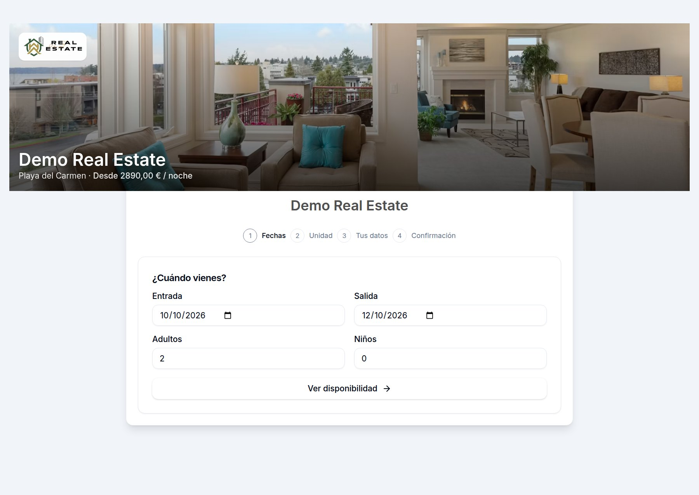
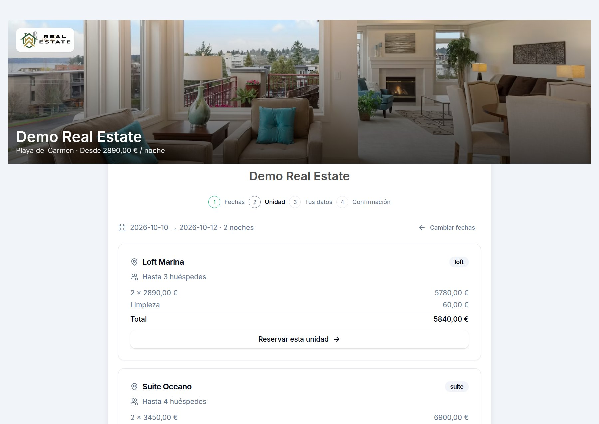
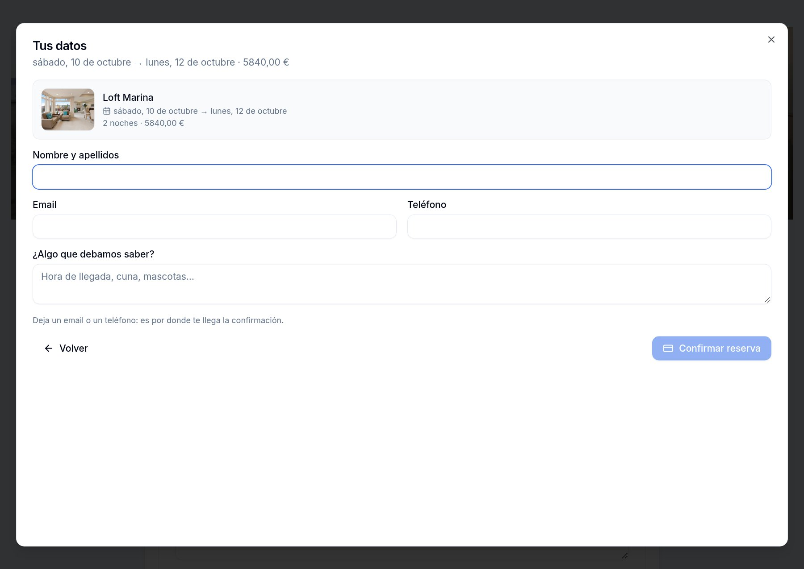
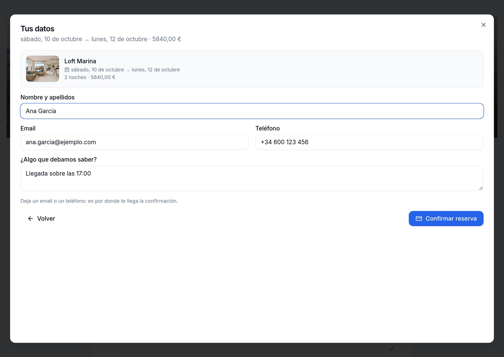
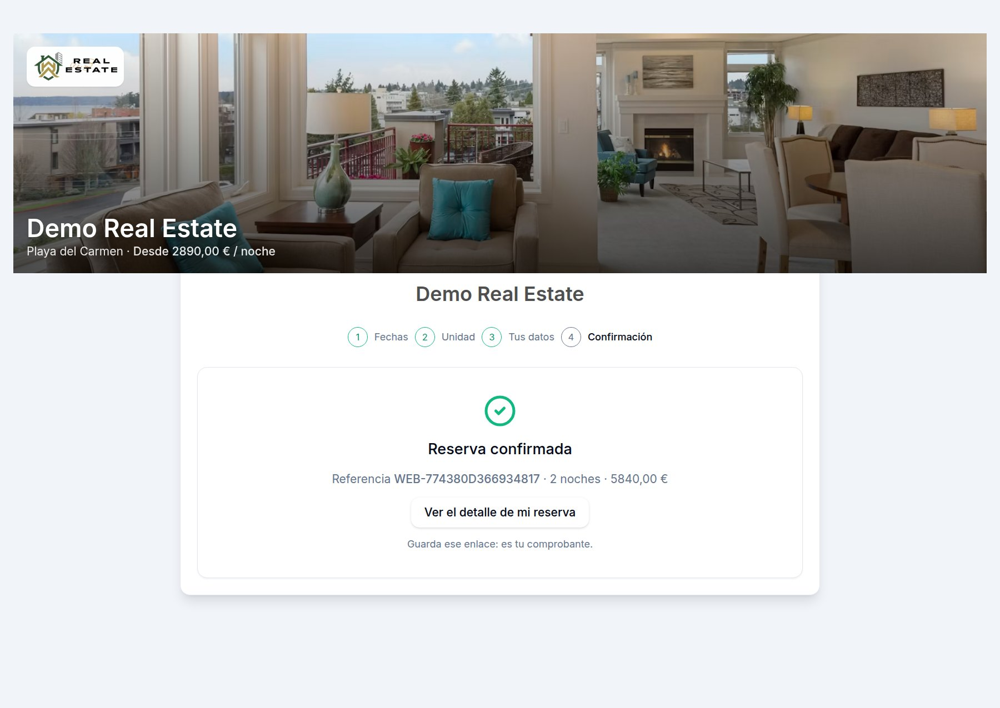

# Volkern Hospitality — Guía del usuario

**Guía de uso del módulo de hospitality: de la primera propiedad a la reseña del huésped.**

Esta guía explica, clic a clic, cómo se usa el módulo de Hospitalidad de Volkern. Está
escrita para quien opera un alojamiento —propietario (Anfitrión), recepción, limpieza,
mantenimiento o agencia administradora— y describe solo lo que el producto hace hoy:
cada pantalla se ha contrastado con su código fuente (listado al final).

**Convenciones usadas en esta guía:**
- Ruta del menú: `Hospitality → Nombre de sección` (el módulo entero cuelga del menú
  lateral bajo **Hospitality**).
- Los botones sensibles al permiso se ocultan si tu rol no puede usarlos: si no ves un
  botón que esta guía menciona, tu rol no tiene esa capacidad — no es un fallo.
- «Unidad» = habitación, apartamento, villa… la cosa reservable. «Propiedad» = el
  edificio o finca que agrupa unidades.

---

## Quick-start para recepción

**La rutina del día en una página.** El resto de esta guía es referencia; esto es lo que
se usa en cada turno.

**1 · Abre el día** — `Hospitality → Reservas`. Las píldoras de arriba dicen la carga de
hoy: «X llegadas hoy» y «X salidas hoy». Púlsalas para filtrar la lista.

**2 · Llegadas (check-in)** — para cada reserva de hoy:
- ¿Faltan los datos del viajero? (aviso amarillo, icono de persona en la fila) → botón
  **Enlace de check-in**: cópialo y envíalo al huésped; lo completa en dos minutos desde
  su móvil, sin cuenta ni contraseñas (§8).
- Datos completos → desplegable de estado **Check-in**: la unidad pasa a «Ocupada» y el
  huésped recibe sola la comunicación con las instrucciones de acceso (§7).
- **Fianza** (escudo en la fila): registra y cobra el depósito al entrar; quedará como
  «Cobrada — devolver a la salida».

**3 · Salidas (check-out)** — desplegable **Check-out**: la unidad pasa a «Limpieza» y la
tarea se crea sola (limpieza la cierra Operaciones). Con daños, la fianza se **aplica a
daños**; si no, se **devuelve** (§7).

**4 · Imprime la hoja del día** — botón **Imprimir**: unidades, horarios y notas para
housekeeping, con el mismo filtro que tengas puesto.

**5 · Prepara mañana** — `Hospitality → Dashboard`, tablón «Movimiento de mañana»: quién
llega y a qué unidad, y quién sale (para limpiezas).

| Si pasa esto… | Ve a |
| --- | --- |
| El huésped no llega (no-show) | Marca **No-show**: la unidad queda libre y el cargo se emite y factura desde la fila (§7) |
| Cobrar un extra, ver lo pagado o lo pendiente | **Finanzas** — el dinero vive ahí, no en Reservas (§12) |
| El Ministerio rechazó un parte | El motivo está en la fila de Reservas; corrige el dato y reenvía (§8) |
| No ves un botón que necesitas | Tu rol no tiene esa capacidad: pídesela al Anfitrión (§4) |
| Cualquier otra duda | Tabla de errores frecuentes (§18) |

---

## Índice

- [Quick-start para recepción](#quick-start-para-recepción)

1. [Mapa del módulo](#1-mapa-del-módulo)
2. [Primeros pasos: crear propiedad y unidades](#2-primeros-pasos-crear-propiedad-y-unidades)
3. [Puesta en marcha (onboarding) y publicación](#3-puesta-en-marcha-onboarding-y-publicación)
4. [Roles y permisos del módulo](#4-roles-y-permisos-del-módulo)
5. [Tarifas y disponibilidad](#5-tarifas-y-disponibilidad)
6. [Booking Engine: reserva directa](#6-booking-engine-reserva-directa)
7. [Reservas (recepción)](#7-reservas-recepción)
8. [Check-in y registro de viajeros (Ministerio)](#8-check-in-y-registro-de-viajeros-ministerio)
9. [Planning y operaciones (limpieza, mantenimiento, check-out)](#9-planning-y-operaciones-limpieza-mantenimiento-check-out)
10. [Dashboard](#10-dashboard)
11. [Huéspedes](#11-huéspedes)
12. [Finanzas](#12-finanzas)
13. [Comunicaciones](#13-comunicaciones)
14. [Automatizaciones](#14-automatizaciones)
15. [Reseñas](#15-reseñas)
16. [Reportes](#16-reportes)
17. [Los crons: qué hace Volkern solo](#17-los-crons-qué-hace-volkern-solo)
18. [Errores frecuentes y cómo salir de ellos](#18-errores-frecuentes-y-cómo-salir-de-ellos)
19. [Anexo A: estados y vocabulario](#19-anexo-a-estados-y-vocabulario)
20. [Anexo B: fuentes de esta guía](#20-anexo-b-fuentes-de-esta-guía)

---

## 1. Mapa del módulo

Estas son las secciones que verás en el menú **Hospitality**:

| Sección | Ruta | Para qué |
| --- | --- | --- |
| Inicio (Propiedades) | `/dashboard/hospitality` | Propiedades y unidades: el inventario |
| Puesta en marcha | `/dashboard/hospitality/onboarding` | Asistente de 10 pasos para publicar una propiedad |
| Dashboard | `/dashboard/hospitality/dashboard` | KPIs, ocupación y movimiento de mañana |
| Planning | `/dashboard/hospitality/calendar` | Calendario de ocupación, mes y operaciones del día |
| Reservas | `/dashboard/hospitality/reservas` | Recepción: crear, cambiar estado, check-in/out, fianza |
| Registro de viajeros | `/dashboard/hospitality/viajeros` | Datos de cada viajero y envío al Ministerio del Interior |
| Tarifas | `/dashboard/hospitality/tarifas` | Planes de tarifa y restricciones de venta |
| Booking Engine | `/dashboard/hospitality/booking-engine` | Motor de reserva directa: enlaces, extras, aspecto |
| Huéspedes | `/dashboard/hospitality/huespedes` | Fichas de huésped con su historial |
| Comunicaciones | `/dashboard/hospitality/comunicaciones` | Plantillas WhatsApp/email por evento |
| Automatizaciones | `/dashboard/hospitality/automatizaciones` | Reglas «cuando pasa X, haz Y» |
| Finanzas | `/dashboard/hospitality/finanzas` | Desglose, comisiones, margen y cobros por reserva |
| Reportes | `/dashboard/hospitality/reportes` | Análisis de operación, ventas y reseñas |
| Reseñas (moderación) | `/dashboard/hospitality/resenas` | Publicar o rechazar reseñas y responderlas |
| Equipo y roles | `/dashboard/hospitality/roles` | Qué puede hacer cada rol dentro del módulo |

Check-in/out, limpieza, mantenimiento y bloqueos de fechas **no tienen menú propio**: son
funciones dentro de Reservas y del Planning.

> Nota sobre dominios: la página pública de reserva también funciona bajo **dominio propio**
> del alojamiento (se configura en Booking Engine). Si tu cuenta ya usa dominio propio,
> las URLs públicas de esta guía se sirven con ese dominio en lugar de `volkern.app`.
> Todas las rutas del panel funcionan igual.

**Dos flujos por los que entra una reserva:**
- **Canal externo** (Airbnb, Booking.com, etc.): el proveedor de conectividad envía un
  webhook; Volkern crea la reserva con el canal correspondiente (§7, §17).
- **Reserva directa**: un huésped reserva en tu página pública (§6) y entra al planning
  como canal **Directa**.

Ambos usan el mismo motor de disponibilidad: lo que está reservado en un canal está
bloqueado en todos, incluida tu propia web.

---

## 2. Primeros pasos: crear propiedad y unidades

Pantalla: `Hospitality → Inicio` (pestañas **Propiedades** y **Unidades**).

### Crear una propiedad

1. Pulsa **Nueva Propiedad** (arriba a la derecha).
2. Rellena el formulario:
   - **Nombre** (obligatorio). **Código** interno (ej. `VMA-01`) y **Zona/Barrio**, opcionales.
   - **Descripción**: texto libre; es la que el huésped leerá en la página pública.
   - Dirección completa (dirección, ciudad, provincia, país, CP) y **latitud/longitud**.
   - **Zona horaria**: la del alojamiento (afecta a fechas y ventanas de crons).
   - **Estado**: `Activa` (operativa), `Inactiva`, `Conectada` (la pone el onboarding al
     publicar) o `En configuración` (borrador).
   - **Penalización por no-show**: `Ninguna`, `Primera noche` o `Estancia completa`. Con
     alguna penalización, una reserva marcada no-show genera un cargo por ese importe.
   - **Salida anticipada**: cómo se cobra una salida antes de tiempo (opción A/B).
   - **Caducidad de reservas pendientes (horas)**: cuántas horas retiene una reserva
     `pending` la unidad sin confirmarse. Por defecto 24 h; `0` = sin caducidad
     automática (alguien la cierra a mano). Una pendiente **con pagos registrados no
     caduca nunca**: eso lo decide una persona.
   - **Fotos** (máx. 10, por URL `http(s)://`): la primera es la portada de la tarjeta.
3. Opcional: en **Unidades iniciales** puedes dar de alta hasta 5 unidades en el mismo paso.
4. Pulsa **Guardar**.

### Crear una unidad

1. Pestaña **Unidades** → **Nueva Unidad** (requiere al menos una propiedad).
2. Rellena: propiedad, **nombre**, **código**, **tipo** (apartamento, habitación, casa,
   villa, estudio, loft, bungalow u otro), **capacidad** (personas), **estado** operativo,
   **tarifa base** con su **moneda** y **descripción**.
3. **Amenidades**: marca las que tiene (Wifi, A/C, cocina, parking, pet friendly…).
4. **Fotos** (máx. 10 por URL). La primera foto es la que verá el huésped al elegir la unidad.
5. **Guardar**.

La divisa de una unidad nueva nace por defecto de la moneda de reporte de la cuenta (o de
la divisa del inventario si ya existe). Puedes cambiarla en el alta.

**Estados operativos de una unidad**: `Disponible`, `Ocupada`, `Limpieza`, `Sucia`,
`Mantenimiento`, `Fuera de servicio`. Los cambias al editar la unidad, y algunos los
cambia el propio sistema (check-out → Limpieza; limpieza completada → Disponible).

### Editar y eliminar

- **Editar** abre el mismo formulario.
- **Eliminar** pide confirmación y borra los datos asociados. Piénsalo: no hay «papelera».
- El buscador filtra tarjetas por nombre, ciudad o código en ambas pestañas.

---

## 3. Puesta en marcha (onboarding) y publicación

Pantalla: `Hospitality → Puesta en marcha` (o el botón **Puesta en marcha** de una
propiedad). Es un asistente de **10 pasos** que termina publicando la propiedad:

1. **Crear propiedad** — si no existe todavía.
2. **Crear unidad** — alta de las unidades reservables.
3. **Datos operativos** — cada unidad necesita capacidad y precio: un plan de tarifa
   activo (Tarifas) o tarifa base. El paso te lista unidad por unidad lo que falta.
4. **Conectividad** — la conexión con los canales la configura la plataforma (te dice si
   está o no configurada).
5. **Mapping externo** — vincular cada unidad con su código del canal externo
   (`hotelCode`). Si el proveedor sugiere vínculos automáticos, aquí se revisan: se
   aceptan o se deshacen (deshacer es un cambio de configuración con confirmación).
6. **Guardar vínculos** — confirmar el mapping unidad ↔ código externo.
7. **Probar disponibilidad** — consulta real al canal para validar el vínculo.
8. **Probar tarifas** — empuja una tarifa y la valida en el canal.
9. **Probar reserva** — registra una reserva de prueba **por el mismo camino que las
   reales y la elimina después**.
10. **Activar** — si todo está cumplido, el botón **Activar propiedad** la marca como
    `Conectada`: ya recibe y sincroniza reservas. Y solo cuando una propiedad está
    `Conectada` se publica en el Booking Engine.

Los pasos fallidos muestran el motivo exacto (p. ej. credenciales sin configurar) y cada
prueba deja traza. Puedes repetir una prueba sin deshacer nada.

---

## 4. Roles y permisos del módulo

Pantalla: `Hospitality → Equipo y roles`.

Este módulo no decide por el nombre del rol: todo se concede con **capacidades**
(`reservas.cancelar`, `operaciones.gestionar`, `integraciones.administrar`…). La pantalla
muestra el **catálogo de roles del producto**:

| Rol | Qué es / puede |
| --- | --- |
| **Anfitrión** | Administra la propiedad entera, incluido su certificado y quién entra al módulo |
| **Agente** | La empresa administradora: opera, cobra y resuelve; no firma ni reparte permisos |
| **Mantenimiento** | Incidencias y el día de la propiedad |
| **Limpieza** | Llegadas, salidas y marcar limpiezas. No entrega llaves, no ve documentos ni dinero |
| **Huésped** | El cliente: solo las reservas vinculadas a su contacto (nada de la cuenta) |

Cómo se usa:

- **Aplicar catálogo**: crea (o completa) los roles anteriores en tu cuenta. Es **solo
  aditivo**: nunca quita permisos, así que repetirlo no deja a nadie sin acceso.
- **Ver matriz**: abre la matriz de permisos del rol en `Equipo → Roles` para ajustarlo
  a mano. La acción de recortar se llama **Restablecer** y pide confirmación a propósito.
- **Huéspedes con acceso** (abajo): lista las cuentas con rol Huésped; ahí se **vincula
  un contacto del CRM** con la cuenta (o se da de alta la cuenta ya vinculada). Sin
  vínculo, un huésped entra y ve cero reservas — nunca todas.

> Ocho módulos con permiso: Reservas, Operaciones, Mantenimiento, Integraciones,
> Finanzas, Comunicaciones, Automatizaciones y «Mis reservas» (el rol Huésped).

---

## 5. Tarifas y disponibilidad

Pantalla: `Hospitality → Tarifas`.

Si una unidad no tiene ningún plan, se vende a su **tarifa base**. Los planes de tarifa
añaden estacionalidad, ajustes y restricciones:

1. **Nuevo Plan** (o **Editar** en un plan existente):
   - Propiedad y **unidad** del plan.
   - **Tarifa por noche** (con su moneda) y nombre/código del plan.
   - **Temporadas** (estacionalidad): rangos de fechas con precio propio.
   - **Ajustes por demanda** y **recargos de fin de semana** (porcentaje extra).
   - **Restricciones**: **mínimo/máximo de noches** por estancia y **días permitidos de
     check-in y check-out** (p. ej. «solo entradas de sábado»).
2. **Duplicar**: crea una copia del plan para editarla (útil entre temporadas).
3. **Sincronizar tarifas**: empuja los cuatro conjuntos (inventario, restricciones,
   tarifas y restricciones de tarifa) al canal externo, horizonte 180 días.
4. Al guardar un plan, la sincronización a los canales se dispara sola.

Las tarjetas de la lista resumen cada plan: precio/noche, rango de noches, nº de
temporadas, recargo de fin de semana, nº de ajustes y días de entrada/salida.

**Bloqueos de fechas**: desde el **Planning** (botón «Bloquear fechas» en la fila de la
unidad) puedes cerrar un rango con motivo `Propietario`, `Mantenimiento` o
`Administrativo`. Un bloqueo resta disponibilidad en todos los canales igual que una
reserva, y se comunica al canal externo.

---

## 6. Booking Engine: reserva directa

Pantalla: `Hospitality → Booking Engine`. Hay dos webs públicas para el huésped:

- **`/reservar/<slug>`** — la página de reservas de tu cuenta (el `slug` es el de tu
  tenant, se asignó al activar el módulo): enseña todas tus propiedades publicadas.
- **`/booking/<id-propiedad>`** — la página de reserva de **una propiedad concreta**, la
  que generan los enlaces de esta pantalla. También hay widget embebible (`/embed`).

Esta pantalla **lista las propiedades publicadas** (las `Conectadas` del onboarding) y,
para cada una, da:

- **Enlace público en español** y **en inglés** (`?lang=en`), con botones de copiar y
  abrir. Los enlaces son por **propiedad** (`/booking/<id-propiedad>`).
- **Snippet de embed** (iframe) para pegar el motor en tu propia web.
- **Extras comprables**: el catálogo de extras que el huésped puede añadir a su reserva.
- Si la propiedad no está publicada: «Completa la Puesta en marcha de esta propiedad…».

### Qué puede configurar el hotel

**a) Aspecto y dominio** (panel superior «Aspecto y dominio»):
- **Plantilla** de la página pública (4 plantillas disponibles).
- **Personalización**: colores de la página (se aplican a la plantilla elegida).
- **Dominio propio** del alojamiento y su **verificación** (registro TXT
  `_volkern-booking.<dominio>` con el valor que te indica el panel; botón **Verificar**).
- El **logo** de la cabecera de la página pública es el **logo corporativo de tu cuenta**
  (Configuración → Empresa). Sin logo configurado, la página pública sale sin logo.
- Para probar: abre el enlace público y recorre el flujo completo.

**b) Extras comprables** (por propiedad, botón **Gestionar**):
- **Nuevo extra**: nombre, **precio** (la moneda es la de reporte de la cuenta, no se
  elige), **precio por noche** sí/no, descripción **ES** y **EN**.
- El interruptor **Activo/Inactivo** deja de vender el extra sin borrarlo (los extras
  **no se borran**: se desactivan, para no romper el histórico de reservas que los compraron).
- Cantidades: el huésped elige 0–10 por extra; los «por noche» se multiplican por las
  noches de la estancia.

**c) Política comercial de la reserva directa** (se guarda con la configuración del
módulo): texto de **política de cancelación**, **anticipo** (% que se pide ahora),
**tarifa de limpieza** y si se **exige pago online**. Si exiges pago online sin cuenta de
cobro conectada, la reserva se rechaza con causa clara en vez de crear una que nadie puede
pagar (§12: la cuenta de cobro se muestra en Finanzas).

### La experiencia del huésped

El huésped recorre un **wizard de 4 pasos**, en español o inglés (`?lang=en`).
Capturas del flujo real en producción (tenant demo, `/reservar/volkern-demo`):

**Paso 1 · Fechas** — calendario + nº de huéspedes → «Ver disponibilidad». Consulta el
motor de disponibilidad real (reservas + bloqueos). Arriba, la cabecera de la página con
el logo corporativo del hotel, la foto de portada y la tarifa «desde»:



**Paso 2 · Unidad** — tarjetas de las unidades libres con su **precio por noche** y el
desglose completo (noches × tarifa + limpieza = total). «Reservar esta unidad» abre el
paso 3:



**Paso 3 · Tus datos** — modal con la **foto de la unidad elegida**, las **fechas en
claro** («sábado, 10 de octubre → lunes, 12 de octubre»), las **noches** y el **total**.
Rellena nombre, email y teléfono; añade extras (selector con cantidades) y envía:





**Paso 4 · Confirmación** — la reserva queda creada con su **referencia** (`WEB-…`) y un
enlace de detalle que el huésped debe guardar como comprobante:



Reglas que conviene conocer:
- **El precio lo calcula el servidor**: la web no inventa importes (anti-manipulación).
- **No se vende dos veces**: si dos huéspedes eligen lo mismo a la vez, el segundo recibe
  error de disponibilidad (409).
- **Idempotencia**: recargar o reenviar el formulario no duplica la reserva.
- Al confirmarse, entra al planning como canal **Directa**, el huésped queda en Huéspedes
  y en el CRM, y se empuja la disponibilidad al canal externo.
- La página pública muestra también la **media de reseñas publicadas** y las últimas
  reseñas (§15), y el idioma se cambia con el conmutador ES/EN.

---

## 7. Reservas (recepción)

Pantalla: `Hospitality → Reservas`.

Es la pantalla de recepción. Arriba: cabecera con el **total de reservas, noches e
ingresos** del listado filtrado, y botones **Exportar CSV**, **Imprimir** y **Nueva Reserva**.

### El día de un vistazo

Dos **píldoras** fijas —«X llegadas hoy» y «X salidas hoy»— muestran la carga del día de
la recepción en toda la cuenta. Al pulsarlas filtran la lista (son excluyentes entre sí:
una reserva llega y sale en días distintos).

### Filtros y avisos

- **Buscar** por huésped, email o referencia; filtrar por **estado**, **canal** y
  **propiedad**. «Limpiar» borra todo.
- **Aviso de partes pendientes** (amarillo): reservas sin los datos del viajero que exige
  el RD 933/2021 antes de la llegada. Desde el aviso o la fila: **Corregir los datos** o
  copiar el **Enlace de check-in** para pedírselos al huésped (§8).
- **Aviso de partes rechazados** (rojo): el Ministerio rechazó la comunicación. Cada
  rechazo trae su **motivo**, qué corregir, y acciones (corregir datos / reenviar). Si se
  agotan los reintentos automáticos, el aviso lo dice: el producto ya no lo reintenta solo.

### Exportar e imprimir

- **Exportar CSV**: descarga la lista visible con los filtros activos (llegadas, salidas y
  respuestas de check-in incluidas).
- **Imprimir**: abre en pestaña nueva la **hoja de housekeeping** (unidades, horarios y
  notas, con los mismos filtros) lista para Ctrl+P.

### Crear o editar una reserva

**Nueva Reserva** abre el formulario: propiedad/unidad, fechas de entrada y salida
(obligatorias; la salida debe ser posterior), datos del huésped (nombre, email, teléfono),
canal (por defecto «Directa»), estado inicial (por defecto «Confirmada»), importe con su
divisa y **notas** (texto libre: «Check-in tardío, cuna para bebé…»). Editar una reserva
permite corregir fechas, unidad o importe; los cambios se comunican al canal externo.

### Estados de una reserva y qué hacer en cada uno

`pending → confirmed → checked_in → checked_out`, con salidas a `cancelled` y `no_show`.
En la tabla, el desplegable de estado de cada fila ofrece **solo los estados que tu rol
puede aplicar** (cancelar exige `reservas.cancelar`; si no puedes aplicar ninguno, no hay
desplegable):

- **Pendiente (pending)**: retención. Caduca sola según las horas configuradas en la
  propiedad (§2) **si no tiene pagos**; si tiene pagos, decide una persona.
- **Confirmada (confirmed)**: bloquea la unidad. Es el estado inicial de las reservas
  directas cuando no se exige pago online.
- **Check-in (checked_in)**: marca la unidad `Ocupada` y dispara la comunicación
  «check_in». Desde la edición también se puede reubicar la reserva en otra unidad.
- **Check-out (checked_out)**: marca la unidad `Limpieza`, crea la **tarea de limpieza**
  y dispara «post_salida».
- **Cancelada (cancelled)**: cancelar una reserva no es editarla — es una acción aparte
  con su propia capacidad, y libera la unidad.
- **No-show**: el huésped no llegó. Genera el **cargo por penalización** según la
  política de la propiedad y **no produce ingreso ni ocupación**: la unidad queda libre.
  En la fila aparece el botón de **Penalización** con previsualización del importe, y dos
  pasos: **emitir el cargo** y **facturarlo por el ERP** (Hospitality no factura; el
  ERP emite la factura con su número).

### Acciones de la fila

Cada fila concentra las acciones del día, según el estado de la reserva y tus permisos:

- **Cambiar estado** (desplegable, con la regla de capacidades de arriba).
- **Fianza** (escudo, si la reserva tiene línea de fianza): abre el diálogo para
  **registrar** el importe, **cobrar**, **devolver** o **aplicar a daños** (con
  importe retenido), o **quitar** la fianza. El dinero real lo mueve Finanzas; aquí se
  gestiona el **estado** de la garantía.
- **Penalización** (solo en no-show): ver el cálculo, emitir el cargo y facturarlo (§ arriba).
- **Parte de viajeros** (si faltan datos): **completar los datos a mano** o **copiar el
  enlace de check-in** del huésped (§8).
- Si el parte fue **rechazado**, la acción correcta aparece según el ámbito del rechazo
  (dato del huésped → corregir datos; configuración → aviso de qué tocar).

> La ficha económica completa —desglose de líneas, comisión OTA, neto, margen y registro
> de pagos— vive en **Finanzas** (§12). Reservas decide **estados**; Finanzas decide
> **dinero**.

---

## 8. Check-in y registro de viajeros (Ministerio)

Dos pantallas trabajan juntas: **Registro de viajeros** (los datos y el envío) y el
**check-in online** del huésped (cómo llegan esos datos).

### El check-in online del huésped

- Cada reserva tiene un **enlace firmado** (`/checkin/<token>`) que recepción copia desde
  la ficha (botón «Enlace de check-in») o que envía la **comunicación pre-llegada**.
- El huésped abre el enlace **sin cuenta ni contraseña** (el token es la credencial), en
  español o inglés, y completa sus datos de viajero (documento, nacionalidad, domicilio…)
  y responde las **preguntas personalizadas** que haya configurado el alojamiento (§8,
  configuración).
- Cuando el huésped envía, los datos quedan en su registro de viajero y el parte del
  Ministerio sale con lo completo (§9: barrido horario).
- Pre-llegada (24 h antes), el cron `hospitality-checkin-due` envía la comunicación
  «pre_llegada» (con el enlace si hay plantilla).

### Registro de viajeros: configuración (una sola vez)

Pantalla: `Hospitality → Registro de viajeros` → **Configuración del arrendador**:
- **Código de arrendador** (lo asigna el Ministerio al registrar el inmueble) y un
  **código de establecimiento por propiedad** (el de cada inmueble registrado).
- **Credenciales** de la Sede Electrónica (usuario/contraseña) y **certificado digital
  de la entidad** (`.p12` + contraseña; se guarda cifrado).
- **Entorno**: `Pruebas del Ministerio` o `Producción`.
- **Código de tipo de pago** del catálogo oficial.
- **Preguntas personalizadas del check-in**: preguntas propias del alojamiento (hora de
  llegada, matrícula del coche, mascotas…) que responde el huésped en su enlace y quedan
  en la reserva para el hotel — **jamás salen en el parte oficial** (una pregunta mal
  puesta podría hacer rechazar la comunicación entera, y por eso están separadas).
- Guardar. Hasta que esté completo, la pantalla avisa «Todavía no se puede comunicar…» y
  el envío automático no arranca.

### Operación diaria

1. La pantalla muestra **KPIs**: Aceptadas, Esperando lote, Faltan datos, Rechazadas.
2. Cada reserva lista a sus **viajeros** con su estado (datos completos o lo que falta).
   Acciones por reserva: **Pedir datos por WhatsApp** (un mensaje con los enlaces firmados
   de todos los viajeros incompletos), añadir/editar viajero a mano, **enviar
   comunicación** (RH: la reserva; PV: el parte de viajeros) y **anular** una ya enviada.
3. **Consultar lotes**: el alta es asíncrona — el Ministerio devuelve un número de lote y
   el código de comunicación (o el error) llega al consultar el lote. El botón consulta
   los lotes pendientes.
4. El **barrido horario** (`hospitality-registro-viajeros`, §17) envía solo: partes
   completos dentro de la ventana de 24 h del RD 933/2021, consulta de lotes y avisos.
   La pantalla muestra si una reserva aún espera el XSD oficial de «reserva de hospedaje
   (RH)» — mientras tanto, el parte de viajeros (PV) sí se comunica con normalidad.
5. Si el Ministerio **rechaza** un parte, el motivo y su corrección aparecen en Reservas
   (§7) y en esta pantalla; corregidos los datos, se reenvía.

**Validaciones que el módulo aplica** (porque el servicio rechaza el fichero entero si
falla una): nombre y primer apellido obligatorios; segundo apellido obligatorio si el
documento es NIF/NIE; número de documento válido para mayores de edad; fecha de
nacimiento; contacto (teléfono o correo); dirección con **código de municipio INE**
(5 dígitos) si el país es España; país y nacionalidad ISO alfa-3; y bloque de pago. Si
hay menores, alguien del parte debe informar el **parentesco**.

---

## 9. Planning y operaciones (limpieza, mantenimiento, check-out)

Pantalla: `Hospitality → Planning` (vista **Operaciones**: `Planning → Operaciones` en el
conmutador de vistas).

### Las tres vistas

- **Planning**: rejilla de unidades × días (semana navegable, botón «Hoy»). Cada barra es
  una reserva con su color de canal (y los bloqueos en su color). En la cabecera de cada
  fila: nº de reservas de la unidad y botón **Bloquear fechas**.
- **Mes**: ocupación del mes por día, con navegación por meses.
- **Operaciones**: el **día de hoy** de la casa — llegadas (con su estado de check-in),
  salidas, limpiezas pendientes/en curso y mantenimientos abiertos. Botón **Refrescar**.
- Filtro por **propiedad** arriba; en móvil, tarjetas «Llegadas hoy» / «Salidas hoy».

### El ciclo de la unidad (lo que el sistema hace solo)

```
Check-out (reserva)  → unidad pasa a Limpieza  → se crea la tarea de limpieza
Limpieza completada  → unidad vuelve a Disponible → push al canal externo
Incidencia de mantenimiento → unidad puede pasar a Mantenimiento (deja de venderse)
```

### Limpiezas y mantenimientos (en Operaciones)

- **Limpieza**: cada tarea tiene prioridad, responsable y estado
  (`pending → in_progress → completed`, o `blocked`). Marcarla completada libera la unidad.
- **Mantenimiento**: registra la incidencia (prioridad, responsable); se resuelve y se
  cierra. La unidad en mantenimiento resta disponibilidad hasta volver.
- Los dos alimentan el Dashboard (contadores de limpieza pendiente y mantenimiento abierto).

---

## 10. Dashboard

Pantalla: `Hospitality → Dashboard`. Es la foto de la casa en un vistazo:

- **KPIs** (tarjetas): Ocupación hoy (unidades ocupadas / total), Llegadas hoy, Salidas
  hoy, Reservas activas (y cancelaciones del período), **Ingresos 30 días** (con noches
  vendidas) y **ADR** (ingreso medio por noche).
- **Movimiento de mañana**: tablón con **quién llega y a qué unidad** (para asignar
  unidades y preparar) y **quién sale** (para planificar limpiezas). Si no hay nada para
  mañana, lo dice — un tablón vacío también es información.
- **Mix de canales**: pastel de reservas e ingresos por canal (Airbnb, Booking.com, Directa…).
- **Próximos 7 días**: barra de ocupación por día.
- **Ocupación por propiedad**: líneas comparando propiedades.
- **Ingresos por canal**: evolución (área apilada) de ingresos por canal.
- **Operaciones**: contadores de limpieza (pendiente + en curso) y mantenimiento (abierta
  + en proceso).

---

## 11. Huéspedes

Pantalla: `Hospitality → Huéspedes`.

- Tarjeta por huésped con su historial: nº de **estancias**, **noches** y **gasto** total,
  y la fecha de su última estancia. Etiqueta **«En CRM»** (vinculado a un contacto) o
  **«Sin vincular»**.
- Buscar por nombre/email/teléfono; ordenar por última estancia o nombre.
- **Ficha** (panel lateral): todas sus estancias con canal, fechas, unidad, importe y
  peticiones especiales.
- **Vincular a CRM**: si el huésped no está vinculado, el botón abre un diálogo para
  buscar un contacto existente (o crearlo). Todo huésped de una reserva —directa o de
  canal— acaba en el CRM de la cuenta; si no, aquí lo puedes atar a mano.
- **Ver en Contactos**: abre el contacto del CRM en su ficha.

---

## 12. Finanzas

Pantalla: `Hospitality → Finanzas`.

Por reserva (todas las cifras las calcula el servidor):

- **Desglose** de líneas (alojamiento, limpieza, extras, otros, penalización) — la suma
  es el ingreso bruto.
- **Comisión OTA** y **comisión de pasarela**, **otros gastos**, y de ahí **neto** y
  **margen %**. Los gastos del ERP asociados a la reserva también aparecen.
- **Estado de cobro**: `Pendiente`, `Parcial`, `Pagado`, `Sobrepagado`, `Reembolsado`.
- **Pagos**: registrar cobros de la reserva (método, importe, referencia, notas).
- **Fianza**: el estado de la fianza de la reserva y sus transiciones (§7).
- La **penalización por no-show** se muestra aparte: es cargo, no ingreso de alojamiento.

Resumen superior: totales **por moneda** (bruto, comisiones, neto, cobrado, pendiente),
**por canal** y **por estado de cobro**. Si la cuenta trabaja en varias divisas, cada
importe se muestra en la suya, sin conversiones inventadas.

**Cuenta de cobro (Stripe Connect)**: tarjeta con el estado de la cuenta que cobra las
reservas directas online (`sin_conectar`, `pendiente`, `activo`, `restringido`). Mientras
no haya cuenta conectada, el pago online del Booking Engine no está disponible (§6) —
la reserva directa funciona y el cobro se hace fuera de la plataforma.

---

## 13. Comunicaciones

Pantalla: `Hospitality → Comunicaciones`.

Plantillas automáticas que Volkern envía por **WhatsApp o email**. Un evento = una
tarjeta; cada plantilla se configura por canal e idioma:

| Evento | Cuándo |
| --- | --- |
| ✅ **Confirmación** | Al recibir una reserva nueva o confirmada |
| 📅 **Pre-llegada** | 24 h antes del check-in (cron) — aquí va el enlace de check-in |
| 🔑 **Check-in** | Instrucciones de acceso el día del check-in |
| 👋 **Post-salida** | Agradecimiento después de la salida |
| ⭐ **Solicitud de reseña** | Tras la salida (cron), con la variable `{{enlace_resena}}` |

En cada plantilla: **canal** (WhatsApp/email), **idioma** (ES/EN), **contenido** con
variables — `{{nombre}}`, `{{propiedad}}`, `{{unidad}}`, `{{referencia}}`, `{{checkIn}}`,
`{{preguntas_pendientes}}`, `{{enlace_checkin}}` y `{{enlace_resena}}` (esta última solo
en el evento reseña) — y acciones: **Enviar prueba** (a un destinatario que escribas),
**Editar**, **Activar/Desactivar** y **Eliminar**. El botón **English** crea la versión
en inglés con el texto sugerido si no existe.

Regla de envío: el mensaje sale en el idioma en que reservó el huésped (directa) y, si no
hay plantilla en ese idioma, cae al español. El canal sale del canal activo de la plantilla.

---

## 14. Automatizaciones

Pantalla: `Hospitality → Automatizaciones`.

Reglas «cuando pasa X, haz Y» sobre el Automation Engine de la plataforma. Un trigger =
una tarjeta, con la sugerencia de regla típica si no tienes ninguna:

| Trigger (disparador) | Sugerencia |
| --- | --- |
| 📥 Reserva creada | Crear tarea de preparación de la unidad |
| ✏️ Reserva modificada | Reenviar confirmación actualizada |
| ❌ Reserva cancelada | Liberar disponibilidad y avisar |
| 🔑 Check-in realizado | Enviar instrucciones de acceso |
| 👋 Check-out realizado | Crear tarea de limpieza |
| ⏰ Check-in en 24h | Enviar recordatorio de llegada |
| 🧹 Limpieza completada | Marcar unidad disponible |
| 🔧 Mantenimiento creado | Notificar al responsable |
| ✅ Mantenimiento completado | Avisar que la unidad vuelve al inventario |

**Acciones disponibles**: Crear tarea (CRM), Crear limpieza, Enviar mensaje (plantilla de
Comunicaciones), Cambiar estado de unidad. Una regla puede encadenar varias acciones.

En cada regla: **Probar con reserva real** (la ejecuta de verdad contra una reserva
existente y muestra el resultado), Editar, Activar/Desactivar y Eliminar. La tarjeta
muestra el nº de ejecuciones y el estado de la última. Estadísticas arriba: reglas,
activas, triggers cubiertos, ejecuciones (y en curso), con fallo o parciales.

---

## 15. Reseñas

Pantalla: `Hospitality → Reseñas` (moderación). El ciclo completo:

1. Tras el check-out, el **cron de reseña** (10:30, dentro de 72 h de la salida) envía la
   plantilla «Solicitud de reseña» con el enlace `{{enlace_resena}}` (en el idioma en que
   reservó el huésped; si no hay plantilla EN, cae a ES).
2. El huésped puntúa **1–5** y comenta en `/review/<token>` (sin cuenta: el token es la
   credencial). La reseña nace **pendiente** y puede corregirla mientras siga pendiente.
3. Tú moderas: **Publicar** o **Rechazar** (con **Reponer** para reabrir una cerrada).
   Puedes añadir una **respuesta pública** del hotel. La puntuación y el comentario del
   huésped **no se editan nunca**.
4. Solo lo **publicado** sale en la web pública: la media (redondeada a un decimal) y las
   últimas reseñas con su respuesta. Sin reseñas publicadas, la web no enseña ningún 0.0.

Importación de histórico: en la misma pantalla puedes **importar el CSV de reseñas de tu
canal** para arrancar con prueba social. Puntuación ≤ 2000 caracteres de comentario;
nombre público sin email ni teléfono.

---

## 16. Reportes

Pantalla: `Hospitality → Reportes`. Selector de ventana arriba (últimos N días, incluye
hoy) y dos exportaciones CSV: **Reporte de operación** y **Reporte de ventas**.

- **Operación**: ocupación por propiedad (media), ADR, **RevPAR**, estancia media,
  llegadas, **no-shows** y su tasa, cancelaciones.
- **Ventas**: mix por canal (reservas, ingresos, ingreso medio), **antelación media y
  mediana de reserva**, y las reservas directas por idioma (ES/EN, cuota e ingresos en EN).
- **Partes de viajeros**: aceptadas, sin reintentar (con el desglose de rechazados vs.
  no entregados — se arreglan distinto) y su tasa; **preguntas de check-in**: respuestas,
  pendientes y tasa de respuesta.
- **Reseñas**: media y volumen por propiedad y canal, y evolución mensual por fecha de
  estancia — aquí se ve el efecto de las mejoras (§15).
- **Holds**: abandono de reservas pendientes caducadas vs. confirmadas, con aviso si es
  anómalo.
- Los importes se escriben en la divisa que devuelve el informe; el multimoneda se lista
  por divisa.

---

## 17. Los crons: qué hace Volkern solo

Nadie tiene que pulsar nada de esto (visión para el operador):

| Qué | Cuándo | Efecto |
| --- | --- | --- |
| Pre-llegada y preguntas de check-in | cada hora | 24 h antes de la llegada: comunicación «pre_llegada» (con el enlace de check-in) y evento para tus reglas de automatización |
| Holds caducados | cada hora | pendientes sin pagos que superan las horas de la propiedad → canceladas + push |
| Registro de viajeros (Ministerio) | cada hora (minuto 30) | envía partes RH/PV completos, consulta lotes, anula, avisa de abandonados |
| Reconciliación con canales | diaria 04:15 | compara reservas del canal vs. internas y **registra** divergencias (nunca cancela solo) |
| Solicitud de reseña | diaria 10:30 | a 24–72 h de la salida, una sola vez por reserva |
| Vínculos automáticos pendientes | diaria 09:45 | avisa de mappings por revisar en Puesta en marcha |
| Salud de conectividad | diaria 05:00 | vigila el estado del proveedor de conectividad (misma sonda que el botón «Probar») |

Si la conectividad no está configurada, no se llama a la red. Un push fallido **no se
reintenta a ciegas**: queda registrado con su causa para revisión (Tarifas → Sincronizar
tarifas lo fuerza a mano; la reconciliación tiene su consulta de lotes/divergencias).

---

## 18. Errores frecuentes y cómo salir de ellos

| Situación | Qué hacer |
| --- | --- |
| «El nombre es requerido» / no puedo guardar propiedad | El nombre es el único campo obligatorio; revisa también que la URL de cada foto empiece por `http(s)://` |
| No veo el botón «Nueva Reserva» / «Cancelar» | Tu rol no tiene la capacidad (§4). Pídesela al Anfitrión desde Equipo y roles |
| Una reserva `pending` bloquea la unidad | Caduca sola a las horas configuradas (§2) si no tiene pagos; con pagos, confírmala o cancélala a mano |
| Un huésped entra y ve cero reservas | Falta el **vínculo** usuario ↔ contacto (§4, «Huéspedes con acceso»); sin vínculo ve cero, nunca todas |
| La página pública no muestra el logo | El logo es el corporativo de la cuenta (Configuración → Empresa). Si no hay, la página sale sin logo (nunca una marca de Volkern) |
| «Pago online» rechaza la reserva directa | Se exige pago online sin cuenta de cobro conectada (§12). Conecta la cuenta o desactiva la exigencia |
| El huésped dice que no recibió el email/WhatsApp | Revisa que la plantilla esté **Activa** y haz **Enviar prueba** (§13); los crons solo usan plantillas activas |
| Una reseña no sale en la web | Solo lo **publicado** sale (§15): revísala en Reseñas y publícala |
| El Ministerio rechazó un parte | Lee el motivo en Reservas (§7), corrige el dato y reenvía; si agotó reintentos, el reenvío es manual |
| Vendí dos veces lo mismo / 409 al reservar | No debería pasar: el motor revalida. Si ves 409 en la web, las fechas quedaron vendidas entre tu consulta y el envío — elige otras fechas o libera la unidad |
| Cambié una tarifa y el canal no la recibió | Revisa el estado de sincronización (fallo registrado, sin reintento ciego) y fuerza **Sincronizar tarifas** (§5) |

---

## 19. Anexo A: estados y vocabulario

**Estados de una reserva**: `pending` (pendiente) → `confirmed` (confirmada) →
`checked_in` (en curso) → `checked_out` (terminada); salidas: `cancelled` (cancelada) y
`no_show` (no presentado). Una reserva cancelada o no-show **no produce ingreso ni
ocupación**: no bloquea, no factura, no suma en huésped ni reportes.

**Estados operativos de una unidad**: `Disponible`, `Ocupada`, `Limpieza`, `Sucia`,
`Mantenimiento`, `Fuera de servicio`.

**Estados de una tarea de limpieza**: `pending`, `in_progress`, `completed`, `blocked`.
**Estados de una incidencia**: `abierta`, `en_proceso`, `resuelta`, `cerrada`.

**Estados de cobro**: `Pendiente`, `Parcial`, `Pagado`, `Sobrepagado`, `Reembolsado`.
**Estados de la fianza**: `Pendiente de cobro` → `Cobrada — devolver a la salida` →
`Devuelta` o `Aplicada a daños`.

**Estados del registro de viajeros** (pantalla): `Aceptadas`, `Esperando lote`,
`Faltan datos`, `Rechazadas`. El parte nace solo cuando los datos del viajero están
completos.

**Canales de reserva**: los del proveedor de conectividad (Airbnb, Booking.com, …) y
**Directa** (Booking Engine). Cada canal tiene color propio en el Planning.

---

## 20. Anexo B: fuentes de esta guía

Cada afirmación de esta guía procede del código del módulo (ramo `master`) y de sus docs
operativas. Referencias principales:

- Ficha técnica del módulo: `docs/hospitality-ficha-tecnica.md` (menú, modelos, flujos A–G).
- Booking Engine: `docs/hospitality-booking-payments-plan.md` (plan),
  `docs/hospitality-booking-extras.md` (extras), `docs/hospitality-booking-engine-e2e.md`.
- Reseñas: `docs/hospitality-resenas.md`.
- Registro de viajeros (Ministerio): `docs/hospitality-registro-viajeros-mir.md`,
  `docs/registro-viajeros-certificado.md`.
- Estados y reglas transversales: `docs/hospitality-estados-auditoria.md`.
- Conectividad: `docs/hospitality-connectivity-contract.md`.
- Pantallas (`app/dashboard/hospitality/`): `page.tsx` (propiedades/unidades),
  `onboarding/`, `dashboard/`, `calendar/`, `reservas/`, `tarifas/`, `booking-engine/`,
  `huespedes/`, `comunicaciones/`, `automatizaciones/`, `finanzas/`, `reportes/`,
  `resenas/`, `roles/`, `viajeros/`.
- Experiencia pública: `app/reservar/[slug]/page.tsx`, `app/booking/[slug]/page.tsx`,
  `app/embed/reservar/[slug]/page.tsx`, `app/checkin/[token]/page.tsx`,
  `app/review/[token]/page.tsx`, `components/hospitality/booking/BookingWizard.tsx`.
- Módulos puros (`lib/hospitality/`): `booking-engine.ts`, `booking-extras.ts`,
  `booking-i18n.ts`, `booking-config.ts`, `estados.ts`, `holds.ts`, `fianza.ts` +
  `fianza-estados.ts`, `resenas.ts`, `checkin-service.ts`, `registro-viajeros.ts`,
  `roles.ts`, `permissions.ts`.

*Guía generada el 2026-09-27 a partir del código real del módulo. Si algo de esta guía
no coincide con lo que ves en pantalla, manda la captura: la guía se corrige contra el
producto, no al revés.*
