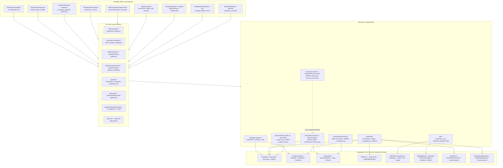
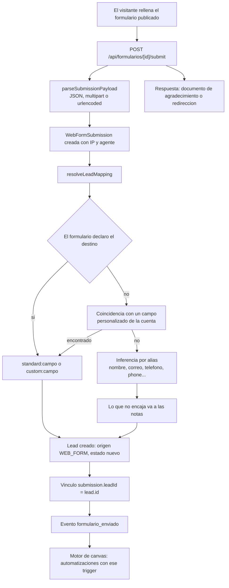
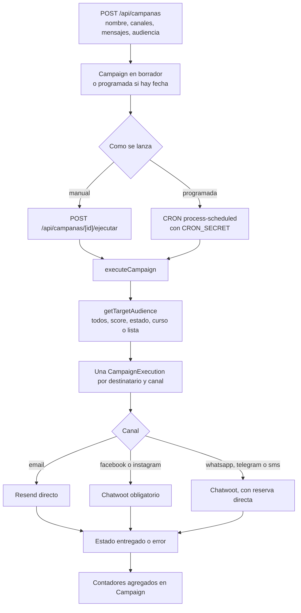
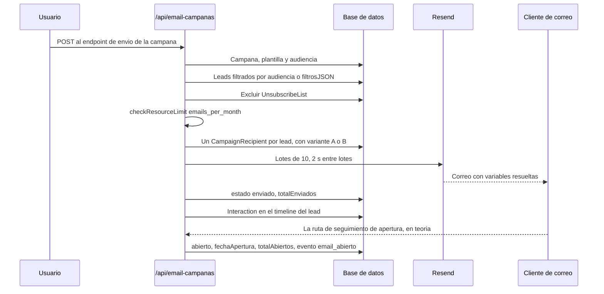
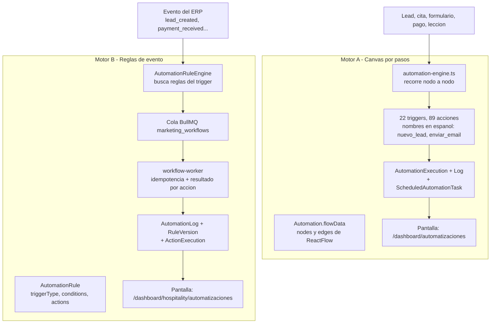
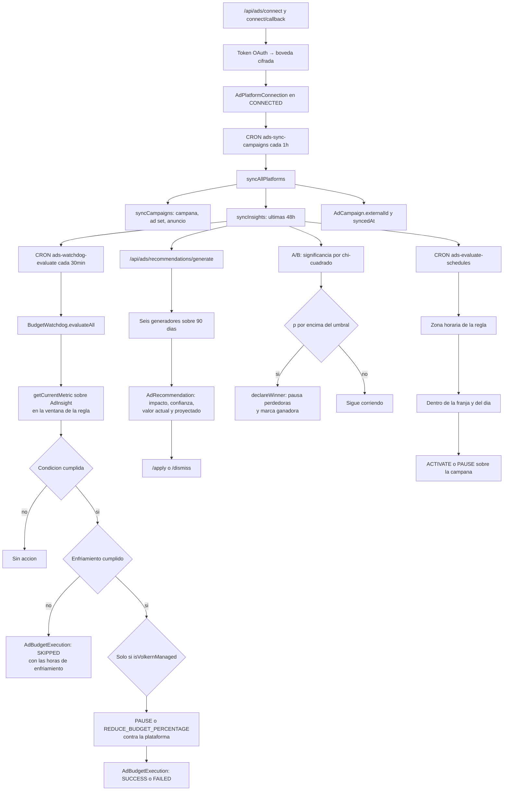
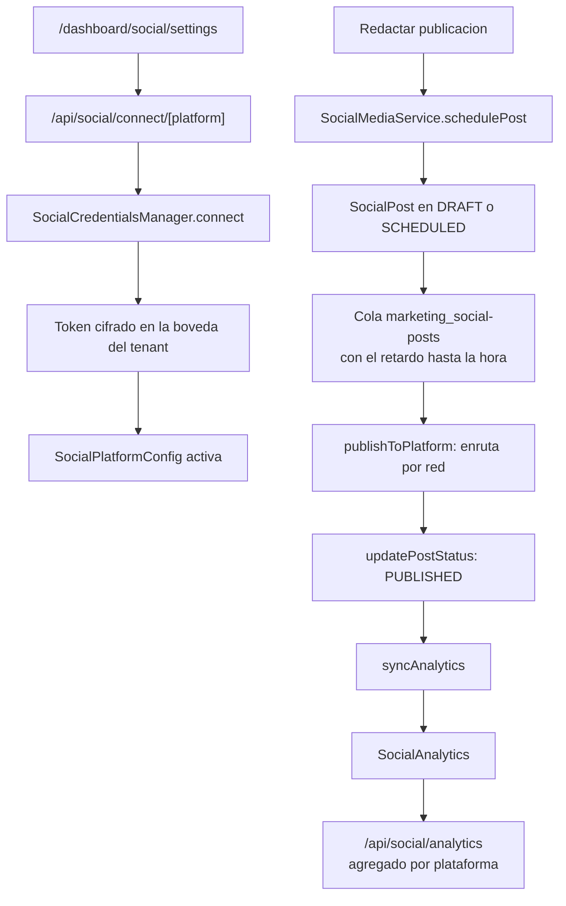
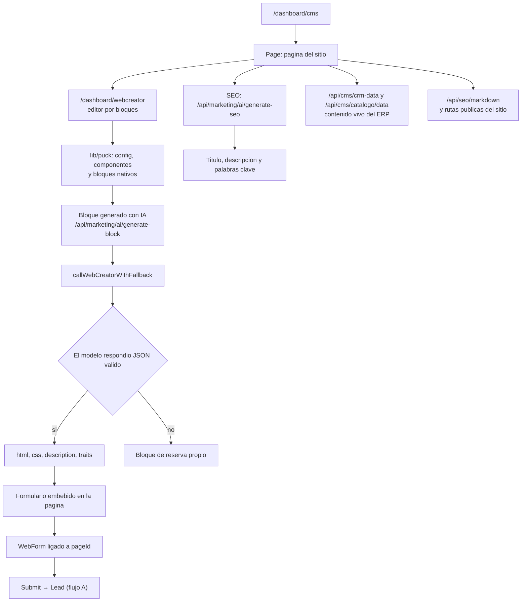

# Volkern Marketing — Documento técnico del módulo

**Qué es, qué hace hoy, cómo funciona por dentro y en qué se diferencia**

Fecha: **2026-10-27** · Autor del inventario: ingeniería de producto Volkern

> **Regla del documento.** No aparece ninguna credencial, contraseña ni clave de API.
> Cuando un dato proviene de una medición, se dice **cuándo** y **cómo** se midió. Cuando
> proviene de otro documento y no se ha podido re-medir, se dice también. Nada se afirma
> «porque el plan lo decía»: hay tres documentos previos que describen este módulo y los
> tres describen, en parte, algo que ya no es cierto (abajo, la lista de correcciones).

## Cómo se ha verificado este documento

| Fuente | Qué se leyó |
|---|---|
| Código del módulo | `lib/marketing/` (21 ficheros, **2.380 líneas**), `lib/ads/` (16 ficheros, **8.201 líneas**), `lib/automation-engine.ts` (832), `lib/automation/` (19 ficheros, 2.403), `lib/campaign-engine.ts`, `lib/automation-service.ts`, `lib/skills/marketing-skills.ts`, `lib/skills/ads-skills.ts`, `lib/leads/` |
| Rutas | **140 `route.ts`** del área (marketing, ads, campañas, email-campañas, formularios, automatizaciones, social, cms, seo, leads, automation) — **14.699 líneas** |
| Interfaz | **24 pantallas** del hub (**≈10.539 líneas**) más `components/hubs/MarketingDashboard.tsx` (233) y `components/hubs/AdsDashboard.tsx` (525) |
| Esquema | `prisma/schema.prisma`: **40 modelos** del área, con sus índices y sus llaves únicas reales |
| Pruebas | 43 ficheros del módulo **ejecutados el 2026-10-27: 618 pruebas, 618 en verde** (§15) |
| Documentos previos | [`MARKETING_ADS_MODULE.md`](./MARKETING_ADS_MODULE.md) (plan de desarrollo por fases, 517 líneas), [`analisis-automatizaciones.md`](./analisis-automatizaciones.md) (27-abr-2026, 436 líneas), [`reporte-automatizaciones.html`](./reporte-automatizaciones.html) |

**Qué corrige este documento respecto a lo que ya estaba escrito:**

1. **`MARKETING_ADS_MODULE.md` es un plan, no un inventario.** Describe seis fases «a
   construir». Lo que está construido y lo que no es exactamente lo que mide el §14: el
   motor de Ads está completo **y sin una sola prueba**; la web pública de planes, los avisos
   y los conectores existen; el bucle «la IA apaga la campaña sola» existe pero su freno de
   seguridad solo cubre campañas marcadas como gestionadas por Volkern.
2. **`analisis-automatizaciones.md` (27-abr-2026) describe el motor de canvas** —14 triggers,
   ReactFlow, `automation-engine.ts` de 1.999 líneas—. Hoy el fichero tiene **832 líneas**
   (el motor se partió en `lib/automation/`), los triggers son **22** y las acciones
   registradas **89**. Además hay **un segundo motor de automatización** que aquel documento
   no menciona (reglas de evento, §9) y que es el único con versionado, idempotencia y
   registro de auditoría.
3. **La aceptación y las bajas de email no usan la tabla de supresión.** El módulo tiene
   `MarketingSuppression` con su servicio y su API (`/api/marketing/compliance/suppressions`),
   y **el camino de envío no la consulta**: consulta `UnsubscribeList`, que es otra tabla
   (§14.1, hallazgo 4).
4. **El píxel de apertura de las campañas de email es una imagen de Google fija**, no la ruta
   de seguimiento del propio producto (§14.1, hallazgo 1).
5. **«Discover» no tiene escritor.** `DiscoverySignal` y `MarketObservation` existen y la
   pantalla los lee, pero **nada en el repositorio los escribe**: la pantalla siempre está
   vacía (§14.1, hallazgo 6).
6. **Las trece acciones de marketing del motor de canvas no funcionan.** Once apuntan a ocho
   modelos que no existen en el esquema (`campana`, `lista`, `publicacionProgramada`,
   `secuenciaEmail`, `actividad`…) y dos llaman a `sendEmail` con la firma equivocada. Compilan
   porque todo va con `as any`; fallan en ejecución (§14.1, hallazgo 2).

---

## 1. Resumen: qué es el módulo

El módulo de Marketing de Volkern es **la máquina de captar y de insistir**: recoge el interés
que llega de fuera, lo convierte en un lead dentro del CRM, y luego lo trabaja —por email,
por redes, por anuncios pagados— sin que nadie tenga que acordarse de hacerlo.

No es una vertical (🏠 Real Estate, 🛡️ Seguros, 🛏️ Hospitality) sino un **conjunto de módulos
de plan** —`campanas`, `ads`, `cms`, `social_manager`, `formularios`, `automatizaciones`,
`leads`, `scoring`— que cualquier cuenta puede contratar por separado
([`lib/navigation-config.ts`](../lib/navigation-config.ts), hub `marketing`).

### La decisión arquitectónica central

> **El gasto publicitario tiene un freno automático que deja registro.**
> `BudgetWatchdog` evalúa reglas declaradas por el cliente (`cpa > 500` en ventana de `7d`),
> y cuando se disparan **ejecuta la acción contra la plataforma real** —pausa, o recorta el
> presupuesto un porcentaje— y escribe en `AdBudgetExecution` el valor medido, el umbral, la
> acción y su resultado. No avisa: actúa. Y solo actúa sobre campañas marcadas
> `isVolkernManaged = true`, que es el contrato de consentimiento del módulo.

Esa decisión es la que separa este módulo de un panel de métricas de anuncios. Todo lo demás
—sincronización horaria, recomendaciones, A/B con significancia estadística, horarios— existe
para alimentar y para rodear ese freno.

### Los cinco pilares, en términos de producto

| Pilar | Qué resuelve | Superficie |
|---|---|---|
| **Captación** | El interés de fuera entra al CRM como lead, con los campos que la cuenta haya definido, sin perder nada de lo que rellenó el visitante | `/dashboard/formularios`, `WebForm` + `WebFormSubmission`, `/api/formularios/[id]/submit`, `/api/public/leads` |
| **Campañas** | Llegar a la base por el canal que cada persona usa —email, WhatsApp, SMS, Telegram, Facebook, Instagram— en un solo envío, con seguimiento y A/B | `/dashboard/campanas`, `/dashboard/email-campanas`, `campaign-engine.ts`, `/api/email-campanas/*` |
| **Automatización** | Que la insistencia no dependa de la memoria de nadie: cinco disparadores de rutina, 22 triggers, 89 acciones, dos motores | `/dashboard/automatizaciones`, `automation-engine.ts` + `lib/automation/` y `AutomationRule` + BullMQ |
| **Publicación** | La web y las redes de la cuenta, construidas y publicadas desde dentro, con IA que redacta copy, metadatos SEO y bloques HTML | `/dashboard/webcreator`, `/dashboard/cms`, `/dashboard/social`, `lib/puck/`, `lib/skills/marketing-skills.ts` |
| **Pago** | Anuncios en Meta, Google, LinkedIn y TikTok: conectar, sincronizar, vigilar el gasto, recomendar y probar A/B | `/dashboard/ads`, `lib/ads/` (8.201 líneas) |

### Para quién está pensado

Para la PYME o el despacho que **no tiene un equipo de marketing**: el que hoy manda campañas
a mano desde su gestor de correo y publica cuando se acuerda. El módulo no le pide que
aprenda una herramienta nueva: le pide una regla —«si el coste por lead pasa de 20 €, baja el
presupuesto»— y a partir de ahí trabaja solo, dejando el registro de lo que hizo.

Y para quien ya tiene equipo: la capa de auditoría (`MarketingAuditLog`, 6 categorías),
el versionado de reglas (`AutomationRuleVersion`) y los roles (`MARKETING_MANAGER`) están
pensados para que el director de marketing pueda explicar qué pasó y revertirlo.

---

## 2. Alcance

### 2.1 Dentro de alcance (implementado y alcanzable hoy)

- **Formularios web de captación**: constructor (`/dashboard/formularios`, 1.010 líneas),
  mapeo configurable campo→lead con inferencia para formularios antiguos, campos
  personalizados por cuenta (`LeadFieldDefinition`), página de agradecimiento con redirección
  validada, y disparo de automatizaciones por el evento `formulario_enviado`.
- **Campañas multicanal**: email, WhatsApp, SMS, Telegram, Facebook e Instagram desde una
  misma campaña; la lógica de canal es Chatwoot primero con reserva directa para WhatsApp,
  Telegram y SMS, y Resend para email.
- **Campañas de email completas**: plantillas, audiencias, programación (inmediata o
  diferida), cola por lotes de 10 con 2 s entre lotes, variables de plantilla, cuota mensual
  por plan y lista de baja.
- **Dos motores de automatización** con 22 disparadores y 89 acciones registradas.
- **Anuncios pagados en cuatro plataformas**: OAuth, sincronización de estructura y de
  métricas, freno automático por umbral, recomendaciones (seis tipos), A/B con chi-cuadrado,
  horarios de encendido/apagado por zona horaria.
- **Redes sociales**: configuración de plataformas con tokens cifrados en la bóveda, cola de
  publicación y panel de analíticas.
- **Web pública y CMS**: editor por bloques, plantillas, generación de bloques con IA,
  metadatos SEO asistidos, y las rutas públicas que sirven la web y el catálogo.
- **Cumplimiento y gobierno**: lista de supresión, página de baja, registro de auditoría de
  marketing y semillas de gobernanza de IA.

### 2.2 Fuera de alcance (declarado, no es deuda)

- **Envío de SMS con proveedor propio**: `sendSMS` existe como acción; no hay pasarela de SMS
  contratada ni pantalla de configuración de proveedor.
- **Pujas automáticas en Google/Meta**: el módulo **lee y ajusta presupuesto y estado**; no
  reoptimiza pujas ni reclasifica campañas en la plataforma.
- **Firma electrónica y páginas de aterrizaje con dominio propio gestionado por el módulo**:
  el CMS publica en el dominio de la cuenta, no compra dominios.
- **Marketplace de integraciones**: no hay catálogo de conectores de terceros. n8n es el
  puente externo previsto (`N8nWorkflow`, `automation-service.ts`).

### 2.3 Lo que el módulo NO promete hacer

Estas tres cosas se leen en el código y conviene decirlas antes de que las lea un cliente:

1. **No promete que un correo entregado se lea.** El seguimiento de apertura existe como ruta
   (`/api/email-campanas/track/[recipientId]`) y existe el contador (`totalAbiertos`), pero el
   píxel que se inserta en el correo apunta a una imagen ajena (§14.1). Hoy la tasa de
   apertura de las campañas de email **no se mide en producción**.
2. **No promete publicar en redes solo.** `SocialMediaService.publishToPlatform` enruta y
   llama a `updatePostStatus`; no hay llamada a la API de LinkedIn, YouTube, TikTok, Facebook
   ni Instagram (§14.1, hallazgo 5).
3. **No promete que la IA «invente» con criterio propio.** `generate_marketing_copy`,
   `analyze_marketing_sentiment`, `generate_seo_metadata` y `suggest_campaign_optimization`
   devuelven **contenido construido en el código**, no una llamada a un modelo (§14.1,
   hallazgo 8). Lo único que habla de verdad con un modelo es
   `generate_web_creator_block`, que usa `callWebCreatorWithFallback` con reserva local si el
   modelo falla.

---

## 3. Arquitectura

### 3.1 Capas



**Cuatro reglas de diseño que sostienen lo demás:**

- **Nada se pierde del formulario.** `resolveLeadMapping` mapea lo que el formulario declaró,
  infiere lo que no declaró y **el resto va a las notas del lead** con el nombre del formulario
  como contexto. Un campo nuevo del formulario no rompe nada: entra en `notas` hasta que
  alguien lo declare.
- **Todo canal tiene reserva.** WhatsApp, Telegram y SMS intentan Chatwoot y, si falla, llaman
  al método directo. Email va directo a Resend siempre, porque es el único con adaptador
  propio.
- **El trigger real vive en el nodo, no en la columna.** `getTriggerFromFlow` lee el nodo
  trigger del canvas porque la columna `trigger` queda desincronizada cuando el constructor
  guarda con estado viejo. Es una defensa deliberada, escrita en el código.
- **Sin Redis no se miente.** Si la cola no está, la ejecución no se omite en silencio: corre
  en modo síncrono (`triggerAutomation`), o queda registrada como `failed` con su causa
  (`AutomationRuleEngine`). La regla es explícita: «mejor un log rojo que un éxito fantasma».

### 3.2 Mapa de ficheros

| Ruta | Líneas | Qué contiene |
|---|---:|---|
| `lib/ads/recommendation-engine.ts` | 1.340 | Seis generadores de recomendación; el único punto que llama a un modelo de lenguaje |
| `lib/ads/connectors/google-ads.ts` | 1.208 | Conector Google Ads |
| `lib/ads/connectors/linkedin-ads.ts` | 1.185 | Conector LinkedIn Ads |
| `lib/ads/connectors/tiktok-ads.ts` | 1.144 | Conector TikTok Ads |
| `lib/ads/connectors/meta-ads.ts` | 825 | Conector Meta (Graph API v22.0) |
| `lib/automation-engine.ts` | 832 | Motor de canvas: recorre nodos, condiciones y esperas |
| `lib/ads/predictor.ts` | 792 | Predicción de métricas y puntuación de anomalía |
| `lib/marketing/social-analytics-service.ts` | 534 | Analíticas de redes y agregados por plataforma |
| `lib/ads/budget-watchdog.ts` | 450 | El freno automático del gasto |
| `lib/marketing/automation/workflow-worker.ts` | 359 | Worker de BullMQ que ejecuta las acciones de una regla |
| `lib/ads/ab-test-engine.ts` | 277 | Significancia por chi-cuadrado y declaración de ganador |
| `lib/marketing/form-lead-mapping.ts` | 223 | Mapeo de formulario a lead: configurado, inferido y notas |
| `lib/ads/sync-engine.ts` | 199 | Sincronización de plataformas y de métricas |
| `lib/automation/condition-evaluator.ts` | 202 | 24 operadores, con alias de la UI a operadores internos |
| `lib/automation/actions/*.ts` | 1.877 | 89 acciones repartidas en 12 dominios, más el registro y las que no tienen manejador |
| `lib/marketing/automation/action-idempotency.ts` | 181 | Reclamación de acción única por ámbito y variante |
| `lib/marketing/automation/rule-engine.ts` | 184 | Reglas de evento y encolado |
| `lib/marketing/automation/version-service.ts` | 59 | Instantáneas y reversión de reglas |
| `lib/marketing/compliance-service.ts` | 58 | Supresión de destinatarios |
| `lib/marketing/audit-service.ts` | 83 | Registro de auditoría de marketing |
| `lib/marketing/queues/queue-monitor-service.ts` | 88 | Estado, reintento y errores de las colas |
| `lib/skills/marketing-skills.ts` | 234 | Copy, sentimiento, SEO, bloque web, consejo de reglas |
| `lib/skills/ads-skills.ts` | 187 | Horarios y A/B como skills invocables |

---

## 4. Modelo de datos

### 4.1 Diagrama de entidades

```mermaid
erDiagram
    Tenant ||--o{ Campaign : "tiene"
    Campaign ||--o{ CampaignMessage : "define"
    Campaign ||--o{ CampaignExecution : "registra"
    Campaign ||--o{ CampaignMetrics : "agrega"

    Tenant ||--o{ EmailCampaign : "tiene"
    EmailCampaign ||--o{ CampaignRecipient : "envia a"
    EmailTemplate ||--o{ EmailCampaign : "plantilla"
    Audience ||--o{ EmailCampaign : "audiencia"
    EmailCampaign ||--o| ABTestResult : "resultado"

    Tenant ||--o{ Automation : "tiene"
    Automation ||--o{ AutomationExecution : "ejecuta"
    AutomationExecution ||--o{ AutomationExecutionLog : "registra"
    Automation ||--o{ ScheduledAutomationTask : "espera"

    Tenant ||--o{ AutomationRule : "tiene"
    AutomationRule ||--o{ AutomationLog : "registra"
    AutomationRule ||--o{ AutomationRuleVersion : "versiona"

    Tenant ||--o{ WebForm : "publica"
    WebForm ||--o{ WebFormSubmission : "recibe"
    WebFormSubmission }o--|| Lead : "crea"

    Tenant ||--o{ AdPlatformConnection : "conecta"
    AdPlatformConnection ||--o{ AdCampaign : "sincroniza"
    AdCampaign ||--o{ AdSet : "contiene"
    AdSet ||--o{ Ad : "contiene"
    AdPlatformConnection ||--o{ AdInsight : "mide"
    AdCampaign ||--o{ AdBudgetRule : "regla"
    AdBudgetRule ||--o{ AdBudgetExecution : "log"
    AdCampaign ||--o{ AdSchedule : "horario"
    AdCampaign ||--o{ AdABTest : "test"
    AdABTest ||--o{ AdABTestVariant : "variantes"

    Tenant ||--o{ SocialPost : "publica"
    SocialPost ||--o| SocialAnalytics : "mide"
    Tenant ||--o{ SocialPlatformConfig : "autoriza"

    Tenant ||--o{ MarketingSuppression : "excluye"
    Tenant ||--o{ MarketingAuditLog : "audita"
```



### 4.2 Las tablas, una a una

**Captación**

| Modelo | Qué guarda | Claves y notas |
|---|---|---|
| `WebForm` | La definición del formulario: páginas, elementos, mapeos y pantalla de agradecimiento | `config` es JSON; `pageId` enlaza con la página del CMS |
| `WebFormSubmission` | El envío crudo, con IP y agente de usuario | `leadId` nulo si no traía email: **el envío se guarda igual** |
| `LeadFieldDefinition` | Los campos personalizados de la cuenta | Único por `[tenantId, fieldKey]` |
| `Lead` | El destino: nombre, email, teléfono, empresa, cargo, ubicación, notas y `metadataExterna` | `origen = 'WEB_FORM'`, `estado = 'nuevo'` al crear |

**Campañas multicanal**

| Modelo | Qué guarda | Claves y notas |
|---|---|---|
| `Campaign` | Nombre, tipo (`manual`, `a_b_test`), canales activos, tipo y configuración de audiencia, programación, y 7 contadores agregados | `canales` es `String[]`; `tenantId` es **opcional** |
| `CampaignMessage` | El contenido por canal, su orden y su variante | `variante` + `porcentajeTrafico` es el A/B |
| `CampaignExecution` | Una fila por destinatario y canal: estado, intentos, y las cinco marcas de tiempo (enviado, entregado, abierto, clic, conversión) | Índices por canal, estado y destinatario |
| `CampaignMetrics` | Agregado por canal y por variante con las cuatro tasas | Se escribe al terminar; `canal = null` son los totales |

**Email**

| Modelo | Qué guarda | Claves y notas |
|---|---|---|
| `EmailCampaign` | Asunto, HTML y texto, remitente, programación, A/B (`varianteA`, `varianteB`, `porcentajeA`), y 8 contadores | `filtrosJSON` guarda los criterios del envío |
| `EmailTemplate` | Plantilla con categoría, variables y `esOficial`; cuenta sus usos | `vecesUtilizada` se incrementa al usar la plantilla |
| `CampaignRecipient` | Un destinatario con su variante asignada: enviado, abierto, clicado, convertido, número de clics y valor | Único por campaña y lead; la baja se marca aquí y en `UnsubscribeList` |
| `Audience` | Audiencia guardada con sus filtros y su total | Se reutiliza entre campañas |
| `ABTestResult` | Resultado A/B con las tasas de las dos variantes | Uno por campaña (`@unique`) |
| `UnsubscribeList` | La lista de baja **que sí se consulta al enviar** | Por `[tenantId, email]` |

**Automatización**

| Modelo | Qué guarda | Claves y notas |
|---|---|---|
| `Automation` | La definición del flujo: `flowData` con `nodes` y `edges` de ReactFlow, `activo`, y la columna `trigger` | La columna puede desincronizarse; manda el nodo |
| `AutomationExecution` | Una pasada del flujo: `ejecutando` → `completado` / `error` / `pausado`, con `contextData` | `currentNodeId` marca dónde se pausó una espera |
| `AutomationExecutionLog` | Nodo a nodo, con estado y mensaje | Es el historial que ve el usuario |
| `ScheduledAutomationTask` | La continuación de un nodo de espera: nodo destino, contexto y `scheduledFor` | Lo consume `processScheduledAutomationTasks` |
| `AutomationRule` | Regla de evento: `triggerType`, `conditions`, `actions`, `isActive` | Tabla `marketing_automation_rules` |
| `AutomationLog` | `queued` → `running` → `success` / `partial` / `failed`, con el resultado por acción | **Solo el worker escribe `success`** |
| `AutomationRuleVersion` | Instantánea de condiciones, acciones, nombre y trigger | Permite revertir a una versión anterior |
| `AutomationActionExecution` | Reclamación de una acción ya ejecutada: clave `acción\|ámbito\|variante` | Único por `[tenantId, key]`; estado `claimed` o `done` |

**Anuncios**

| Modelo | Qué guarda | Claves y notas |
|---|---|---|
| `AdPlatformConnection` | Cuenta conectada, tokens cifrados, estado y `lastSyncedAt` | Único por `[tenantId, platform, accountId]` |
| `AdCampaign` | Campaña espejo con `externalId`, objetivo, presupuestos, puja y `isVolkernManaged` | `isVolkernManaged` es la llave del freno automático |
| `AdSet` / `Ad` | Segmentación, emplazamientos, creatividad, titular y texto | El `Ad` cuelga del `AdSet`, que cuelga de la campaña |
| `AdInsight` | Métrica por intervalo: impresiones, clics, gasto, alcance, frecuencia, CPC, CPM, CTR, conversiones, CPA, ROAS, ingresos, leads, coste por lead | Cinco índices, incluido `[tenantId, platformId, dateStart]` |
| `AdBudgetRule` | La condición (`metric`, `operator`, `value`, `window`), el ámbito, la acción, su valor y el enfriamiento | `cooldownHours` por defecto 24 |
| `AdBudgetExecution` | Cada disparo: umbral, valor medido, acción, resultado y motivo | `SUCCESS` / `FAILED` / `SKIPPED` con el motivo del salto |
| `AdRecommendation` | Sugerencia con impacto, confianza, valor actual y proyectado, y si se aplicó o se descartó | Seis tipos |
| `AdSchedule` | Días, franja horaria y zona horaria, con acción `ACTIVATE` o `PAUSE` | `triggerCount` y `lastTriggeredAt` |
| `AdABTest` / `AdABTestVariant` | Métrica objetivo, umbral de significancia, reparto, ganador declarado; y las métricas actuales por variante | `autoDeclare` permite cierre automático |

**Redes, cumplimiento y gobierno**

| Modelo | Qué guarda | Claves y notas |
|---|---|---|
| `SocialPost` | Contenido, medios, plataformas, programación y estado | `platforms` es `String[]`; un solo registro sirve a varias redes |
| `SocialPlatformConfig` | Token de acceso y de refresco **cifrados**, perfil y caducidad | Único por `[tenantId, platform]` |
| `SocialAnalytics` | Vistas, me gusta, comentarios, compartidos, clics y tasa de interacción | Uno por publicación |
| `MarketingSuppression` | La lista de exclusión global de la cuenta, con motivo y origen | Único por `[tenantId, email]` |
| `MarketingAuditLog` | Acción, categoría (`SOCIAL`, `AUTOMATION`, `CAMPAIGN`, `AI`, `SECURITY`, `COMPLIANCE`), entidad, detalle, IP y agente | Registro de gobierno |
| `DiscoverySignal` / `MarketObservation` | Señales de compra y observaciones de mercado | **Nadie los escribe hoy** (§14.1) |

### 4.3 Índices: lo que hay

El módulo no indexa por gusto. Los índices que existen y lo que sostienen:

- `AdInsight` lleva **cinco** índices; dos de ellos empiezan por `dateStart` porque el freno
  automático y el predictor consultan por ventana de tiempo antes que por campaña.
- `CampaignExecution` indexa `[campaignId]`, `[estado]`, `[canal]` y `[fechaCreacion]`, que son
  exactamente las cuatro preguntas que hace el panel de métricas.
- `AutomationLog` indexa `[ruleId]` y `[tenantId]`, y la API de logs ordena por `executedAt`
  con límite 50: el índice por fecha **no está**, y con muchas reglas esa consulta ordena en
  memoria.
- `AdBudgetRule` indexa `[isActive]` y `[scope]` pero **no** `[tenantId, isActive]`, que es la
  consulta real de `evaluateAll`.
- Las tablas de marketing con `tenantId` **no usan el filtro global de modelos de `lib/db.ts`**:
  salvo Hospitality, los modelos de marketing se consultan contra la base del tenant con
  `prisma` o `getTenantDb` explícito, y el aislamiento depende de que cada consulta escriba su
  `where: { tenantId }`. Es el patrón del resto del producto, pero conviene tenerlo presente:
  es una convención, no una garantía del motor.

### 4.4 Claves de configuración del módulo

| Variable | Para qué | Dónde se usa |
|---|---|---|
| `ADS_META_CLIENT_ID` / `ADS_META_CLIENT_SECRET` | OAuth de Meta Ads | `lib/ads/connectors/meta-ads.ts` |
| `ADS_GOOGLE_CLIENT_ID` / `ADS_GOOGLE_CLIENT_SECRET` / `ADS_GOOGLE_DEVELOPER_TOKEN` | OAuth y token de desarrollador de Google Ads | `lib/ads/connectors/google-ads.ts` |
| `ADS_LINKEDIN_CLIENT_ID` / `ADS_LINKEDIN_CLIENT_SECRET` | OAuth de LinkedIn Ads | `lib/ads/connectors/linkedin-ads.ts` |
| `ADS_TIKTOK_CLIENT_ID` / `ADS_TIKTOK_CLIENT_SECRET` | OAuth de TikTok Ads | `lib/ads/connectors/tiktok-ads.ts` |
| `CRON_SECRET` | Autoriza el barrido de campañas programadas | `/api/campanas/process-scheduled` |
| `REDIS_URL` (implícita en `initRedis`) | Colas BullMQ: `marketing_workflows`, `marketing_social-posts`, `marketing_campaign-emails`, `marketing_lead-nurturing`, `ads-sync`, `ads-watchdog` | `lib/core/redis.ts` y los workers |

Las nueve variables de Ads están declaradas en [`.env.example`](../.env.example) (líneas 90-98),
así que el módulo se puede configurar sin leer el código.

### 4.5 Las puertas de plan

El módulo no tiene su propia escalera de precios: **reutiliza la del CRM**. La puerta que le
afecta hoy es una sola, en `/api/marketing/automation/rules`:

```
Automatizaciones activas por cuenta ≤ ent.limits.maxAutomations   (según nivel)
```

El resto de módulos de marketing se abren por `planModule` en la navegación
(`campanas`, `ads`, `cms`, `social_manager`, `formularios`, `automatizaciones`, `leads`,
`scoring`), es decir, **por módulo contratado, no por consumo**. La única cuota de consumo que
el camino de envío comprueba es la de emails al mes
(`checkResourceLimit(tenantId, 'emails_per_month')`), con dos negativas distintas y explícitas:
`LIMIT_REACHED` si ya se agotó y `INSUFFICIENT_QUOTA` si no alcanza para todos los
destinatarios de esta campaña.

---

## 5. Superficie funcional

### 5.1 Pantallas

| Pantalla | Líneas | Qué hace |
|---|---:|---|
| `/dashboard/campanas/nueva` | 1.253 | Constructor de campaña multicanal: canales, mensajes por canal, variantes A/B y audiencia |
| `/dashboard/formularios` | 1.010 | Constructor de formularios y mapeo de campos a lead |
| `/dashboard/leads/[id]` | 941 | Ficha del lead: interacciones, notas, tareas, adjuntos, puntuación |
| `/dashboard/automatizaciones` | 801 | Canvas de flujos: disparadores, condiciones, acciones y esperas |
| `/dashboard/automatizaciones/builder/[id]` | 637 | Editor del flujo con validación por nodo |
| `/dashboard/campanas` | 618 | Listado, estados y lanzamiento |
| `/dashboard/email-campanas/nueva` | 583 | Redacción de campaña de email con vista previa |
| `/dashboard/campanas/[id]` | 517 | Detalle, estadísticas y A/B |
| `/dashboard/webcreator` | 480 | Constructor de la landing por bloques |
| `/dashboard/email-campanas/audiencias` | 466 | Audiencias guardadas y sus filtros |
| `/dashboard/email-campanas` | 440 | Listado de campañas de email y su estado |
| `/dashboard/cms` | 437 | Páginas del sitio, plantillas y datos del CRM |
| `/dashboard/emails` | 428 | Plantillas, dominios y cuentas de envío |
| `/dashboard/email-campanas/[id]` | 378 | Detalle, métricas y resultados A/B |
| `/dashboard/formularios/[id]/submissions` | 349 | Envíos recibidos y su lead asociado |
| `/dashboard/social` | 338 | Publicaciones y analíticas |
| `/dashboard/automatizaciones/[id]/executions` | 335 | Historial de ejecuciones, nodo a nodo |
| `/dashboard/discover` | 186 | Señales de compra y observaciones de mercado |
| `/dashboard/social/settings` | 165 | Conexión de redes |
| `/dashboard/cms/editor/[id]` | 97 | Editor de página |
| `/dashboard/ads` | 27 | Cockpit del hub de anuncios |
| `/dashboard/ads/campaigns/[id]` | 27 | Detalle de campaña de anuncios |
| `/dashboard/marketing` | 21 | Cockpit del hub |
| `/dashboard/leads` | 5 | Listado de leads (delega en `LeadsContent`) |

Los dos cockpits aportan el contenido real: `AdsDashboard.tsx` (525 líneas) y
`MarketingDashboard.tsx` (233).

### 5.2 API interna (sesión o API key)

**Campañas multicanal** — `/api/campanas`: listado y alta, detalle, `ejecutar`, `pausar`,
`reanudar`, `cancelar`, `estadisticas`, `abtest` y `abtest/finalizar`,
`process-scheduled` (con `CRON_SECRET`).

**Email** — `/api/email-campanas`: listado y alta, detalle, `send`, `preview`, `metrics`,
`analytics`, `ab-results`, `conversion`, `templates` (y por `[id]`), `audiences` (y por `[id]`),
`unsubscribe/[token]`, y la familia de seguimiento `track/[recipientId]`, `track/[recipientId]/click`,
`track/[recipientId]/convert`, `track/[recipientId]/unsubscribe`, más `track-click/[recipientId]`.

**Formularios y captación** — `/api/formularios` y `/api/formularios/[id]` (definición),
`/api/formularios/[id]/submit` (público, ver §5.3), `/api/formularios/[id]/submissions`;
`/api/leads` con `stats`, `export`, `import`, `custom-fields`, `assignment/config`,
`interacciones`, `external/enrich`, `external/import`, `external/search`,
`external-search/apollo|hunter|linkedin`, `external/saved-searches` (y `.../sync`).

**Automatización de canvas** — `/api/automatizaciones`: listado, `[id]`, `duplicate`,
`executions`, `stats`, `test`, `templates` (y por `[id]`), `process-scheduled`;
`/api/automation/scheduler` y la familia externa `/api/automation/external/workflows`,
`/execute`, `/sync`.

**Automatización de reglas** — `/api/marketing/automation/rules`, `/simulate`, `/logs`.

**Anuncios** — `/api/ads`: `connect` y `connect/callback`, `platforms` (y por `[id]`),
`campaigns` (y por `[id]`, `pause`, `resume`, `sync`), `insights` (+ `daily`, `summary`),
`watchdog/rules` (y por `[id]`), `watchdog/logs`, `watchdog/evaluate`,
`recommendations` (+ `generate`, `[id]`, `[id]/apply`, `[id]/dismiss`),
`schedules` (y por `[id]`), `ab-tests` (+ `[id]`, `[id]/significance`, `[id]/declare-winner`),
`predict/[campaignId]`.

**Redes y web** — `/api/social`: `configs`, `connect/[platform]`, `callback/[platform]`,
`posts` (y por `[id]`), `analytics`; `/api/marketing/social/publish`, `social/status`;
`/api/cms/pages` (y por `[id]`, `ai-suggest`), `cms/templates`, `cms/crm-data`,
`cms/catalogo/data`; `/api/seo/markdown`.

**Cumplimiento y gobierno** — `/api/marketing/compliance/suppressions`,
`/api/marketing/audit`, `/api/marketing/queues/status`, `/api/marketing/queues/retry`,
`/api/marketing/web/submit`.

**Asistencia IA** — `/api/marketing/ai/generate` (copy), `ai/generate-seo`, `ai/generate-block`,
`ai/advise`.

### 5.3 API pública (sin sesión)

| Ruta | Qué expone | Cómo se protege hoy |
|---|---|---|
| `POST /api/formularios/[id]/submit` | Alta de lead desde un formulario publicado | El identificador del formulario es el secreto; devuelve la página de agradecimiento en HTML o redirige |
| `POST /api/marketing/web/submit` | La misma operación por la ruta del módulo de marketing | Igual |
| `POST /api/public/leads` | Alta de lead genérica | Igual (no hay `withPublicTenant` con alcance declarado) |
| `GET /api/email-campanas/unsubscribe/[token]` | Baja por enlace firmado | Token en base64 con cuenta, email y fecha |
| `GET /api/email-campanas/track/[recipientId]` | Marca de apertura | **Solo el identificador del destinatario**: quien lo tenga puede marcar la apertura |
| `GET /api/email-campanas/track-click/[recipientId]` | Marca de clic y redirección | Igual |

Es un módulo con superficie pública deliberadamente ancha —los formularios captan, y captar
exige estar abierto—, y con dos servidumbres que conviene declarar: el píxel de seguimiento es
identificable por quien tenga el identificador, y las rutas públicas de formulario no llevan
límite de tasa propio.

### 5.4 Herramientas MCP y skills

- **Skills invocables desde la IA** (`lib/skills/index.ts`, categoría `marketing`):
  `generate_marketing_copy`, `analyze_marketing_sentiment`, `suggest_campaign_optimization`,
  `generate_web_creator_block`, `generate_seo_metadata`, `advise_on_automation_rules`; y en
  `ads-skills.ts`: `create_ad_schedule`, `list_ad_schedules`, `toggle_ad_schedule`,
  `delete_ad_schedule`, `create_ab_test`, `start_ab_test`, `calculate_ab_test_significance`,
  `declare_ab_test_winner`.
- **Catálogo MCP remoto** (`mcp-server/src/tools-catalog.ts`, 43 herramientas): **no hay
  ninguna herramienta de marketing, campañas, anuncios ni redes.** El catálogo remoto expone
  contactos, leads, citas, catálogo, servicios, tareas, WhatsApp, conversaciones,
  interacciones, notas, deals, cotizaciones, órdenes y contratos. Es decir: el MCP llega al
  CRM de Ventas, no a la máquina de marketing. Está así hoy y conviene que así conste.

---

## 6. Flujo A — Captación: del formulario al lead



**Lo que el backend arregla por su cuenta:**

1. **Un envío sin email no se pierde.** La sumisión queda guardada y se devuelve sin crear
   lead, con un aviso en consola. Es la decisión correcta: el dato del visitante no se tira.
2. **El mapeo tiene tres escalones**: lo que el formulario declaró, lo que coincide con un
   campo personalizado de la cuenta —por clave exacta, por etiqueta visible o por
   solapamiento de palabras, con umbral de dos puntos—, y la inferencia por alias. Solo lo
   que no encaja en ninguno va a las notas.
3. **La respuesta ya es HTML de verdad.** `buildThankYouDocument` escapa el título y el
   mensaje, construye el botón solo si hay texto **y** URL, y `getThankYouRedirectUrl` acepta
   únicamente `http:` y `https:` absolutos. Una redirección a `javascript:` no sale.
4. **El trigger respeta el formulario.** Si una automatización declara `formId` en su nodo
   trigger, solo se ejecuta con ese formulario; sin `formId`, sirve para cualquiera.

**Lo que no está:** no hay protección anti-abuso propia en esta ruta (ni captcha, ni límite de
tasa por IP), y el alta tampoco comprueba si ese email ya existe como lead: dos envíos del
mismo visitante crean dos leads.

---

## 7. Flujo B — Campaña multicanal



**Cómo lo hace:**

- **Audiencia de cinco tipos**: todos (leads más estudiantes), rango de puntuación, estados del
  embudo, cursos con inscripción activa, y lista explícita de identificadores.
- **Variables de plantilla** resueltas por destinatario: `{nombre}`, `{email}`, `{telefono}`,
  `{empresa}`, `{id_fiscal}`, `{fecha_hoy}` y `{unsubscribe_link}`.
- **Un ritmo deliberado**: 100 ms entre envíos, y la ejecución entera abandonada si no
  encuentra la campaña o si ya estaba en curso.
- **Métricas a posteriori** con `updateCampaignMetrics`, que agrega por canal y en total las
  cuatro tasas: entrega, apertura, clic y conversión.

**Cómo lo mide (y con qué honestidad):** el estado de cada envío avanza por una escala
—`pendiente`, `enviando`, `entregado`, `abierto`, `click`, `convertido`, `error`—, y cada tasa
se calcula sobre el escalón anterior, no sobre el total. La tasa de apertura es
`abiertos / entregados`, no `abiertos / enviados`. Es lo correcto, y conviene decirlo porque
hace que los números de este módulo **no sean comparables** con los de una herramienta que
calcule sobre el total.

**Lo que falta en este flujo:** el A/B de campañas multicanal (`variante` y
`porcentajeTrafico` en `CampaignMessage`) se guarda y se calcula —`getABTestResults`,
`finalizarABTest`—, pero la **asignación de variante al destinatario no se hace en
`executeCampaign`**: las ejecuciones se crean sin `variante`. El A/B del motor multicanal
existe de puertas adentro y no llega a la calle. El A/B que sí funciona de punta a punta es el
de email (§8) y el de anuncios (§10).

---

## 8. Flujo C — Campaña de email: envío, seguimiento y baja



**Cómo lo hace bien:**

- **La cuota se comprueba antes, y con dos mensajes distintos**: «ya agotaste tu cuota»
  (`LIMIT_REACHED`) o «no te alcanza para todos» (`INSUFFICIENT_QUOTA`, con las dos cifras).
- **La baja se respeta**: los destinatarios en `UnsubscribeList` se excluyen y la respuesta
  dice cuántos quedaron fuera (`excluidos`).
- **Un destinatario sin cupo no rompe la campaña**: se guarda como `fallido` con su motivo, y
  el contador de fallidos se actualiza al terminar.
- **El A/B de email sí funciona de punta a punta**: se asigna variante por índice según
  `porcentajeA`, se elige el contenido (variante A o B), y `[id]/ab-results` y
  `[id]/analytics` comparan.

**Los dos cortes del ciclo de seguimiento (medidos el 2026-10-27):**

1. **El píxel de apertura no es del producto.** En
   [`app/api/email-campanas/[id]/send/route.ts`](../app/api/email-campanas/%5Bid%5D/send/route.ts)
   la línea 305 construye:

   ```
   
   ```

   Es una imagen alojada por Google, **idéntica para todos los destinatarios**. La ruta que
   sabría contar la apertura existe y está implementada
   (`/api/email-campanas/track/[recipientId]`: marca `abierto`, incrementa `totalAbiertos`,
   escribe la interacción y dispara el trigger `email_abierto`), pero **nadie la llama desde
   un correo**. Consecuencia verificable: `totalAbiertos`, `fechaApertura` y el trigger
   `email_abierto` no se alimentan en producción, y la tasa de apertura que enseña la pantalla
   es 0 salvo que alguien abra la URL de seguimiento a mano.

2. **Los clics no se rastrean.** El envío **no reescribe los enlaces** del contenido HTML. Las
   rutas `/track-click/[recipientId]` y `/track/[recipientId]/click` existen y funcionan, pero
   ningún enlace del correo apunta a ellas.

3. **El enlace de baja usa un dominio fijo.** La línea 313 escribe
   `https://volkern.app/api/email-campanas/unsubscribe/${token}`. En una cuenta que no viva en
   `volkern.app` —o en local— el enlace de baja apunta a otro sitio. La ruta alternativa
   `[token]` sí es relativa al despliegue; esta no.

A estos tres se suma un cuarto, más de forma que de fondo: la pantalla de analíticas
**fabrica** los desglosos que no puede medir. `[id]/analytics` reparte los dispositivos como
60 % escritorio, 35 % móvil y 5 % tableta, y los clientes de correo como 50 % Gmail, 25 %
Outlook, 15 % Apple y 10 % otros, multiplicando por `totalAbiertos`. El propio código lo dice
(«simulado - en producción vendría de metadataJSON»). Un porcentaje de apertura calculado sobre
una base que no se mide, repartido por constantes, no es información: es una cifra con
apariencia de dato.

---

## 9. Flujo D — Automatizaciones: los dos motores

El módulo tiene **dos motores de automatización que coexisten a propósito**, con vocabularios
y modelos distintos. Es la parte que más confunde al leer el código, y conviene tenerla clara.



| | **Motor A — canvas** | **Motor B — reglas** |
|---|---|---|
| Definición | Un flujo con nodos y aristas, dibujado en pantalla | Una condición JSON y una lista de acciones |
| Disparadores | 22, en español (`nuevo_lead`, `formulario_enviado`…) | Los nombres del bus de eventos (`lead_created`, `payment_received`…) |
| Acciones | 89 registradas en 12 dominios | 8 implementadas |
| Versión histórica | No | Sí (`AutomationRuleVersion`, con reversión) |
| Idempotencia | No | Sí, en 4 de sus 8 acciones |
| Esperas largas | Sí (`delay`, con tarea programada) | No |
| Resultado registrado | Nodo a nodo, con mensaje | Por acción, con duración y artefacto creado |
| Cómo corre | En línea; si no hay Redis, síncrono | Cola BullMQ; sin cola, el log queda `failed` con la causa |
| Dónde se usa hoy | Marketing: `/dashboard/automatizaciones` | Hospitality: `/dashboard/hospitality/automatizaciones` |
| Pruebas del módulo | 12 ficheros | 4 ficheros |

**Por qué esta convivencia no es un accidente.** El motor A resuelve «cuando entra un lead,
haz esto, espera dos días y luego esto otro»: es un flujo con forma, y por eso se dibuja. El
motor B resuelve «cuando ocurre este evento del ERP, si el importe supera X, crea esta tarea y
manda este mensaje»: es una regla con condición, y por eso se declara. El B es el que tiene
versionado, idempotencia y auditoría porque es el que escribe en sistemas externos —tareas de
limpieza, mensajes al huésped—, donde repetir es caro.

**El límite del motor A, medido:** de las 89 acciones registradas, las de comunicación
(`enviar_email`, `enviar_sms`, `enviar_whatsapp`, `enviar_telegram`, `enviar_notificacion`) y
las de CRM (`actualizar_lead`, `asignar_tag`, `crear_tarea`, `crear_cita`, `crear_deal`,
`asignar_a_usuario`, `actualizar_score`…) están implementadas y prueban. **Las 13 de marketing
del canvas no lo están**: once apuntan a ocho modelos que no existen en el esquema y dos llaman
a `sendEmail` con la firma equivocada (§14.1, hallazgo 2).

**El límite del motor B, medido:** solo 4 de sus 8 acciones tienen idempotencia declarada
(`CREATE_HOSPITALITY_TASK`, `CREATE_HOSPITALITY_CLEANING`, `SEND_GUEST_MESSAGE`,
`SET_UNIT_STATUS`). Las otras cuatro —`START_NURTURING`, `SEND_SOCIAL_POST`, `CREATE_CRM_TASK`,
`NOTIFY_GEMMA`— se ejecutan de nuevo si el evento llega dos veces. Y de esas cuatro,
`SEND_SOCIAL_POST` **no publica**: llama a `SocialMediaService.schedulePost` pasando
`platforms` donde la firma espera `platform` (§14.1, hallazgo 5).

**Y un detalle de vocabulario que muerde:** una regla del motor B creada desde
`/api/marketing/automation/rules` solo se dispara si su `triggerType` coincide con el nombre
del bus de eventos (`lead_created`), mientras el motor A usa `nuevo_lead` para lo mismo. Dos
formas de decir «entró un lead» conviven en el mismo módulo, y no hay pantalla de marketing
que ayude a elegir la correcta.

---

## 10. Flujo E — Anuncios: conectar, sincronizar, frenar y recomendar



**El freno, en detalle.** `BudgetWatchdog` es la pieza más seria del subsistema y merece que
se explique como se comporta, no solo lo que promete:

- **Ocho métricas soportadas**: `cpa`, `roas`, `ctr`, `cpc`, `spendPerConversion`,
  `conversionRate`, `impressions` y `frequency`. La ventana se declara como `7d` o `24h` y se
  traduce a horas; sin formato válido, 24 h.
- **Cuatro ámbitos**: campaña, ad set, anuncio y cuenta entera. En ámbito de cuenta, la acción
  recorre **todas** las campañas activas y gestionadas.
- **Enfriamiento con registro.** Si la regla se disparó hace menos de `cooldownHours`, no
  actúa y **escribe el motivo**: `SKIPPED` con «en cooldown (X h de Y h)». No hay silencio.
- **El resultado se guarda aunque falle.** La acción va contra la plataforma; si la llamada
  revienta, se registra `FAILED` con el mensaje, y el contador de la regla no se incrementa.
- **`NOTIFY_ONLY` no actúa.** Es la puerta por la que se empieza: la regla mide y avisa sin
  tocar dinero.
- **Un detalle de implementación que conviene saber:** `cpa` y `spendPerConversion` devuelven
  `Infinity` cuando no hay conversiones, y `evaluateCondition` **descarta explícitamente** los
  infinitos. Es la decisión correcta —una campaña sin conversiones no es una campaña con CPA
  infinito—, pero significa que una regla `cpa > 500` **no** se dispara en una campaña que
  gasta sin convertir. Para eso hace falta una regla por `spend` o por `impressions`.

**Las recomendaciones.** Seis generadores, uno por tipo: presupuesto, segmentación,
creatividad, puja, horario y plataforma. Analizan la ventana de 90 días y exigen un mínimo de
30 días de datos para opinar. Cada recomendación lleva valor actual, proyectado, impacto
(`HIGH`, `MEDIUM`, `LOW`) y confianza; se guarda, se puede aplicar o descartar, y cada
aplicación se marca. La parte que consulta a un modelo de lenguaje es
`callWebCreatorWithFallback` —el mismo cliente que usa el constructor web—, reservado a las
recomendaciones de segmentación y creatividad.

**La predicción.** `lib/ads/predictor.ts` (792 líneas) produce, por campaña, la predicción del
día siguiente, de la semana y del mes para cada métrica, **con intervalo de confianza**, más
una puntuación de anomalía de 0 a 1. Es la pieza que permitiría avisar «esto se está
saliendo de su comportamiento» antes de que el umbral del freno se cumpla.

**Los cuatro conectores.** Meta (Graph API v22.0), Google, LinkedIn y TikTok: **4.362 líneas**
de cliente real, con OAuth, sincronización de estructura, sincronización de métricas, pausa y
reanudación, actualización de presupuesto y creación de campaña. No son simulaciones: llaman
a las APIs con `fetch` y credenciales de entorno. **Y no tienen ni una sola prueba** (§14.2).

---

## 11. Flujo F — Redes sociales



**Lo que está bien y es de verdad:**

- **Las credenciales están cifradas** con la bóveda del tenant (`VaultService.encrypt` con
  `vaultSeed`), se descifran solo al usarlas, y al revocar se marca `isActive: false` y el
  token queda como `REVOKED`. Es la forma correcta de guardar un token de terceros, y está
  igual en `SocialCredentialsManager` y en `SocialMediaService`.
- **El estado de conexión se puede auditar**: `getStatus` devuelve plataforma, perfil,
  caducidad y si ya expiró.
- **La cola respeta la hora**: el retardo del trabajo es la diferencia hasta `scheduledFor`,
  con mínimo cero.

**Los dos huecos, medidos:**

1. **Publicar no publica.** `publishToLinkedIn`, `publishToYouTube`, `publishToTikTok`,
   `publishToFacebook` y `publishToInstagram` escriben una traza en consola y llaman a
   `updatePostStatus`. No hay ninguna llamada a la API de esas redes. El comentario lo dice
   («API Call Logic»), y hoy esa lógica no está.
2. **Las métricas son aleatorias.** `syncAnalytics` genera vistas, me gusta, comentarios,
   compartidos y clics con `Math.random()` y guarda la tasa de interacción calculada sobre
   esos números. La pantalla de analíticas, por tanto, muestra datos inventados por el propio
   servidor. `social-analytics-service.ts` sí sabe leer de la Meta Graph API (v19.0) para el
   agregado por plataforma; lo que no existe es el camino que trae los números por publicación.

Es, con diferencia, el pilar menos terminado del módulo, y el que más fácil se confunde con
terminado porque la pantalla se ve completa.

---

## 12. Flujo G — Web Creator, CMS y SEO



**Lo que aporta al módulo de marketing:**

- **El formulario vive dentro de la página.** `WebForm.pageId` enlaza formulario y página, así
  que la captación del flujo A no es un widget externo: es parte del sitio que el módulo
  construye.
- **Contenido vivo del ERP.** `/api/cms/crm-data` y `/api/cms/catalogo/data` permiten que una
  página muestre catálogo o servicios reales, no una copia que envejece.
- **Generación de bloques con reserva honesta.** Si el modelo no devuelve JSON válido,
  `generate_web_creator_block` **no falla**: devuelve un bloque de reserva con el título y una
  llamada a la acción, y deja el error en consola. Y si el proveedor entero se cae, hay una
  reserva más simple todavía. Es la única función de IA del módulo que habla con un modelo de
  verdad y la única que declara qué hace cuando no puede.
- **SEO: la infraestructura está, el texto no.** El módulo expone `/api/seo/markdown`,
  `/api/marketing/ai/generate-seo` y toda la familia de descubrimiento por agentes
  (`lib/seo/ai-crawlers.ts`, `web-bot-auth.ts`, `mcp-server-card.ts`, `acp-discovery.ts`,
  `webmcp.ts`) con sus pruebas. Lo que **no** es real es el contenido: `generate_seo_metadata`
  compone el título, la descripción y las palabras clave con plantillas de cadena, no con un
  modelo (§14.1, hallazgo 8).

---

## 13. Seguridad, permisos, aislamiento y gobernanza de la IA

### 13.1 Aislamiento por cuenta

- **Todas las tablas de marketing llevan `tenantId`** y todas las consultas del camino
  principal lo filtran. La excepción a vigilar es `Campaign.tenantId`, que es **opcional** en
  el esquema: una campaña sin cuenta es una campaña que ninguna consulta filtrada verá, y es
  el tipo de fila que aparece cuando algo se creó sin contexto.
- **Los secretos de terceros van cifrados**: tokens de redes y de anuncios en la bóveda del
  tenant, nunca en claro. `AdPlatformConnection.accessToken` y
  `SocialPlatformConfig.accessToken` documentan en el esquema que van cifrados.
- **La cola es por cuenta y el rate limit también**: `executeAutomationsSync` corta a **100
  ejecuciones por minuto y por cuenta y trigger**, con contador en memoria. Es una defensa
  razonable en un proceso, y no protege entre instancias: con varias instancias desplegadas,
  cada una lleva su propio contador.
- **Los trabajos de automatización corren dentro del contexto del tenant**, vía
  `dbContext.run({ tenantId, client })`, para que un flujo de una cuenta no lea la base de
  otra.

### 13.2 Permisos

- Las rutas del módulo usan `withTenantAuth` con **alcances declarados** —`campaigns:read`,
  `campaigns:write`, `ads:read`, `ads:write`, `ads:admin`, `marketing:read`, `sales:read`—, lo
  que significa que una API key del cliente puede tener campañas sin tener anuncios, o al
  revés.
- Las pantallas usan sesión de NextAuth, y el estado de las colas exige además uno de tres
  roles (`ADMIN`, `OWNER`, `MARKETING_MANAGER`). Es la única ruta del módulo con criterio de
  rol explícito, y es coherente: el estado de las colas es información de operación, no de
  marketing.

### 13.3 Cumplimiento

- **Baja de email** por enlace con token y por `[recipientId]`, escribiendo en
  `UnsubscribeList`, que es la tabla que el envío consulta. Funciona.
- **Supresión global por cuenta**: `MarketingSuppression`, con servicio propio y API. **No está
  conectada al envío** (§14.1, hallazgo 4): quien dé de alta una supresión desde la pantalla
  creerá que ese email no volverá a recibir nada, y volverá a recibirlo.
- **Registro de auditoría de marketing** con seis categorías (`SOCIAL`, `AUTOMATION`,
  `CAMPAIGN`, `AI`, `SECURITY`, `COMPLIANCE`) y API de lectura. El modelo está bien pensado;
  el escritor no se ha conectado (§14.1, hallazgo 3).

### 13.4 Gobernanza de la IA

El módulo tiene la infraestructura de gobierno en el esquema y en el código, y conviene decir
exactamente en qué punto está:

- `MarketingAuditLog.category = 'AI'` existe, y `MarketingAuditService.logAiDecision` está
  escrito para registrar el desenlace de una sugerencia (`ACCEPTED`, `REJECTED`, `DISMISSED`).
- En la práctica, **ningún punto del código llama a ese registro**, y las dos únicas rutas que
  generan contenido con un modelo —`generate_web_creator_block` y las recomendaciones de
  anuncios— no dejan traza de la sugerencia en la auditoría.
- Las recomendaciones **sí** guardan su desenlace en su propia tabla (`isApplied`,
  `isDismissed`, `appliedAt`), que es un gobierno equivalente y más útil para el operador,
  aunque no esté en el registro de auditoría.

**Resumen honesto:** el módulo tiene control de gasto automatizado (el freno), registro de
acciones de automatización y versionado de reglas. Lo que no tiene todavía es la cadena
completa «la IA sugirió → alguien aceptó → pasó esto» en un solo registro.

---

## 14. Qué falta: deuda medida el 2026-10-27

Todo lo que sigue se comprobó leyendo el código y ejecutando la suite, no por inferencia.
Se separa en tres bloques: lo que falla ahora mismo, la deuda que tiene consecuencia de
producto, y la deuda de cobertura.

### 14.1 Lo que falla ahora mismo (medido, no inferido)

| # | Defecto | Cómo se ha comprobado | Consecuencia |
|---|---|---|---|
| 1 | El píxel de apertura de las campañas de email es una imagen fija alojada por Google, igual para todos los destinatarios; el enlace de baja apunta a `https://volkern.app` fijo y los enlaces no se reescriben para rastrear clics | `app/api/email-campanas/[id]/send/route.ts:305` y `:313`; las rutas de seguimiento existen y están implementadas | La tasa de apertura y de clic **no se mide**; `totalAbiertos` y el trigger `email_abierto` no se alimentan; la baja apunta a otro dominio fuera de `volkern.app` |
| 2 | **Las trece acciones de marketing del canvas fallan.** Once usan ocho modelos que no existen en el esquema —`campana`, `lista`, `listaContacto`, `publicacionProgramada`, `reporteCampana`, `campanaEnvio`, `secuenciaEmail`, `actividad` (0 coincidencias cada uno en `prisma/schema.prisma`)— y campos de `Lead` que tampoco existen (`etapaNurturing`, `diasEnEtapa`); las otras dos (`sendFollowUp`, `sendMarketingEmail`) llaman a `sendEmail` con cuatro argumentos posicionales donde la función espera un objeto | `lib/automation/actions/marketing.ts` completo; `getTenantDb` devuelve un `Proxy` que reenvía el acceso al cliente Prisma, sin alias, así que `campana` es `undefined`; las dos firmas erróneas van con `as any` | Cualquier flujo que use esas acciones falla en ejecución con `Cannot read properties of undefined` o envía un correo vacío. Compila porque todo va con `as any` |
| 3 | `MarketingAuditService` no tiene ni un llamador | `grep` de `MarketingAuditService` en `lib` y `app`: solo aparece su propia definición | La pantalla de auditoría de marketing y `GET /api/marketing/audit` **siempre devuelven vacío** |
| 4 | La supresión global no se consulta al enviar | `isSuppressed` y `filterSuppressed` no tienen llamadores fuera de su fichero; el envío de email solo consulta `UnsubscribeList` | Quien dé de alta una supresión creerá que esa dirección está excluida y volverá a recibir campañas |
| 5 | `SEND_SOCIAL_POST` no publica: pasa `platforms` donde la firma espera `platform`, y la llamada va con `as any` | `workflow-worker.ts` frente a `social-media-service.ts`; además los cinco `publishTo*` no llaman a ninguna API y `syncAnalytics` usa `Math.random()` | La acción falla o deja un borrador; las métricas de redes son números aleatorios |
| 6 | `DiscoverySignal` y `MarketObservation` existen y se leen, pero **nada los escribe** | `grep` de `discoverySignal.create` / `marketObservation.create`: 0 resultados | `/dashboard/discover` siempre está vacío, con el aviso de «estado degradado» del propio código |
| 7 | Cuatro funciones de IA del módulo devuelven texto construido en el código, no una llamada a un modelo | `lib/skills/marketing-skills.ts`: `generate_marketing_copy`, `analyze_marketing_sentiment` (usa `Math.random()`), `suggest_campaign_optimization` (lista fija de sugerencias), `generate_seo_metadata` (plantillas de cadena) | Se presentan como IA y no lo son. El único que llama a un modelo es `generate_web_creator_block` |
| 8 | El A/B de campañas multicanal no asigna variante al destinatario | `CampaignMessage` guarda `variante` y `porcentajeTrafico`; `executeCampaign` crea las ejecuciones **sin** `variante` | `getABTestResults` de una campaña multicanal siempre devuelve variantes vacías |
| 9 | La pantalla de analíticas de email fabrica el desglose por dispositivo y por cliente | `app/api/email-campanas/[id]/analytics/route.ts`: proporciones fijas multiplicadas por `totalAbiertos`, con el comentario «simulado» en el propio código | Cifras con apariencia de dato, calculadas sobre una base que además no se mide (hallazgo 1) |

### 14.2 Deuda con consecuencia de producto

1. **Anuncios sin una sola prueba.** `lib/ads/` son **8.201 líneas** —incluidos 4.362 de
   conectores que mueven dinero real y pausan campañas reales— y **ningún fichero de `tests/`
   menciona `BudgetWatchdog`, `syncAllPlatforms`, `recommendation-engine`, `predictor`,
   `AdCampaign`, `AdBudgetRule`, `AdInsight`, `ab-test-engine` ni `schedule-engine`**. La
   verificación de grep sobre los 592 ficheros de `tests/` es concluyente. Es, con diferencia,
   la mayor deuda del módulo: la única parte que gasta dinero es la única sin red.
2. **La idempotencia cubre 4 de las 8 acciones del motor de reglas.** Las cuatro que faltan
   incluyen `CREATE_CRM_TASK` (tareas duplicadas) y `START_NURTURING` (destinatarios
   duplicados).
3. **`SEND_SOCIAL_POST` roto** (hallazgo 5) y **`publishTo*` sin implementar**: el pilar social
   no puede cumplir su promesa hoy.
4. **Falta la pantalla de reglas del motor B para marketing.** La API
   (`/api/marketing/automation/rules`) y el motor existen; la única pantalla que consume
   `AutomationRule` es la de Hospitality. Un cliente de marketing no puede crear una regla sin
   salir del hub.
5. **Dos vocabularios de trigger en el mismo módulo** (`nuevo_lead` en el canvas,
   `lead_created` en las reglas) sin ninguna ayuda en la interfaz para elegir.
6. **`evaluateConditions` del motor B solo entiende `_gt` y `_lt`.** No hay igualdad por
   arrays, ni «contiene», ni fechas: las condiciones del motor con versionado y auditoría son
   **más pobres** que las del motor de canvas (24 operadores en
   `lib/automation/condition-evaluator.ts`). La asimetría es al revés de lo que uno esperaría.
7. **El rate limit de automatizaciones vive en memoria**: 100 ejecuciones por minuto y cuenta,
   por proceso. Con varias instancias, el límite real se multiplica.
8. **Índices que faltan en las dos consultas que más corren**: `AutomationLog` ordena por
   `executedAt` sin índice, y `AdBudgetRule` filtra por `[tenantId, isActive]` sin índice
   compuesto.

### 14.3 Deuda de cobertura

| Área | Ficheros de prueba | Qué cubre |
|---|---:|---|
| Automatización, motor de canvas | 10 | Triggers, validación de nodos, despacho de acciones, filtro por formulario, escucha de eventos, barrido y el parser de variables |
| Automatización, motor de reglas | 3 | El encolado con reserva, el worker que escribe el resultado por acción y la idempotencia |
| Condiciones y variables (módulos puros) | 2 | Los 24 operadores con sus alias y el reemplazo de variables |
| Formularios y captación | 3 | Mapeo de campos a lead, alta de lead desde el formulario, integración del submit |
| Leads | 3 | Listado, detalle, asignación, leads sin respuesta |
| Campañas | 1 | Canales de la campaña multicanal |
| Email | 1 | Reemplazo de variables en el cuerpo |
| Intenciones y MCP | 2 | Intenciones de marketing, conformidad del catálogo |
| Web Creator | 11 | Plantillas, bloques, validación, estilos, exportar/importar, tokens máximos |
| Puentes y utilidades del área | 7 | Transformadores de LinkedIn y Nexus, puentes de automatización de Academia y Hospitality, encuestas del formulario y webhook de Stripe |
| **Anuncios** | **0** | **Nada** |
| **Redes sociales** | **0** | **Nada** |
| **Rutas de email-campañas** | **0** | **Nada** (ni envío, ni seguimiento, ni baja, ni cuota) |
| **CMS y páginas** | **0** | **Nada** (el SEO sí tiene: 5 ficheros de descubrimiento y tarjeta MCP) |

**Total medido: 43 ficheros y 618 pruebas en verde** (§15), con esos cuatro bloques en cero.
Los ficheros de Web Creator están contados porque alimentan el constructor del módulo, aunque
su hogar natural sea el CMS.

---

## 15. Verificación

Todo lo de abajo se ejecutó el **2026-10-27** en este árbol de trabajo.

| Comando | Resultado |
|---|---|
| `npx vitest run` sobre **43 ficheros** del módulo (automatización y canvas, formularios y captación, leads, campañas, email, Web Creator, intenciones y MCP) | **618 pruebas, 618 en verde** · 43/43 ficheros · salida 0 |
| Verificación de cobertura de anuncios: `grep` de las piezas de `lib/ads/` sobre los **592 ficheros** de `tests/` | **0 coincidencias**: el subsistema de Ads no tiene pruebas |
| Verificación de los modelos fantasma: `grep -c "^model X" prisma/schema.prisma` para los 8 modelos citados por las acciones de marketing | **0 en los ocho**; `Campaign` (el real) existe |
| Verificación de la superficie de auditoría y supresión: `grep` de `MarketingAuditService`, `isSuppressed`, `filterSuppressed` en `lib` y `app` | **Sin llamadores** en los tres casos |
| Verificación del escritor de «Discover»: `grep` de `discoverySignal.create` y `marketObservation.create` | **0 resultados** |
| Verificación de las variables de entorno de anuncios contra `.env.example` | Las **9** declaradas (líneas 90-98) |
| Recomputo de las cifras de cabecera con `wc -l` sobre el árbol: `lib/marketing/`, `lib/ads/`, los cuatro conectores, las 24 pantallas, las 140 rutas y el recuento de `^model` | **10.581** líneas de servicio (2.380 + 8.201), **4.362** de conectores, **10.539** de pantallas, **14.699** de rutas, **40** modelos |
| `npm run lint:docs` | **PASS**: cero caracteres CJK en `docs/` |

**Qué cubre la suite del módulo** (contada sobre los ficheros ejecutados):

| Área | Ficheros | Qué congela |
|---|---:|---|
| Automatización de canvas | 10 | El trigger canónico se lee del nodo, no de la columna; la validación por nodo; el despacho de acciones y su guarda de profundidad; el filtro por formulario; la escucha de eventos y el barrido |
| Automatización por reglas | 3 | El motor encola en vez de dar por bueno; sin cola el log queda `failed` con su causa; el worker escribe el resultado real por acción; la reclamación de idempotencia y su liberación al fallar |
| Condiciones y variables | 2 | Los 24 operadores con sus alias y el reemplazo de variables con el orden de llaves |
| Formularios y captación | 3 | El mapeo configurado, inferido y a notas; el alta del lead con sus campos; el submit de punta a punta |
| Leads | 3 | Listado con aislamiento, detalle, asignación y el barrido de leads sin respuesta |
| Campañas | 1 | Los seis canales de la campaña multicanal |
| Email | 1 | El reemplazo de variables del cuerpo |
| Web Creator | 11 | Registro de plantillas, bloques nativos, validación, personalización de estilos, exportar e importar, y el límite de tokens de la generación con IA |
| Intenciones y MCP | 2 | Las intenciones de marketing y la conformidad del catálogo |
| Puentes y utilidades | 7 | Transformadores de LinkedIn y Nexus, puentes de Academia y Hospitality, encuestas y webhook de Stripe |

**Límites declarados de esta verificación:**

1. **No se ejecutó la suite completa del repositorio** (592 ficheros de prueba): se ejecutaron
   los 43 del módulo.
2. **No se levantó la aplicación ni se llamó a ninguna API externa.** Los conectores de
   anuncios y las APIs de redes sociales **no se han probado contra los proveedores reales**:
   lo que aquí se afirma de ellos es que el código está escrito, no que funcione contra Meta,
   Google, LinkedIn o TikTok.
3. **No se midió nada contra la base de datos de producción.** Cuando aquí se dice «hoy», es el
   árbol de trabajo, no lo que hay desplegado.
4. **No se ha comprobado si hay claves de anuncios configuradas** en el entorno real de la
   cuenta. Las variables están declaradas en `.env.example`; si están rellenas en producción
   es algo que este documento no ha mirado.
5. **Los nueve diagramas no se han renderizado.** El repositorio no tiene un motor de Mermaid
   instalado, así que su sintaxis se ha revisado a mano (etiquetas entrecomilladas, sin
   paréntesis sueltos), no ejecutando un validador. Si alguno no pinta, es un error de
   sintaxis del diagrama, no del contenido que describe.

---

## 16. Qué diferencia a este módulo

### 16.1 La diferencia estructural: el gasto tiene un freno con registro

Lo normal en una plataforma que gestiona anuncios es **avisar**. Aquí hay un servicio que
**actúa contra la plataforma** —pausa o recorta presupuesto— con cuatro salvaguardas
declaradas: solo sobre campañas marcadas como gestionadas por Volkern, con enfriamiento por
regla, con el valor medido y el umbral guardados en cada disparo, y con un modo
`NOTIFY_ONLY` para empezar sin tocar dinero. La combinación «actúa + deja el registro de por
qué actuó + el cliente decide el umbral» es lo que no ofrece un panel de anuncios: allí el
freno eres tú mirando la pantalla.

### 16.2 La diferencia de fondo: la captación no pierde nada

El mapeo de formulario a lead tiene tres escalones y un vertedero que no tira nada: lo que no
se reconoce va a las notas del lead con el nombre del formulario como contexto. Suena menor y
no lo es: es lo que permite que alguien añada un campo al formulario y **no perderlo** hasta
que decida dónde guardarlo. Y el envío sin email se conserva igual.

### 16.3 La diferencia que todavía no existe

Hay que decirlo porque es la parte que un comprador evaluaría primero: **el ciclo de medición
de email no está cerrado** y **el pilar social no publica**. Un módulo de marketing se juzga
por «¿llegó y funcionó?», y hoy la respuesta de este módulo es «llegó» —el envío, la cuota, la
baja y el A/B funcionan— pero **«funcionó» no se puede contestar** con sus propios datos. Eso
no es un matiz de acabado: es la mitad del valor de una campaña, y está identificado, medido y
localizado (§14.1, hallazgos 1 y 9).

### 16.4 Paridad de mercado (no diferencial)

Constructor de formularios, campañas multicanal, plantillas, audiencias guardadas, cola de
envío con cuota, redes sociales, constructor web por bloques, CMS, seguimiento de clics y
aperturas, A/B testing, versionado y auditoría: **todo esto lo tiene el mercado** y aquí está,
con distinto grado de terminación. La comparación con herramientas del sector no se hace en
este documento porque exigiría medir precios y planes ajenos, y eso no se ha hecho.

### 16.5 Frente a una suite de marketing de gran cuenta

Una suite grande llega con ecosistema —miles de integraciones, automatizaciones probadas a
escala, entregabilidad cuidada durante años—. Este módulo compite donde aquella es débil:
**el dato del CRM y el dato del anuncio son el mismo sistema**, así que una campaña puede
segmentar por la etapa real del embudo y un anuncio puede crear un lead que aparece en el
embudo con su etapa; y **el presupuesto tiene un freno dentro del producto**, no en una
herramienta aparte. Lo que no tiene, y conviene no disimular: ni marketplace de integraciones,
ni entregabilidad propia, ni años de rodaje en las APIs de anuncios.

---

## 17. Estado en producción

Lo que se puede afirmar y lo que no, con honestidad:

| Afirmación | Estado |
|---|---|
| El módulo está **implementado y en el árbol**: 140 rutas (14.699 líneas), 24 pantallas (10.539), 40 modelos y 10.581 líneas de servicio entre `lib/marketing/` y `lib/ads/` | Verificado leyendo el código |
| El motor de canvas tiene **22 triggers y 89 acciones** registradas | Verificado en `lib/automation/constants.ts` y `actions/index.ts` |
| El freno automático **actúa contra la plataforma** y deja registro en cada disparo, con enfriamiento | Verificado en `lib/ads/budget-watchdog.ts` |
| El envío de email **respeta la cuota del plan** y la lista de baja que consulta | Verificado en `app/api/email-campanas/[id]/send/route.ts` |
| Las credenciales de redes y anuncios van **cifradas en la bóveda del tenant** | Verificado en `SocialCredentialsManager` y en el esquema |
| Los 43 ficheros de prueba del módulo pasan (**618/618**) | Verificado ejecutando la suite el 2026-10-27 (§15) |
| **Si los conectores de anuncios funcionan contra Meta, Google, LinkedIn y TikTok** | **No verificado.** No se ha llamado a ninguna API externa ni existe prueba alguna |
| **Si hay cuentas de anuncios o redes conectadas en producción** | **No medido.** Exigiría consultar la base de datos de producción |
| **Cuántas campañas, automatizaciones o tenants usan el módulo** | **No medido**, por la misma razón |
| **La tasa real de apertura de las campañas de email** | **No se puede saber**: el píxel no apunta al producto (§14.1) |
| Estado del despliegue (versión publicada, migraciones aplicadas) | No comprobado en esta pasada |

---

## 18. Conclusión en cinco frases

1. El módulo de Marketing de Volkern es **la máquina de captar y de insistir**: formularios que
   no pierden ningún campo, campañas por seis canales, dos motores de automatización, redes,
   web propia y anuncios en cuatro plataformas — **10.581 líneas de servicio, 140 rutas, 24
   pantallas y 40 modelos**.
2. Su pieza más seria es el **freno automático del gasto publicitario**: ocho métricas, cuatro
   ámbitos, enfriamiento por regla y registro de cada disparo con el valor medido y el umbral,
   que es lo que separa este módulo de un panel de anuncios.
3. Su deuda más grave también está en anuncios: **8.201 líneas —4.362 de conectores que mueven
   dinero real— y ni una sola prueba**, junto a `SEND_SOCIAL_POST` roto, las trece acciones de
   marketing del canvas apuntando a modelos o firmas que no existen y un ciclo de medición de
   email que no cierra porque el píxel apunta a Google.
4. Lo que sí está verificado y probado —**43 ficheros, 618 pruebas en verde**— es el motor de
   canvas, los formularios y su mapeo, el envío de email con cuota y baja, la idempotencia de
   las acciones de Hospitality y el constructor web: es decir, la mitad del módulo está
   madura y la otra mitad está construida pero sin red.
5. La lectura útil para decidir qué hacer el lunes es esta: **nada de lo que falta exige
   rehacer la arquitectura.** El píxel, el enlace de baja, la supresión y la auditoría son
   líneas concretas; las acciones fantasma son un renombrado de modelos; y la deuda grande —las
   pruebas de anuncios— es trabajo de redacción, no de diseño.

---

## 19. Anexo — Glosario del módulo

| Término | Qué significa aquí exactamente |
|---|---|
| **Automation** | Un flujo de canvas: nodos y aristas en `flowData`, en español como vocabulario |
| **AutomationRule** | Una regla de evento: condición JSON y lista de acciones, con versión y auditoría |
| **ActionRegistry** | El mapa de 89 `actionType` a funciones; si un tipo no está, el nodo falla con aviso |
| **trigger canónico** | El disparador leído del nodo trigger del canvas, no de la columna `trigger` |
| **AdInsight** | Una métrica de anuncio por intervalo; la materia prima del freno y del predictor |
| **AdBudgetRule** | La condición del freno: métrica, operador, valor, ventana, ámbito, acción y enfriamiento |
| **Enfriamiento (cooldown)** | Las horas mínimas entre dos disparos de la misma regla; si no se cumple, el registro dice `SKIPPED` con el motivo |
| **`isVolkernManaged`** | La marca que autoriza al freno a tocar la campaña; sin ella, el watchdog no actúa |
| **Motor A / Motor B** | Canvas por pasos / reglas de evento; §9 los compara entero |
| **`MarketingSuppression`** | La lista de exclusión global de la cuenta; existe, se puede llenar, y hoy el envío no la mira |
| **`UnsubscribeList`** | La lista de baja que el envío **sí** consulta |
| **`CampaignRecipient`** | Un destinatario de una campaña de email, con su variante A o B y sus marcas |
| **`AutomationActionExecution`** | El registro de idempotencia: clave `acción\|ámbito\|variante`, con estado `claimed` o `done` |
| **`AdABTestVariant`** | Una variante de un test de anuncios, con sus métricas actuales acumuladas |
| **Intervalo de confianza** | En `predictor.ts`, el rango mínimo y máximo de la predicción de una métrica |
| **Puntuación de anomalía** | De 0 a 1: cuánto se aparta el comportamiento observado del esperado |
| **Reserva (fallback)** | Lo que hace el módulo cuando el camino principal no está: cola → síncrono; Chatwoot → envío directo; modelo → bloque local |
| **`planModule`** | La clave de navegación que decide si un módulo del hub se ve, según lo contratado |

### Documentos relacionados

- [`MARKETING_ADS_MODULE.md`](./MARKETING_ADS_MODULE.md) — plan de desarrollo por fases del módulo de anuncios
- [`analisis-automatizaciones.md`](./analisis-automatizaciones.md) — análisis del motor de canvas (27-abr-2026; los recuentos han caducado)
- [`real-estate-documento-tecnico.md`](./real-estate-documento-tecnico.md) — documento técnico de la vertical inmobiliaria
- [`crm-ventas-documento-tecnico.md`](./crm-ventas-documento-tecnico.md) — documento técnico del CRM de Ventas, del que este módulo hereda la escalera de precios
- [Automatizaciones de Hospitality](../app/dashboard/hospitality/automatizaciones/page.tsx) — la única pantalla que hoy usa el motor de reglas
