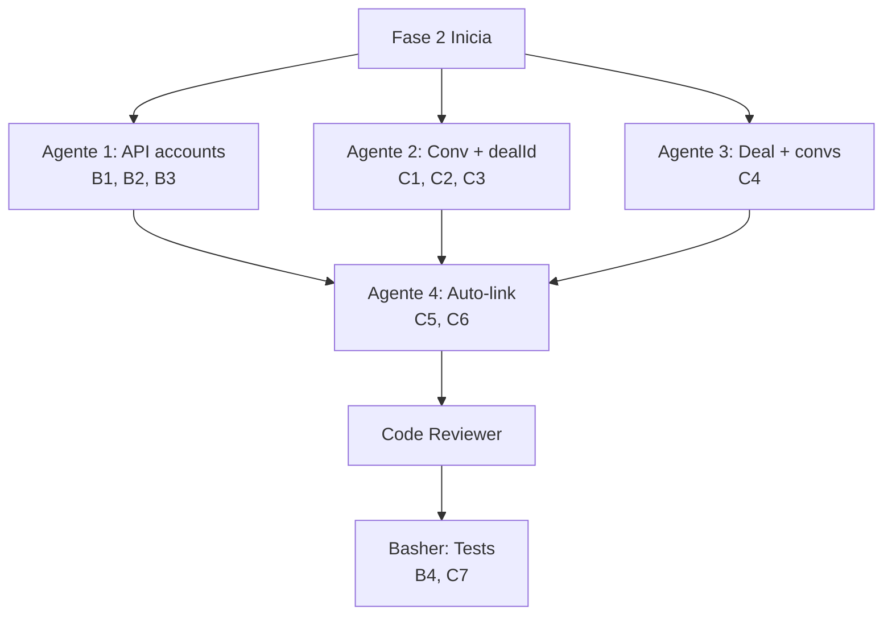

# 🏗️ Plan de Implementación — Correo Corporativo por Usuario + Conversaciones Ligadas a Oportunidades

> **Proyecto:** Volkern CRM/ERP  
> **Fecha:** 28 de mayo de 2026  
> **Autor:** Buffy (Codebuff AI Agent)  
> **Estado:** Pendiente de autorización  
> **Versión:** 3.0 — Stack Mox (webhook entrante + WebAPI saliente)

---

## 📊 Diagnóstico del Proyecto

| Aspecto | Estado Actual |
|---|---|
| **Mailer base** | ✅ Nodemailer + Amazon SES configurado (`lib/ses-email.ts`) |
| **Notificaciones** | ✅ Sistema unificado multicanal (`lib/skills/notification-layer.ts`) — email, WhatsApp, Telegram, in-app |
| **Correos empresariales** | ✅ API NameCrane para crear dominios y cuentas en Mox (`lib/namecrane-smartermail.ts`) |
| **Usuarios con correo corporativo** | ❌ No existe relación entre `User` y `BusinessEmailAccount` |
| **Conversaciones → Oportunidades (Deals)** | ❌ `Conversation` no tiene campo `dealId` — se pierde el hilo al convertir Lead en Deal |
| **Email como canal en Mensajes** | ❌ Solo WhatsApp/chat — no hay bandeja de email bidireccional ni webhook entrante |
| **Mox** | ❌ No está integrado como proveedor de email (webhook + API send) |

### Mapa de modelos actual (relevante)

```
Tenant ──┬── dominio (campo suelto)
         └── BusinessDomain[] ──┬── domain (único)
                                └── BusinessEmailAccount[] ──┬── email (único)
                                                              ├── smartermailId?
                                                              ├── moxApiToken?     ← NUEVO
                                                              └── userId? @unique  ← NUEVO

User ──┬── email (único, personal)
       ├── businessEmailId? ── BusinessEmailAccount (1:1)     ← NUEVO
       └── tenantId ──── Tenant

Conversation ──┬── leadId ──── Lead
               ├── contactId ── Contact
               ├── estudianteId ── Estudiante
               ├── canal: string  (whatsapp, messenger, etc.)
               ├── mensajes ──── Message[]
               └── dealId? ──── Deal (N:1)                    ← NUEVO

Deal ──┬── leadId ──── Lead
       ├── contactId ── Contact
       ├── companyId ── Contact (empresa)
       └── conversations ──── Conversation[]                   ← NUEVO (implícito)

EmailMessage (NUEVO) ──┬── conversationId ── Conversation
                       ├── fromAddr, toAddr
                       ├── subject, body, htmlBody
                       ├── messageId @unique (dedup)
                       ├── direction: "incoming" | "outgoing"
                       ├── provider: "mox"
                       ├── senderUserId? ── User              ← NUEVO (para outgoing)
                       └── Tenant (vía conversación)
```

---

## 🧩 Bloques de Implementación

### Fase 0 — Email Bidireccional con Mox (Infraestructura)

> **⚠️ CRÍTICO:** Esta fase es requisito para que el plan completo tenga sentido. Sin email bidireccional, las "conversaciones de email" serían cascarones vacíos. **Debe ejecutarse antes que cualquier otro bloque.**

| ID | Tarea | Descripción Técnica |
|---|---|---|
| **F0.1** | **Campos Mox en BusinessEmailAccount** | Agregar `moxApiToken String?` al modelo. El `domain` se obtiene vía `BusinessEmailAccount → BusinessDomain.domain`. |
| **F0.2** | **Webhook de email entrante (Mox)** | Endpoint `POST /api/webhooks/mox/incoming`. Mox envía JSON con `{ To: [{Address}], From: [{Address}], MessageID, Subject, Text, HTML }`. **Sin HMAC** (Mox no firma — validar por secreto compartido en query param o header). Flujo: identificar tenant → buscar/crear Conversation → crear EmailMessage → notificar agente |
| **F0.3** | **API de envío saliente (Mox WebAPI)** | `POST /api/communications/email/send` — Envía email usando la cuenta corporativa del usuario autenticado vía `https://mox.{domain}/api/send`. Auth vía `Bearer {moxApiToken}`. Body Mox: `{ From, To: [to], Subject, Text, HTML }`. Crea `EmailMessage` con `senderUserId` |
| **F0.4** | **Modelo EmailMessage + EmailWebhookLog** | Definir ambos modelos en schema (ver detalle abajo). Incluir `senderUserId?` en EmailMessage |
| **F0.5** | **Cola de procesamiento ligera** | Los emails entrantes se encolan (tabla DB simple o BullMQ si ya hay Redis) para: dedup, enriquecimiento, notificación push al agente asignado |

#### Detalle F0.2: Webhook Mox entrante

```typescript
// POST /api/webhooks/mox/incoming
export async function POST(req: Request) {
  const payload = await req.json();

  // 1. Identificar tenant por dominio del destinatario
  const domain = payload.To[0].Address.split('@')[1];
  const businessDomain = await prisma.businessDomain.findFirst({
    where: { domain },
    include: { tenant: true }
  });
  // ⚠️ Nota: en el código propuesto original se usa tenant.businessDomain.domain,
  // pero Tenant no tiene esa relación directa. Se resuelve vía BusinessDomain → tenant.

  // 2. Buscar o crear conversación
  let conversation = await findOrCreateConversation({
    tenantId: businessDomain.tenantId,
    fromEmail: payload.From[0].Address,
    messageId: payload.MessageID,
    subject: payload.Subject
  });

  // 3. Guardar EmailMessage
  await prisma.emailMessage.create({
    data: {
      conversationId: conversation.id,
      fromAddr: payload.From[0].Address,
      toAddr: payload.To[0].Address,
      subject: payload.Subject,
      body: payload.Text,
      htmlBody: payload.HTML,
      messageId: payload.MessageID,
      direction: "incoming",
      provider: "mox"
    }
  });

  // 4. Notificar al agente asignado (si existe)
  if (conversation.assignedToId) {
    await notifyAgent(conversation.assignedToId, payload);
  }

  return new Response("OK", { status: 200 });
}
```

#### Detalle F0.3: API de envío Mox

```typescript
// POST /api/communications/email/send
export async function POST(req: Request) {
  const { to, subject, body, html, conversationId } = await req.json();
  const user = await getCurrentUser(req);

  // Obtener cuenta de email asignada al usuario
  const emailAccount = await prisma.businessEmailAccount.findUnique({
    where: { userId: user.id },
    include: { domain: true }
  });

  // Enviar vía Mox WebAPI
  const moxResponse = await fetch(`https://mox.${emailAccount.domain.domain}/api/send`, {
    method: "POST",
    headers: {
      "Authorization": `Bearer ${emailAccount.moxApiToken}`,
      "Content-Type": "application/json"
    },
    body: JSON.stringify({
      From: emailAccount.email,
      To: [to],
      Subject: subject,
      Text: body,
      HTML: html
    })
  });

  // Guardar en historial
  await prisma.emailMessage.create({
    data: {
      conversationId,
      fromAddr: emailAccount.email,
      toAddr: to,
      subject,
      body,
      htmlBody: html,
      direction: "outgoing",
      provider: "mox",
      senderUserId: user.id
    }
  });

  return new Response(JSON.stringify({ success: true }));
}
```

#### Diagrama de flujo

```mermaid
flowchart LR
    A[Email entrante<br>cliente@ejemplo.com] --> B{Webhook<br>POST /api/webhooks/mox/incoming}
    B --> C[Extraer dominio<br>destinatario]
    C --> D[Buscar BusinessDomain<br>→ tenantId]
    D --> E[findOrCreateConversation<br>por fromEmail o messageId]
    E --> F[Deduplicar por<br>messageId @unique]
    F --> G[Crear EmailMessage<br>direction: incoming]
    G --> H[Notificar agente<br>asignado vía WS/push]

    I[Usuario responde<br>desde Volkern] --> J[POST /api/communications/email/send]
    J --> K[Obtener cuenta Mox<br>del usuario autenticado]
    K --> L[Enviar vía Mox WebAPI<br>https://mox.{domain}/api/send]
    L --> M[Crear EmailMessage<br>direction: outgoing<br>senderUserId: user.id]
    M --> N[Actualizar<br>Conversation]
```

#### Modelo EmailMessage

```prisma
model EmailMessage {
  id              String       @id @default(cuid())
  conversationId  String
  conversation    Conversation @relation(fields: [conversationId], references: [id], onDelete: Cascade)
  fromAddr        String
  toAddr          String
  subject         String?
  body            String?         // Texto plano
  htmlBody        String?         // HTML
  messageId       String       @unique  // Message-ID del email real (para dedup)
  threadId        String?          // Para agrupar hilos de conversación
  inReplyTo       String?          // messageId al que responde (para threading)
  direction       String       @default("incoming")  // "incoming" | "outgoing"
  provider        String       @default("mox")       // "mox"
  attachments     Json?           // [{filename, mimeType, size, url}]
  metadata        Json?           // Headers completos, SPF/DKIM status, etc.
  senderUserId    String?         // Quién envió el email (solo outgoing)
  senderUser      User?        @relation(fields: [senderUserId], references: [id])
  readAt          DateTime?
  createdAt       DateTime     @default(now())

  @@index([conversationId])
  @@index([threadId])
  @@index([direction])
  @@index([senderUserId])
  @@index([createdAt])
  @@map("email_messages")
}
```

#### Modelo EmailWebhookLog (auditoría)

```prisma
model EmailWebhookLog {
  id              String    @id @default(cuid())
  messageId       String
  conversationId  String?
  fromAddr        String
  toAddr          String
  subject         String?
  status          String    @default("received")    // received | processed | error
  rawPayload      Json?     @db.Json
  error           String?
  createdAt       DateTime  @default(now())

  @@index([messageId])
  @@index([createdAt])
  @@map("email_webhook_logs")
}
```

---

### Bloque A — Migración de Schema (Prisma)

Agregar las relaciones faltantes a los modelos existentes.

| ID | Modelo | Cambio |
|---|---|---|
| **A0** | `BusinessEmailAccount` | Agregar `moxApiToken String?` + `userId String? @unique` + relación belongsTo con `User` |
| A1 | `User` | Agregar `businessEmailId String? @unique` → relación belongsTo con `BusinessEmailAccount` |
| A2 | `Conversation` | Agregar `dealId String?` + `@@index([dealId])` + relación belongsTo con `Deal`. Agregar `assignedToId String?` (si no existe ya) para notificaciones del webhook |
| A3 | `Deal` | Agregar `conversations Conversation[]` (implícito vía dealId en Conversation, no requiere campo nuevo) |
| A4 | **Modelo `EmailMessage`** | Crear modelo completo (detalle arriba en F0.4) |
| A5 | **Modelo `EmailWebhookLog`** | Crear modelo para auditoría |
| A6 | Migración | Ejecutar `prisma migrate dev --name add-email-deal-links` + `prisma generate` |

> **Nota sobre A0:** El `userId` en `BusinessEmailAccount` es `@unique` para garantizar 1 usuario = 1 cuenta. El campo `domain` del modelo `BusinessDomain` se accede vía relación: `emailAccount.domain.domain`. En la API de envío Mox, la URL se construye como `https://mox.{emailAccount.domain.domain}/api/send`.

#### Resumen de cambios en schema.prisma

```prisma
// BusinessEmailAccount — agregar:
model BusinessEmailAccount {
  // ... campos existentes ...
  moxApiToken String?           // Token API de Mox para enviar emails
  userId      String?  @unique  // Usuario asignado (1:1)
  user        User?    @relation(fields: [userId], references: [id])
}

// User — agregar:
model User {
  // ... campos existentes ...
  businessEmailId String? @unique
  businessEmail   BusinessEmailAccount? @relation(fields: [businessEmailId], references: [id])
}

// Conversation — agregar:
model Conversation {
  // ... campos existentes ...
  dealId      String?
  deal        Deal?      @relation(fields: [dealId], references: [id])
  assignedToId String?    // Para notificaciones del webhook (agente asignado)
  assignedTo  User?      @relation("ConversationAssignee", fields: [assignedToId], references: [id])
  emails      EmailMessage[]  // Relación con EmailMessage

  @@index([dealId])
  @@index([assignedToId])
}
```

---

### Bloque B — Backend: Asignación de Correo a Usuarios

| ID | Ruta | Método | Descripción |
|---|---|---|---|
| B1 | `/api/emails/accounts/[id]/assign` | `PATCH` | Asignar cuenta empresarial a un User del tenant. Body: `{ userId: string }`. **Valida:** que userId exista, que no tenga ya cuenta asignada (error 409), que la cuenta no esté ya asignada (error 409). Solo admin |
| B2 | `/api/emails/accounts/[id]/unassign` | `PATCH` | Desvincular cuenta (`userId = null`). Verifica permisos de admin. No elimina la cuenta de Mox |
| B3 | `/api/emails/accounts` | `GET` | Modificar para incluir `user: { id, name, email }` en cada cuenta si está asignada. **Incluir `moxApiToken` solo si el usuario autenticado es admin** |
| B4 | Tests | — | Validar asignación, que dos usuarios no compartan cuenta (error 409), que solo admin pueda asignar (error 403), que un usuario con cuenta no pueda recibir otra (error 409) |

---

### Bloque C — Backend: Conversaciones Ligadas a Oportunidades

| ID | Ruta / Lógica | Método | Descripción |
|---|---|---|---|
| C1 | `/api/mensajes/conversaciones/[id]` | `PATCH` | Aceptar `dealId` como campo actualizable (además de `estado`, `leadId`, `estudianteId`) |
| C2 | `/api/mensajes/conversaciones` | `GET` | Aceptar `dealId` como filtro de búsqueda opcional. **Incluir `_count: { emails }`** para saber cuántos emails tiene cada conversación |
| C3 | `/api/mensajes/conversaciones/[id]` | `GET` | Incluir datos básicos del `deal` (titulo, etapa, estado, valor) y `emails` recientes (últimos 20) en la respuesta |
| C4 | `/api/deals/[id]` | `GET` | Incluir `conversations` relacionadas con su `canal`, `ultimoMensaje`, `noLeidos`, `fechaUltimoMensaje`, `_count: { emails, mensajes }` |
| **C5** | **Auto-link transaccional** | — | Cuando se crea un Deal desde un Lead que tiene Conversaciones activas, migrar `conversation.leadId → conversation.dealId` **dentro de una transacción `$transaction` con `SELECT ... FOR UPDATE`** para evitar race conditions |
| **C6** | **Persistencia post-venta** | — | Cuando un Deal cambia a estado "ganado", las conversaciones NO se desvinculan — se mantienen para post-venta. **Regla:** No se pueden crear **nuevas** conversaciones en un Deal ganado (redirigir a "soporte post-venta"). Las conversaciones existentes siguen activas |
| C7 | Tests | — | Validar CRUD con dealId, auto-link transaccional, data consistency |

#### Detalle de C5: Auto-link con Transacción Serializable

```typescript
// Auto-link al crear Deal desde Lead
await prisma.$transaction(async (tx) => {
  // 1. Lock pesimista en el Lead (evita race conditions)
  await tx.$executeRaw`SELECT id FROM Lead WHERE id = ${leadId} FOR UPDATE`;

  // 2. Crear el Deal
  const deal = await tx.deal.create({ data: { ...dealData } });

  // 3. Migrar conversaciones del Lead al Deal (mover, no duplicar)
  const { count } = await tx.conversation.updateMany({
    where: { leadId, dealId: null },
    data: { dealId: deal.id, leadId: null },
  });

  // 4. Si había conversaciones, asignar el deal al mismo agente del lead
  if (count > 0 && dealData.usuarioAsignadoId) {
    // Opcional: notificar al agente que tiene nuevas conversaciones
  }

  return deal;
}, {
  isolationLevel: 'Serializable',
});
```

#### Detalle de C6: Reglas Post-Venta

```typescript
// En el PATCH /api/deals/[id] o donde se cambie el estado
async function handleDealStageChange(dealId: string, newStage: string) {
  if (newStage === 'ganado' || newStage === 'closed_won') {
    // NO desvincular conversaciones — se mantienen para post-venta

    // Marcar conversaciones como "post-venta" (campo nuevo o inferido)
    // No permitir nuevas conversaciones directas — redirigir a soporte
  }
}
```

---

### Bloque D — Frontend: Interfaz de Usuario

| ID | Componente/Página | Descripción |
|---|---|---|
| D1 | **Perfil de Usuario** (`/dashboard/perfil`) | Nueva sección "Mi Correo Corporativo" que muestra cuenta asignada (email, dominio). Si no tiene, mensaje "Sin correo asignado — contacta a tu administrador" |
| D2 | **Admin Equipo** (`/dashboard/equipo`) | Los administradores ven las cuentas de correo disponibles y pueden asignarlas a miembros del equipo. Indicador visual de cuenta asignada ✅ / libre ⬜ |
| D3 | **Detalle de Deal** (`/dashboard/pipeline/[id]`) | Nuevo panel/tab "Comunicaciones" que lista las conversaciones vinculadas al deal en un **feed unificado ordenado por fecha**, con badges indicando el canal (📧 email, 💬 WhatsApp, ✉️ messenger). Cada entrada muestra: badge de canal, último mensaje (truncado), remitente, fecha, indicador de no leídos |
| D4 | **Sidebar de Conversación** | Mostrar enlace al Deal asociado si `conversation.dealId` existe, con datos básicos (título, etapa, valor). Si el Deal está ganado, mostrar badge "✅ Post-venta" |
| D5 | **Mensajes** (`/dashboard/mensajes`) | Filtro lateral para mostrar solo conversaciones vinculadas a un Deal específico. Los emails aparecen como un canal más en la bandeja unificada |
| D6 | **Bandeja de Email** (dentro de Mensajes) | Vista que muestra emails con indicador de leído/no leído. Botón "Responder" que abre el compositor de email inline (to: prellenado, subject: "Re: {original}") |

---

## 👥 Agentes y Ejecución en Paralelo

### Fase 0 — Email Bidireccional con Mox (35-50 min)

| Paso | Responsable | Actividad | Dependencias |
|---|---|---|---|
| **F0.1** | **Buffy** | Agregar campos `moxApiToken` + `userId` a `BusinessEmailAccount` + modelos `EmailMessage` + `EmailWebhookLog` al schema | — |
| **F0.2** | **Agente Webhook** | Crear endpoint `POST /api/webhooks/mox/incoming` con: parseo de payload Mox, lookup de tenant por dominio, `findOrCreateConversation`, creación de `EmailMessage`, `notifyAgent` | F0.1 |
| **F0.3** | **Agente API Send** | Crear `POST /api/communications/email/send` con: autenticación, lookup de cuenta Mox del usuario, llamado a `https://mox.{domain}/api/send`, creación de `EmailMessage` con `senderUserId` | F0.1 |
| **F0.4** | **Agente Cola + Tests** | Configurar cola ligera (tabla DB) para procesamiento asíncrono de webhooks. Tests: enviar email, dedup por messageId, threading | F0.2, F0.3 |

### Fase 1 — Schema + Migración (15-20 min)

| Paso | Responsable | Actividad |
|---|---|---|
| 1.1 | **Buffy** | Editar `schema.prisma` con cambios A0–A5 |
| 1.2 | **Code Searcher** | Buscar referencias a `prisma.conversation.create` para saber dónde migrar |
| 1.3 | **Code Searcher** | Buscar referencias a `BusinessEmailAccount` en frontend y backend |
| 1.4 | **Buffy + Basher** | Ejecutar migración + `prisma generate` |

### Fase 2 — Backend API (60-90 min, 4 agentes en paralelo)



| Agente | Tareas | Depende de |
|---|---|---|
| **Agente 1** | Crear `PATCH /api/emails/accounts/[id]/assign` y `unassign`, modificar `GET /api/emails/accounts` | Migración (Fase 1) |
| **Agente 2** | Modificar `GET /api/mensajes/conversaciones` y `PATCH /api/mensajes/conversaciones/[id]` para `dealId` | Migración (Fase 1) |
| **Agente 3** | Modificar `GET /api/deals/[id]` para incluir `conversations` | Migración (Fase 1) |
| **Agente 4** | Crear lógica Auto-link con transacción serializable + persistencia post-venta + reglas de negocio | Agentes 2 y 3 |
| **Code Reviewer** | Revisar todos los cambios de backend | Agentes 1–4 |
| **Basher** | Ejecutar tests B4 y C7 + tests existentes | Code Reviewer |

### Fase 3 — Frontend (45-60 min, 3-4 agentes en paralelo)

| Agente | Tareas | Depende de |
|---|---|---|
| **Agente 5** | Perfil → "Mi Correo Corporativo" + Admin Equipo → asignar correo | API asignación (Fase 2) |
| **Agente 6** | Deal detail → feed unificado de comunicaciones + Sidebar | API deals+conversaciones (Fase 2) |
| **Agente 7** | Mensajes → filtro por Deal + bandeja de email + responder inline | API conversaciones + send (Fase 0, Fase 2) |
| **Code Reviewer** | Revisar todos los cambios de frontend | Agentes 5–7 |

### Fase 4 — Tests y Validación (30 min)

| Paso | Responsable | Actividad |
|---|---|---|
| 4.1 | **Basher** | Ejecutar `npx vitest run` — tests existentes + nuevos |
| 4.2 | **Basher** | Ejecutar `npx tsc --noEmit` — type check |
| 4.3 | **Data consistency check** | Verificar: `SELECT COUNT(*) FROM Conversation WHERE leadId IS NOT NULL AND dealId IS NOT NULL;` = 0 filas |
| 4.4 | **Data consistency check** | Verificar: `SELECT userId, COUNT(*) FROM BusinessEmailAccount GROUP BY userId HAVING COUNT(*) > 1;` = 0 filas |
| 4.5 | **Browser Use** | Verificar en navegador: asignación de correo en Perfil + Equipo |
| 4.6 | **Browser Use** | Verificar en navegador: conversaciones visibles en detalle de Deal + feed unificado |
| 4.7 | **Code Reviewer** | Revisión final de todos los cambios |

---

## 🛡️ Checkpoints de Soporte ante Fallas

| CP | ¿Cuándo? | Síntoma de falla | Acción correctiva |
|---|---|---|---|
| **CP0** | Después de F0.2 (webhook Mox) | Webhook no recibe POST de Mox | Verificar URL del webhook en panel de Mox. Probar con `curl -X POST http://localhost:3002/api/webhooks/mox/incoming -H 'Content-Type: application/json' -d '{"To":[{"Address":"test@dominio.com"}],"From":[{"Address":"cliente@test.com"}],"MessageID":"test-123","Subject":"Prueba","Text":"Cuerpo"}'` |
| **CP1** | Después de F0.3 (API send) | Error al enviar email | Verificar `moxApiToken` y dominio en `BusinessEmailAccount`. Probar conectividad a `https://mox.{dominio}/api/send` |
| **CP2** | Después de `prisma migrate dev` | Error de migración (conflicto, campo duplicado) | `prisma migrate dev --name rollback` + diagnosticar y corregir schema |
| **CP3** | Después de Agente 1 (API accounts) | Tests de emails existentes fallan | Revertir cambios del endpoint, revisar lógica de permisos |
| **CP4** | Después de Agente 2 (Conversaciones) | Tests de mensajes fallan o PATCH existente se rompe | Verificar que `dealId` sea opcional, que el schema del body acepte campos nuevos sin romper los viejos |
| **CP5** | Después de Agente 4 (Auto-link) | Leads sin conversaciones lanzan error | Revisar que el hook maneje `null`/`undefined`. Verificar transacción con `FOR UPDATE` |
| **CP6** | Data consistency check | Existen conversaciones con leadId Y dealId simultáneamente | El auto-link no migró correctamente. Revisar lógica de C5 y ejecutar script de limpieza |
| **CP7** | Después de Fase 3 (Frontend) | Páginas no cargan (error 500) | Verificar que los componentes manejen datos nulos, que las APIs devuelvan los campos esperados |
| **CP8** | Tests finales | Tests unitarios fallan | Aislar el cambio que causa la falla con `git bisect` y corregir |

---

## ✅ Checklist de Avance

```markdown
[ ] F0.1 Campos moxApiToken + userId en BusinessEmailAccount
[ ] F0.2 Webhook Mox entrante funcionando (POST /api/webhooks/mox/incoming)
[ ] F0.3 API de envío saliente con Mox WebAPI (POST /api/communications/email/send)
[ ] F0.4 Modelos EmailMessage + EmailWebhookLog creados y migrados
[ ] F0.5 Cola ligera + tests de email bidireccional ✅
[ ] 1. Schema Prisma editado (A0-A5: campos + relaciones)
[ ] 2. Migración ejecutada y prisma generate exitoso
[ ] 3. API: asignar/desasignar cuenta de correo a usuario (B1, B2)
[ ] 4. API: listar cuentas con info de asignación + moxApiToken (B3)
[ ] 5. API: agregar dealId a conversaciones — GET con filtro, PATCH (C1, C2)
[ ] 6. API: GET /api/mensajes/conversaciones/[id] incluye deal + emails (C3)
[ ] 7. API: incluir conversations en GET /api/deals/[id] (C4)
[ ] 8. Auto-link transaccional (FOR UPDATE) al crear Deal desde Lead (C5)
[ ] 9. Reglas post-venta: conversaciones persisten, no crear nuevas (C6)
[ ] 10. Tests de backend (B4 + C7) ✅
[ ] 11. Frontend: Perfil muestra correo asignado (D1)
[ ] 12. Frontend: Admin asigna correo desde Equipo (D2)
[ ] 13. Frontend: Deal detail feed unificado de comunicaciones (D3)
[ ] 14. Frontend: Sidebar de conversación muestra Deal + badge (D4)
[ ] 15. Frontend: Mensajes con filtro por Deal + bandeja email (D5, D6)
[ ] 16. Data consistency: sin conversaciones con leadId + dealId simultáneos
[ ] 17. Data consistency: sin usuarios con >1 cuenta asignada
[ ] 18. TypeScript check sin errores
[ ] 19. Tests E2E en navegador ✅
[ ] 20. Code Review final aprobado
```

---

## ⏱️ Estimación de Tiempo (Revisada v3.0)

| Fase | v2.0 (SmarterMail) | v3.0 (Mox) | Agentes en paralelo |
|---|---|---|---|
| Fase 0 — Email bidireccional | 30-45 min | **35-50 min** (Mox más simple, sin HMAC) | 3-4 agentes |
| Fase 1 — Schema + Migración | 15-20 min | **15-20 min** (igual) | 1 Buffy + 2 Code Searchers |
| Fase 2 — Backend API | 60-90 min | **60-90 min** (igual) | 4 agentes en paralelo |
| Fase 3 — Frontend | 45-60 min | **45-60 min** (igual) | 3-4 agentes en paralelo |
| Fase 4 — Tests y validación | 30 min | **30-35 min** (+ check de consistencia) | 2 Bashers + 2 Browser Use |
| **Total** | **~180-245 min** | **~185-255 min (~3-4 horas)** | **Hasta 6 agentes simultáneos** |

---

## 📌 Notas Técnicas

1. **@brijesh/email** no existe como paquete npm. La integración con **Mox** (vía webhook entrante + WebAPI saliente) es suficiente y no requiere librerías externas adicionales.

2. **Mox webhook payload format:**
   ```json
   {
     "To": [{ "Address": "ventas@midominio.com" }],
     "From": [{ "Address": "cliente@example.com" }],
     "MessageID": "<abc123@mox.local>",
     "Subject": "Consulta sobre presupuesto",
     "Text": "Cuerpo en texto plano",
     "HTML": "<p>Cuerpo en HTML</p>"
   }
   ```
   Mox **no firma** los webhooks con HMAC. La validación se hace mediante:
   - Secreto compartido en query param: `/api/webhooks/mox/incoming?secret=...`
   - O header personalizado configurado en Mox

3. **Mox WebAPI send endpoint:**
   ```
   POST https://mox.{dominio}/api/send
   Authorization: Bearer {moxApiToken}
   Content-Type: application/json
   
   {
     "From": "ventas@midominio.com",
     "To": ["cliente@example.com"],
     "Subject": "Re: Consulta sobre presupuesto",
     "Text": "Cuerpo",
     "HTML": "<p>Cuerpo</p>"
   }
   ```

4. **`findOrCreateConversation` helper** (F0.2): Busca conversación existente por `messageId` o crea una nueva con `canal: "email"`. Debe deduplicar: si ya existe un `EmailMessage` con ese `messageId`, no crear duplicado.

5. **`notifyAgent` helper** (F0.2): Envía notificación push/WebSocket al agente asignado. Si `conversation.assignedToId` es null, no notificar (la conversación quedará en la bandeja general).

6. **Aislamiento multi-tenant:** El webhook Mox recibe el dominio del destinatario → busca `BusinessDomain.domain` → obtiene `tenantId`. Toda la lógica posterior (crear conversación, email, notificar) debe usar ese `tenantId`. Las APIs existentes ya filtran por tenant.

7. **Seguridad:**
   - Solo administradores del tenant pueden asignar/desasignar cuentas de correo
   - La API de envío saliente (`F0.3`) autentica al usuario y verifica que la cuenta Mox usada es la suya
   - El webhook Mox valida mediante secreto compartido (query param o header)
   - El `moxApiToken` solo se expone a administradores en `GET /api/emails/accounts`

8. **Deduplicación:** `messageId @unique` en `EmailMessage` garantiza que no se dupliquen emails. Para casos sin messageId (excepcional en Mox), usar hash SHA256 de (`fromAddr` + `toAddr` + `subject` + `createdAt` redondeada a minutos).

9. **Data consistency post-ejecución:**
   ```sql
   -- No deben existir conversaciones con leadId y dealId simultáneamente
   SELECT COUNT(*) FROM Conversation WHERE leadId IS NOT NULL AND dealId IS NOT NULL;
   
   -- Un usuario no debe tener más de una cuenta asignada
   SELECT userId, COUNT(*) FROM BusinessEmailAccount 
   GROUP BY userId HAVING COUNT(*) > 1;
   ```

10. **Feed unificado:** En el detalle del Deal, los mensajes de diferentes canales (email, WhatsApp, messenger) se muestran en un solo feed cronológico con badge indicador de canal. Esto requiere normalizar `Message` y `EmailMessage` en una interfaz común tipo `{ id, text, channel, timestamp, sender }`.

11. **Post-venta:** Cuando un Deal cambia a "ganado", las conversaciones existentes se mantienen activas. No se pueden crear **nuevas** conversaciones en un Deal ganado — si el contacto intenta iniciar una nueva conversación, se redirige a un flujo de "soporte post-venta" separado.

12. **Corrección sobre el código propuesto original:** En el webhook, se usó `prisma.tenant.findFirst({ where: { businessDomain: { domain } } })` pero Tenant no tiene una relación directa `businessDomain`. La forma correcta es buscar en `BusinessDomain` primero:
    ```typescript
    const businessDomain = await prisma.businessDomain.findFirst({
      where: { domain }
    });
    if (!businessDomain) return new Response("Domain not found", { status: 404 });
    const tenantId = businessDomain.tenantId;
    ```

---

## 🔄 Resumen de Cambios v2.0 → v3.0

| Aspecto | v2.0 (SmarterMail) | v3.0 (Mox) |
|---|---|---|
| **Proveedor email** | SmarterMail (SMTP + webhook con HMAC) | **Mox** (WebAPI REST + webhook sin HMAC) |
| **Webhook entrante** | `/api/webhooks/smartermail/incoming` | **`/api/webhooks/mox/incoming`** |
| **API de envío** | SMTP con credenciales de la cuenta | **Mox WebAPI**: `POST https://mox.{domain}/api/send` con `Bearer {moxApiToken}` |
| **Autenticación webhook** | HMAC signature | **Secreto compartido** (query param o header) |
| **EmailMessage.provider** | `"smartermail"` o `"ses"` | **`"mox"`** |
| **EmailMessage.senderUserId** | ❌ No existía | ✅ **Nuevo campo** para trackear quién envió el email |
| **BusinessEmailAccount.moxApiToken** | ❌ No existía | ✅ **Nuevo campo** para token API de Mox |
| **Tenant lookup en webhook** | ❌ No especificado | ✅ **Vía `BusinessDomain.domain`** (con corrección: no existe `tenant.businessDomain`) |
| **Payload format** | No especificado | ✅ **Mox format**: `{ To: [{Address}], From: [{Address}], MessageID, Subject, Text, HTML }` |
| **Diagrama Mermaid** | SmarterMail → SMTP | **Mox** → **WebAPI** |
| **Checklist** | 19 items | **20 items** (nuevo: campos Mox en cuenta) |
| **Checkpoints** | 8 | **9** (nuevo: CP1 API send Mox) |
