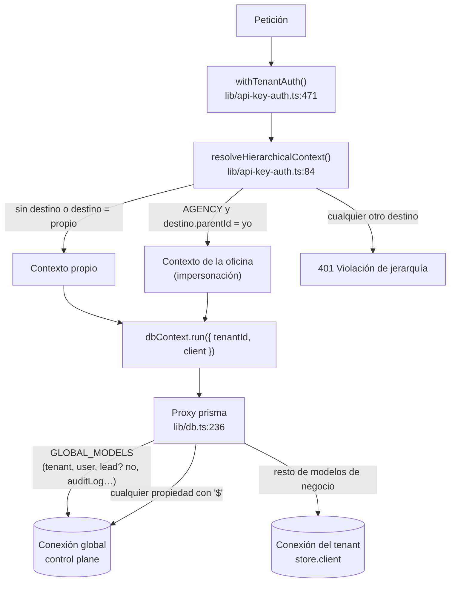
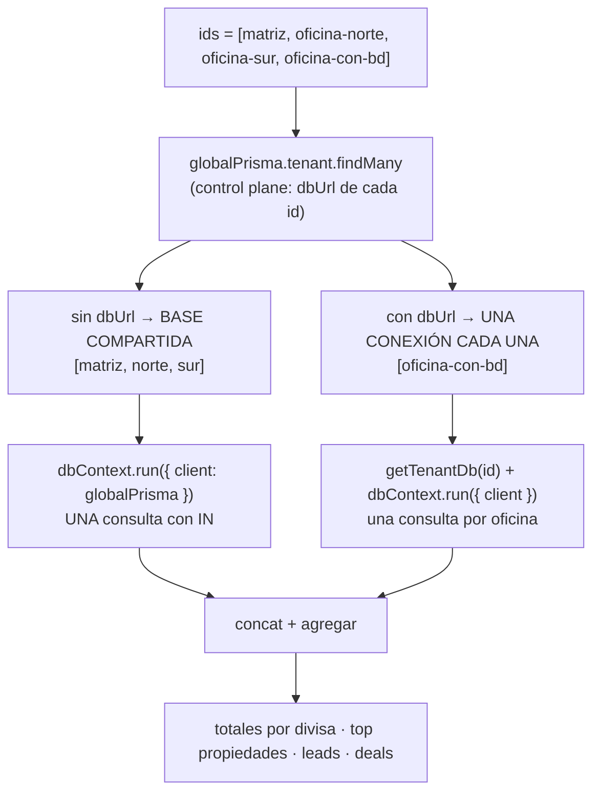

# Volkern Real Estate — Aislamiento multitenant y franquicias

**Cómo se aísla cada cuenta, por qué la franquicia era el caso frágil y qué se arregló**

Fecha: **2026-10-27** · Rama: `feat/nobeds-f1-lectura`

> **Regla del documento.** Nada se afirma por lectura del nombre de una función: lo que se pudo
> ejecutar, se ejecutó y se dice con qué resultado. Lo que queda como límite, se declara como límite.

## Cómo se ha verificado este documento

| Qué | Cómo |
|---|---|
| Capa de autenticación | Lectura de [`lib/api-key-auth.ts`](../lib/api-key-auth.ts) completo: `authenticateRequest`, `resolveHierarchicalContext`, `validateApiKey`, `withTenantAuth`, `withPublicTenant` |
| Enrutamiento de conexiones | Lectura de [`lib/db.ts`](../lib/db.ts) (`getTenantDb`, `GLOBAL_MODELS`, proxy `prisma`) **y ejecución de una sonda** que comprobó, con el proxy real, que `catalogoItem`, `comision`, `lead`, `deal`, `contact` y `captacion` van al cliente del contexto, que `tenant` siempre va al control plane y que `$executeRawUnsafe` siempre sale por la conexión global |
| Topología de tenants | Lectura de [`app/api/admin/tenants/route.ts`](../app/api/admin/tenants/route.ts), [`app/api/agency/slots/route.ts`](../app/api/agency/slots/route.ts), [`lib/slot-manager.ts`](../lib/slot-manager.ts), [`lib/tenant-provisioning.ts`](../lib/tenant-provisioning.ts), [`lib/tenant-resolver.ts`](../lib/tenant-resolver.ts) |
| Rutas del módulo | Las 15 rutas de `app/api/real-estate/`, `app/api/public/real-estate/` y `app/api/ai/real-estate/`, revisando de dónde sale cada `tenantId` |
| Franquicia | [`lib/real-estate/commission-calculator.ts`](../lib/real-estate/commission-calculator.ts), las dos rutas de `franchise/`, `lib/skills/real-estate-skills.ts` (`calculate_franchise_commissions`) y el panel [`app/dashboard/real-estate/page.tsx`](../app/dashboard/real-estate/page.tsx) |
| Pruebas | `npx vitest run` sobre los 9 ficheros `tests/real-estate-*.test.ts`: **133 pruebas, 133 en verde** (antes, 121); `npm run typecheck`: **0 errores** |

---

## 1. El aislamiento son dos capas, no una

La intuición habitual —«cada consulta filtra por `tenantId`»— describe solo la mitad. En Volkern hay
dos fronteras y la segunda es la que decide en producción.



**Capa 1 — jerarquía.** `resolveHierarchicalContext` ([`lib/api-key-auth.ts:84`](../lib/api-key-auth.ts#L84)) impide que una cuenta entre en otra: solo un `AGENCY` puede tomar el contexto de un tenant cuyo `parentId` sea el suyo ([línea 146](../lib/api-key-auth.ts#L146)), el destino debe estar `activo` o `trial`, y la divisa que manda es la del destino. Un `BUSINESS` no puede saltar al padre ni a un hermano. Está cubierto por [`tests/agency-isolation.test.ts`](../tests/agency-isolation.test.ts).

**Capa 2 — conexión.** El proxy `prisma` ([`lib/db.ts:236`](../lib/db.ts#L236)) envía cada modelo de negocio al cliente que esté en el contexto ([línea 251](../lib/db.ts#L251)) y solo los de `GLOBAL_MODELS` ([línea 70](../lib/db.ts#L70)) al control plane. `Tenant` es global; `CatalogoItem`, `Captacion`, `Comision`, `Deal` y `Contact` **no**, así que salen por la conexión del tenant que tenga el turno.

Consecuencia que gobierna todo este documento: **una consulta que cruce cuentas no se puede escribir como un `IN` sobre una sola conexión**. Si esas cuentas no comparten base de datos, el `IN` no devuelve un error: devuelve menos filas.

## 2. Cómo nace cada cuenta (la topología real)

| Vía de alta | `accountType` | `dbUrl` | Dónde quedan sus datos |
|---|---|---|---|
| Panel de administración ([`admin/tenants`](../app/api/admin/tenants/route.ts#L142)) | el que digan | **Siempre se asigna**, con `autoProvision = true` por defecto ([línea 101](../app/api/admin/tenants/route.ts#L101)) | En su base dedicada `volkern_tenant_<slug>` |
| Oficinas de agencia ([`agency/slots`](../app/api/agency/slots/route.ts#L87)) y `SlotManager` ([línea 161](../lib/slot-manager.ts#L161)) | `BUSINESS` | **No se asigna** — «usaremos la misma DB (*Shared Schema logic*)» | En la base compartida |

Es decir: el camino por defecto del panel deja a **la matriz con base propia y a sus oficinas en la compartida**. Esa asimetría es exactamente el escenario en el que la consolidación de franquicia fallaba.

## 3. La franquicia: dónde estaba el fallo

Antes, las dos rutas de franquicia hacían una única consulta con todos los ids:

```
prisma.comision.findMany({ where: { tenantId: { in: [matriz, ...oficinas] } } })
```

Dentro de `withTenantAuth`, ese `prisma` resuelve al cliente **de la matriz**. Si la matriz tiene base propia, las comisiones de las oficinas (que están en la base compartida) no existen para esa conexión: el reporte devolvía **ceros, con HTTP 200 y sin error**. Y como `prisma.tenant` sí va al control plane, la lista de oficinas se pintaba correctamente mientras todos los importes salían a cero — un fallo silencioso y creíble, el peor de diagnosticar.

### El arreglo: una consulta por conexión

[`lib/real-estate/franquicia.ts`](../lib/real-estate/franquicia.ts) agrupa los ids por conexión física antes de consultar:



- `enCadaConexion(ids, consultar)` ([línea 76](../lib/real-estate/franquicia.ts#L76)) es el único punto por el que pasan ahora las lecturas consolidadas.
- La base compartida se consulta **por la conexión global explícitamente** ([línea 96](../lib/real-estate/franquicia.ts#L96)), no por la del tenant que tenga el turno. Ese es el corazón del arreglo.
- `oficinasDeFranquicia` ([línea 48](../lib/real-estate/franquicia.ts#L48)) es también el único sitio que decide **qué oficinas cuentan**: solo `activo` y `trial` ([línea 42](../lib/real-estate/franquicia.ts#L42)), el mismo criterio que la impersonación y que `app/api/v1/finance/global`.

## 4. Hallazgos y arreglos

| # | Hallazgo | Gravedad | Estado |
|---|---|---|---|
| 1 | La consolidación de franquicia consultaba una sola conexión | Crítica | **Arreglado** |
| 2 | Escritura entre tenants desde el formulario público, sin autenticar | Alta | **Arreglado** |
| 3 | Las captaciones aceptaban ids de otra cuenta y los devolvían resueltos | Alta | **Arreglado** |
| 4 | Los totales de la franquicia sumaban divisas distintas | Media | **Arreglado** |
| 5 | La franquicia solo existe en 2 de los 11 endpoints autenticados | Media | Abierto, documentado (§5) |
| 6 | Las oficinas dadas de baja seguían contando | Media | **Arreglado** |
| 7 | El control de «es franquicia» admite `BUSINESS` y `commissions` no tiene ninguno | Baja | Abierto, documentado (§5) |

### 4.1 Consolidación por conexión (crítica)

**Causa.** Un `IN` multi-tenant ejecutado con el cliente de la matriz.
**Arreglo.** `enCadaConexion` en las dos rutas ([overview](../app/api/real-estate/franchise/overview/route.ts#L43), [commissions](../app/api/real-estate/franchise/commissions/route.ts#L45)) y en los dos agregados del calculador ([`getFranchiseCommissionSummary:223`](../lib/real-estate/commission-calculator.ts#L223), [`getFranchiseGlobalStats:298`](../lib/real-estate/commission-calculator.ts#L298)).
**Prueba.** [`tests/real-estate-franquicia-conexiones.test.ts`](../tests/real-estate-franquicia-conexiones.test.ts): 4 pruebas que ejercitan **el proxy real y el `dbContext` real** (solo se mockea la lectura de `Tenant` del control plane) y comprueban que el grupo de oficinas **no** se consulta con la conexión de la matriz, que la matriz sí usa la suya y que los grupos se reparten por conexión.

### 4.2 Escritura entre tenants desde el formulario público (alta)

**Síntoma.** `POST /api/public/real-estate/contact` validaba el `propertyId` solo para leer el nombre del inmueble, y después escribía su `metadata` sin mirar el tenant: `catalogoItem.update({ where: { id: propertyId } })` y un `$executeRawUnsafe ... WHERE id = $1`. Sin sesión, cualquiera podía reescribir el JSONB `metadata` de un inmueble de **otra** cuenta e inflar su contador `totalLeads`.
**Causa.** El `id` llega del cliente y no se comprobaba la pertenencia antes de escribir. Agravante: el SQL crudo del proxy sale **siempre** por la conexión global (comprobado con la sonda), así que alcanzaba la fila de la víctima aunque el tenant del `slug` tuviera base propia.
**Arreglo.** La búsqueda acotada por tenant es ahora lo único que autoriza a escribir ([línea 72](../app/api/public/real-estate/contact/route.ts#L72)); la metadata se lee de ese mismo resultado; la escritura usa `updateMany` con `tenantId` ([línea 112](../app/api/public/real-estate/contact/route.ts#L112)) y el incremento atómico corre en la conexión del tenant con el filtro **dentro de la sentencia** `AND "tenantId" = $2` ([línea 128](../app/api/public/real-estate/contact/route.ts#L128)).
**Prueba.** [`tests/real-estate-referencias-ajenas.test.ts`](../tests/real-estate-referencias-ajenas.test.ts): con un `propertyId` ajeno no se llama ni a `updateMany` ni al SQL crudo; con uno propio, el `where` lleva el tenant y la sentencia lleva la guarda.

### 4.3 Referencias ajenas en captaciones (alta)

**Síntoma.** `propiedadId` y `contactoPropietarioId` se guardaban del cuerpo sin comprobar de quién eran, y `CAPTACION_INCLUDE` los resolvía **por clave foránea**: la API devolvía nombre, precio y fotos del inmueble ajeno y nombre, email y teléfono del contacto ajeno.
**Arreglo.** Dos capas:
- Al escribir, `exigirRelacionesDeLaCuenta` ([línea 77](../lib/real-estate/captacion-helpers.ts#L77)) valida cada id contra la cuenta y lanza `ReferenciaAjenaError` ([línea 66](../lib/real-estate/captacion-helpers.ts#L66)) en el alta ([línea 279](../lib/real-estate/captacion-helpers.ts#L279)) y en la modificación ([línea 362](../lib/real-estate/captacion-helpers.ts#L362)); las rutas lo traducen a **400** con el campo en el mensaje.
- Al leer, `relacionDeLaCuenta` ([línea 119](../lib/real-estate/captacion-helpers.ts#L119)) descarta cualquier relación cuyo tenant no coincida, así que **las filas ya contaminadas antes del arreglo tampoco se filtran**.
**Prueba.** Mismo fichero: rechaza propiedad ajena, rechaza contacto ajeno, crea cuando ambas son propias, oculta las ajenas al serializar y no expone el `tenantId` de la relación.

### 4.4 Totales por divisa (media)

**Síntoma.** `totals.total` sumaba pesos y euros y lo etiquetaba con `monedaEfectiva([comisiones[0]?.moneda], …)`: la divisa de **la primera fila**. En una red con oficinas en MXN y EUR, el número no significaba nada. El panel hacía lo mismo en el cliente (`commissions.reduce(...)`) y además escribía todos los importes con la divisa de la matriz.
**Arreglo.** `sumarPorMoneda` ([línea 142](../lib/real-estate/franquicia.ts#L142)) agrupa por divisa. `totalComisiones` pasa a ser **`null` cuando hay varias divisas** y el desglose va en `totalesPorMoneda` + `multiDivisa`; lo mismo en `dealsByStage` por etapa. En el panel, `ImporteConsolidado` enseña una cifra con una sola divisa y una línea por divisa cuando hay varias, y cada oficina se formatea con la suya (`office.moneda`).
**Prueba.** `sumarPorMoneda` (4 casos) y el caso nuevo de la ruta: dos divisas → `multiDivisa: true`, `total: null`, `porMoneda` con dos entradas.

### 4.5 Oficinas no vigentes (media)

**Síntoma.** Las tres consultas de hijas filtraban solo por `parentId`: una oficina suspendida o eliminada seguía sumando comisiones y seguía exportando al panel de la matriz los emails de sus leads.
**Arreglo.** Filtro de estado en el único sitio que decide la composición de la red ([`franquicia.ts:42`](../lib/real-estate/franquicia.ts#L42)), con el precedente de [`app/api/v1/finance/global`](../app/api/v1/finance/global/route.ts#L40) y de `SlotManager.listSlots`.

## 5. Lo que queda abierto, y por qué

**5.1 La franquicia solo existe en 2 de los 11 endpoints autenticados.** `overview` y `commissions` conocen la jerarquía; inventario, captaciones, dashboard, export, sync y consulta de IA filtran por `auth.tenant.id` y **no** tienen modo franquicia. No es una fuga —es todo lo contrario—, pero significa que la matriz que entra a su propio panel ve el inventario y las captaciones vacíos y tiene que impersonar oficina por oficina. Darles alcance de franquicia es una decisión de producto con coste (cada listado consolidado pasa a ser N consultas), no un bug; queda declarado.

**5.2 El control de «es franquicia» es más ancho que la realidad.** [`overview:23`](../app/api/real-estate/franchise/overview/route.ts#L23) admite `AGENCY` **o** `BUSINESS` —y las oficinas se crean como `BUSINESS`—, mientras que `commissions` no comprueba nada. Sin fuga: sin hijas, lo único que ocurre es que devuelven ceros. Endurecer `commissions` con un 403 rompería el caso legítimo de una cuenta personal que consulta **sus propias** comisiones, así que se deja como está y se documenta.

**5.3 El listado público acepta `?tenantId=` sin validar la cuenta.** [`app/api/public/real-estate/properties`](../app/api/public/real-estate/properties/route.ts#L29) resuelve el tenant por `slug` y, si no hay `slug`, toma el `tenantId` de la query tal cual. Los datos que devuelve son inmuebles `activo: true`, es decir, exactamente lo que el portal publica —por eso no se ha tocado—, pero ignora si la cuenta está activa y permite dirigirse a un tenant que no tiene portal. Recomendación: exigir cuenta vigente también en esa vía.

**5.4 El contrato de captación sigue sin sellar.** Es deuda previa, recogida en el documento técnico (§12.1) y ajena a esta revisión; se menciona aquí solo para que no se confunda con los arreglos de aislamiento.

**5.5 Ruido de log esperado.** Cuando una matriz tiene base propia y alguna oficina también, `getTenantDb` avisa `[db.ts] Tenant mismatch` por cada apertura de conexión ajena ([`lib/db.ts:185`](../lib/db.ts#L185)). Es el registro de una lectura cruzada deliberada; conviene vigilarlo, no silenciarlo.

## 6. Comprobar la topología en producción

El hallazgo 4.1 es condicional a la topología, y los valores reales de `Tenant.dbUrl` no se ven desde el código. Lo primero que hay que mirar:

```sql
SELECT id, slug, "accountType", "parentId", ("dbUrl" IS NOT NULL) AS tiene_bd_propia
FROM "Tenant"
WHERE "accountType" = 'AGENCY' OR "parentId" IS NOT NULL
ORDER BY "parentId" NULLS FIRST;
```

Una fila de matriz con `tiene_bd_propia = true` y sus oficinas con `false` es el escenario que rompía el panel consolidado. Con el arreglo, ese caso ya agrega bien; lo que sigue siendo cierto es que **cada oficina con base propia multiplica las consultas** del panel consolidado.

## 7. Verificación ejecutada

| Comando | Resultado |
|---|---|
| `npx vitest run tests/real-estate-*.test.ts` (9 ficheros) | **133 pruebas, 133 en verde** |
| `npx vitest run tests/module-guard.test.ts` | 12 pruebas, 12 en verde |
| `npx vitest run tests/real-estate-commission-calculator.test.ts` | 22 pruebas en verde (adaptado al nuevo acceso a datos) |
| `npm run typecheck` | **0 errores** |
| Sonda del enrutamiento (fichero temporal, ya retirado) | Confirmó las dos reglas del proxy: modelos de negocio → cliente del contexto; `$` y `GLOBAL_MODELS` → conexión global |

**Lo que no se ha ejecutado.** No hay prueba de integración contra una base de datos con dos conexiones reales: el entorno de tests tiene una sola. Por eso el arreglo se prueba por la vía que sí es verificable aquí —qué cliente recibe cada grupo— y no por el resultado de una consulta cruzada entre dos bases. Queda como el hueco natural de esta suite.

**Un fallo preexistente, no relacionado.** `tests/moneda-plataforma-guard.test.ts` falla (5 casos) con deuda de divisas en `app/dashboard/hospitality/conectividad/page.tsx`, `app/dashboard/hospitality/onboarding/page.tsx`, `components/public/PricingPage.tsx`, `lib/crm-pricing.ts`, `app/dashboard/cotizaciones/page.tsx` y `app/dashboard/ventas/pronosticos/page.tsx`. Son ficheros **idénticos a `HEAD`** (`git diff --stat HEAD` vacío) y ninguno pertenece a este módulo: el inventario del guard está desactualizado respecto a trabajo anterior. No se ha tocado.
