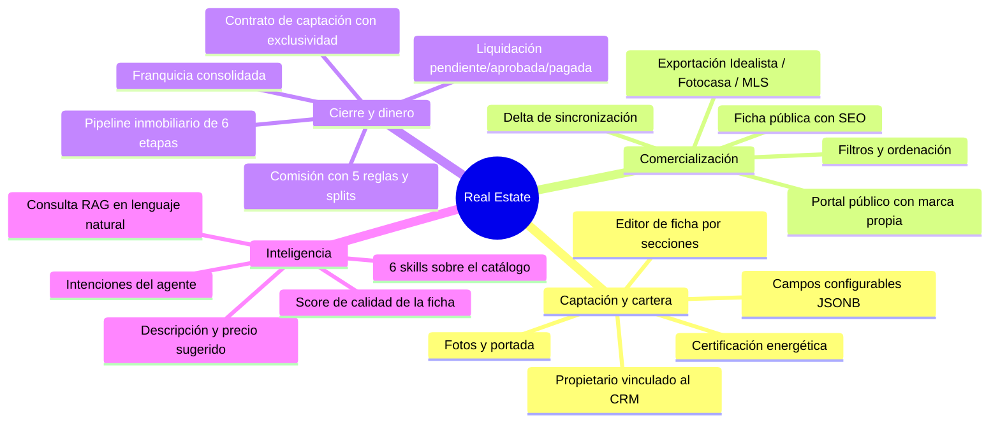
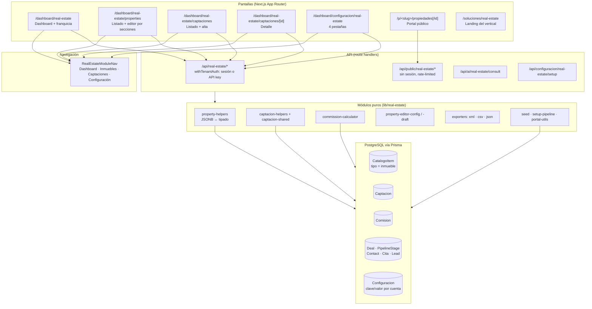
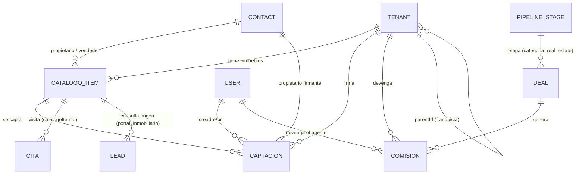
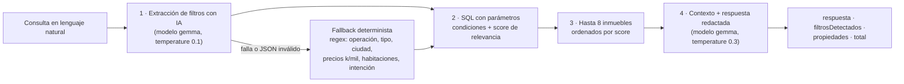
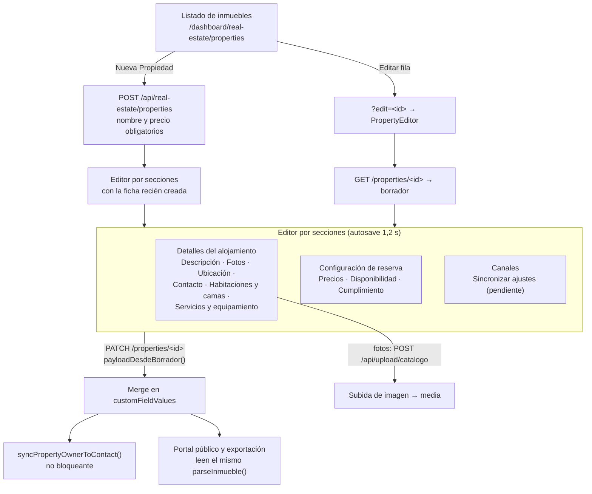
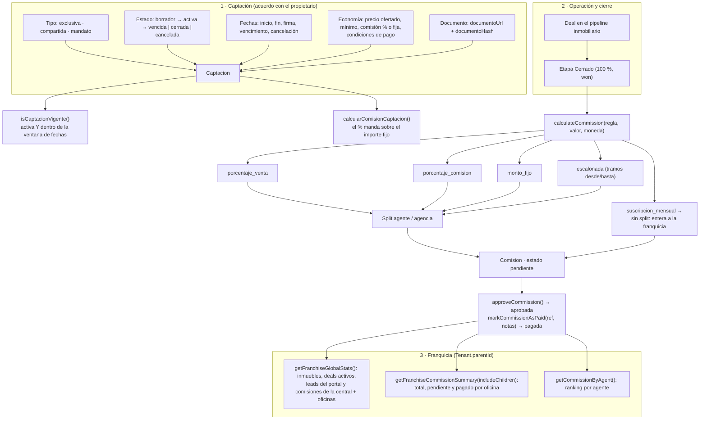
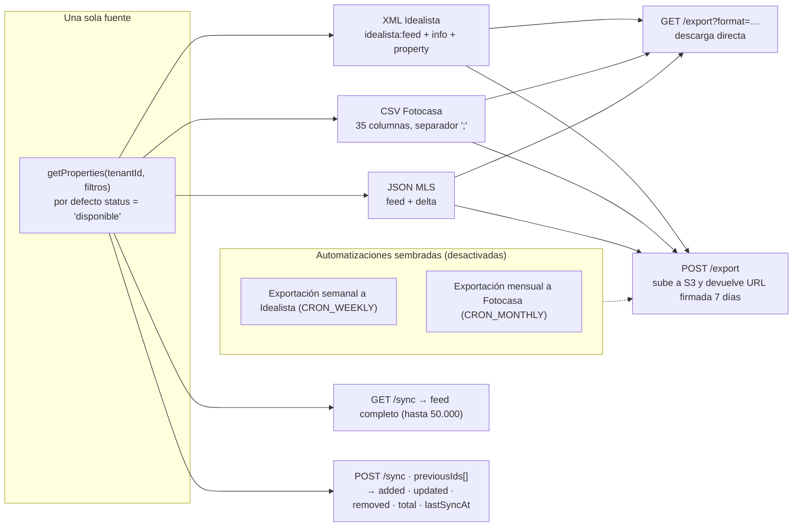
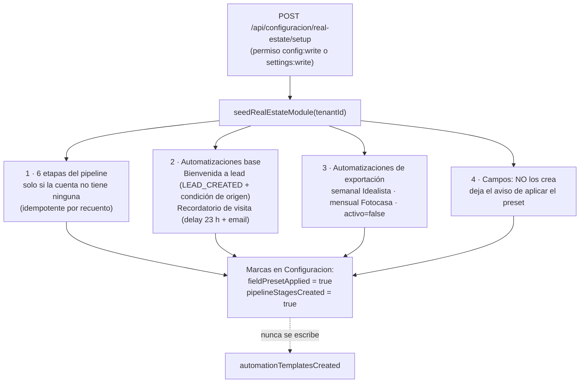
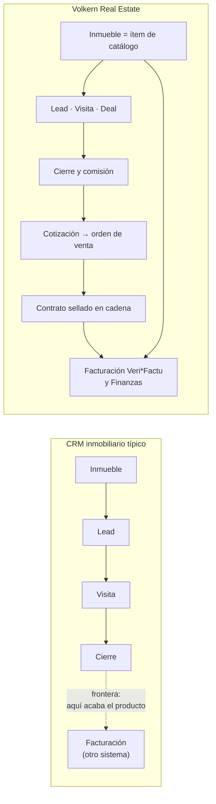

# Volkern Real Estate — Documento técnico del módulo

**Qué es, qué hace hoy, cómo funciona por dentro y en qué se diferencia**

Fecha: **2026-10-27** · Rama: `feat/nobeds-f1-lectura` · Autor del inventario: ingeniería de producto Volkern

> **Regla del documento.** No aparece ninguna credencial, contraseña ni clave de API. Cuando un dato
> proviene de una medición, se dice **cuándo** y **cómo** se midió. Cuando proviene de otro documento
> y no se ha podido re-medir, se dice también. Nada se afirma «porque el plan lo decía».

## Cómo se ha verificado este documento

| Fuente | Qué se leyó |
|---|---|
| Código del módulo | `lib/real-estate/` (13 ficheros), `app/api/real-estate/` + `app/api/public/real-estate/` + `app/api/ai/real-estate/` + `app/api/configuracion/real-estate/` (15 rutas), `app/dashboard/real-estate/` (4 pantallas), `components/real-estate/` (5 componentes), `lib/puck/components/real-estate/` (6 ficheros) |
| Esquema | `prisma/schema.prisma` (`CatalogoItem`, `Captacion`, `Comision`, `Deal`, `PipelineStage`, `Contact`, `Cita`, `Lead`, `Tenant`, `Configuracion`) e índices reales en `prisma/migrations/` |
| Pruebas | 9 ficheros `tests/real-estate-*.test.ts` **ejecutados el 2026-10-27: 133 pruebas, 133 en verde** y `npm run typecheck` con 0 errores |
| Documentos previos | [`real-estate-ficha-tecnica.md`](./real-estate-ficha-tecnica.md) (inventario del 29-sep-2026), [`REAL-ESTATE-MODULE.md`](./REAL-ESTATE-MODULE.md), [`COMMERCIAL-REAL-ESTATE.md`](./COMMERCIAL-REAL-ESTATE.md), [`verificacion-plan-inmobiliario.md`](./verificacion-plan-inmobiliario.md) |

**Qué corrige este documento respecto a la ficha del 29-sep-2026** (lo que se midió y ya no es cierto):

1. **La captación ya tiene interfaz.** Existen listado, alta, detalle, cambio de estado y borrado
   (`app/dashboard/real-estate/captaciones/`). La ficha decía que solo era alcanzable por API.
2. **El panel inmobiliario ya tiene navegación propia.** `components/real-estate/RealEstateModuleNav.tsx`
   es el hub que faltaba, y se pinta en las cuatro pantallas del módulo.
3. **El pipeline ya no escribe en MXN fijo.** `app/dashboard/pipeline/page.tsx:564` usa
   `formatCurrency(value, currency = monedaTenant || 'EUR')`; el importe sale en la divisa de la cuenta.
4. **El editor de la ficha ya no es un formulario plano**: es un editor **por secciones** con autosave,
   estado de completado y progreso (ver §6).

---

## 1. Resumen: qué es el módulo

El módulo inmobiliario de Volkern es la capa de negocio de la vertical **Inmobiliaria (Real Estate)**
(🏠, `VERTICAL_DEFINITIONS.real_estate` en `lib/plans.ts:170`, plan comercial `inmobiliaria` /
`real-estate` a **59 €/mes** en `lib/vertical-plans.ts`).

Su decisión arquitectónica central, de la que sale casi todo lo demás:

> **Un inmueble no es una tabla propia: es un ítem de catálogo.**
> `CatalogoItem` con `tipo = 'inmueble'`, y los campos inmobiliarios en `customFieldValues` (JSONB).

Esa decisión es la que hace que una casa o un local hereden **sin código nuevo** todo lo que el ERP ya
sabe hacer con un ítem de catálogo: precios e impuestos, cotizaciones, órdenes de venta, contratos,
multimedia, deals y pipeline, citas, chatbot, exportaciones y los módulos de facturación y finanzas.

### Los cuatro pilares, en términos de producto



### Para quién está pensado

| Perfil | Dolor que resuelve | Pieza del módulo que lo resuelve |
|---|---|---|
| Agencia pequeña (1–5 agentes) | Excel + WhatsApp, sin catálogo publicable | Catálogo de inmuebles, portal público, pipeline |
| Agencia mediana | Comisiones a mano, sin visibilidad de oficinas | Comisión con reglas y splits, dashboard consolidado |
| Franquicia / red | Central sin datos de sus oficinas | `Tenant.parentId`, `franchise/overview`, `franchise/commissions` |
| Promotora / constructora | Preventas y seguimiento de compradores | Pipeline con etapas propias por categoría, deals, ERP detrás |
| Renta vacacional | Ficha sin detalle de habitaciones y servicios | Editor con 15 tipos de habitación, 9 de cama y 55 servicios; `alquiler_temporada` |

---

## 2. Alcance

### 2.1 Dentro de alcance (implementado y alcanzable hoy)

- **Cartera de inmuebles** completa: alta, edición por secciones, fotos con portada, desactivación
  lógica, búsqueda y filtros, destacados, estados de comercialización.
- **Contrato de captación** con exclusividad, fechas, economía (precio de oferta y mínimo, comisión)
  y condiciones de pago, con su ciclo de estados.
- **Comercialización**: portal público propio por cuenta (slug o dominio propio), ficha pública con SEO,
  formulario de contacto que crea lead.
- **Salida a portales** en los tres formatos del sector y canal de sincronización incremental.
- **Cálculo y liquidación de comisiones** con cinco reglas de cálculo y reparto agente/agencia.
- **Consolidado de franquicia** sobre la jerarquía `Tenant.parentId`.
- **IA** sobre el catálogo: descripción comercial, precio sugerido, score de calidad, recomendación,
  búsqueda por lenguaje natural y consulta RAG con respuesta redactada.
- **CRM alrededor**: pipeline inmobiliario de 6 etapas, leads con origen, citas vinculadas a inmuebles,
  propietario sincronizado con `Contact`.

### 2.2 Fuera de alcance (declarado, no es deuda)

| Fuera de alcance | Estado |
|---|---|
| Sincronización **bidireccional** real con portales (Idealista/Fotocasa) | Se publica el feed y se sirve el delta; la vuelta la resuelve el integrador. No hay API de portal integrada. |
| **Firma electrónica** del contrato de captación | No implementada. El modelo tiene las columnas, sin escritor (§5.3). |
| **Valoración con datos de mercado externos** (AVM) | El precio sugerido se calcula con comparables **internos** del propio catálogo. |
| **Cobro por operación** (señal, reserva, *transaction fee*) | El módulo no tiene pasarela de pago: ni `stripe` ni `payment` ni `checkout` aparecen en `lib/real-estate/` ni en la API del módulo. El *transaction fee* del pack comercial es una propuesta comercial, no una capacidad implementada. |
| **App móvil de agentes** | No existe. El panel es web y responsive, no aplicación. |
| Tour virtual 360°, mapa con clustering, comparador de hipotecas | Roadmap del pack comercial, sin implementación. |

### 2.3 Lo que el módulo NO promete hacer con el dinero

Conviene decirlo explícitamente porque el pack comercial lo menciona: **la plataforma no cobra ni
retiene comisiones**. Calcula el importe de la comisión y guarda su estado (`pendiente`, `aprobada`,
`pagada`) con la referencia de pago que introduce un humano. El movimiento de dinero ocurre fuera del
módulo.

---

## 3. Arquitectura

### 3.1 Capas



**Regla de diseño:** `captacion-shared.ts`, `operation-labels.ts` y `property-editor-config.ts` son
módulos **puros a propósito** (no importan Prisma), para que el navegador y los tests los usen sin
arrastrar el cliente de base de datos al bundle. `captacion-helpers.ts` los reexporta, así que el
contrato de servidor no cambia.

### 3.2 Mapa de ficheros

| Ruta | Líneas | Para qué |
|---|---:|---|
| `lib/real-estate/property-helpers.ts` | 581 | `parseInmueble()`, `getProperties()`, `getPropertyStats()`, `buildCustomFieldValues()`, `updatePropertyCustomFields()`, `syncPropertyOwnerToContact()`. La frontera JSONB → tipado |
| `lib/real-estate/commission-calculator.ts` | 428 | 5 reglas de comisión, splits, `createCommissionFromDeal()`, resumen de franquicia, liquidación |
| `lib/real-estate/property-editor-config.ts` | 433 | Grupos y secciones del editor, catálogos (habitaciones, camas, servicios) y reglas de completado |
| `lib/real-estate/captacion-helpers.ts` | 368 | Alta/listado/edición/borrado de captaciones, estadísticas |
| `lib/real-estate/property-editor-draft.ts` | 258 | Borrador de la ficha, fotos, payload y estado: lógica pura que el editor usa sin tocar la API |
| `lib/real-estate/captacion-shared.ts` | 256 | Tipos, etiquetas y badges de captación, `calcularComisionCaptacion()`, `isCaptacionVigente()`, `diasRestantesCaptacion()` |
| `lib/real-estate/seed.ts` | 234 | `seedRealEstateModule()`: etapas, automatizaciones base y de exportación |
| `lib/real-estate/exporters/json-exporter.ts` | 471 | Feed MLS JSON + `generateSyncDelta()` |
| `lib/real-estate/exporters/csv-exporter.ts` | 184 | CSV Fotocasa |
| `lib/real-estate/exporters/xml-exporter.ts` | 140 | XML Idealista |
| `lib/real-estate/setup-pipeline.ts` | 117 | Las 6 etapas del pipeline inmobiliario |
| `lib/real-estate/operation-labels.ts` | 52 | Etiquetas, color y sufijo de precio por tipo de operación |
| `lib/real-estate/portal-utils.ts` | 35 | `resolveTenantBySlug()` (slug de cuenta **o** `portalSlug`) y `resolveTenantByCustomDomain()` |

Superficie de pantallas: dashboard 1.061 líneas, listado de inmuebles 1.233, captaciones 1.326,
detalle de captación 572, editor 526 + secciones + modales.

---

## 4. Modelo de datos

### 4.1 Diagrama de entidades



### 4.2 Las tablas, una a una

| Modelo | Tabla | Papel en el módulo |
|---|---|---|
| `CatalogoItem` | `catalogo_items` | **El inmueble.** `tipo='inmueble'`; `nombre`, `descripcion`, `precioBase`, `moneda`, `destacado`, `activo`, `media` (JSONB), `pricing` (JSONB), `customFieldValues` (JSONB), `metadata`, `contactId` |
| `Captacion` | `captaciones` | Contrato con el propietario: tipo, estado, cinco fechas, exclusividad, precios, comisión, condiciones de pago, documento y —sin usar— las columnas de sellado |
| `Comision` | `comisiones` | Comisión devengada por una operación: tipo, porcentaje, importe fijo y calculado, divisa, estado, `metodoCalculo` (la regla en JSON), fechas de aprobación y pago, referencia y notas |
| `Deal` | `deals` | La operación; el pipeline inmobiliario cuelga de `PipelineStage` con `categoria='real_estate'` |
| `PipelineStage` | `pipeline_stages` | Las 6 etapas sembradas: 10 % → 25 % → 50 % → 70 % → 90 % → 100 % (cerrado/ganado) |
| `Contact` | `contacts` | Propietario o vendedor; relación `OwnerProperties` |
| `Cita` | `citas` | Visita a un inmueble (`catalogoItemId`) |
| `Lead` | `leads` | Consulta entrante; el portal escribe `fuente='portal_inmobiliario'` |
| `Tenant` | `tenants` | `parentId` **es** la franquicia: central con oficinas hijas |
| `Configuracion` | `configuracion` | Claves/valor por cuenta: portal, comisiones y exportación (§4.4) |

### 4.3 Índices: lo que hay y lo que no

Medido sobre `prisma/migrations/`. Sobre `catalogo_items` existen cuatro índices **btree**:
`tenantId`, `tipo`, `activo` y `categoriaFiscal` (`0_init/migration.sql:7802-7811`).

**No existe ningún índice GIN sobre `customFieldValues`.** Y sin embargo los filtros del módulo —el
listado interno, el portal público, la exportación y la consulta IA— preguntan justo por rutas JSONB
(`zona`, `ciudad`, `tipo_operacion`, `tipo_inmueble`, `estado`). El plan inmobiliario daba el índice
por hecho; en el código no está. Es el primer punto a resolver antes de que una cuenta tenga miles de
inmuebles.

### 4.4 Claves de configuración del módulo

Viven en `Configuracion` (clave/valor por `tenantId`) y viajan por la ruta genérica `/api/configuracion`:

| Clave | Para qué |
|---|---|
| `portalSlug`, `portalEnabled`, `portalCustomDomain` | Portal público: slug, encendido y dominio propio |
| `commissionType` | Regla de comisión por defecto de la cuenta |
| `defaultCommissionPct`, `defaultMonthlyFee`, `defaultFixedFee` | Importes por defecto de las tres reglas más usadas |
| `defaultSplitAgent`, `defaultSplitAgency` | Reparto por defecto agente / agencia |
| `defaultCurrency` | Divisa por defecto del módulo |
| `exportFormats`, `autoExportEnabled`, `autoExportFormat` | Formatos y exportación automática |
| `fieldPresetApplied`, `pipelineStagesCreated` | Marcas que escribe el setup (§7.5) |

El portal resuelve la cuenta por **dos** vías: el `slug` del tenant o el valor de `portalSlug`
(`resolveTenantBySlug()`), y por dominio propio vía `portalCustomDomain` + `/api/configuracion/resolve-domain`.

### 4.5 El mapeo JSONB → TypeScript

`parseInmueble()` es el **único** traductor. El resto del módulo (API y pantallas) trabaja con
`InmuebleParsed` y nunca con el JSON crudo. Mapeo completo:

| Clave en `customFieldValues` | Propiedad | Tipo |
|---|---|---|
| `tipo_operacion` | `operationType` | `venta \| alquiler \| traspaso \| alquiler_temporada` |
| `tipo_inmueble` | `propertyType` | `Casa`, `Departamento`, `Ático`, `Villa`, `Loft`, `Local`, `Oficina`, `Terreno`, `Nave`… |
| `estado` | `status` | `disponible \| reservada \| vendida \| alquilada` (por defecto `disponible`) |
| `superficie_total` / `superficie_construida` | `areaM2` / `builtM2` | number |
| `habitaciones` / `banos` / `estacionamientos` | `bedrooms` / `bathrooms` / `parking` | number |
| `direccion` / `zona` | `address` / `city` | string |
| `latitud` / `longitud` | `lat` / `lng` | number |
| `antiguedad` | `yearBuilt` | number |
| `ascensor`, `estacionamiento`, `alberca`, `jardin`, `trastero`, `terraza`, `balcon`, `aire_acondicionado`, `calefaccion`, `amueblado` | `hasElevator`, `hasParking`, `hasPool`, `hasGarden`, `hasStorageRoom`, `hasTerrace`, `hasBalcony`, `hasAirConditioning`, `hasHeating`, `furnished` | boolean |
| `orientacion` | `orientation` | string |
| `certificacion_energetica` | `energyCert` | `A`…`G` \| `En trámite` |
| `consumo_energetico` / `emisiones_co2` | `energyCertConsumption` / `energyCertEmission` | number |
| `organismo_certificador`, `fecha_certificado`, `caducidad_certificado`, `documento_certificado` | `energyCertBody`, `energyCertDate`, `energyCertExpiry`, `energyCertUrl` | string |
| `destacada` | `featured` | boolean |
| `descripcion_larga` / `tags_seo` | `longDescription` / `seoTags` | string |
| `propietario_nombre` / `propietario_telefono` / `propietario_email` / `propietario_contact_id` | `owner.name` / `.phone` / `.email` / `.contactId` | string |
| `habitaciones_detalle` | `roomsDetail` | `{ bano: 1, dormitorio: 2 }` |
| `camas_detalle` | `bedsDetail` | `{ cama_doble: 1, sofa_cama: 2 }` |
| `servicios` | `servicios` | `string[]` |

Dos detalles de robustez que el documento hereda del código y conviene conservar:

- **Los contadores se validan.** El JSONB acepta cualquier forma, y una pantalla que asuma la
  estructura puede pintar `NaN` en los contadores: `esContadorDetalle()` solo acepta objetos cuyos
  valores sean enteros ≥ 0 (el cero se conserva, es un contador legítimo). La API sanea lo mismo en
  `POST` y `PATCH` antes de persistir.
- **La divisa del inmueble se resuelve, no se asume.** `parseInmueble()` aplica `monedaEfectiva([item.moneda])`
  y el alta usa `monedaEscritura(moneda, tenant.moneda)`: si el usuario no indica divisa, se hereda la
  de la cuenta en vez de caer al literal de la columna.

### 4.6 Tres listas de campos del inmueble (deuda real)

| Origen | Contenido |
|---|---|
| `app/api/catalogo/field-definitions/presets/route.ts`, preset `inmobiliaria` | **38 campos** exactos: operación, tipo, estado, dirección, zona, ciudad, provincia, código postal, lat/lng, superficies, habitaciones, baños, estacionamientos, antigüedad, los booleanos de equipamiento, orientación, los 7 campos de certificación energética, destacada, descripción larga, tags SEO, amenidades y los 4 del propietario |
| `scripts/seed-real-estate.ts` | Juego propio del seed genérico del módulo |
| `scripts/seed-demo-real-estate.ts` | **21 campos activos** de la cuenta de demostración |

Medido hoy: **`habitaciones_detalle`, `camas_detalle` y `servicios` no están en el preset de 38.** El
editor por secciones (§6) escribe esas tres claves en el JSONB, así que un inmueble puede tener datos
que la pantalla de definiciones de campo no declara. No rompe nada —el JSONB acepta lo que se le
escriba y el portal los lee— pero significa que la definición de campos y el editor no son la misma
fuente de verdad.

---

## 5. Superficie funcional

### 5.1 Pantallas

| # | Pantalla | Ruta | Estado |
|---|---|---|---|
| 1 | Dashboard inmobiliario | `/dashboard/real-estate` | KPIs, distribución por operación y ciudad, inmuebles recientes, sección de comisiones y bloque de franquicia |
| 2 | Inmuebles | `/dashboard/real-estate/properties` | Listado con filtros + **editor de ficha por secciones** |
| 3 | Captaciones | `/dashboard/real-estate/captaciones` | Listado, 5 tarjetas de estadísticas, filtros, alta por diálogo, cambio de estado y borrado |
| 4 | Detalle de captación | `/dashboard/real-estate/captaciones/[id]` | Ficha del contrato, cambio de estado, borrado |
| 5 | Configuración | `/dashboard/configuracion/real-estate` | 4 pestañas: `general`, `portal`, `commissions`, `export` |
| 6 | Catálogo de inmuebles | `/dashboard/catalogo?tipo=inmueble` | Pantalla compartida del catálogo |
| 7 | Campos del inmueble | `/dashboard/catalogo/campos` | Pantalla compartida de definiciones |
| 8 | Pipeline | `/dashboard/pipeline` | Pantalla compartida; las etapas inmobiliarias viven aquí |
| 9 | Portal público | `/p/<slug>/propiedades` | Pública; filtros, ordenación y tarjetas |
| 10 | Ficha pública | `/p/<slug>/propiedades/<id>` | Pública; galería, mapa y formulario |
| 11 | Landing del vertical | `/soluciones/real-estate` | Página comercial pública |

**Navegación.** La entrada de menú única sigue siendo *Configuración → Inmobiliaria*
(`lib/navigation-config.ts:625`), pero el módulo ya **no depende de escribir la URL**:
`RealEstateModuleNav` pinta una tira de cuatro pestañas —Dashboard, Inmuebles, Captaciones,
Configuración— en todas las pantallas del módulo, con la sección activa marcada por `aria-current`.
El propio componente documenta por qué existe: es el hub que faltaba.

### 5.2 API interna (12 rutas, todas con `withTenantAuth`)

`withTenantAuth()` (`lib/api-key-auth.ts`) acepta **sesión NextAuth o clave de API**, resuelve el
tenant y deja `auth.tenant` disponible; cada consulta filtra por `tenantId`.

| Dominio | Rutas |
|---|---|
| Inmuebles | `GET/POST /api/real-estate/properties` · `GET/PATCH/DELETE /api/real-estate/properties/[id]` · `POST /api/real-estate/properties/[id]/media` |
| Captaciones | `GET/POST /api/real-estate/captaciones` (con `?stats=true`) · `GET/PATCH/DELETE /api/real-estate/captaciones/[id]` |
| Métricas | `GET /api/real-estate/dashboard-stats` |
| Portales | `GET/POST /api/real-estate/export` · `GET/POST /api/real-estate/sync` |
| Franquicia | `GET /api/real-estate/franchise/overview` · `GET /api/real-estate/franchise/commissions` |
| IA | `POST /api/ai/real-estate/consult` |
| Puesta en marcha | `POST /api/configuracion/real-estate/setup` (exige `config:write` o `settings:write`) |

Detalles que importan:

- **`GET /properties` tiene dos caminos**: con `?search=` hace la búsqueda textual en SQL (Prisma, con
  `skip`/`take` y `count`, filtrable por `status` vía ruta JSONB); sin `search` delega en
  `getProperties()`, que **trae todo y filtra en memoria** (§11).
- **`DELETE /properties/[id]` es una desactivación lógica** (`activo = false`), no un borrado.
- **`POST /properties/[id]/media`** añade una entrada `{ url, alt, order, addedAt }` al array `media`;
  recibe una URL, no un binario (la subida del editor usa `/api/upload/catalogo`).
- **`franchise/overview` exige `accountType` AGENCY o BUSINESS**; en cualquier otra cuenta responde
  **403** con el motivo.
- **`export` limita a 10.000 inmuebles**; `sync` sube hasta 50.000.
- **`export` con `POST`** sube el feed a S3 en `exports/<tenantId>/portales/<timestamp>-<fichero>` y
  devuelve una URL firmada válida **7 días**.

### 5.3 API pública (3 rutas, sin sesión)

| Ruta | Límite | Qué hace |
|---|---|---|
| `GET /api/public/real-estate/properties` | 120/min | Listado por `?slug=`; resuelve el tenant, filtra en memoria y ordena (`precio_asc`, `precio_desc`, `superficie_desc`, `destacados`, por defecto fecha descendente) |
| `GET /api/public/real-estate/properties/[id]` | 120/min | Ficha de un inmueble |
| `POST /api/public/real-estate/contact` | 50/hora | Crea el lead del portal |

El contacto público exige `name` y `email`, busca el inmueble para adjuntar su nombre, crea el lead con
`fuente = 'portal_inmobiliario'` a través de la skill `create_lead`, deja en su metadata el inmueble, la
fecha de visita preferida, el `referer`, el `user-agent` y la IP, **incrementa el contador de leads del
inmueble** (`metadata.totalLeads`, con `jsonb_set` atómico) y publica `LEAD_CREATED` en el EventBus.

Todas las públicas corren en el contexto de tenant (`getTenantDb` + `dbContext.run`), con el aislamiento
aplicado igual que en las internas.

### 5.4 Módulos puros y sus funciones clave

| Fichero | Funciones que definen comportamiento |
|---|---|
| `property-helpers.ts` | `parseInmueble` · `parseInmuebles` · `getProperties` · `getPropertyById` · `getFeaturedProperties` · `getPropertyStats` · `buildCustomFieldValues` · `updatePropertyCustomFields` · `getPropertyWithFields` · `syncPropertyOwnerToContact` |
| `commission-calculator.ts` | `calculateCommission` · `createCommissionFromDeal` · `getFranchiseCommissionSummary` · `getFranchiseGlobalStats` · `approveCommission` · `markCommissionAsPaid` · `getCommissionByAgent` |
| `captacion-shared.ts` | `calcularComisionCaptacion` · `isCaptacionVigente` · `diasRestantesCaptacion` · `primeraImagenInmueble` · etiquetas y badges |
| `captacion-helpers.ts` | `listCaptaciones` · `getCaptacionById` · `createCaptacion` · `updateCaptacion` · `deleteCaptacion` · `getCaptacionStats` · `getCaptacionesActivasPorPropiedad` |
| `property-editor-config.ts` | `estadoSecciones` · `progresoGlobal` · `contarFotos` · `sumarDetalle` · catálogos `HABITACIONES_GRUPOS`, `CAMAS_CATALOGO`, `SERVICIOS_GRUPOS` |
| `property-editor-draft.ts` | `borradorDesdeInmueble` · `payloadDesdeBorrador` · `estadoDesdeBorrador` · `mediaAFotos` · `hacerPortada` · `dormitoriosEfectivos` · `banosEfectivos` |
| `setup-pipeline.ts` | `setupRealEstatePipeline` (idempotente) · `getRealEstateStages` |

### 5.5 Componentes de interfaz

| Componente | Papel |
|---|---|
| `RealEstateModuleNav` | Hub de 4 pestañas del panel inmobiliario |
| `PropertyEditor` (+ `PropertyEditorSections`, `PropertyEditorModals`) | Editor de ficha por secciones con autosave |
| `OwnerCard`, `OwnerBadge` | Ficha y distintivo del propietario, reutilizados por el listado |
| `RealEstateConfigDashboard` | Las 4 pestañas de configuración |
| `components/public/real-estate/*` | Landing del vertical: problema, cómo funciona, oferta, resultados, casos de uso, comparativa, integraciones |
| `lib/puck/puck-config.tsx` | Los 7 bloques del CMS registrados en la categoría inmobiliaria: `PropertyGrid`, `PropertyCard`, `PropertyDetail`, `PropertyContactForm` (en `lib/puck/components/real-estate/`) y los widgets `RealEstateStatsWidget`, `RealEstateChartWidget`, `RealEstateRecentWidget` |

Los bloques Puck permiten **incrustar el catálogo y las métricas dentro de una página del constructor
visual** del cliente: la inmobiliaria puede montar su web con el mismo sistema que gestiona los
inmuebles.

### 5.6 Inteligencia artificial

**Seis funciones implementadas** en `lib/skills/real-estate-skills.ts`, todas sobre `AIEngine.chat()`
(el motor con fallback de modelos del resto del ERP):

| Skill | Qué devuelve | Escribe en el inmueble |
|---|---|---|
| `generate_property_description` | Descripción comercial redactada | Sí: `descripcion_larga` |
| `suggest_price_based_on_market` | Precio sugerido + confianza y mensaje, a partir de comparables **internos** de la misma zona | No |
| `calculate_property_quality_score` | Score 0–100 con nota A–D y desglose por completitud e imágenes | No |
| `recommend_properties` | Recomendaciones con score y una razón breve por inmueble | No |
| `search_properties_by_filters` | Búsqueda por lenguaje natural para el chatbot | No |
| `calculate_franchise_commissions` | Consolidado de comisiones de la red | No |

Nota fina: **el catálogo de skills anuncia cinco** (`lib/skills/index.ts:4684-4689`, categoría
`real_estate`); `calculate_franchise_commissions` es invocable (wrapper en la línea 3204, registrado en
la línea 4452) pero **no aparece listado**. Es una asimetría entre lo que el sistema puede hacer y lo
que anuncia.

**Consulta RAG** — `POST /api/ai/real-estate/consult`:



Los filtros que extrae son: `tipoOperacion`, `tipoInmueble`, `ciudad`, `zona`, `precioMin`,
`precioMax`, `habitacionesMin`, `banosMin`, `superficieMin`, `palabrasClave` e `intencion`
(`consulta`, `busqueda`, `comparacion`, `recomendacion`). El score de relevancia premia tener operación,
tipo, superficie, multimedia, descripción de más de 50 caracteres y precio. Si la IA falla, el fallback
en regex sostiene la búsqueda y la respuesta cae a un texto plantilla: **la consulta no se queda sin
contestar cuando el modelo no responde**.

También existe `lib/agents/intents/real-estate-intents.ts`, el vocabulario con el que el agente
reconoce una petición inmobiliaria y la enruta a la ruta determinista en vez de al LLM.

### 5.7 Pipeline inmobiliario

`REAL_ESTATE_STAGES` (`setup-pipeline.ts`) define las seis etapas con su probabilidad y color:

| Orden | Etapa | Probabilidad |
|---:|---|---:|
| 0 | Contacto inicial | 10 % |
| 1 | Visita programada | 25 % |
| 2 | Oferta recibida | 50 % |
| 3 | Negociación | 70 % |
| 4 | Escrituración | 90 % |
| 5 | Cerrado | 100 % (etapa final · `won`) |

`setupRealEstatePipeline()` es **idempotente por etapa**: busca por `(tenantId, nombre, categoria)` y
solo crea la que falta; devuelve cuántas creó.

---

## 6. Flujo A — Alta y publicación de un inmueble

El corazón operativo del módulo. El listado y el editor conviven en la misma pantalla: al pulsar
«Nueva Propiedad» o editar una fila, el editor **sustituye por completo al listado** y la URL lleva
`?edit=<id>`, de modo que una ficha concreta es enlazable.



### 6.1 Reglas del editor

- **Grupos y secciones** (3 y 10, en `property-editor-config.ts`): 9 secciones tienen estado de
  completado y `progresoGlobal()` es su media en porcentaje entero; la décima —`sincronizacion`— es la
  única sin estado, porque todavía no hace nada.
- **Completado significa publicable, no exhaustivo.** El propio módulo lo documenta: una ficha con
  ciudad pero sin coordenadas cuenta como ubicada. Las reglas: descripción exige nombre **y**
  descripción; fotos, al menos una; ubicación, ciudad **o** dirección; contacto, uno de los tres datos
  del propietario; habitaciones, contador clásico **o** detalle de habitaciones **o** de camas;
  equipamiento, servicios marcados **o** algún booleano clásico; precios, importe mayor que cero;
  disponibilidad, estado presente; cumplimiento, certificación energética presente.
- **Compatibilidad hacia atrás explícita:** un inmueble creado antes del editor (con booleanos
  `ascensor`, `alberca`…) cuenta como equipado. El catálogo de servicios mapea 10 de sus entradas a
  esos mismos booleanos, así que marcar «Piscina» en el editor nuevo mantiene el campo clásico en
  sincronía y nada que leyera el formato antiguo se queda ciego.
- **Fotos:** la sección de fotos sube con `POST /api/upload/catalogo` (binario, multipart), no con la
  ruta `media` —que recibe una URL—. El borrador maneja portada (`hacerPortada`) y títulos de foto
  (máximo 100 caracteres).
- **Habitaciones y camas:** 15 tipos de habitación en dos grupos (privadas y compartidas) y 9 tipos de
  cama. Los totales efectivos (`dormitoriosEfectivos`, `banosEfectivos`) salen del detalle cuando
  existe, y sirven para rellenar los contadores clásicos que el portal y la exportación leen.
- **Servicios:** 55 entradas repartidas en 12 grupos (Popular primero, porque es lo que casi toda ficha
  declara) con buscador que filtra en todos los grupos. Diez de ellas declaran su `boolKey` y mantienen
  sincronizado el booleano clásico del inmueble.
- **Autosave con 1,2 s de debounce** sobre `PATCH`. El usuario no pulsa «guardar»: escribe y la ficha
  se guarda sola. Por eso el editor manda solo lo que cambió y el servidor hace *merge* sobre el JSONB
  existente en lugar de reemplazarlo.
- **Sección de canales:** es un aviso, no una función. Escribe literalmente que queda «preparada para
  la integración con canales». Documentarlo evita que alguien venda una sincronización que no existe.

### 6.2 Lo que hace el backend con lo que llega

`POST /properties` acepta los campos inmobiliarios en plano (`operationType`, `areaM2`…), los convierte
con `buildCustomFieldValues()` a las claves JSONB, sanea los contadores, escribe `categorias: ['inmueble']`
y parte `tags_seo` en `etiquetas`. `PATCH` recorre dos tablas de mapeo explícitas —28 campos y 11
booleanos— más los tres bloques del editor, y hace merge solo si hay algo que fusionar.

El **propietario** se sincroniza hacia el CRM: si el PATCH no envía un campo del propietario, se usa el
valor **actual** del inmueble (no `undefined`), de modo que editar solo el teléfono no borre el nombre.
La sincronización es *best-effort* y no bloquea la respuesta; devuelve `no_contact_id`,
`contact_not_found`, `no_owner_data` o los campos actualizados.

---

## 7. Flujo B — Del portal público al lead

```mermaid
sequenceDiagram
    autonumber
    participant V as Visitante
    participant W as Portal público
    participant A as API pública
    participant DB as PostgreSQL
    participant EB as EventBus
    participant AU as Motor de automatizaciones

    V->>W: /p/&lt;slug&gt;/propiedades (filtros y orden)
    W->>A: GET /api/public/real-estate/properties?slug=
    A->>A: resolveTenantBySlug (slug o portalSlug)
    A->>A: rate limit 120/min
    A->>DB: inmuebles activos del tenant (contexto de tenant)
    DB-->>V: tarjetas con inmueble, precio y foto
    V->>W: /propiedades/&lt;id&gt; (galería, mapa, similares)
    V->>A: POST /api/public/real-estate/contact
    A->>A: exige nombre y email · rate limit 50/h
    A->>DB: busca el inmueble para el asunto
    A->>DB: create_lead con fuente=portal_inmobiliario
    A->>DB: inmueble.metadata.totalLeads += 1 (jsonb_set atómico)
    A->>EB: LEAD_CREATED
    EB->>AU: automatización «Bienvenida a nuevo lead inmobiliario»
    AU->>DB: tarea «Llamar a lead inmobiliario», prioridad alta, en 2 h
    A-->>V: «Gracias por tu interés. Te contactaremos pronto.»
```

**El lead del portal es el mismo lead del CRM**, y eso tiene una consecuencia doble: por un lado nace ya
con historial, pipeline y automatizaciones; por otro, el KPI «Leads (Portal)» del dashboard cuenta
**exactamente** `fuente = 'portal_inmobiliario'` (§11), así que un lead inmobiliario que entre por
WhatsApp o por teléfono no suma en esa tarjeta aunque sea del mismo negocio.

**SEO y marca.** El listado y la ficha generan `Metadata` con `openGraph`, y ambos aplican el branding
efectivo de la cuenta (`getEffectiveBranding`): el portal sale con la marca del cliente, no con la de
Volkern. El dominio propio se resuelve por `portalCustomDomain`.

---

## 8. Flujo C — Captación, comisión y franquicia

Es el flujo que sostiene el dinero del vertical, y el que la ficha anterior daba por inalcanzable.



### 8.1 Las cinco reglas de comisión, con su comportamiento exacto

| Regla | Cálculo | Casos límite que el código resuelve |
|---|---|---|
| `porcentaje_venta` | `valor × pct/100` | Sin porcentaje asume **3 %** |
| `porcentaje_comision` | `valor × pct/100` | Sin porcentaje asume 100 % |
| `monto_fijo` | Importe fijo | Sin importe, 0 |
| `escalonada` | El tramo que contiene el valor | Ordena los tramos antes de buscar; si el valor **excede el último tramo**, aplica el porcentaje del último; sin tramos, 0 y lo deja escrito en el desglose |
| `suscripcion_mensual` | Cuota mensual | **Retorna antes de aplicar splits**: la suscripción va entera a la franquicia, por diseño |

**Splits:** si se define `splitAgente`, ese porcentaje va al agente y el resto de lo no asignado queda a
la agencia; si solo se define `splitAgencia`, el agente se queda el resto. Los importes se redondean a
dos decimales, y cada resultado trae un **desglose legible** (texto con los importes ya formateados en
la divisa) que es lo que hace auditable la liquidación: quien paga ve de dónde sale el número, no solo
el número.

**Divisa de la comisión:** `monedaEscritura(userMoneda, deal.moneda)` — la que pida quien la crea y, si
no, la del negocio del que sale. El comentario del código es explícito sobre el error que corrige:
antes caía a `'EUR'` (el literal de la columna) y una comisión de una operación en pesos se guardaba en
euros.

**Ciclo de vida de la captación:** `borrador` (en edición, sin firmar) → `activa` (vigente,
comercializándose) → `vencida` / `cerrada` (se vendió o alquiló durante la vigencia) / `cancelada`
(rescindida). El módulo separa **estado** y **vigencia real**: `isCaptacionVigente()` exige estado
`activa` **y** estar dentro de la ventana de fechas, porque una captación activa con la fecha de fin
pasada ya no lo está aunque nadie la haya marcado como vencida. `diasRestantesCaptacion()` cuenta días
naturales —«quedan 0 días» es el último día de vigencia, no una fracción de jornada— y ambos inyectan
el momento de referencia en lugar de leer el reloj, para que un test no afirme hoy algo distinto de lo
que afirmó el día que se escribió.

**Interfaz de captaciones:** listado con cinco tarjetas de estadísticas (total, activas, exclusivas,
comisión promedio, precio ofertado), filtros por estado, tipo, texto y rango de fechas, alta por
diálogo, cambio de estado por `PATCH` y borrado. La pantalla de alta propone vencimientos por
temporadas, no por días sueltos, porque así se firma este contrato en la calle.

---

## 9. Flujo D — Salida a portales



Los tres formatos y el delta salen del **mismo** `getProperties()`, y eso no es un detalle de estilo: es
la garantía de que un inmueble no puede aparecer en el feed de Idealista y desaparecer del de Fotocasa.
Los dos *crons* de exportación se siembran **con `activo: false`**: existen como plantilla y los enciende
el cliente.

**Consecuencia que hay que conocer:** `getProperties()` filtra por defecto
`status = 'disponible'`, así que **la exportación excluye todo lo que no esté disponible** —reservado,
vendido o alquilado—. La ruta interna **sí** acepta `?status=`, pero el botón de la interfaz no lo usa;
quien exporte desde el panel obtiene solo lo disponible.

---

## 10. Flujo E — Puesta en marcha y Flujo F — Consulta IA

### 10.1 Puesta en marcha del módulo



**Tres asimetrías que conviene saber antes de fiarse del indicador de estado:**

1. `fieldPresetApplied = true` **se escribe aunque no se haya creado ningún campo**: el seed no crea
   campos, solo apunta que el preset se aplica desde el endpoint de definiciones.
2. `automationTemplatesCreated` —la tercera marca que lee la pantalla— **no se escribe nunca**, así que
   el componente «Automatizaciones» aparece «Pendiente» de forma permanente, incluso con las
   automatizaciones creadas.
3. Como las marcas solo las escribe el *setup*, una cuenta configurada por datos (todos los clientes
   reales) verá los tres componentes en «Pendiente». El indicador mide **si se pulsó un botón**, no si
   el módulo está configurado.

También existen `seedAllRealEstateTenants()` —recorre cuentas activas y siembra las que ya tienen
inmuebles— y dos scripts de datos: `scripts/seed-real-estate.ts` y `scripts/seed-demo-real-estate.ts`
(este último es el que dejó los 21 campos activos de la demo).

### 10.2 Encendido comercial

| Vía | Dónde |
|---|---|
| Vertical de producto | `lib/plans.ts:170` → `real_estate`: «Inmobiliaria (Real Estate)» 🏠, con sus 19 módulos (leads, contactos, empresas, pipeline, tareas, analytics, mensajes, citas, catalogo, cotizaciones, contratos, ordenes_venta, campanas, cms, builder_premium, mi_tarjeta, integraciones, equipo, configuracion) |
| Plan comercial | `lib/vertical-plans.ts` → `inmobiliaria` / `real-estate`, «Propiedades, leads y cierres», **59 €/mes** |
| Módulo de la cuenta | `Tenant.enabledModules` incluye el literal `real-estate` |
| Altas guiadas | `app/signup/page.tsx:252` («Inmobiliaria») y `app/dashboard/onboarding-quick/page.tsx:31` («ERP inmobiliario completo») |
| Escaparate público | `lib/navigation.ts:11` («Inmobiliarias» → `/soluciones/real-estate`), la landing del vertical y la página de soluciones |

**La puerta real es `enabledModules`.** Ni `lib/permissions.ts` ni `lib/permissions-core.ts` mencionan
`real-estate` ni `inmobiliaria`: no hay comprobación de plan ni de permiso específico del vertical en el
motor de permisos, más allá del permiso de escritura que exige el `setup` y del `accountType` que exige
la vista de franquicia.

---

## 11. Seguridad, permisos y aislamiento

| Capa | Cómo se protege |
|---|---|
| API interna | `withTenantAuth()` en **todas** las rutas: sesión NextAuth **o** clave de API; el tenant queda resuelto y cada consulta filtra por `tenantId` |
| API pública | Sin sesión: resuelve el tenant por `slug` y aplica rate limit. Listado y ficha 120/min, contacto 50/h |
| Consulta IA | `withTenantAuth`; el SQL se construye con parámetros enlazados y `LIMIT` por parámetro |
| Franquicia | Exige `accountType` AGENCY o BUSINESS; si no, **403** con motivo |
| Setup | Exige `config:write` o `settings:write` |
| Documentos | `Captacion.documentoUrl` y `documentoHash`; la captación **no** se sella (§12.1) |
| Secreto | Ninguno: el módulo no guarda credenciales de terceros. No hay claves de portal, ni tokens de API de Idealista ni de Fotocasa, porque la integración es por feed, no por API |

**Contexto de tenant en lectura pública:** las rutas públicas entran en el contexto de tenant
(`getTenantDb` + `dbContext.run`) para consultar, pero la **resolución** del tenant por slug —
`portal-utils.ts`— usa el cliente global (`globalPrisma`), porque en ese momento todavía no se sabe de
qué cuenta se trata. Es correcto por necesidad, y conviene tenerlo presente al revisar el aislamiento:
la primera consulta es intencionadamente global; a partir de ahí, todo va por tenant.

### 11.1 El aislamiento son dos capas: jerarquía y conexión

El filtro por `tenantId` es solo la mitad. La otra mitad es **qué conexión se usa**: el proxy `prisma`
de `lib/db.ts` envía los modelos de negocio al cliente que esté en el contexto y solo los de
`GLOBAL_MODELS` al control plane —`Tenant` es global; `CatalogoItem`, `Captacion` y `Comision` no—. Si
dos cuentas no comparten base de datos, una consulta que las cruce con un `IN` **no falla: devuelve
menos filas**, y lo hace sin error.

Eso es exactamente lo que le ocurría a la consolidación de franquicia: el panel de la matriz devolvía
ceros mientras la lista de oficinas se pintaba bien. La revisión del 27-oct lo corrigió con un módulo
propio, [`lib/real-estate/franquicia.ts`](../lib/real-estate/franquicia.ts): `enCadaConexion()` abre el
contexto que corresponde a cada grupo de conexión —la base compartida se consulta por la conexión
global, explícitamente— y `oficinasDeFranquicia()` es el único sitio que decide qué oficinas cuentan
(solo `activo` y `trial`).

En la misma revisión se cerraron **dos escrituras cruzadas de cuenta y una lectura de relaciones
dejenas**: el formulario público de contacto ya no puede escribir la metadata de un inmueble de otra
cuenta, las captaciones no aceptan `propiedadId`/`contactoPropietarioId` ajenos y descartan al leer las
relaciones que no son suyas, y los totales consolidados dejaron de sumar divisas distintas en una cifra.

El detalle completo, hallazgo por hallazgo, con las pruebas que lo cubren y lo que queda abierto, está
en [`real-estate-aislamiento-multitenant.md`](./real-estate-aislamiento-multitenant.md).

---

## 12. Qué falta: deuda medida el 2026-10-27

### 12.1 Deuda con consecuencia de producto

| # | Qué falta | Por qué importa |
|---|---|---|
| 1 | **El contrato de captación no está sellado.** `Captacion` declara `auditHash` (`@unique`), `chainedHash`, `sealedAt` y `signatureAudit`; **ningún fichero de `lib/real-estate/` ni de `app/api/real-estate/` las escribe** (verificado por búsqueda). El patrón de cadena SHA-256 sí existe en el ERP para contratos, nóminas y stock, pero no se aplicó aquí | La exclusividad es la cláusula que sostiene el negocio inmobiliario, y hoy no tiene prueba de integridad encadenada. El esquema está preparado: falta el escritor |
| 2 | **No hay índice GIN sobre `customFieldValues`** (§4.3) | El listado, el portal, la exportación y la consulta IA filtran por rutas JSONB. Con pocos inmuebles no se nota; con una cartera grande, sí |
| 3 | **El portal público no está enlazado desde el listado de inmuebles** y el botón del dashboard apunta a `/p/propiedades`, **sin slug** (`app/dashboard/real-estate/page.tsx:627`) | Ese destino no resuelve a ninguna cuenta: debería ser `/p/<slug>/propiedades`. Es un enlace roto en la interfaz, no en la ruta |
| 4 | **La sección «Sincronizar con canales» del editor es un aviso**, no una función | Está declarada como pendiente en la propia pantalla. No se puede vender como integración |
| 5 | **`calculate_franchise_commissions` no aparece en el catálogo de skills** aunque sea invocable (§5.6) | Lo que el sistema puede hacer y lo que anuncia no coinciden |
| 6 | **`habitaciones_detalle`, `camas_detalle` y `servicios` no están en el preset de 38 campos** (§4.6) | El editor escribe claves que la pantalla de definiciones no declara: dos fuentes de verdad para «qué campos tiene un inmueble» |
| 7 | **Tres listas de campos conviven** (preset de 38, seed del módulo, seed de la demo con 21 activos) | Un inmueble creado desde el preset y otro desde el seed de la demo no comparten vocabulario |
| 8 | **El setup se declara hecho sin crear campos y nunca escribe una de sus tres marcas** (§10.1) | El indicador de «módulo configurado» mide si se pulsó el botón |

### 12.2 Deuda de consulta y de dinero

| # | Qué falta | Consecuencia |
|---|---|---|
| 9 | **`getProperties()` filtra en memoria.** Trae **todos** los inmuebles activos de la cuenta sin `skip`/`take` y luego filtra y pagina en JavaScript | La paginación no ahorra una sola fila leída. El portal público y la exportación hacen lo mismo |
| 10 | **Los promedios del dashboard mezclan operaciones.** `getPropertyStats()` promedia `precioBase` de todos los inmuebles juntos —ventas de siete cifras junto a alquileres de cuatro— y `dashboard-stats` devuelve la divisa de la **cuenta** (`auth.tenant.moneda`) con la que el panel escribe el resultado | «Precio Promedio» y «€/m²» del panel son un número real calculado sobre una mezcla que no significa nada comercialmente |
| 11 | **Los dos orígenes de divisa no están conciliados:** la divisa del **ítem** y la de la **cuenta** conviven. Cada línea de un feed lleva la suya, correctamente; los promedios del panel, no | Un panel que escribe en la divisa de la cuenta mientras los inmuebles están en otra |
| 12 | **«Leads (Portal)» solo cuenta `fuente = 'portal_inmobiliario'`** y **«Visitas Agendadas» solo suma citas en estado `pendiente` con fecha futura o `completada`** (`dashboard-stats`) | Una cita `confirmada` vinculada a un inmueble **no aparece en ninguna de las dos tarjetas**; un lead inmobiliario que entre por otro canal tampoco. Las tarjetas no cuentan «lo inmobiliario», cuentan dos filtros |
| 13 | **La exportación solo saca lo disponible** y la interfaz no permite elegir estado, aunque la ruta sí acepte el parámetro | Quien quiera exportar reservados o vendidos tiene que usar la API a mano |
| 14 | **Cobertura de tests incompleta:** desde el 27-oct sí hay pruebas de aislamiento —conexiones de franquicia y referencias ajenas en captaciones y en el formulario público—, pero siguen faltando las de captaciones de extremo a extremo, exportación y medios (§13) | El camino principal, las piezas puras y los bordes de aislamiento están cubiertos; el CRUD y la exportación, no |

---

## 13. Verificación

```
npx vitest run tests/real-estate-api.test.ts \
  tests/real-estate-captacion-shared.test.ts \
  tests/real-estate-commission-calculator.test.ts \
  tests/real-estate-consult.test.ts \
  tests/real-estate-franquicia-conexiones.test.ts \
  tests/real-estate-intents.test.ts \
  tests/real-estate-property-editor-config.test.ts \
  tests/real-estate-property-helpers.test.ts \
  tests/real-estate-referencias-ajenas.test.ts
```

**Resultado medido el 2026-10-27: 9 ficheros, 133 pruebas, 133 en verde.** El *typecheck* del proyecto
(`npm run typecheck`) se ejecutó en la misma fecha con **0 errores**.

| Fichero | Qué cubre |
|---|---|
| `real-estate-api.test.ts` | Rutas de inmuebles y contrato de la API |
| `real-estate-property-helpers.test.ts` | `parseInmueble`, filtros y estadísticas |
| `real-estate-property-editor-config.test.ts` | Secciones, reglas de completado y progreso |
| `real-estate-captacion-shared.test.ts` | Etiquetas, comisión de captación, vigencia y días restantes (con el momento inyectado) |
| `real-estate-commission-calculator.test.ts` | Las cinco reglas, tramos y splits |
| `real-estate-consult.test.ts` | Consulta IA sobre inmuebles |
| `real-estate-intents.test.ts` | Reconocimiento de intenciones inmobiliarias (18 pruebas) |
| `real-estate-franquicia-conexiones.test.ts` | **Aislamiento de franquicia:** que cada grupo de oficinas se consulte con la conexión que le corresponde y no con la de la matriz; oficinas vigentes y agrupación de importes por divisa |
| `real-estate-referencias-ajenas.test.ts` | **Pertenencia de referencias:** captaciones que apuntan a inmuebles o contactos de otra cuenta, y el formulario público sin poder escribir fuera de su tenant |

Estos dos últimos ejercitan el **proxy `prisma` y el `dbContext` reales** (solo mockean la lectura de
`Tenant` del control plane): son la clase de prueba que faltaba, porque mockear `lib/db` entero hace
invisible el enrutamiento por conexión, que es donde vive la mitad del aislamiento.

**Lo que estas 133 pruebas no cubren:** captaciones de extremo a extremo, exportadores, el editor en el
navegador, y una integración real contra dos bases de datos distintas —el entorno de pruebas tiene una
sola, así que la consolidación se verifica por la conexión que recibe cada grupo y no por el resultado
de una consulta entre dos bases—. Se declara como límite, no como cobertura.

---

## 14. Qué diferencia a este módulo

La comparación honesta separa **tres clases de diferencia**: lo estructuralmente imposible en un
competidor, lo que cuesta trabajo replicar, y lo que es paridad de mercado.

### 14.1 Diferencia estructural: el inmueble vive dentro del ERP



Un CRM inmobiliario termina en el cierre. Aquí el cierre **empieza** la parte fiscal: el inmueble es un
ítem de catálogo, así que tiene cotizaciones, órdenes de venta, contratos y facturación del mismo
sistema que ya usa la empresa para todo lo demás. Esa es la diferencia que no se replica añadiendo
funciones a un CRM vertical: exige ser un ERP primero.

**Corolario honesto:** hoy la comisión **no** se factura automáticamente desde la operación. El cálculo
y la liquidación existen; el puente de la comisión a una factura del ERP no está implementado.

### 14.2 Diferencia de fondo: la franquicia es del modelo de datos, no un módulo encima

`Tenant.parentId` es la jerarquía, y las comisiones se consolidan recorriéndola
(`getFranchiseGlobalStats`, `getFranchiseCommissionSummary(includeChildren)`). El franquiciador ve las
propiedades, los leads del portal y las comisiones **de la central y de sus oficinas** en una consulta,
con desglose por oficina y ranking por agente, sin exportar nada a Excel. Y el aislamiento entre oficinas
no es una convención de la interfaz: es el mismo `withTenantAuth` que protege el resto del ERP.

### 14.3 Diferencia de producto: la IA trabaja sobre datos propios y escribe en ellos

No es un chat de escaparate: las skills operan sobre el catálogo real. `generate_property_description`
**escribe** `descripcion_larga` en la ficha; `suggest_price_based_on_market` calcula con los comparables
de la propia zona y **declara su confianza** (`high`/`medium`/`low`) y, cuando no hay datos suficientes,
lo dice en lugar de inventar un precio; `calculate_property_quality_score` convierte la completitud de la
ficha en un número accionable. La consulta RAG responde con los inmuebles que encuentra y mantiene un
fallback determinista para que una caída del modelo no deje al cliente sin respuesta.

### 14.4 Paridad de mercado (no diferencial)

Conviene decirlo para no venderlo de más: el portal público con filtros, la ficha con SEO, los feeds a
Idealista y Fotocasa, el pipeline visual, el control de visitas, los campos configurables y el dashboard
con KPIs **no** son diferenciales — son lo que el mercado ya espera de un CRM inmobiliario. Lo diferencial
está en que todo eso conviva con facturación, franquicia y comisiones en el mismo sistema, y en el precio:
**59 €/mes por la vertical**, sin comisión de plataforma por operación.

### 14.5 Frente a los portales (Idealista, Fotocasa)

Los portales son **canales de captación de demanda**, no gestores de cartera: cobran por publicar y por
destacar, y no facturan, ni gestionan comisiones, ni consolidan una red. Aquí el portal inmobiliario del
cliente es **propiedad del cliente**: su marca, su dominio, sus datos. El módulo no compite con el portal
grande, lo **alimenta** con un feed — y ese es el reparto correcto.

### 14.6 Frente a un CRM de gran cuenta

El diferencial no es la lista de funciones, es el **tiempo hasta el primer inmueble publicado**: con el
panel, el editor por secciones, el preset de campos y el seed, una cuenta puede tener su catálogo
publicado y su portal en pie el mismo día, sin proyecto de implantación. La configuración de la ficha es
por secciones y con autosave precisamente para eso.

---

## 15. Estado en producción

> **Nota de procedencia.** Los datos de esta sección provienen del inventario del **29-sep-2026**
> ([`real-estate-ficha-tecnica.md`](./real-estate-ficha-tecnica.md)), que los midió con consultas de
> solo lectura sobre producción. **No se han re-medido para este documento**: la revisión de hoy es de
> código. Se marcan como heredados a propósito.

Cuenta inspeccionada entonces: **Demo Real Estate** (`demo-real-estate`), la única con datos
inmobiliarios reales.

| Dato | Valor (29-sep-2026) |
|---|---|
| Módulos de la cuenta | `crm`, `real-estate`, `leads`, `calendario` |
| Inmuebles | 12 (11 disponibles, 1 reservada; 5 destacadas) |
| Por operación | 6 venta · 6 alquiler de temporada |
| Divisa de los inmuebles | MXN en los 12 · divisa de la cuenta: EUR |
| Certificación energética cargada | 0 inmuebles |
| Captaciones | **0** |
| Comisiones | **0** — el panel de franquicia no llega a dibujarse |
| Pipeline | 2 («Renta Vacacional», 6 etapas; «Venta de Propiedades», 7 etapas) |
| Deals | 6 (4 en el pipeline vacacional) |
| Leads | 5 · **0 con `fuente = 'portal_inmobiliario'`** |
| Citas | 3 · 1 vinculada a un inmueble, en estado `confirmada` |
| Contactos | 28 |
| Campos del inmueble activos | 21 |
| Configuración del portal | `portalSlug = realestate` · publicado · sin dominio propio |

**Lectura:** de todo lo que describe este documento, lo que la demo **puede enseñar** es cartera,
portal, pipeline, leads y editor. Lo que **no puede enseñar** es comisión, liquidación ni franquicia,
porque las tablas están a cero — y la causa era que la captación no tenía interfaz. Esa causa está
resuelta; lo que falta ahora son captaciones reales con su comisión.

---

## 16. Conclusión en cinco frases

1. El módulo cubre el ciclo **captar → publicar → visitar → cerrar → comisionar → consolidar**, con el
   inmueble como ítem de catálogo para heredar todo el ERP.
2. Lo que hoy está maduro y probado: cartera con editor por secciones, captaciones con contrato y
   exclusividad, portal público con marca propia, feeds a portales con delta, comisiones con cinco
   reglas y liquidación, franquicia consolidada y seis skills de IA.
3. Lo que falta para vender el ciclo completo sin asteriscos: **sellado del contrato de captación**,
   índices GIN, y datos reales de captación y comisión.
4. La diferencia que sostiene el precio no es la lista de funciones —el portal, el pipeline y los feeds
   son paridad— sino que **el cierre del negocio desembocó en la facturación del mismo sistema**, que la
   franquicia es del modelo de datos, y que la IA opera y escribe sobre el catálogo propio.
5. Lo que **no** hay que prometer: sincronización bidireccional con portales, firma electrónica,
   valoración con mercado externo, cobro por operación y app móvil.

---

## 17. Anexo — Glosario del módulo

| Término | Significado exacto en este módulo |
|---|---|
| **Inmueble** | `CatalogoItem` con `tipo = 'inmueble'`; no existe modelo `Property` |
| **Captación** | Contrato de comercialización con el propietario: tipo, exclusividad, fechas, comisión |
| **Exclusiva / Compartida / Mandato** | Los tres tipos de captación: solo la agencia, compartida con otros agentes, o encargo sin exclusividad |
| **Vigente** | Estado `activa` **y** dentro de la ventana de fechas (`isCaptacionVigente`) |
| **Disponible / Reservada / Vendida / Alquilada** | Estados de comercialización del inmueble (`estado` en el JSONB) |
| **venta / alquiler / traspaso / alquiler_temporada** | Tipos de operación; el último es renta vacacional y su precio se muestra «/noche» |
| **Comisión** | Importe devengado por una operación, con estado `pendiente` → `aprobada` → `pagada` |
| **Split** | Reparto de la comisión entre agente y agencia |
| **Escalonada** | Regla de comisión por tramos de valor de operación |
| **Suscripción mensual** | Regla de comisión por cuota; va íntegra a la franquicia, sin split |
| **Franquicia** | Jerarquía `Tenant.parentId`: central con oficinas hijas |
| **Feed** | Fichero de inmuebles para un portal: XML Idealista, CSV Fotocasa o JSON MLS |
| **Delta** | Diferencia entre lo publicado y lo que el integrador conocía (`added`, `updated`, `removed`) |
| **Progreso de la ficha** | Media de las 9 secciones del editor con estado, en porcentaje |
| **Portal público** | Web de propiedades de la cuenta en `/p/<slug>/propiedades`, con su marca y dominio opcional |
| **RAG** | Consulta en lenguaje natural que recupera inmuebles del catálogo y redacta la respuesta con ellos |

### Documentos relacionados

| Documento | Contenido |
|---|---|
| [`real-estate-ficha-tecnica.md`](./real-estate-ficha-tecnica.md) | Inventario y estado del módulo (29-sep-2026); origen de varios datos de §15 |
| [`REAL-ESTATE-MODULE.md`](./REAL-ESTATE-MODULE.md) | Documento de módulo original, con mapas de archivos y contratos de API |
| [`OPERATIONAL-MANUAL-REAL-ESTATE.md`](./OPERATIONAL-MANUAL-REAL-ESTATE.md) | Manual operativo del vertical, paso a paso por pantalla |
| [`COMMERCIAL-REAL-ESTATE.md`](./COMMERCIAL-REAL-ESTATE.md) | Pack comercial: ICPs, competencia, argumentarios, FAQ, roadmap y pricing |
| [`verificacion-plan-inmobiliario.md`](./verificacion-plan-inmobiliario.md) | Verificación del plan inmobiliario contra el código base (mayo-2026) |
| [`consideraciones-modulo-inmobiliario.md`](./consideraciones-modulo-inmobiliario.md) | Decisiones de arquitectura tomadas al diseñar el módulo |
| [`COMMERCIAL-VERTICALS.md`](./COMMERCIAL-VERTICALS.md) | Mapa de verticales y matriz de hubs por vertical |
| [`VOLKERN-SYSTEM-MODULES.md`](./VOLKERN-SYSTEM-MODULES.md) | Arquitectura funcional de los hubs del sistema |
| [`real-estate-tecnico.pdf`](./real-estate-tecnico.pdf) | Versión ilustrada con capturas reales (`scripts/generar-pdf-tecnico-real-estate.cjs`) |

*Documento técnico del módulo Real Estate — inventario verificado el 27 de octubre de 2026.*
