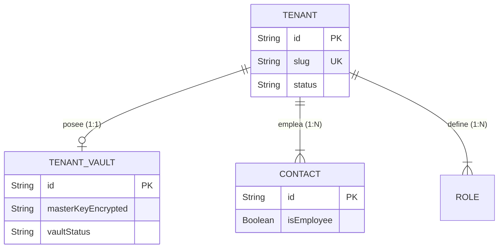
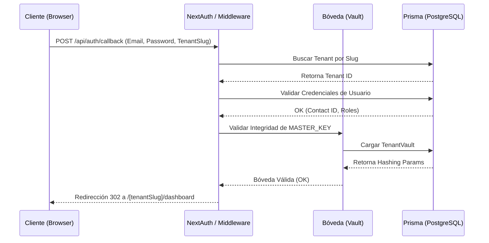

# 0. Core e Infraestructura

## 1. Arquitectura del Módulo

El módulo Core de Volkern actúa como la base de la plataforma multi-tenant. Está diseñado para garantizar un aislamiento criptográfico y estructural estricto entre inquilinos (Tenants), administrando la autenticación, la inyección del contexto del Tenant, y el "Proceso Génesis" (inicialización operativa basada en "DNA" y bóvedas de seguridad).

**Componentes Principales:**
- **Middleware de Inyección (`middleware.ts`):** Extrae el identificador del tenant (Slug) de la URL y valida sesiones.
- **MasterKey Vault:** Bóveda que resguarda la clave criptográfica asimétrica única por tenant, utilizada para sellar operaciones contables y nóminas.
- **Industrial Onboarding (Génesis):** Flujo de inicialización donde se define el "DNA" operativo de la empresa (Ej: Reglas de Producción vs Servicios).

---

## 2. Modelo de Datos (Prisma)

El modelo de datos base define las fronteras físicas del inquilino y la bóveda de seguridad.

```prisma
model Tenant {
  id                String       @id @default(cuid())
  name              String
  slug              String       @unique
  plan              String       @default("TRIAL") // TRIAL, BASIC, PRO, ENTERPRISE
  status            String       @default("ACTIVE") // ACTIVE, SUSPENDED, PENDING_SETUP
  createdAt         DateTime     @default(now())
  updatedAt         DateTime     @updatedAt
  vault             TenantVault? 
  
  // Relaciones Core
  users             Contact[]
  roles             Role[]
}

model TenantVault {
  id                  String   @id @default(cuid())
  tenantId            String   @unique
  masterKeyEncrypted  String   @db.Text
  hmacSecret          String   @db.Text
  salt                String   @db.Text
  vaultStatus         String   @default("LOCKED")
  lastRotation        DateTime @default(now())
  
  tenant              Tenant   @relation(fields: [tenantId], references: [id], onDelete: Cascade)
}
```

### Diagrama Entidad-Relación (ER)



---

## 3. Flujos de Lógica de Negocio

El flujo más crítico del Core es la **Autenticación e Inyección del Tenant**. A diferencia de arquitecturas SaaS tradicionales, Volkern requiere que el Vault del Tenant esté sincronizado en el momento del inicio de sesión.

### Diagrama de Secuencia: Autenticación y Validación de Vault



---

## 4. Seguridad y Acceso

La seguridad perimetral se maneja mediante:
1. **Rutas Dinámicas (`/[tenant]/...`):** Cada petición debe contener el ID del Tenant en su contexto.
2. **HOC Auth Guard:** `withTenantAuth` envuelve los endpoints de API garantizando que el usuario en la sesión coincida criptográficamente con el Tenant de la URL. Si hay desajuste, se devuelve error `403 Forbidden`.
3. **Vault Lockdown:** Si la firma `hmacSecret` no coincide, el Vault entra en estado `LOCKED`, desactivando temporalmente módulos críticos como Nómina y Contracts hasta la intervención de un SuperAdmin.

---

## 5. Integración MCP y AI

A nivel Core, se exponen *Tools* al protocolo MCP para que el modelo Gemma pueda consultar el estado de salud del Tenant, pero con permisos restringidos de solo lectura.

- `core_get_tenant_status`: Permite a la IA verificar si la bóveda está activa.
- `core_validate_dna`: Verifica las configuraciones base de inicialización (Génesis).

---

## 6. Eventos y Auditoría

Cada inicio de sesión y desbloqueo del Vault emite un evento en el `EventBus` interno.
- `AUTH_LOGIN_SUCCESS`: Registrado en logs internos, disparando alertas si detecta anomalías en IP.
- `VAULT_INTEGRITY_FAILED`: Emite una alerta de nivel 1 al Trust Protocol, bloqueando operaciones de escritura firmadas.

---

## 7. Casos de Borde y Manejo de Errores

- **Desincronización de Master Key:** Si ocurre un cambio de infraestructura, la llave maestra cifrada puede lanzar `TypeError` o errores de 32 bytes en la desencriptación. El sistema lo captura mediante un bloque `try/catch` envolvente en `VaultService.verify()`, abortando la petición HTTP con `500 Vault Error`.
- **Inyección de Slug:** Un usuario malicioso podría inyectar un slug válido de otra empresa. El sistema neutraliza esto porque el `Contact ID` de la sesión JWT solo existe en el `Tenant ID` originario.

---

## 8. Manual de Troubleshooting Técnico

1. **Error de Login "Invalid Tenant":**
   - *Causa:* El slug proporcionado en la URL no existe en la base de datos `Tenant`.
   - *Solución DB:* `SELECT slug FROM erp_tenant WHERE name = 'XYZ';`
2. **Error 500: Vault Integrity Check Failed:**
   - *Causa:* Las variables de entorno `VAULT_SECRET` o el algoritmo de encripción cambiaron, haciendo ilegible `masterKeyEncrypted`.
   - *Solución:* El SysAdmin debe correr el script de "Rotación de Llaves de Emergencia" (`npx tsx scripts/vault-recovery.ts`).
3. **Usuarios ven una pantalla blanca post-login:**
   - *Causa:* El usuario no tiene asignado un Rol que conceda permisos a ningún Hub.
   - *Solución DB:* Asignar manualmente en la tabla pivote de roles o mediante el Hub de HR por el SuperAdmin.
