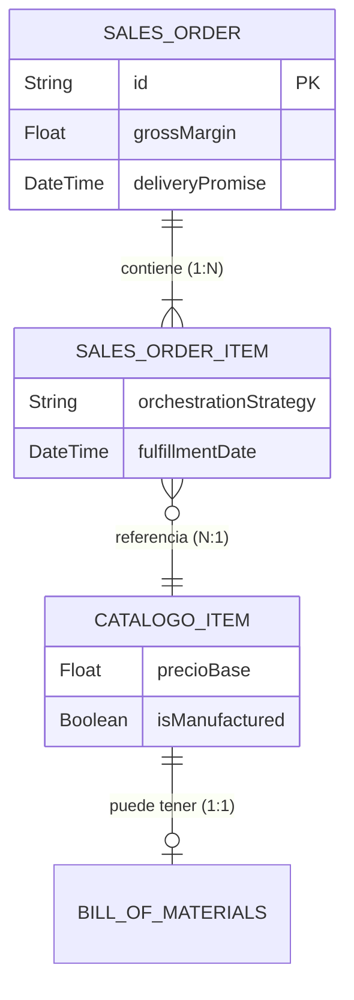
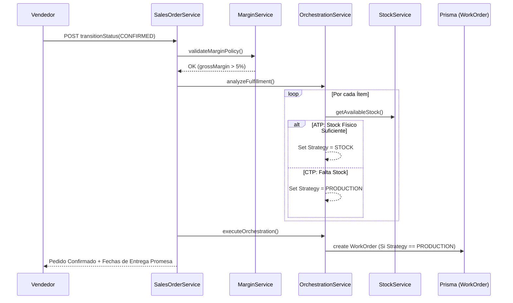

# 1. Sales Hub

## 1. Arquitectura del Módulo

El Sales Hub no es solo un CRM, es el motor de orquestación transaccional de Volkern. Conecta las oportunidades comerciales (Leads/Deals) con la promesa de entrega logística y productiva mediante dos servicios core:
- **OrchestrationService:** Analiza el inventario (`StockService`) frente a la demanda del pedido. Si el inventario disponible (`ATP`) es insuficiente, deriva la necesidad a Producción (`CTP`) generando de manera autónoma una `WorkOrder`.
- **MarginGuard (MarginService):** Evalúa rentabilidad cruzando el precio de venta contra el Costo Operativo (calculado a partir de la Lista de Materiales o Precio Base). Bloquea la confirmación si la rentabilidad (`grossMargin`) cae por debajo de la política de seguridad (ej. 5%).

---

## 2. Modelo de Datos (Prisma)

El modelo pivota alrededor de `SalesOrder` y se conecta directamente con el catálogo general.

```prisma
model SalesOrder {
  id                String             @id @default(cuid())
  tenantId          String
  contactId         String
  batchNumber       String             @unique
  status            String             @default("DRAFT") // DRAFT, CONFIRMED, SHIPPED
  totalPrice        Float              @default(0)
  
  // Margin Guard
  realCost          Float?
  realMargin        Float?
  grossMargin       Float?
  marginAlert       Boolean            @default(false)
  
  // Orquestación
  deliveryPromise   DateTime?
  confidenceScore   Float?
  orchestrationLog  Json?
  
  items             SalesOrderItem[]
}

model SalesOrderItem {
  id                    String        @id @default(cuid())
  salesOrderId          String
  catalogItemId         String
  quantity              Int
  unitPrice             Float
  totalPrice            Float
  
  // ATP/CTP
  orchestrationStrategy String?       // "STOCK" | "PRODUCTION"
  fulfillmentDate       DateTime?
  
  salesOrder            SalesOrder    @relation(fields: [salesOrderId], references: [id])
  catalogItem           CatalogoItem  @relation(fields: [catalogItemId], references: [id])
}
```

### Diagrama Entidad-Relación (ER)



---

## 3. Flujos de Lógica de Negocio

El flujo principal ocurre al transicionar un pedido de estado `DRAFT` a `CONFIRMED`.

### Diagrama de Secuencia: Confirmación y Orquestación



---

## 4. Seguridad y Acceso

- **Middlewares (`withTenantAuth`):** Todo acceso a cotizaciones filtra automáticamente por el `tenantId`.
- **Restricción de Precios:** Los vendedores no tienen acceso de escritura a `precioBase` en el `CatalogoItem`. Las alteraciones de precio durante la venta se capturan en el `MarginGuard` de forma auditable.
- **Transacciones Atómicas:** La confirmación de pedidos utiliza el bloqueo atómico transaccional de Prisma para evitar "Double Spending" de inventario durante escenarios de concurrencia elevada.

---

## 5. Integración MCP y AI

- **Gemma Deal Coach:** La IA se conecta como coach estratégico durante la venta.
- **Skills (Tools):** 
  - `sales_calculate_margin`: Gemma evalúa la BoM antes de proponer descuentos al cliente.
  - `sales_simulate_atp`: Analiza en memoria la viabilidad de la fecha de entrega para no prometer imposibles.

---

## 6. Eventos y Auditoría

- **SalesOrderAudit:** Cualquier alteración de estado (ej: de `CONFIRMED` a `CANCELLED`) graba un registro en la tabla `SalesOrderAudit` anclando el ID del usuario, fecha y el hash previo.
- **AiDecisionLog:** Cada consejo tarifario provisto por el "Deal Coach" se graba inmutablemente en el Trust Protocol.

---

## 7. Casos de Borde y Manejo de Errores

- **Fallo de Rentabilidad (Error de Margen):** Si el margen calculado es menor al 5%, `validateMarginPolicy()` arroja una Excepción deteniendo la transición atómica. Retorna `400 Bad Request: POLÍTICA DE MARGEN inaceptable`.
- **Falta de BillOfMaterials (BoM):** Si un producto no tiene BoM pero carece de Stock Físico, el sistema aplica un fallback de costo estimativo (`precioBase * 0.6`).
- **Race Condition de Stock:** Si dos vendedores confirman un pedido simultáneamente y agotan el stock, Prisma transaccionará secuencialmente, el segundo vendedor verá su pedido convertido en estrategia `PRODUCTION` (CTP).

---

## 8. Manual de Troubleshooting Técnico

1. **Error: "Cannot read properties of undefined (reading 'precioBase')"**
   - *Causa:* El `CatalogoItem` asociado no tiene configurado un costo base ni componentes en su BoM.
   - *Solución DB:* `UPDATE erp_catalogo_items SET "precioBase" = X WHERE id = Y;`
2. **Los ítems con stock se envían a Producción (Strategy = PRODUCTION)**
   - *Causa:* Descuadre en `StockLevel`. Hay inventario en el lote (`InventoryLot`), pero no hay registro consolidado de entrada en `StockMovement`, o el lote está en `QUARANTINE`.
   - *Solución:* Usar la interfaz de Logística para cambiar el lote a `AVAILABLE`.
3. **Fallas en Generación de WorkOrders:**
   - *Causa:* Falta de mapeo del campo `endDate` o `quantityToMake` en la creación de Prisma debido a inconsistencias de esquema.
   - *Solución:* Re-compilar Prisma client (`npx prisma generate`) en el contenedor afectado tras un parche.
