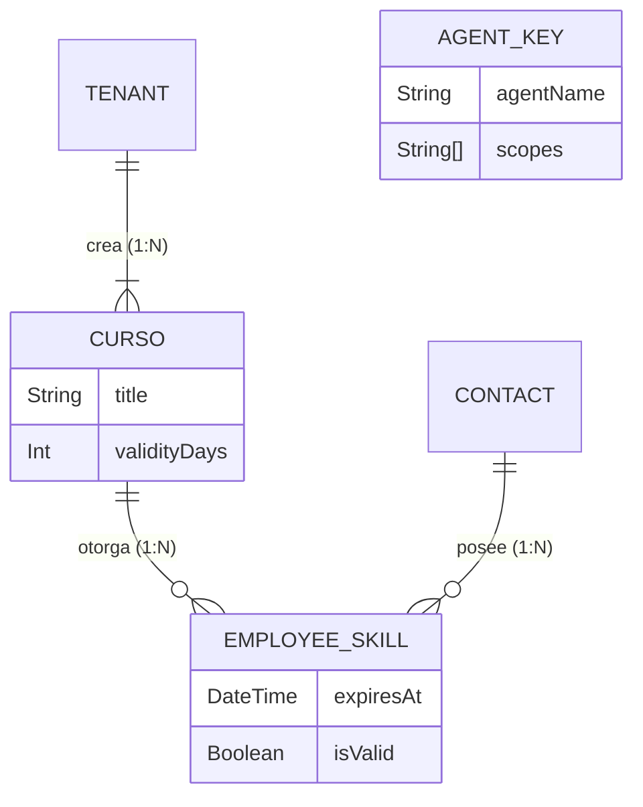
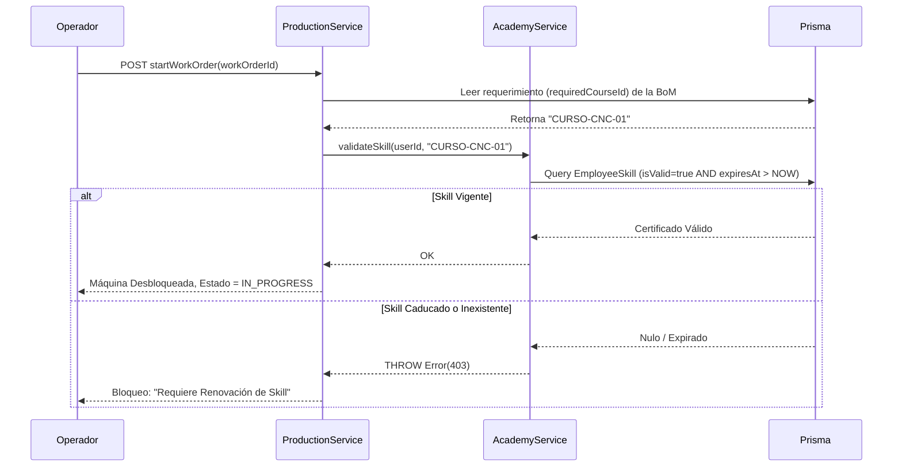

# 2. Academy Hub

## 1. Arquitectura del Módulo

El Academy Hub (Skill-Guard) funciona como el guardián perimetral de capacidades técnicas de la plataforma. Su filosofía es "Cero Confianza Operativa": ni un operario ni una Inteligencia Artificial pueden interactuar con maquinaria o herramientas críticas sin un manifiesto válido o un certificado aprobado.

**Componentes Principales:**
- **Skill-Guard Engine:** Middleware interno que intercepta peticiones a módulos productivos y valida si el ejecutor posee la competencia (Skill/Certificado) vigente requerida.
- **Agent Skills Gateway:** Módulo diseñado específicamente para el Model Context Protocol (MCP). Emite, revoca y audita los manifiestos (Manifest/OpenAPI) y tokens de API (API Keys) que permiten a la IA (Gemma) consumir servicios internos de Volkern.

---

## 2. Modelo de Datos (Prisma)

El modelo de datos entrelaza la estructura de entrenamiento (Cursos) con el perfil del usuario, emitiendo una certificación temporal.

```prisma
model Curso {
  id              String         @id @default(cuid())
  tenantId        String
  title           String
  content         String         @db.Text
  requiredScore   Int            @default(80)
  validityDays    Int            @default(365) // Vencimiento del Skill
  
  certifications  EmployeeSkill[]
}

model EmployeeSkill {
  id              String         @id @default(cuid())
  tenantId        String
  contactId       String         // ID del Empleado o Agente IA
  cursoId         String
  issuedAt        DateTime       @default(now())
  expiresAt       DateTime?
  isValid         Boolean        @default(true)
  
  curso           Curso          @relation(fields: [cursoId], references: [id])
}

model AgentKey {
  id              String         @id @default(cuid())
  tenantId        String
  agentName       String         // Ej: Gemma-Deal-Coach
  apiKeyHash      String         @unique
  scopes          String[]       // Permisos (Skills) inyectados al MCP
  isActive        Boolean        @default(true)
}
```

### Diagrama Entidad-Relación (ER)



---

## 3. Flujos de Lógica de Negocio

El flujo principal es la intercepción de operaciones críticas (Ej: Iniciar una WorkOrder) por el Skill-Guard.

### Diagrama de Secuencia: Intervención Skill-Guard



---

## 4. Seguridad y Acceso

- **Aislamiento de Revocación:** Las certificaciones (`EmployeeSkill`) pueden marcarse administrativamente como `isValid = false` en caso de infracciones de seguridad sin borrar el registro.
- **Hash de API Keys:** El `AgentKey` no almacena las llaves en texto plano. Utiliza Bcrypt o un HMAC similar a la llave maestra del Tenant para evitar extracción de tokens MCP.

---

## 5. Integración MCP y AI

- **Agent Skills Module:** Es la espina dorsal para la Inteligencia Artificial. Expone un endpoint `GET /api/mcp/manifest` que sirve dinámicamente las capacidades basadas en la `AgentKey` detectada.
- **Roles como Scopes:** A las inteligencias artificiales se les trata como Empleados; si Gemma necesita consultar inventario, se le asigna el Scope `stock:read` en su `AgentKey`.

---

## 6. Eventos y Auditoría

- `SKILL_EXPIRED_EVENT`: Disparado asíncronamente por un cron job nocturno. Marca certificaciones vencidas y revoca permisos operativos de línea.
- Conectividad API Audit: Todo token MCP usado por un agente de IA pasa por un Rate Limiter y graba la IP y latencia de inferencia para protección contra ataques de exfiltración de prompt.

---

## 7. Casos de Borde y Manejo de Errores

- **Bypass de Emergencia:** Si el Skill-Guard bloquea un paro de planta y el curso no carga, un `SuperAdmin` puede insertar directamente en base de datos un `EmployeeSkill` manual.
- **Invalidación de API:** Si un modelo de OpenAI/OpenRouter filtra su API Key externa, la `AgentKey` puede ser revocada al instante (`isActive = false`), aislando a la IA del ERP sin afectar el resto de operaciones del Tenant.

---

## 8. Manual de Troubleshooting Técnico

1. **Error: Agente IA recibe "401 Unauthorized" al conectar MCP**
   - *Causa:* El header `Authorization: Bearer <API_KEY>` no hace match con el `apiKeyHash` en la base de datos o el registro de `AgentKey` está inactivo.
   - *Solución:* Generar y copiar una nueva llave desde el Agent Skills Panel y actualizar la configuración del cliente MCP (Claude Desktop o Cursor).
2. **Error: "Skill Validation Failed" al operar en Producción**
   - *Causa:* El tiempo límite del certificado (`expiresAt`) fue superado por la hora actual del servidor UTC.
   - *Solución DB:* Si es urgente, prolongar la validez temporalmente: `UPDATE "EmployeeSkill" SET "expiresAt" = NOW() + INTERVAL '1 day' WHERE "contactId" = X;`
3. **El Servidor MCP devuelve Manifiesto Vacío:**
   - *Causa:* El `AgentKey` no tiene perfiles en el array `scopes`.
   - *Solución:* Añadir scopes (ej. `["sales:write", "crm:read"]`) en la tabla `AgentKey`.
