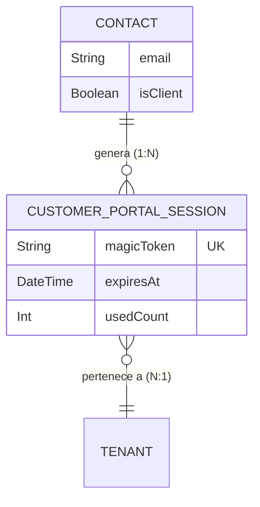
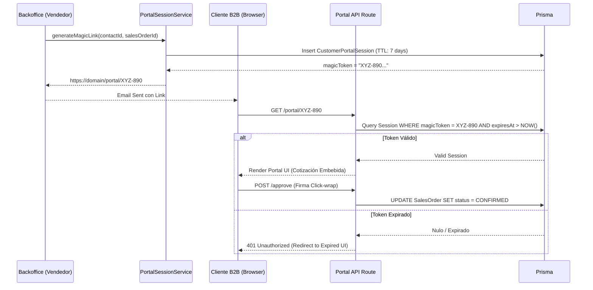

# 3. Member Portal

## 1. Arquitectura del Módulo

El "Portal de Miembros" o "Customer Portal" proporciona un canal de autoservicio B2B/B2C desacoplado del ERP principal. Se basa en una arquitectura de "Sesiones Temporales Públicas" o "Magic Links" (JWT sin Password), lo que permite interactuar con cotizaciones, facturas o dar seguimiento (Tracking) sin exponer las rutas o APIs de administración de Backoffice (`/api/erp/`).

**Componentes Principales:**
- **Customer Portal Next.js App:** Vista enjaulada en `/portal/[magicToken]`.
- **PortalSessionService:** Servicio encargado de generar y auditar tokens criptográficos con tiempo de vida limitado (TTL).
- **Read-Only Proxy:** Adaptador de Prisma que intercepta queries complejas para convertirlas en versiones ligeras (`pick` de campos) antes de mandarlas al cliente.

---

## 2. Modelo de Datos (Prisma)

No hay modelos masivos dedicados solo al portal, sino modelos de sesión (Tokens) que se conectan con el modelo de Contacto base del Tenant.

```prisma
model CustomerPortalSession {
  id              String         @id @default(cuid())
  tenantId        String
  contactId       String
  magicToken      String         @unique
  expiresAt       DateTime
  lastIp          String?
  usedCount       Int            @default(0)
  
  contact         Contact        @relation(fields: [contactId], references: [id])
}
```

### Diagrama Entidad-Relación (ER)



---

## 3. Flujos de Lógica de Negocio

El flujo de aprobación remota de una Cotización de Ventas es la operación más frecuente en el portal.

### Diagrama de Secuencia: Aprobación Remota (Magic Link)



---

## 4. Seguridad y Acceso

- **Aislamiento de Rutas:** El API Gateway del portal (`/api/portal/*`) es físicamente distinto al del ERP (`/api/erp/*`), garantizando que ninguna vulnerabilidad o inyección en el portal otorgue acceso a la capa de administración.
- **Limitación por Tasa (Rate Limiting):** Para prevenir que un bot descubra tokens válidos por fuerza bruta (Bruteforce enumeration), las llamadas a `/portal/[token]` están fuertemente rate-limited por IP.
- **Single-Scope Tokens:** Los tokens mágicos se pueden enjaular con metadatos para que SOLO sirvan para ver "El pedido X" y nada más.

---

## 5. Integración MCP y AI

Actualmente no se exponen APIs de portal de miembros hacia Gemma 4. Sin embargo, los chatbots integrados en la landing page del Tenant podrían usar un token anónimo restringido (Guest MCP Token) para responder preguntas sobre los términos de servicio mediante RAG.

---

## 6. Eventos y Auditoría

- Cada vista renderizada en el portal inyecta en DB el evento `PORTAL_DOCUMENT_VIEWED` para que el vendedor reciba una notificación (Websocket/UI Alert) que indica: "El cliente acaba de abrir tu cotización".

---

## 7. Casos de Borde y Manejo de Errores

- **Robo de Token (Token Theft):** Si la cookie o link se filtra y se abre desde un país/IP distinto simultáneamente, el backend marca el token como `SUSPICIOUS`, invalidándolo y forzando la re-generación por parte del administrador.
- **Cliente firma dos veces:** Prisma previene operaciones paralelas mediante manejo transaccional; si dos peticiones de firma caen al mismo milisegundo en `/approve`, la primera comitea, la segunda lanza un error por intentar modificar una orden que ya está en estado `CONFIRMED`.

---

## 8. Manual de Troubleshooting Técnico

1. **Cliente reporta "Token Inválido" al instante de recibirlo:**
   - *Causa:* El huso horario del servidor (Timezone) está desincronizado al insertar el `expiresAt` en Prisma.
   - *Solución:* Asegurarse de usar UTC para toda generación de fechas (`new Date().toISOString()`).
2. **Error al cargar los PDFs embebidos:**
   - *Causa:* El motor de renderizado de PDF está sufriendo "CORS" si se carga el Blob desde un Bucket externo sin las cabeceras `Access-Control-Allow-Origin`.
   - *Solución:* Parametrizar CORS en el S3 Bucket para permitir orígenes del dominio principal del Tenant.
