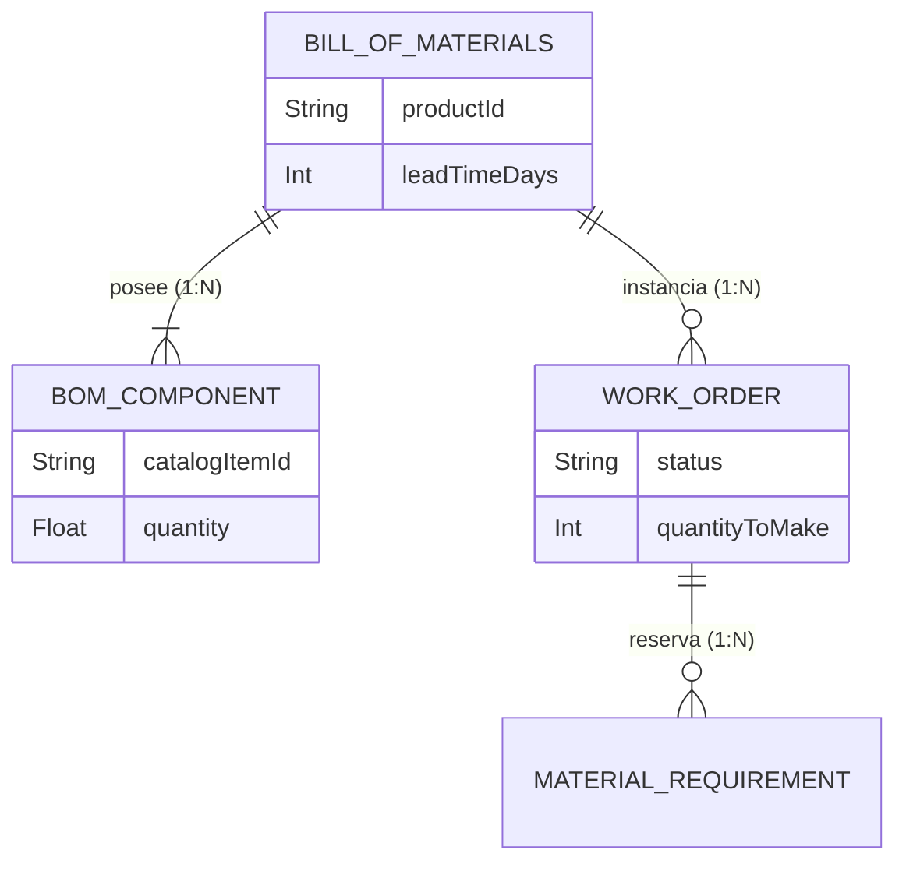
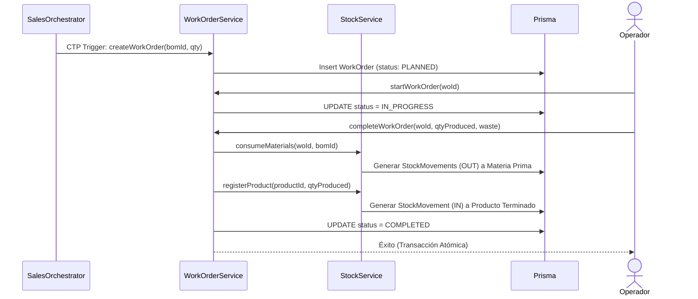

# 4. Production Hub

## 1. Arquitectura del Módulo

El Módulo de Producción (Industrial Hub) ejecuta la manufactura de productos mediante Órdenes de Trabajo (`WorkOrder`). No actúa de manera aislada: requiere instrucciones claras desde el "Sales Hub" (vía el motor de Orquestación CTP) y valida consumo de materiales directos e indirectos conectándose al "Logistics Hub". 

**Componentes Principales:**
- **WorkOrder Engine:** Controla el ciclo de vida de producción (PLANNED -> IN_PROGRESS -> COMPLETED -> HALTED).
- **BoM Parser:** Servicio que expande un Árbol de Materiales (`BillOfMaterials`) de N-Niveles para calcular requerimientos crudos (Raw Materials).
- **Costing Calculator:** Realiza prorrateos de costos indirectos (Luz, Mano de Obra) más costos directos por lotes consumidos de inventario.

---

## 2. Modelo de Datos (Prisma)

El modelo relaciona las Órdenes de Trabajo con la Lista de Materiales y el equipo/pasillo que ejecuta la tarea.

```prisma
model BillOfMaterials {
  id              String         @id @default(cuid())
  tenantId        String
  productId       String         // Apunta a CatalogoItem (Producto Final)
  description     String
  leadTimeDays    Int            @default(1)
  isActive        Boolean        @default(true)
  
  components      BomComponent[]
  workOrders      WorkOrder[]
}

model BomComponent {
  id              String         @id @default(cuid())
  bomId           String
  catalogItemId   String         // Apunta a CatalogoItem (Materia Prima)
  quantity        Float
  uom             String         // Unit of Measure (Ej: kg, L, pcs)
  
  bom             BillOfMaterials @relation(fields: [bomId], references: [id])
}

model WorkOrder {
  id                   String                @id @default(cuid())
  tenantId             String
  bomId                String
  status               String                @default("PLANNED")
  quantityToMake       Int
  quantityProduced     Int                   @default(0)
  wasteReported        Int                   @default(0)
  startDate            DateTime?
  endDate              DateTime?
  requiredCourseId     String?               // Vínculo con Academy (Skill-Guard)
  
  bom                  BillOfMaterials       @relation(fields: [bomId], references: [id])
  materialRequirements MaterialRequirement[] // Reservas de stock en almacén
  productionLogs       ProductionLog[]
}
```

### Diagrama Entidad-Relación (ER)



---

## 3. Flujos de Lógica de Negocio

La completitud de una WorkOrder conlleva consumir el stock bruto e inflar el stock neto final.

### Diagrama de Secuencia: Ciclo de Vida Producción



---

## 4. Seguridad y Acceso

- **Verificación de Skill-Guard:** Integrado con el Academy Hub, si una BoM o línea de ensamblaje requiere `requiredCourseId`, el controlador HTTP validará la existencia en `EmployeeSkill` del operador antes de cambiar el estado a `IN_PROGRESS`.
- **Deducción Transaccional (Backflushing):** Todo el consumo de materia prima y creación de producto se engloba dentro de un `$transaction` en Prisma. Si falta 1 gramo de material en la DB para un Lote, la transacción hace Rollback automático, previniendo stocks fantasma (Negativos).

---

## 5. Integración MCP y AI

- **Gemma Predictive Analytics:** Herramienta que revisa los `ProductionLogs` para inferir tiempos de paro de máquina y recomendar mantenimientos.
- **Skills:** `prod_analyze_bottlenecks`, `prod_simulate_bom_cost`.

---

## 6. Eventos y Auditoría

- `WORKORDER_COMPLETED`: Un evento vital consumido por Ventas y Logística para notificar que el pedido original del CTP ya está listo para "Pick & Pack".

---

## 7. Casos de Borde y Manejo de Errores

- **Manejo de Stock Negativo (`Insufficient Stock Exception`):** Si en físico se gastó material pero el sistema reporta cero, la WorkOrder se va a estado `HALTED_MATERIAL`. Un supervisor debe hacer ajuste de inventario antes de reintentar la operación.
- **Residuos Infinitos (Float Precision errors):** Al consumir recetas de BoM (Ej: `0.3333` kilos), Prisma redondea de acuerdo a los constraints del Schema. Si hay desbordamiento, el Costing module guarda los remanentes decimales como Varianzas Mínimas de Costo.

---

## 8. Manual de Troubleshooting Técnico

1. **Error: `Invalid invocation: Unknown argument 'quantity'` al crear WorkOrder:**
   - *Causa:* Desactualización del código fuente respecto al schema. La base de datos requiere `quantityToMake` en la v6.7.0.
   - *Solución:* Modificar la llamada de Prisma y recompilar.
2. **Error al cerrar WorkOrder: "Lote de Materia Prima bloqueado"**
   - *Causa:* El operario seleccionó para su consumo un lote de materia prima que se encontraba marcado en estado de Cuarentena.
   - *Solución:* Aprobar el lote desde el módulo de control de calidad o forzar el uso de otro lote disponible en `InventoryLot`.
