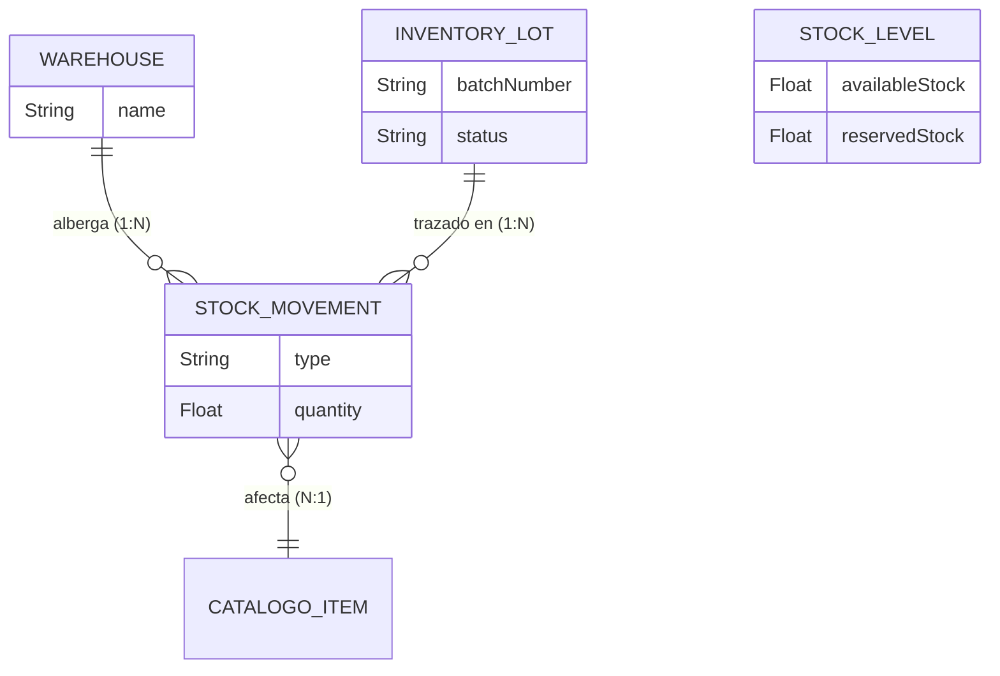
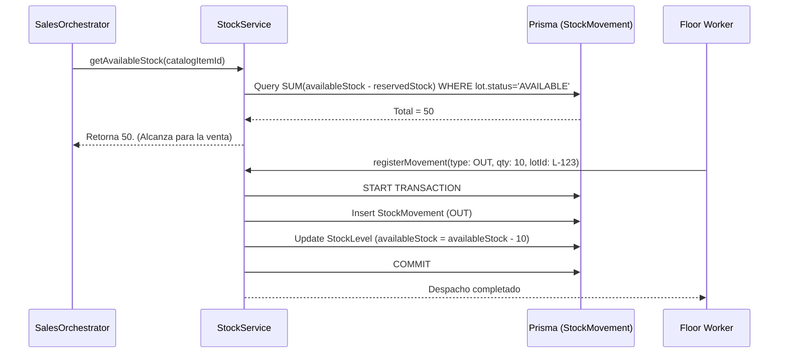

# 5. Logistics Hub

## 1. Arquitectura del Módulo

El Logistics Hub gobierna el universo físico de Volkern. Todo producto que es vendido, producido o adquirido debe residir en este Ledger (Libro mayor). Implementa un patrón de Contabilidad de Partida Doble para el inventario, donde ninguna "Caja" aparece o desaparece mágicamente; todo se inserta vía un evento criptográfico y atómico llamado `StockMovement`.

**Componentes Principales:**
- **StockService:** Interface centralizada que computa al vuelo el Inventario Disponible (Físico vs Reservado).
- **Loteo y Trazabilidad (InventoryLot):** Cada ingreso de producto genera un lote único atado a fechas de caducidad o control de calidad (Status: Quarantine, Available).
- **Fulfillment Engine:** Coordina la recolección (`Pick`) y embalaje (`Pack`) vinculando los despachos con transportistas externos y APIs de paquetería.

---

## 2. Modelo de Datos (Prisma)

El concepto base es la inmutabilidad: se lee de `StockLevel` (una vista consolidada) pero se escribe en `StockMovement` (Kardex).

```prisma
model Warehouse {
  id              String         @id @default(cuid())
  tenantId        String
  name            String
  location        String?
  
  movements       StockMovement[]
}

model InventoryLot {
  id              String         @id @default(cuid())
  tenantId        String
  catalogItemId   String
  batchNumber     String         @unique
  status          String         @default("AVAILABLE") // QUARANTINE, REJECTED
  expiryDate      DateTime?
  
  movements       StockMovement[]
}

model StockMovement {
  id              String         @id @default(cuid())
  tenantId        String
  warehouseId     String
  lotId           String?
  catalogoItemId  String
  type            String         // IN, OUT, TRANSFER, ADJUSTMENT
  quantity        Float
  referenceId     String?        // ID de WorkOrder o SalesOrder causante
  createdAt       DateTime       @default(now())
  
  warehouse       Warehouse      @relation(fields: [warehouseId], references: [id])
  lot             InventoryLot?  @relation(fields: [lotId], references: [id])
}

model StockLevel {
  id              String         @id @default(cuid())
  tenantId        String
  catalogoItemId  String
  lotId           String?
  availableStock  Float
  reservedStock   Float
}
```

### Diagrama Entidad-Relación (ER)



---

## 3. Flujos de Lógica de Negocio

El cálculo del ATP (Available To Promise) se deriva de los `StockLevels` cruzados con el estado de los lotes.

### Diagrama de Secuencia: Reserva de ATP y Movimiento



---

## 4. Seguridad y Acceso

- **Ajustes de Inventario:** El movimiento tipo `ADJUSTMENT` requiere una validación de roles más estricta (`requiresSupervisorApproval`).
- **Bloqueo Transaccional:** La escritura de movimientos concurrente utiliza bloqueos optimistas o `$transaction` de Prisma para evitar pérdida de actualizaciones (Dirty Reads) que generarían Stock Cero virtual.

### 4.1 Stock Service - Inmutabilidad del Kardex

El módulo de inventario implementa un sistema de inmutabilidad mediante encadenamiento de hashes en cada `StockMovement`, creando un ledger inmutable tipo blockchain.

**Ubicación:** `/lib/erp/stock-service.ts`

**Características del sistema:**

| Característica | Descripción |
|----------------|-------------|
| **Algoritmo** | SHA-256 con encadenamiento de movimientos |
| **Kardex Inmutable** | Solo insert, nunca update/delete en StockMovement |
| **Auditoría** | Cada movimiento incluye hash + chainedHash + timestamp |

**Flujo de Registro de Movimiento:**
```
registerMovement(type, quantity, ...) 
→ Obtener último auditHash 
→ Generar nuevo hash (chainedHash + data)
→ Insertar StockMovement sellado
→ Actualizar StockLevel (upsert)
```

**Campos de Auditoría en StockMovement:**
```prisma
model StockMovement {
  auditHash       String    // SHA-256 del movimiento
  chainedHash     String    // Hash del movimiento anterior
  sealedAt        DateTime  // Timestamp del sellado
  // ... otros campos
}
```

**Reconstrucción de Estado:**
El sistema puede reconstruir cualquier estado de inventario en cualquier punto del tiempo sumando algebraicamente todos los movimientos desde el génesis (primer movimiento con chainedHash = '0'.repeat(64)).

**Tipos de Movimiento Protegidos:**
- `IN` - Entrada de inventario
- `OUT` - Salida (ventas, consumo)
- `ADJUSTMENT` - Ajuste (requiere supervisión)
- `TRANSFER` - Transferencia entre almacenes
- `CONSUMPTION` - Consumo en producción
- `PRODUCTION_OUTPUT` - Salida de producción

---

## 5. Integración MCP y AI

- **Gemma Stock Assistant:** Permite usar herramientas para predecir cuándo el inventario tocará fondo.
- **Skills:** `stock_forecast_depletion`, `stock_query_level` (Solo lectura para agentes base).

---

## 6. Eventos y Auditoría

- `LOW_STOCK_ALERT`: Evento asíncrono emitido cuando `availableStock` cae por debajo del umbral mínimo de reposición parametrizado en la base de datos (Safety Stock Trigger).

---

## 7. Casos de Borde y Manejo de Errores

- **Fallo de FIFO / Caducidad:** El sistema previene el consumo (Pick) de un lote viejo si hay uno más antiguo sin consumir (Strict FIFO/FEFO policy constraint en Prisma).
- **Ajustes "Negativos" Fantasma:** En casos de robos, el sistema exige generar un `StockMovement` tipo `OUT` pero atado a un código de clasificación de pérdida (`SHRINKAGE`), lo que afecta directamente el P&L contable (Profit and Loss).

---

## 8. Manual de Troubleshooting Técnico

1. **Error de Query lidiando con "lot is null":**
   - *Causa:* En algunas instancias migradas de legacy, `lotId` es nulo. Prisma fallará al hacer `.reduce` sobre un objeto anidado.
   - *Solución:* Las queries deben incorporar siempre un OR lógico: `{ OR: [ { lot: null }, { lot: { status: 'AVAILABLE' } } ] }`.
2. **Las existencias físicas no cuadran con el sistema después de una falla de red:**
   - *Causa:* Se ejecutó una escritura parcial por fuera de un entorno transaccional `$transaction`.
   - *Solución:* Correr un script en background que reconstruya `StockLevel` recorriendo desde cero el historial total de la tabla inmutable `StockMovement` y aplicando la sumatoria algebraica.
