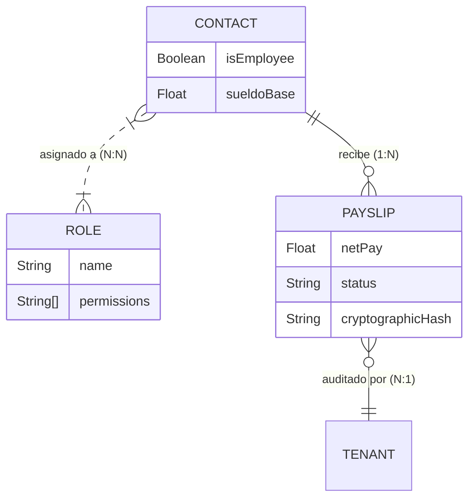
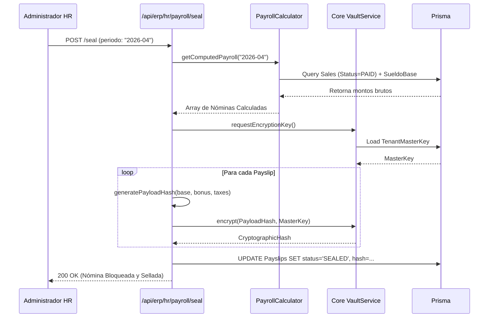

# 6. HR & Payroll Hub

## 1. Arquitectura del Módulo

Este módulo gestiona la capa identitaria y compensatoria del ecosistema. Más allá de un CRUD de empleados, opera como el distribuidor de permisos (Roles Pivot) e incluye el motor financiero más delicado de Volkern: el "Payroll Vault". Este motor procesa nóminas (sueldos base, bonos, variables, deducciones fiscales) garantizando que una nómina cerrada (Sellada) quede encriptada simétricamente para prevenir alteraciones a posteriori.

**Componentes Principales:**
- **RoleMatrix Engine:** Validador en tiempo de ejecución (`O(1)` usando bitmasks o Sets) que verifica si un `Contact` tiene privilegios para acceder a un endpoint.
- **PayrollCalculator:** Motor analítico que computa ingresos variables sondeando facturas cerradas en el Hub Financiero y calculando retenciones (IRPF/Seguridad Social).
- **PayrollVaultService:** Algoritmo que, utilizando la `MasterKey` del Tenant, bloquea criptográficamente el conjunto de datos de un mes de nómina.

---

## 2. Modelo de Datos (Prisma)

El modelo relaciona contactos con roles y consolida los recibos de nómina (`Payslip`).

```prisma
model Contact {
  id              String         @id @default(cuid())
  tenantId        String
  email           String         @unique
  nombre          String
  isEmployee      Boolean        @default(false)
  
  // Financieros
  nif             String?        @unique
  sueldoBase      Float?         @default(0)
  defaultIrpf     Float?         @default(15.0)
  
  roles           Role[]
  payslips        Payslip[]
}

model Role {
  id              String         @id @default(cuid())
  tenantId        String
  name            String         @unique // "ADMIN", "SALES", "HR"
  permissions     String[]
  
  contacts        Contact[]
}

model Payslip {
  id              String         @id @default(cuid())
  tenantId        String
  contactId       String
  periodStart     DateTime
  periodEnd       DateTime
  
  baseSalary      Float
  commissions     Float          @default(0)
  manualBonus     Float          @default(0)
  taxDeductions   Float          @default(0)
  netPay          Float
  
  status          String         @default("DRAFT") // DRAFT, SEALED
  cryptographicHash String?      @db.Text
  
  contact         Contact        @relation(fields: [contactId], references: [id])
}
```

### Diagrama Entidad-Relación (ER)



---

## 3. Flujos de Lógica de Negocio

El flujo de sellado es el punto donde el algoritmo de nómina cruza con el motor criptográfico del Core.

### Diagrama de Secuencia: Sellado de Nómina (Payroll Vault)



---

## 4. Seguridad y Acceso

- **Protección Diferencial de Datos Personales (PII):** Los datos bancarios y el NIF de los contactos se guardan cifrados usando una llave estática a nivel de instancia, desacoplados del cifrado de nómina, previniendo fuga de PII en dumps de base de datos.
- **Acceso Exclusivo (`FINANCE_ROLE`):** Para invocar `/api/erp/hr/payroll/seal`, el middleware exige un permiso de grado 3 (Financiero o SuperAdmin). Un rol normal de HR solo puede preparar los borradores (Drafts).

### 4.1 Payroll Sealer - Inmutabilidad con Encadenamiento

El módulo de nómina implementa un sistema de sellado criptográfico mediante `PayrollSealer` que garantiza la integridad inmutable de los registros de nómina.

**Ubicación:** `/lib/finance/payroll/es/payroll-sealer.ts`

**Características del sellado:**

| Característica | Descripción |
|----------------|-------------|
| **Algoritmo** | SHA-256 con encadenamiento (blockchain-style) |
| **Snapshot** | Guardado completo del cálculo (gross, net, SS, IRPF) |
| **Chaining** | Cada nómina referencia el hash de la anterior |
| **Verificación** | Integridad verificable en tiempo de ejecución |

**Flujo de Sellado:**
```
Draft → PayrollSealer.sealPayroll() → LOCKED → SEALED
```

**Estados de Verificación:**
- `VALID`: Hash coincide y datos intactos
- `TAMPERED`: Hash coincide pero valores DB difieren del snapshot
- `SNAPSHOT_MISSING`: Falta el snapshot del cálculo
- `HASH_MISMATCH`: El hash recalculado no coincide (manipulación detectada)

**Campos de Auditoría:**
```prisma
model PayrollRecordES {
  status          String    // DRAFT, LOCKED, SEALED
  auditHash       String    // SHA-256 del snapshot
  chainedHash     String    // Hash de la nómina anterior
  sealedAt        DateTime  // Timestamp del sellado
  calculationSnapshot Json  // Copia del cálculo completo
}
```

**Auditoría:**
- Cada sellado genera `auditLog` con acción `PAYROLL_HARDENED_SEAL`
- Las violaciones de integridad generan `VIOLACION_INTEGRIDAD_NOMINA`

---

## 5. Integración MCP y AI

A nivel de API Tools para agentes MCP, este módulo expone conectores de consulta:
- `hr_query_org_chart`: Usado por la IA para deducir quién es el jefe de un operario.
- **Limitación estricta:** Gemma o cualquier IA tiene un "Hard-Ban" en el backend para ejecutar cálculos u operaciones de escritura sobre `Payslip`.

---

## 6. Eventos y Auditoría

- `PAYROLL_SEALED`: Un evento transmitido al módulo contable de Finanzas para que procese el asiento de partida doble contra la caja del negocio.
- **VeriFactu Anchor:** En jurisdicciones como España, el hash final de la nómina puede enviarse a la cadena inmutable para auditoría laboral.

---

## 7. Casos de Borde y Manejo de Errores

- **Modificación a Toro Pasado:** Si después del sellado (Día 30) se detecta un error de comisiones, el sistema impedirá editar el `Payslip` blindado en la DB (`cryptographicHash` validación). Obliga a que se genere un concepto contable en el `Payslip` del mes siguiente ("Deducción o Abono por ajuste retroactivo").
- **Empleado sin NIF:** La función de cálculo impositivo arrojará `FiscalDataMissingException`, deteniendo la generación individual del empleado pero procesando al resto del batch.

---

## 8. Manual de Troubleshooting Técnico

1. **El cierre falla por "MasterKey Not Found" o "Decryption Failed":**
   - *Causa:* Desincronización del Vault a nivel Core. La bóveda fue bloqueada o las variables de entorno del servicio cambiaron.
   - *Solución:* Validar logs del Core (Fase 0).
2. **Las comisiones variables marcan Cero en empleados específicos:**
   - *Causa:* El vendedor originó las `SalesOrder` pero Financieramente no hay `Invoice` vinculada marcada como `PAID` dentro del rango temporal del periodo (periodStart - periodEnd).
   - *Solución:* Usar el endpoint de verificación: `GET /api/erp/finance/invoices?contactId=X&status=PAID` para auditar la correlación temporal.
