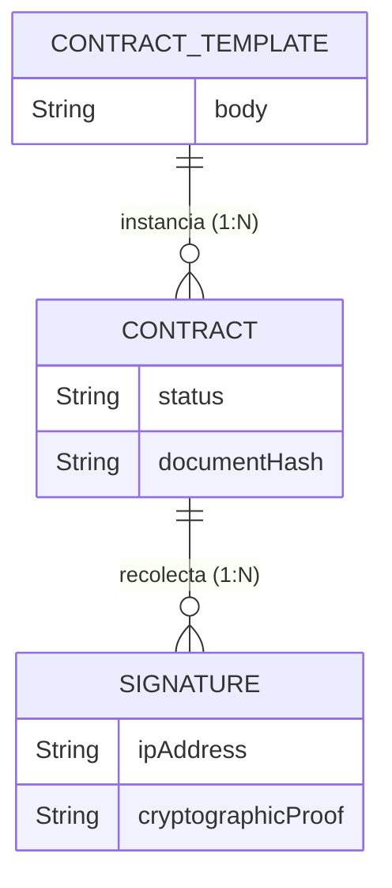
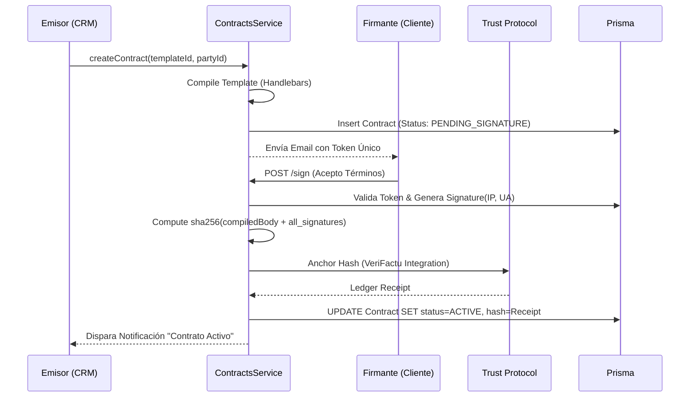

# 7. Contracts Hub

## 1. Arquitectura del Módulo

El módulo de Contratos proporciona funcionalidades de gestión de ciclo de vida contractual (CLM). Implementa la generación de documentos dinámicos combinando Plantillas (Templates) en formato Handlebars/Markdown con el motor de renderizado a PDF. Además, maneja un flujo de recolección de Firmas Digitales asíncronas para proveer validez legal a los acuerdos entre el Tenant y terceros.

**Componentes Principales:**
- **Template Engine:** Analiza documentos pre-establecidos e inyecta variables del CRM (Nombres, Costos, Fechas).
- **E-Signature Coordinator:** Servicio que expide y administra tokens temporales (`SignatureSession`) para recolectar IPs, User Agents y Timestamps como evidencia Click-Wrap.
- **PDF Artifact Generator:** Compila y sella visualmente el PDF adjuntándole los certificados de firma en su última página (Hoja de Auditoría).

---

## 2. Modelo de Datos (Prisma)

El modelo pivota sobre `Contract` y sus firmas asociadas (`Signature`).

```prisma
model ContractTemplate {
  id              String         @id @default(cuid())
  tenantId        String
  name            String         // Ej: "NDA Estándar B2B"
  body            String         @db.Text // Markdown con variables {{clientName}}
  
  contracts       Contract[]
}

model Contract {
  id              String         @id @default(cuid())
  tenantId        String
  templateId      String
  partyId         String         // Cliente o Empleado (Contact)
  status          String         @default("DRAFT") // PENDING_SIGNATURE, ACTIVE, VOID, EXPIRED
  startDate       DateTime
  endDate         DateTime?
  compiledBody    String         @db.Text
  documentHash    String?
  
  template        ContractTemplate @relation(fields: [templateId], references: [id])
  signatures      Signature[]
}

model Signature {
  id              String         @id @default(cuid())
  contractId      String
  signerEmail     String
  signedAt        DateTime       @default(now())
  ipAddress       String
  userAgent       String
  cryptographicProof String      @db.Text
  
  contract        Contract       @relation(fields: [contractId], references: [id])
}
```

### Diagrama Entidad-Relación (ER)



---

## 3. Flujos de Lógica de Negocio

El flujo más complejo es la recolección distribuida de firmas y el sellado inmutable del contrato.

### Diagrama de Secuencia: Flujo de Firma Inmutable



---

## 4. Seguridad y Acceso

- **Proof of Action:** Una firma en el entorno B2B se considera vinculante si se puede demostrar la intencionalidad, la identidad y la inalterabilidad. Volkern recopila Metadatos (IP, Headers) al momento de firmar y genera un hash que vincula el contenido estático del texto con esos metadatos.
- **Inmutabilidad Post-Emisión:** El ORM (Prisma) tiene triggers o validaciones a nivel de middleware que previenen cualquier comando `UPDATE` sobre el campo `compiledBody` de un `Contract` si su estado ya no es `DRAFT`.

### 4.1 Contract Sealer - Sello Digital Inmutable

El módulo de contratos implementa un sistema de sellado digital mediante `ContractSealer` que garantiza la integridad criptográfica de los contratos firmados.

**Ubicación:** `/lib/erp/contract-sealer.ts`

**Características del sellado:**

| Característica | Descripción |
|----------------|-------------|
| **Algoritmo** | SHA-256 con encadenamiento |
| **Snapshot** | Copia completa del contrato (número, título, total, items) |
| **Chaining** | Cada contrato referencia el hash del anterior |
| **Verificación de Cadena** | Método para verificar toda la cadena de contratos |

**Flujo de Sellado:**
```
PENDING_SIGNATURE → ContractSealer.sealContract() → ACTIVE (sealedAt set)
```

**Campos de Auditoría:**
```prisma
model Contrato {
  auditHash       String    // SHA-256 del snapshot
  chainedHash     String    // Hash del contrato anterior
  sealedAt        DateTime  // Timestamp del sellado
  signatureAudit Json      // { method, version, snapshot }
}
```

**Verificación de Integridad:**
```typescript
// Verificar toda la cadena de contratos
const results = await ContractSealer.verifyChain(tenantId);
// Retorna: [{ id, numero, isValid }, ...]
```

**Auditoría:**
- Cada sellado genera `auditLog` con acción `CONTRACT_HARDENED_SEAL`
- Se registra en Trust Protocol con metadata { hash, chainedHash }

---

## 5. Integración MCP y AI

- **Gemma Legal Summarizer:** Una herramienta expuesta a los miembros (a través de RAG o en el hub interno) para resumir cláusulas legales pesadas: `legal_summarize_contract`.
- Se restringe la capacidad de la IA de generar o redactar contratos desde cero de manera autónoma para evitar riesgos legales de alucinaciones (Solo se permiten variaciones sobre plantillas revisadas).

---

## 6. Eventos y Auditoría

- Cron Jobs programados ejecutan un barrido nocturno para localizar contratos próximos a su `endDate` y emiten el evento `CONTRACT_EXPIRING_SOON` hacia el CRM para activar a los ejecutivos de cuenta para su renovación.

---

## 7. Casos de Borde y Manejo de Errores

- **Firma Corrupta:** Si un firmante modifica los parámetros del POST maliciosamente para alterar su IP, el backend descarta la petición ya que extrae estas métricas directamente del request TCP/HTTP nativo (`req.socket.remoteAddress`).
- **Anulación Necesaria:** Al no permitir edición, si se descubre un error ortográfico post-firma, el contrato debe moverse a estado `VOID` originando una Adenda o nuevo contrato. Se exige inyectar una justificación de auditoría en la transición a VOID.

---

## 8. Manual de Troubleshooting Técnico

1. **Template Parsing Error (Renderizado en Blanco o "undefined"):**
   - *Causa:* La variable Mustache/Handlebars solicitada (Ej: `{{empresa.nombreFiscal}}`) no está mapeada en el Payload al momento de instanciar el contrato.
   - *Solución:* Validar el DTO de creación en el servicio `compileTemplate`.
2. **Las notificaciones de expiración de contrato no llegan:**
   - *Causa:* El sistema de tareas en background (Cron/Upstash/Inngest) que corre el Job de revisión diaria se ha detenido.
   - *Solución:* Disparar manualmente el webhook de expiración `/api/cron/contracts-check` o revisar logs de ejecución.
