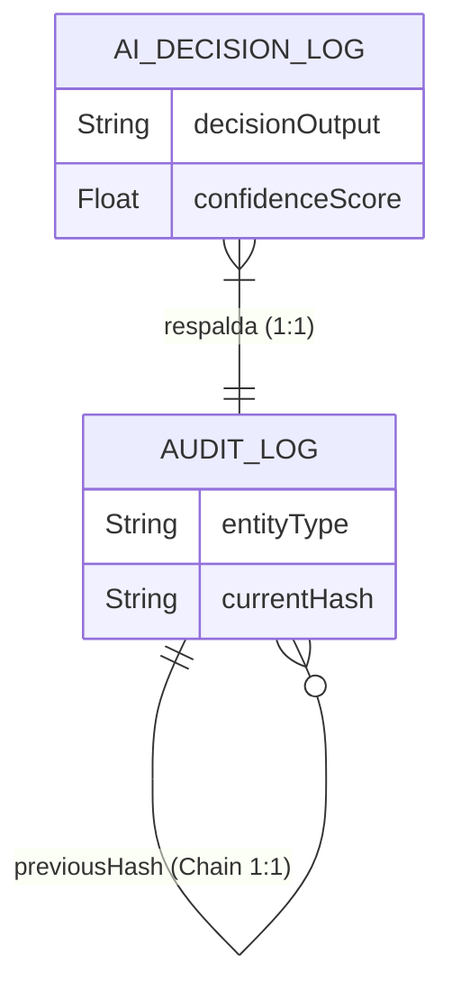
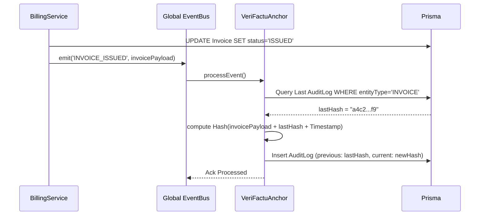

# 8. Security & Audit Hub (Trust Protocol)

## 1. Arquitectura del Módulo

El Hub de Seguridad, conocido como **Trust Protocol**, es la piedra angular del cumplimiento normativo (Ej. Anti-Fraude, VeriFactu europeo, normativas locales de retención). Su trabajo no es procesar transacciones de usuarios, sino observarlas, capturarlas en el Bus de Eventos y entrelazarlas criptográficamente (Blockchain/Hash-chain privada) para que sea estadísticamente y operativamente imposible alterar o borrar un registro sin corromper la cadena.

**Componentes Principales:**
- **VeriFactu Anchor Engine:** Motor de encadenamiento que enlaza la Factura N con la Factura N-1, generando un hash continuo inmutable.
- **AiDecisionLog Service:** Observador que almacena *inputs*, *outputs* y puntuaciones de confianza (Confidence Scores) de cualquier decisión autónoma de la Inteligencia Artificial.
- **Forensic Query Layer:** Capa de acceso de solo lectura para Auditores.

---

## 2. Modelo de Datos (Prisma)

El modelo garantiza la trazabilidad anidando registros con apuntadores al padre.

```prisma
model AuditLog {
  id              String         @id @default(cuid())
  tenantId        String
  entityType      String         // "INVOICE", "SALES_ORDER", "PAYROLL"
  entityId        String
  action          String         // "CREATE", "UPDATE_STATUS", "DELETE"
  actorId         String         // Quién ejecutó (User o AgentIA)
  timestamp       DateTime       @default(now())
  
  // Encadenamiento Criptográfico (Blockchain Pattern)
  payloadSnapshot String         @db.Text
  previousHash    String?        @db.Text // parentFingerprint
  currentHash     String         @db.Text // Fingerprint de este nodo
}

model AiDecisionLog {
  id              String         @id @default(cuid())
  tenantId        String
  agentName       String         // Ej: "Gemma-Deal-Coach"
  contextId       String         // ID de la Venta o Contexto
  promptUsed      String         @db.Text
  decisionOutput  String         @db.Text
  confidenceScore Float
  appliedAt       DateTime       @default(now())
  
  auditLogId      String?
}
```

### Diagrama Entidad-Relación (ER)



---

## 3. Flujos de Lógica de Negocio

El anclaje se produce como un Hook transversal (Interceptación de eventos de dominio) post-facturación.

### Diagrama de Secuencia: Encadenamiento VeriFactu



---

## 4. Seguridad y Acceso

- **Arquitectura Append-Only:** A nivel base de datos, el usuario que se conecta desde la aplicación Next.js no debería tener permisos de ejecución `DELETE` sobre la tabla `erp_audit_logs`.
- **Visibilidad:** Solo roles de `Compliance` o `SuperAdmin` pueden cargar las vistas del Forensic Analyzer en el Frontend.

---

## 5. Integración MCP y AI

- **Gemma Forensics:** Las herramientas asociadas permiten a la IA buscar discrepancias ("Troubleshoot Mode").
- **Explicabilidad (Explainable AI):** El registro en `AiDecisionLog` previene el efecto "Caja Negra" de los LLMs. Si el sistema vendió por debajo del precio, el auditor puede leer exactamente el `promptUsed` que causó que Gemma autorizara esa acción.

---

## 6. Eventos y Auditoría

- Este hub es literalmente la personificación de la auditoría. Si la comprobación de integridad falla (`verifyChainIntegrity()` devuelve `false`), el sistema activa un modo de contingencia ("Chain Breach Lockdown") y paraliza la emisión de nuevos documentos fiscales.

---

## 7. Casos de Borde y Manejo de Errores

- **Rotura de Cadena por Concurrencia (Forks):** Si dos facturas se emiten al mismo microsegundo exacto y ambas clonan el mismo `previousHash`, la cadena sufriría una bifurcación (Fork).
  - *Mitigación:* Se implementa un bloqueo (Lock) de base de datos a nivel de tabla (ej. de tipo transaccional secuencializado) durante los 10ms que tarda el hash en ser calculado e insertado.

---

## 8. Manual de Troubleshooting Técnico

1. **La Auditoría Forense reporta "Cadena Rota" (Red Semaphore):**
   - *Causa:* Alguien manipuló directamente la base de datos SQL eludiendo el ORM, o un `rollback` de un servidor alteró el orden de inserción de las facturas (Los IDs no cuadran secuencialmente con los hashes).
   - *Solución:* Investigar los Logs del Servidor SQL. Se deberá inyectar un "Re-Sync Hash Node" autorizado por la gerencia para reiniciar el conteo del hash desde un punto de control fiable, asumiendo la falta en el registro histórico frente al ente regulador.
2. **Tabla AuditLog desborda almacenamiento (Storage Limit):**
   - *Causa:* Las cadenas JSON del `payloadSnapshot` crecen exponencialmente y agotan el almacenamiento de la base de datos transaccional en PostgreSQL.
   - *Solución:* Configurar una purga (Archiving) exportando la cadena vieja a Cold Storage (AWS S3) y manteniendo en base de datos únicamente el "Checkpoint Hash" del último año fiscal.
