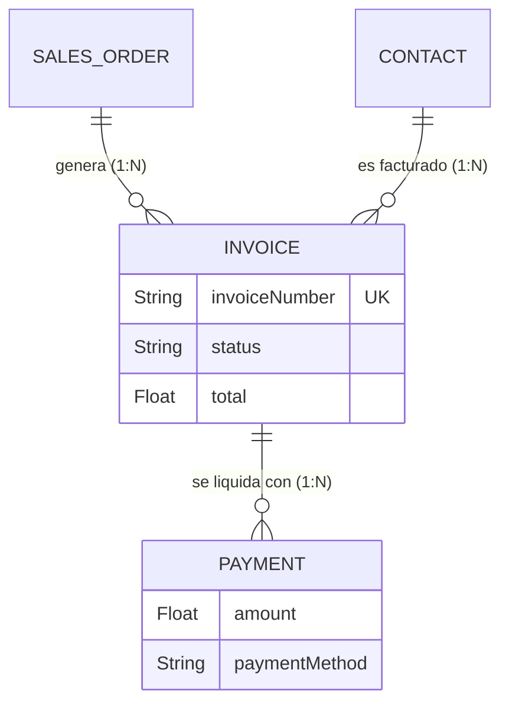
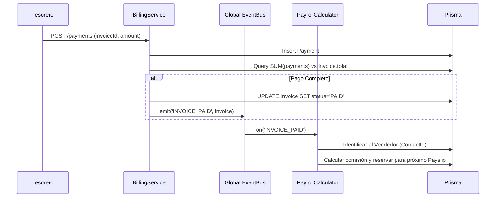

# 9. Finance Hub

## 1. Arquitectura del Módulo

El Módulo Financiero actúa como el controlador transaccional monetario de Volkern. Escucha activamente el progreso de los pedidos (Sales Hub) y dispara la creación de documentos fiscales (Invoices) bajo un rigor absoluto. Además, funciona como proveedor de datos primario para el cálculo de ingresos variables (Comisiones) en el HR Hub.

**Componentes Principales:**
- **BillingService:** Orquesta la generación de Invoices y previene la facturación duplicada. Emite eventos hacia el Trust Protocol (VeriFactu).
- **PaymentGateway Adapter:** Abstracción para integraciones con pasarelas de cobro externo (Stripe).
- **Fiscal Validator:** Middleware de validación que bloquea la emisión de documentos si el cliente no posee un NIF/CIF válido o si el Tenant tiene el Vault bloqueado.

---

## 2. Modelo de Datos (Prisma)

El modelo de finanzas está desacoplado del pedido, lo que permite facturación parcial o agrupar pedidos.

```prisma
model Invoice {
  id              String         @id @default(cuid())
  tenantId        String
  contactId       String
  salesOrderId    String?
  invoiceNumber   String         @unique // Secuencia Fiscal
  status          String         @default("DRAFT") // ISSUED, PAID, VOID
  
  subtotal        Float
  taxAmount       Float
  total           Float
  currency        String         @default("EUR")
  
  dueDate         DateTime?
  issuedAt        DateTime?
  
  // Encadenamiento VeriFactu (Referencia local)
  fingerprintHash String?        @db.Text
  
  contact         Contact        @relation(fields: [contactId], references: [id])
  salesOrder      SalesOrder?    @relation(fields: [salesOrderId], references: [id])
  payments        Payment[]
}

model Payment {
  id              String         @id @default(cuid())
  invoiceId       String
  amount          Float
  paymentMethod   String         // TRANSFER, CREDIT_CARD, CASH
  transactionRef  String?
  receivedAt      DateTime       @default(now())
  
  invoice         Invoice        @relation(fields: [invoiceId], references: [id])
}
```

### Diagrama Entidad-Relación (ER)



---

## 3. Flujos de Lógica de Negocio

El flujo de cobranza activa la cadena de eventos para la compensación del talento.

### Diagrama de Secuencia: Cobranza y Comisiones



---

## 4. Seguridad y Acceso

- **Inmutabilidad Post-Emisión:** Un bloque a nivel de Controlador REST que prohíbe cualquier petición `PUT` o `PATCH` sobre los campos monetarios (`total`, `subtotal`, `taxAmount`) si la factura está en estado `ISSUED` o superior.
- **Bloqueo Secuencial:** Para evitar colisión de números de factura (Ej: Dos usuarios intentando crear la factura "INV-001"), se utiliza un bloqueo a nivel de tabla `SELECT FOR UPDATE` al generar la secuencia `invoiceNumber`.

---

## 5. Integración MCP y AI

- **Gemma Financial Analyst:** La IA tiene acceso a herramientas como `finance_query_overdue` para listar deudores y sugerir estrategias de cobranza.
- **Deducción de Impuestos:** Herramienta para autocompletar la tasa impositiva basándose en la geografía del cliente (RAG Tax rules).

---

## 6. Eventos y Auditoría

- La facturación es el principal contribuyente al **Trust Protocol**. La emisión dispara instantáneamente el encriptado y encadenamiento del Hash.

---

## 7. Casos de Borde y Manejo de Errores

- **Falla en VeriFactu Lock:** Si el Trust Protocol devuelve error al asentar el hash (debido a timeout de red), la factura entra en estado transicional `PENDING_SYNC` y un Job reintenta la sincronización. La factura no se puede considerar válida y no puede enviarse al cliente hasta que el hash se haya afianzado.

---

## 8. Manual de Troubleshooting Técnico

1. **Error: "Unique constraint failed on the fields: (`invoiceNumber`)"**
   - *Causa:* La secuencia de facturación (Invoice Sequence Generator) ha chocado porque no se implementó un lock pesimista durante picos de concurrencia.
   - *Solución:* Asegurarse que el servicio de facturación invoque a Prisma usando `$transaction` y aislamiento `Serializable`.
2. **Un vendedor afirma no haber cobrado comisión por una gran venta:**
   - *Causa:* El pedido en `SalesHub` está en estado `SHIPPED`, pero la `Invoice` en Financiero sigue en `ISSUED` porque no se registró el pago (`Payment`) por el valor total.
   - *Solución:* Ejecutar auditoría: `SELECT * FROM erp_payments WHERE invoiceId = X;`
