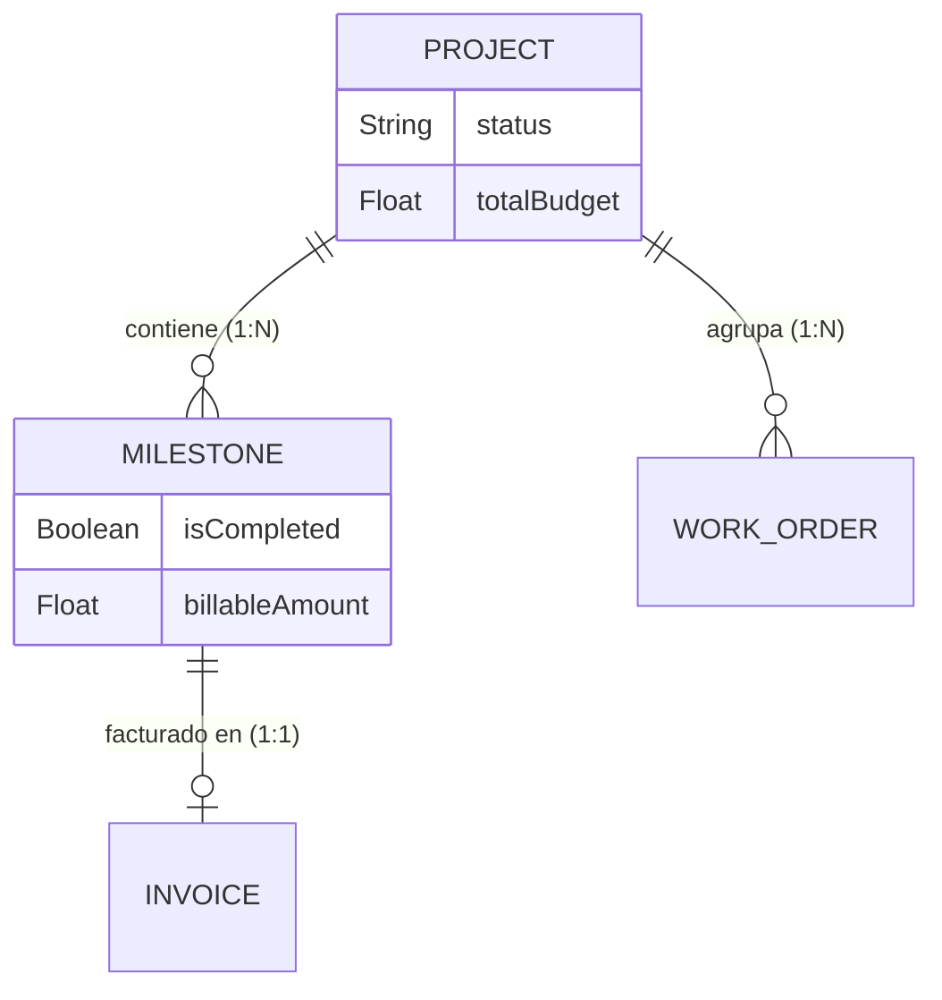
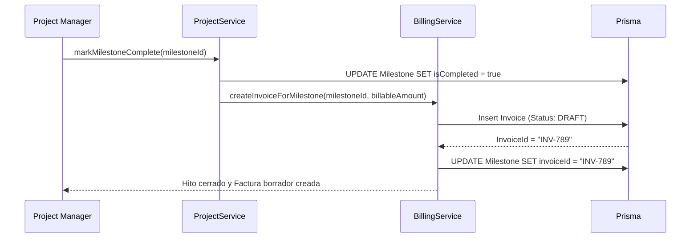

# 10. Tech Hub: Proyectos e Hitos

## 1. Arquitectura del Módulo

El módulo de Proyectos es un "Contenedor de Alta Jerarquía". Agrupa elementos de diferentes módulos (Ventas, Producción, Facturación) bajo un paraguas presupuestal común.

**Componentes Principales:**
- **ProjectEngine:** Administra el estado global del proyecto y de sus hitos (Milestones).
- **CostAggregator:** Servicio de lectura que suma en tiempo real los costos incurridos por las `WorkOrder` y los compara contra el `budget` del proyecto.

---

## 2. Modelo de Datos (Prisma)

```prisma
model Project {
  id              String         @id @default(cuid())
  tenantId        String
  name            String
  contactId       String         // Cliente dueño del proyecto
  managerId       String         // Empleado líder
  status          String         @default("PLANNING") // PLANNING, ACTIVE, ON_HOLD, COMPLETED
  totalBudget     Float
  consumedBudget  Float          @default(0)
  
  milestones      Milestone[]
  workOrders      WorkOrder[]    // Relación añadida a WorkOrder
}

model Milestone {
  id              String         @id @default(cuid())
  projectId       String
  title           String
  dueDate         DateTime
  isCompleted     Boolean        @default(false)
  billableAmount  Float
  invoiceId       String?        // Enlace a la factura cuando se cobra
  
  project         Project        @relation(fields: [projectId], references: [id])
}
```

### Diagrama Entidad-Relación (ER)



---

## 3. Flujos de Lógica de Negocio

### Diagrama de Secuencia: Hito a Facturación



---

## 4. Seguridad y Acceso
- **Project Level Security:** Un usuario solo puede invocar `GET /api/projects/:id` si su `ContactId` es igual a `managerId` o si pertenece al `TEAM_ROLE` global.

## 5. Casos de Borde y Manejo de Errores
- **Sobregiro de Proyecto:** El `CostAggregator` emitirá un `BudgetExceededEvent` si la suma de costos de manufactura supera `totalBudget`. El proyecto no se detiene técnicamente (no bloquea la planta), pero dispara banderas rojas gerenciales.

## 6. Manual de Troubleshooting Técnico
- **Error: Factura de Hito duplicada.**
  - *Causa:* El PM presionó doble click al cerrar el hito.
  - *Solución:* Validar a nivel de API: `if (milestone.invoiceId) throw Error("Ya facturado")`.
