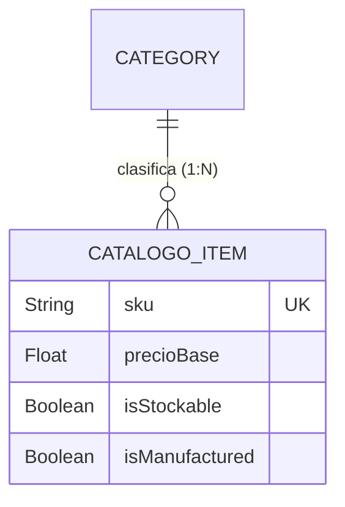
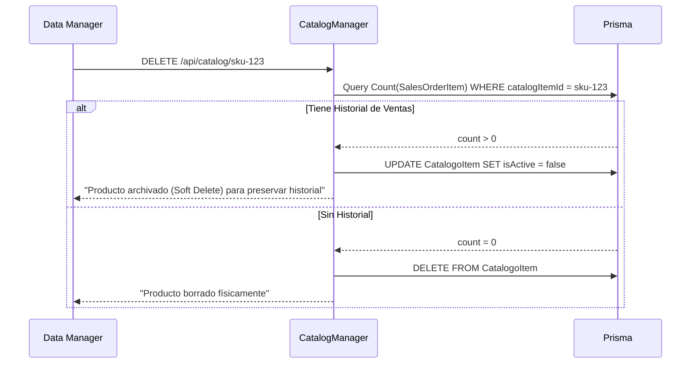

# 11. Tech Hub: Catálogo de Inventarios

## 1. Arquitectura del Módulo

Define los metadatos de todo lo que fluye por Volkern. A diferencia del Stock Level (Logística), el Catálogo es relativamente estático.

**Componentes Principales:**
- **CatalogManager:** Controlador CRUD con soporte para caché en Redis de la lista de precios (`precioBase`).
- **WarehouseService:** Servicio secundario para crear recintos (Warehouses) físicos o virtuales.

---

## 2. Modelo de Datos (Prisma)

```prisma
model CatalogoItem {
  id              String         @id @default(cuid())
  tenantId        String
  sku             String         @unique
  name            String
  description     String?        @db.Text
  precioBase      Float
  
  // Modificadores de comportamiento en el Orquestador
  isStockable     Boolean        @default(true)
  isManufactured  Boolean        @default(false)
  isService       Boolean        @default(false)
  
  categoryId      String?
  category        Category?      @relation(fields: [categoryId], references: [id])
  
  // Archivo vs Borrado
  isActive        Boolean        @default(true)
}

model Category {
  id              String         @id @default(cuid())
  name            String
  items           CatalogoItem[]
}
```

### Diagrama Entidad-Relación (ER)



---

## 3. Flujos de Lógica de Negocio

### Diagrama de Secuencia: Inactivación Segura (Soft Delete)



---

## 4. Seguridad y Acceso
- Los SKUs y catálogos suelen ser públicos para los vendedores. La restricción de seguridad (`PRODUCT_MANAGER_ROLE`) se aplica estrictamente a los métodos `POST`, `PUT`, `DELETE`.

## 5. Integración MCP y AI
- **RAG Vector Search:** Si Gemma 4 necesita recomendar un producto, no hace un `SELECT *`, utiliza una Tool MCP `catalog_semantic_search` basada en PGVector para encontrar productos afines a la descripción del cliente.

## 6. Manual de Troubleshooting Técnico
- **Error: Orquestador falla por "No Strategy matched".**
  - *Causa:* El `CatalogoItem` tiene `isStockable=false`, `isManufactured=false` y `isService=false`. El orquestador de ventas no sabe qué hacer con él.
  - *Solución:* Corregir los booleanos de comportamiento en el catálogo.
