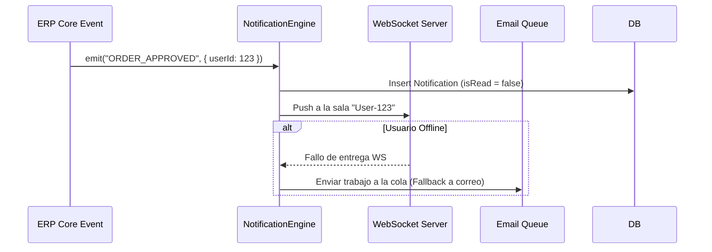

# 12. Tech Hub: Comunicaciones

## 1. Arquitectura del Módulo

Construido sobre una arquitectura Pub/Sub y WebSocket. Maneja notificaciones en tiempo real, chat persistente y colas de correos transaccionales.

**Componentes Principales:**
- **NotificationEngine:** Escucha el EventBus global y emite registros en la tabla `Notification`.
- **WebSocket Gateway (Socket.io/Pusher):** Empuja el JSON de la notificación al navegador del cliente si está online.
- **Email Dispatcher:** Consumidor asíncrono (RabbitMQ/Inngest) que envía correos mediante AWS SES o Sendgrid.

---

## 2. Modelo de Datos (Prisma)

```prisma
model Notification {
  id              String         @id @default(cuid())
  tenantId        String
  recipientId     String         // ContactId
  title           String
  body            String         @db.Text
  actionUrl       String?        // Deep link (Ej: /sales/order/123)
  isRead          Boolean        @default(false)
  createdAt       DateTime       @default(now())
  
  recipient       Contact        @relation(fields: [recipientId], references: [id])
}

model ChatMessage {
  id              String         @id @default(cuid())
  tenantId        String
  senderId        String
  receiverId      String?        // Null = Broadcast
  message         String         @db.Text
  createdAt       DateTime       @default(now())
}
```

---

## 3. Flujos de Lógica de Negocio

### Diagrama de Secuencia: Notificación y Email Fallback



---

## 4. Seguridad y Acceso
- **Aislamiento de Salas WebSocket:** Un cliente web solo puede suscribirse a su propio canal (Firmando la suscripción con su JWT). Previene que escuche notificaciones de otros usuarios modificando el ID en el JS del cliente.

## 5. Manual de Troubleshooting Técnico
- **Chat funciona, pero al recargar desaparece:**
  - *Causa:* El servidor de Websocket está enviando los eventos pero no se están comiteando a la base de datos `ChatMessage` (Storage failure).
- **Sobrecarga de Emails (Spam loop):**
  - *Causa:* Un proceso del ERP cayó en un ciclo infinito de errores y disparó 10,000 notificaciones a un Admin.
  - *Solución:* El `Email Dispatcher` debe tener un "Debouncer" integrado (Ej: Máximo 5 emails por minuto por destinatario).
