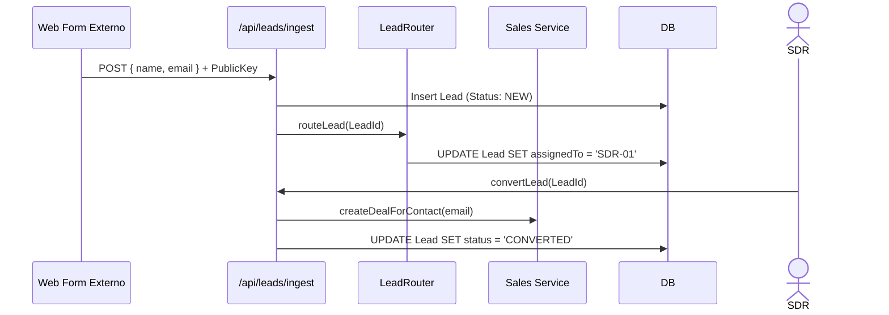

# 13. Tech Hub: Marketing CRM

## 1. Arquitectura del Módulo

Es el embudo inicial. Se conecta fuertemente con Webhooks de entrada (Formularios externos) y un motor de Scoring.

**Componentes Principales:**
- **LeadIngestion API:** Endpoint sin autenticación estricta (usa API Keys públicas) para recibir POSTs de WordPress, Shopify o Webforms.
- **LeadRouter:** Algoritmo que asigna Leads (Round-robin o basado en reglas geográficas).
- **CampaignManager:** Motor de correos masivos.

---

## 2. Modelo de Datos (Prisma)

```prisma
model Lead {
  id              String         @id @default(cuid())
  tenantId        String
  email           String         @unique
  name            String
  source          String         // Ej: "WEB_FORM", "LINKEDIN"
  status          String         @default("NEW") // NEW, CONTACTED, QUALIFIED, CONVERTED
  score           Int            @default(0)
  
  assignedToId    String?        // SDR encargado
  assignedTo      Contact?       @relation(fields: [assignedToId], references: [id])
}

model Campaign {
  id              String         @id @default(cuid())
  tenantId        String
  name            String
  htmlTemplate    String         @db.Text
  sentCount       Int            @default(0)
  openCount       Int            @default(0)
}
```

---

## 3. Flujos de Lógica de Negocio

### Diagrama de Secuencia: Ingesta y Conversión de Lead



---

## 4. Seguridad y Acceso
- **Public Ingestion Protection:** El endpoint `/ingest` es vulnerable a ataques de bots (DDoS). Se debe usar un reCAPTCHA u ocultar el form detrás de un Cloudflare WAF para evitar inserción de Spam en la tabla `Lead`.

## 5. Manual de Troubleshooting Técnico
- **Leads no se asignan y quedan "Huérfanos":**
  - *Causa:* La regla de Round-Robin del `LeadRouter` tiene la lista de SDRs vacía o inactivos.
  - *Solución:* Asignar SDRs válidos en la configuración de la campaña.
