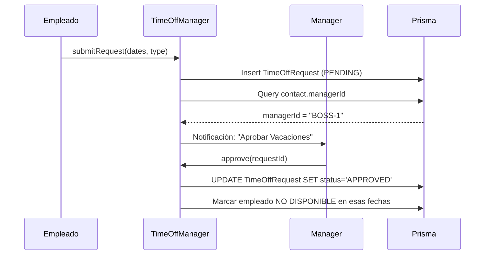

# 14. Tech Hub: RRHH Core (Talento y Ausencias)

## 1. Arquitectura del Módulo

Desacoplado de la Nomina (Payroll). Se encarga de organigramas y motores de aprobación de fechas.

**Componentes Principales:**
- **TimeOffManager:** Motor de cálculo de bolsas de vacaciones anuales.
- **OrgChartService:** Resuelve recursivamente la jerarquía `managerId` para flujos de aprobación multinivel.

---

## 2. Modelo de Datos (Prisma)

```prisma
model TimeOffRequest {
  id              String         @id @default(cuid())
  tenantId        String
  contactId       String
  startDate       DateTime
  endDate         DateTime
  type            String         // VACATION, SICK_LEAVE
  status          String         @default("PENDING") // APPROVED, REJECTED
  
  approverId      String?
  
  contact         Contact        @relation(fields: [contactId], references: [id])
}

model PerformanceReview {
  id              String         @id @default(cuid())
  tenantId        String
  contactId       String
  reviewerId      String
  score           Float
  feedback        String         @db.Text
  createdAt       DateTime       @default(now())
}
```

---

## 3. Flujos de Lógica de Negocio

### Diagrama de Secuencia: Aprobación de Vacaciones



---

## 4. Seguridad y Acceso
- **Visibilidad Jerárquica:** El endpoint `GET /api/hr/performance/:contactId` valida si el solicitante es igual al `managerId` del contacto (o superior jerárquico). Un colega lateral (Peer) no puede ver el salario ni el performance del otro.

## 5. Manual de Troubleshooting Técnico
- **Loop Infinito en OrgChart:**
  - *Causa:* El Usuario A tiene como jefe al Usuario B, y el Usuario B tiene como jefe al Usuario A (Circular Dependency).
  - *Solución:* Ejecutar validación de Grafos Dirigidos Acíclicos (DAG) al asignar managers.
- **Horas de TimeOff negativas:**
  - *Causa:* Concurrencia. Dos peticiones simultáneas consumieron el saldo disponible antes de que el servidor actualizara el total.
  - *Solución:* Usar `$transaction` y una condición de guarda `availableBalance >= requestedDays`.
