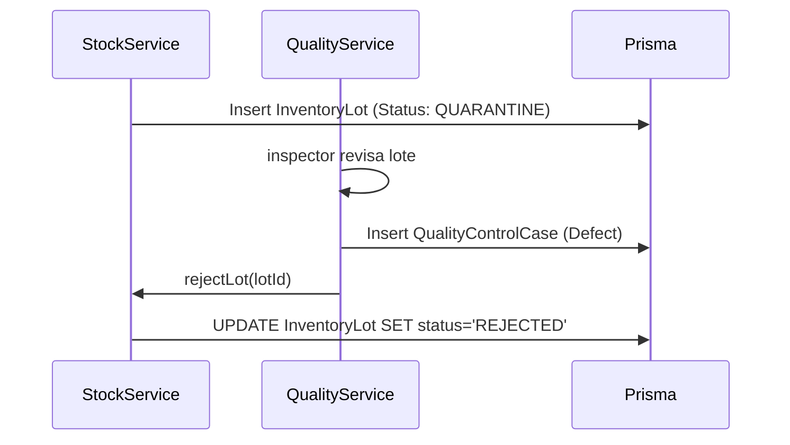

# 15. Tech Hub: Quality Control

## 1. Arquitectura del Módulo

Control de Calidad (QC) actúa como un middleware interceptor dentro del motor de Logística. No tiene almacenes propios, manipula los metadatos de los lotes.

**Componentes Principales:**
- **QualityGate:** Validador que escucha creaciones de `InventoryLot` e inyecta reglas de cuarentena.
- **NCR Manager:** Controlador de tickets de No Conformidad.

---

## 2. Modelo de Datos (Prisma)

```prisma
model QualityControlCase {
  id              String         @id @default(cuid())
  tenantId        String
  lotId           String
  inspectorId     String
  status          String         @default("OPEN") // RESOLVED, DISCARDED
  defectType      String         // DIMENSIONAL, COSMETIC, FUNCTIONAL
  notes           String         @db.Text
  createdAt       DateTime       @default(now())
  
  lot             InventoryLot   @relation(fields: [lotId], references: [id])
}
```

---

## 3. Flujos de Lógica de Negocio

### Diagrama de Secuencia: Cuarentena y Rechazo



---

## 4. Seguridad y Acceso
- El `QC_ROLE` tiene autoridad para ejecutar `.rejectLot()`. Un vendedor no puede forzar la liberación a `AVAILABLE` de un lote en Cuarentena.

## 5. Manual de Troubleshooting Técnico
- **No se puede consumir Lote en Producción:**
  - *Causa:* El lote tiene status `QUARANTINE`.
  - *Solución:* En un escenario de emergencia, un SuperAdmin puede hacer un bypass por base de datos, aunque dejará rastro en el `AuditLog`.
