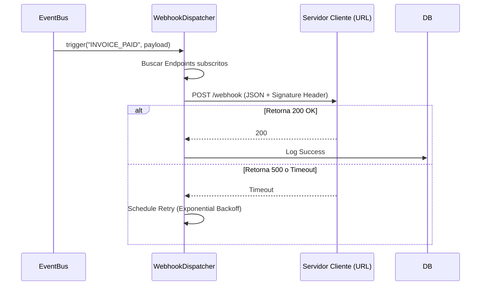

# 16. Tech Hub: Integrations (Webhooks & APIs)

## 1. Arquitectura del Módulo

Conecta a Volkern con el mundo exterior mediante Egress y Ingress gateways.

**Componentes Principales:**
- **WebhookDispatcher:** Worker asíncrono que reintenta peticiones fallidas.
- **ThirdPartyVault:** Almacén secundario de cifrado simétrico para llaves de Stripe/Sendgrid.

---

## 2. Modelo de Datos (Prisma)

```prisma
model WebhookEndpoint {
  id              String         @id @default(cuid())
  tenantId        String
  url             String
  secretKey       String?        // Para firmar el payload saliente
  events          String[]       // ["INVOICE_PAID", "ORDER_SHIPPED"]
  isActive        Boolean        @default(true)
}

model ExternalCredential {
  id              String         @id @default(cuid())
  tenantId        String
  provider        String         // "STRIPE", "PAYPAL"
  encryptedKey    String         @db.Text
}
```

---

## 3. Flujos de Lógica de Negocio

### Diagrama de Secuencia: Disparo de Webhook



---

## 4. Seguridad y Acceso
- **Firmas HMAC (Webhooks):** Volkern firma el payload JSON saliente usando `secretKey` con HMAC-SHA256, permitiendo al servidor receptor validar que la petición realmente viene del Tenant.
- **Cifrado KMS:** `encryptedKey` se protege igual que la MasterKey.

## 5. Manual de Troubleshooting Técnico
- **El Webhook no llega:**
  - *Causa:* El payload JSON supera el límite de memoria del worker.
  - *Solución:* Validar si el payload contiene arrays gigantescos (Ej: miles de ítems) y truncarlo o solo mandar el `ID` para que el receptor haga `GET` después.
