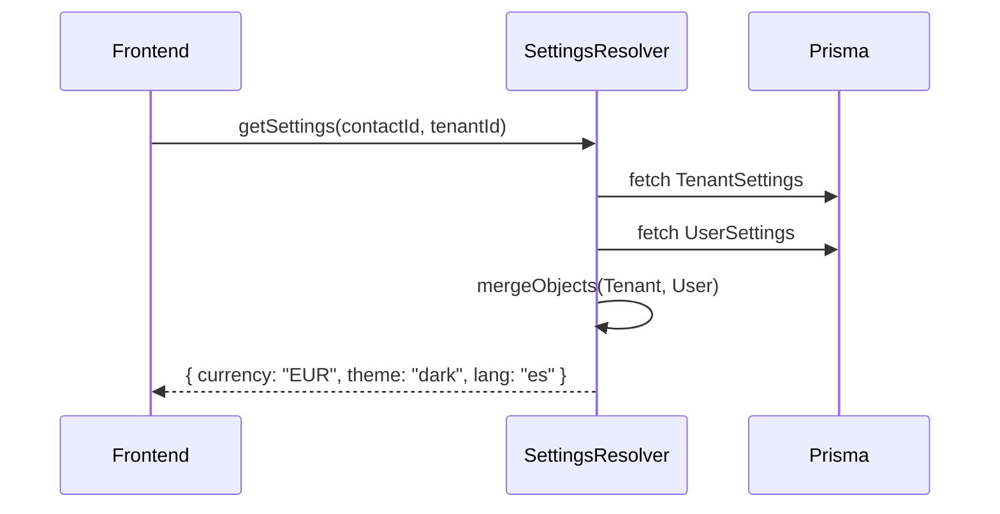

# 17. Tech Hub: Configuration & User Profiles

## 1. Arquitectura del Módulo

Resuelve la cascada de configuraciones: Si un usuario no definió un idioma, hereda el del Tenant. Si el Tenant no definió uno, hereda el global de la instancia SaaS.

**Componentes Principales:**
- **SettingsResolver:** Middleware que fusiona (merges) las variables de entorno de BD.

---

## 2. Modelo de Datos (Prisma)

```prisma
model TenantSettings {
  tenantId        String         @id
  currency        String         @default("EUR")
  timezone        String         @default("UTC")
  defaultIva      Float          @default(21.0)
  marginPolicy    Float          @default(5.0) // Margin Guard minimum
  logoUrl         String?
}

model UserSettings {
  contactId       String         @id
  language        String         @default("es")
  theme           String         @default("system")
  twoFactorEnabled Boolean       @default(false)
  twoFactorSecret String?
}
```

---

## 3. Flujos de Lógica de Negocio

### Diagrama de Secuencia: Cascada de Configuración



---

## 4. Seguridad y Acceso
- **MFA/2FA Engine:** Si `twoFactorEnabled = true`, el módulo de Login Core obliga al usuario a pasar un segundo challenge de TOTP (Time-based One Time Password) antes de expedir el JWT final.

## 5. Manual de Troubleshooting Técnico
- **Usuario pierde acceso a su app de Autenticación (Google Auth):**
  - *Causa:* Cambio o pérdida de dispositivo celular.
  - *Solución DB:* `UPDATE UserSettings SET twoFactorEnabled = false, twoFactorSecret = null WHERE contactId = X;`
