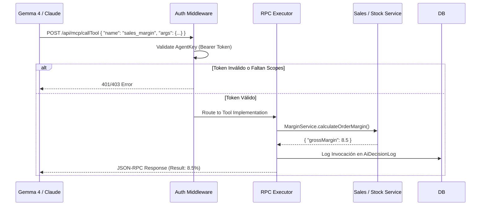

# 18. Tech Hub: MCP Server (Model Context Protocol)

## 1. Arquitectura del Módulo

El MCP (Model Context Protocol) es el puente JSON-RPC que traduce los *Intents* (intenciones) de la Inteligencia Artificial a llamadas internas de Volkern. Expone las funciones de TypeScript (Tools) a modelos LLM para que puedan usarlas de forma determinista.

**Componentes Principales:**
- **MCP Middleware:** Intercepta peticiones HTTP en `/api/mcp` o por Stdio.
- **Manifest Builder:** Servicio que genera dinámicamente la lista de Tools (`Tools List`) filtrando las funciones según los "Scopes" permitidos en el API Key del Agente.
- **RPC Executor:** Mapea el string de invocación (Ej: `stock_query`) a la función TypeScript real (`StockService.getAvailableStock()`).

---

## 2. Modelo de Datos y Seguridad (Prisma)

El MCP no tiene tablas de datos operativas propias, pero depende intrínsecamente del `AgentKey` del Academy Hub y escribe en el `AiDecisionLog` del Security Hub.

---

## 3. Flujos de Lógica de Negocio

### Diagrama de Secuencia: Invocación de Herramienta MCP

---

## 4. Seguridad y Acceso
- **Scope Fencing (Enjaulado de Permisos):** Si el LLM intenta invocar `payroll_seal` (Sellar nómina), el Manifest Builder ocultará la herramienta si el AgentKey no contiene el scope `finance:write`. Si el LLM adivina el nombre de la herramienta y la invoca, el MCP rechaza la petición.

## 5. Manual de Troubleshooting Técnico
- **LLM falla parseando el JSON de retorno (Tool Result Error):**
  - *Causa:* La función de TypeScript devolvió fechas tipo `Date` u objetos circulares no serializables en JSON, rompiendo el estándar JSON-RPC de MCP.
  - *Solución:* Envolver la salida de la función con `JSON.parse(JSON.stringify(data))` o forzar strings estáticos antes de retornar al LLM.
