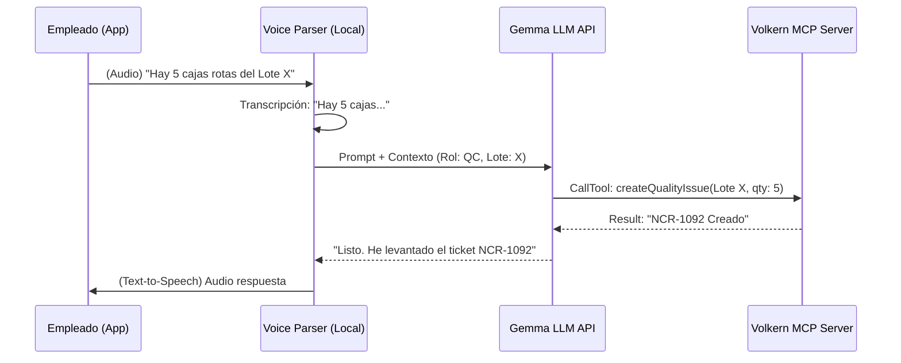

# 19. Tech Hub: Gemma 4 Mobile Edge

## 1. Arquitectura del Módulo

Gemma 4 en entorno móvil opera bajo un modelo de "Thin Client / Thick LLM". El dispositivo capta voz/imagen, pero el razonamiento pesado y la conexión con el MCP se derivan al cloud, a menos que se use un modelo cuantizado (Gemma 2B) on-device para tareas básicas.

**Componentes Principales:**
- **Voice-to-Text Gateway:** Módulo nativo (iOS/Android) que transcribe el audio ruidoso industrial.
- **RAG Mobile Optimizer:** Embebido en la app, filtra el contexto (Coordenadas GPS, ID del Usuario) y lo inyecta en el "System Prompt" antes de mandarlo a la API.

---

## 2. Inyección de Contexto Dinámico

Cuando un empleado usa su celular, Gemma no empieza de cero. La App inyecta un encabezado oculto al prompt de la IA.

```json
// Contexto inyectado silenciosamente por la App
{
  "system_context": {
    "userRole": "WAREHOUSE_OPERATOR",
    "locationGPS": "Zona_Embarque_Sur",
    "timeUTC": "2026-04-18T10:00:00Z",
    "tenantId": "volkern-001"
  }
}
```

---

## 3. Flujos de Lógica de Negocio

### Diagrama de Secuencia: Ejecución de Voz en Campo



---

## 4. Seguridad y Acceso
- **Autenticación Delegada JWT:** La app móvil utiliza un JSON Web Token con un TTL (Time-To-Live) ultracorto (ej: 4 horas) emparejado con validación biométrica para evitar abusos si el dispositivo es robado.
- El servidor MCP recibe las peticiones provenientes del backend proxy de la app móvil, por lo que hereda las restricciones de permisos del `Contact` humano, limitando así a la IA.

## 5. Manual de Troubleshooting Técnico
- **La IA rechaza ejecutar el comando de voz:**
  - *Causa:* El RAG Optimizer inyectó una ubicación GPS fuera del polígono autorizado ("Geofence"). El servidor bloquea operaciones de "Movimiento de Stock" si el empleado no está físicamente en el almacén.
  - *Solución:* Verificar permisos de ubicación del OS móvil o anular geocerca para perfiles gerenciales.
