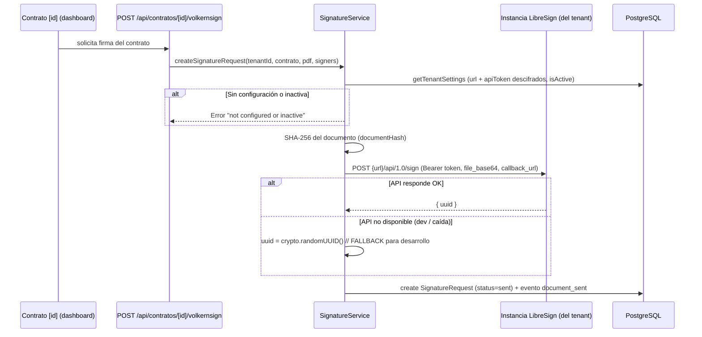

# 21. Tech Hub: Firma Digital (LibreSign / VolkernSign)

> **Estado actual (agosto 2026):** el módulo está **integrado en el código pero sin ningún
> tenant configurado en producción** (0 registros en `ClientSignatureSettings` y 0 en
> `SignatureRequest`). Esta guía documenta cómo funciona y cómo conectar una instancia
> LibreSign cuando un tenant la requiera.

---

## 1. Arquitectura del Módulo

Volkern integra **LibreSign** (plataforma de firma electrónica self-hosted) como proveedor de
firma digital para los contratos del módulo CLM. El diseño es **multi-tenant por instancia**:
cada tenant apunta a su propia instancia LibreSign (URL + token), no existe una instancia
central de firma.

**Componentes Principales:**
- **`SignatureService`** (`lib/signatures/SignatureService.ts`): orquesta el envío de documentos
  a la API de LibreSign, calcula el hash del documento, crea el registro local y mantiene la
  cadena de auditoría (event-chain hash).
- **`ClientSignatureSettings`**: credenciales cifradas por tenant (URL, API token, webhook secret).
- **`SignatureRequest` + `SignatureAuditEvent`**: registro local de cada solicitud y su
  trazabilidad inmutable (cada evento referencia el hash del evento anterior).
- **Webhook entrante** (`app/api/webhooks/signatures/route.ts`): recibe los eventos de LibreSign
  (`document_signed`, `viewed`, etc.) y actualiza el estado de la solicitud.
- **Ruta de disparo** (`app/api/contratos/[id]/volkernsign/route.ts`): genera el PDF del contrato,
  lo envía a LibreSign y devuelve el UUID de la solicitud.

---

## 2. Modelo de Datos (Prisma)

```prisma
model ClientSignatureSettings {
  id                     String   @id @default(cuid())
  tenantId               String   @unique
  provider               String   @default("libresign")  // único proveedor actual
  url                    String                          // URL base de la instancia LibreSign
  apiTokenEncrypted      String                          // cifrado con lib/core/crypto (encrypt)
  webhookSecretEncrypted String                          // cifrado; verificación de origen (TODO)
  isActive               Boolean  @default(true)
  settings               Json?
  createdAt              DateTime @default(now())
  updatedAt              DateTime @updatedAt

  @@map("client_signature_settings")
}

model SignatureRequest {
  id            String                @id @default(cuid())
  tenantId      String
  libreSignUuid String                @unique               // UUID devuelto por LibreSign
  contratoId    String?
  leadId        String?
  title         String
  status        String                @default("draft")     // draft | sent | signed | ...
  signers       Json                                        // [{email, name, role, required}]
  documentHash  String?                                     // SHA-256 del documento (eIDAS)
  documentUrl   String?
  auditTrailUrl String?
  sentAt        DateTime?
  expiresAt     DateTime?
  completedAt   DateTime?

  @@map("signature_requests")
}

model SignatureAuditEvent {
  id                 String           @id @default(cuid())
  signatureRequestId String
  eventType          String           // document_sent, viewed, document_signed, ...
  signerEmail        String?
  ipAddress          String?
  userAgent          String?
  timestamp          DateTime         @default(now())
  details            Json?
  eventHash          String?          // sha256(`${requestId}-${eventType}-${prevHash}`)
  prevEventHash      String?          // encadena cada evento al anterior (tamper-evident)
}
```

---

## 3. Flujos de Lógica de Negocio

### 3.1 Envío de documento a firma



**Callback registrado por el tenant:** `{NEXT_PUBLIC_APP_URL}/api/webhooks/signatures?tenantId={id}`

### 3.2 Webhook de eventos

```
POST /api/webhooks/signatures?tenantId={id}
```

- Valida `tenantId`, carga `ClientSignatureSettings` del tenant (y su `webhookSecret`).
- Busca la `SignatureRequest` por `libreSignUuid` y registra el evento en cadena
  (`eventHash` + `prevEventHash`).
- Si el evento es `document_signed`, marca la solicitud como `signed` con `completedAt`.
- **Pendiente documentado en el código:** verificación de la firma del payload
  (`x-libresign-signature` + `webhookSecret`) — hoy solo valida tenantId.

---

## 4. Conexión de una instancia LibreSign (por tenant)

### Requisitos previos

1. Una instancia **LibreSign** desplegada y accesible por HTTPS desde el VPS de Volkern
   (LibreSign corre sobre Nextcloud; ver nota del volumen en §6).
2. Un **token de API** de LibreSign para la app.
3. El **webhook secret** compartido (para verificar el origen de los eventos).

### Pasos

1. **Insertar la configuración del tenant** (vía admin o script; las claves se cifran con
   `encrypt()` de `lib/core/crypto` antes de guardar):

```ts
// Ejemplo de alta (datos de ejemplo, reemplazar por los reales)
await prisma.clientSignatureSettings.create({
  data: {
    tenantId: '<tenantId>',
    provider: 'libresign',
    url: 'https://firma.cliente.com',          // instancia LibreSign del tenant
    apiTokenEncrypted: encrypt('<api-token>'),
    webhookSecretEncrypted: encrypt('<webhook-secret>'),
    isActive: true,
  },
});
```

2. **Configurar el webhook** en la instancia LibreSign para que apunte a
   `https://volkern.app/api/webhooks/signatures?tenantId=<id>`.

3. **Verificar** desde el dashboard de Contratos: al solicitar la firma de un contrato
   (`/dashboard/contratos/[id]` → botón de firma), debe crearse la `SignatureRequest` con un
   UUID real (no aleatorio), y el firmante debe recibir el correo de LibreSign.

### Comportamiento de fallback (importante para pruebas)

Si `url` o `apiToken` no están configurados, o la API de LibreSign no responde, el servicio
**no falla**: genera un `libreSignUuid` aleatorio (mock) y guarda la solicitud como `sent`.
Esto permite desarrollo sin instancia real, pero **no envía correos ni recoge firmas** —
en producción debe configurarse la instancia real del tenant.

---

## 5. Estado en producción (verificado 17 ago 2026)

| Verificación | Resultado |
|---|---|
| `ClientSignatureSettings` (tenants configurados) | **0** |
| `SignatureRequest` (solicitudes creadas) | **0** |
| Contenedores / stack LibreSign en el VPS | Ninguno |
| Impacto si no se configura | Ninguno: el módulo no bloquea flujos, solo hace fallback |

El módulo de Contratos funciona sin la firma digital; la integración LibreSign se activa solo
cuando un tenant configura sus credenciales.

---

## 6. Nota operativa: volúmenes LibreSign del VPS (histórico)

El VPS alojó una instancia **LibreSign/Nextcloud de prueba** (volúmenes `libresign-volkern_*`),
que fue retirada en mayo 2026. Los volúmenes se eliminaron el 17 ago 2026 (~720 MB) al
confirmarse que ningún tenant los referenciaba y que el código apunta a instancias de cada
cliente, no a una central. Si se necesita firma para un tenant, **no** se restaura esa instancia:
se despliega una instancia nueva por cliente o se usa una instancia LibreSign existente del cliente.

---

## 7. Manual de Troubleshooting Técnico

- **"Digital signature service not configured or inactive for this tenant."**
  - *Causa:* no existe `ClientSignatureSettings` para el tenant o `isActive = false`.
  - *Solución:* crear la configuración (§4) y verificar `isActive`.

- **La solicitud se crea con UUID aleatorio (parece no llegar a LibreSign)**
  - *Causa:* `url`/`apiToken` ausentes, o la instancia no responde (`[SignatureService] Could not reach VolkernSign server`).
  - *Solución:* revisar URL/token y conectividad VPS → instancia LibreSign; el fallback es intencional para dev.

- **El webhook de eventos no actualiza la solicitud**
  - *Causa:* `tenantId` incorrecto en la callback_url, o evento con UUID desconocido.
  - *Solución:* verificar la URL registrada en LibreSign y que `libreSignUuid` coincida.
  - *Pendiente:* implementar verificación de firma HMAC del payload (hoy se valida solo `tenantId`).

- **¿Dónde está el dashboard de configuración por tenant?**
  - Actualmente la alta se hace por script/admin (no hay UI de configuración de firma en el
    dashboard). Si se contrata el módulo para un tenant, conviene añadir una pantalla de
    configuración antes de activarlo comercialmente.
